# Pantheon Suite

A monorepo of 14 mastering and music plugins plus 2 standalone apps named after Greek gods, built with [JUCE](https://juce.com) under AGPL-3.0-or-later.

**Format:** Source-only C++ monorepo (VST3 · AU · Standalone; macOS & Linux CI — no binaries ship)

## Theme

**Name origin:** *Pantheon* — the temple of all the gods, where each tool takes a Greek figure matching its role (Apollo for tone, Nemesis for sibilance, Hera for glue, Themis for judgment, Orpheus for voice, Olympus where they play together); *Suite* — a connected set of mastering, mixing, and creation tools that chain in sequence and hand off measurements via `pdsp::link`.

```mermaid
flowchart LR
    A["1. Apollo Curve<br/>Corrective EQ"] --> B["2. Iris Prism<br/>Dynamic EQ"]
    B --> C["3. Nemesis Hush<br/>De-esser"]
    C --> D["4. Atlas Span<br/>Multiband Dynamics"]
    D --> E["5. Hera Bond<br/>Glue Compressor"]
    E --> F["6. Dionysus Warmth<br/>Saturation"]
    F --> G["7. Hephaestus Forge<br/>Harmonic Balance"]
    G --> H["8. Castor Pair<br/>Stereo Width & Mono Bass"]
    H --> I["9. Aegis Ceiling<br/>True-Peak Limiter"]
    I --> J["10. Hermes Level<br/>Loudness & Metering"]
    J --> K["11. Themis Verdict<br/>Final Mastering Check"]
```



Alongside the 11-stage mastering chain sit **Hestia Space** (inter-stem spacer), **Harmonia Pitch** (live vocal pitch correction), **Selene Poly** (16-voice synth), **Orpheus Pitch Editor**, and **Olympus Basic DAW**.

### Core philosophy

- **One job per god, connected by hand-off.** Mastering tools chain from corrective shaping to final judgment (`pdsp::link` clipboard hand-off from Themis into Apollo, Iris, Hephaestus, Castor, and Aegis).
- **Shared knob & switch rules everywhere.** Drag any knob (vertical or horizontal), double-click for default, or click its readout to type (`250 Hz`, `2.5k`, `-3 dB`, `0.5 s`; `Enter` applies, `Esc` cancels; switches match prefix like `inf`).
- **Analog look, digital brain.** Studio-hardware interface drawn entirely from code by the shared kit ([shared/ui](shared/ui)); no image, font or sound files ship, while [shared/dsp](shared/dsp) shares biquads, FFT analyzer, and `8×` true-peak math.
- **Free, public, source only.** The repository holds the code, not a download, under the AGPL-3.0-or-later (see [NOTICE](NOTICE.md)).

## See it

### Plugins

| Plugin | What it is | Showcase |
|---|---|---|
| [Aegis Ceiling](plugins/aegis/README.md) | True-peak limiter: input gain, dBTP ceiling, release, look-ahead, and `8×` inter-sample peak reading. | [docs/showcase.gif](plugins/aegis/docs/showcase.gif) |
| [Apollo Curve](plugins/apollo/README.md) | 8-band parametric EQ (bell, shelves, notch, `12–48 dB/oct`), stereo/mid/side, minimum or linear phase. | [docs/showcase.gif](plugins/apollo/docs/showcase.gif) |
| [Atlas Span](plugins/atlas/README.md) | 6-band music compressor: stereo, L/R, or M/S per band, solo/delta/gain-match, zero-latency or linear-phase, oversampling. | [docs/showcase.gif](plugins/atlas/docs/showcase.gif) |
| [Castor Pair](plugins/castor/README.md) | Stereo imager: 6-band side width, mid/side level, mono bass, goniometer, and correlation meter. | [docs/showcase.gif](plugins/castor/docs/showcase.gif) |
| [Dionysus Warmth](plugins/dionysus/README.md) | Saturator: tape, tube, transformer, diode, fold, and clip curves, bias, tone, parallel mix, auto gain, up to `8×` OS. | [docs/showcase.gif](plugins/dionysus/docs/showcase.gif) |
| [Harmonia Pitch](plugins/harmonia/README.md) | Natural-sounding live pitch correction for solo vocals. | [docs/showcase.gif](plugins/harmonia/docs/showcase.gif) |
| [Hephaestus Forge](plugins/hephaestus/README.md) | Mastering harmonic forge: fills in upper harmonics and missing bass fundamentals for tonal balance. | [docs/showcase.gif](plugins/hephaestus/docs/showcase.gif) |
| [Hera Bond](plugins/hera/README.md) | Glue compressor: peak/RMS detector, soft knee, auto release/makeup, parallel mix, stereo link, sidechain HPF. | [docs/showcase.gif](plugins/hera/docs/showcase.gif) |
| [Hermes Level](plugins/hermes/README.md) | Gain staging & metering: trim, polarity, mono/L/R/side checks, BS.1770 loudness, `8×` true peak, level-matched A/B. | [docs/showcase.gif](plugins/hermes/docs/showcase.gif) |
| [Hestia Space](plugins/hestia/README.md) | Inter-stem spacer: instances on shared mixes duck conflicting bands for higher-priority stems with depth control and sidechain. | [docs/showcase.gif](plugins/hestia/docs/showcase.gif) |
| [Iris Prism](plugins/iris/README.md) | Dynamic EQ: L/R/M/S bands, clean/saturated mode, delta/gain-match, region solos, and reference matching. | [docs/showcase.gif](plugins/iris/docs/showcase.gif) |
| [Nemesis Hush](plugins/nemesis/README.md) | De-esser: band detector, split-band or wideband, absolute or relative detection, and listen switch. | [docs/showcase.gif](plugins/nemesis/docs/showcase.gif) |
| [Selene Poly](plugins/selene/README.md) | 16-voice City Pop analog-style synth: dual oscillators with sub and FM, ZDF filter, dual ADSR, LFO, BBD chorus, tape echo. | [docs/showcase.gif](plugins/selene/docs/showcase.gif) |
| [Themis Verdict](plugins/themis/README.md) | Mastering check suite: tonal balance, translation, phase, clipping, loudness, and prioritised Master Plan. | [docs/showcase.gif](plugins/themis/docs/showcase.gif) |

### Standalone Apps

| App | What it is | Showcase |
|---|---|---|
| [Orpheus Pitch Editor](apps/orpheus/README.md) | Offline pitch editor for solo vocals: Viterbi pitch roll, per-note PSOLA resynthesis, 24-bit WAV export. | [docs/showcase.gif](apps/orpheus/docs/showcase.gif) |
| [Olympus Basic DAW](apps/olympus/README.md) | Basic DAW hosting VST3/AU chains across tracks with MIDI, automation, recording, stem render, and 38-tool MCP server. | [docs/showcase.gif](apps/olympus/docs/showcase.gif) |

### UI colour legend (`Hardware.h`)

| Swatch | Hex | Role | Meaning |
|---|---|---|---|
| 🩵 | `#37E3C5` | `accent` | Target bands, scope traces, corrected pitch curves, active display data |
| 🟡 | `#FFB347` | `amber` | Digital numeric read-outs, lit switches, playhead, sung pitch traces |
| 🟢 | `#5FD68C` | `good` | Passing verdicts, in-tune notes, nominal signal levels, active correction |
| 🟠 | `#F2A33A` | `warn` | Caution verdicts, slightly off-pitch notes, hot meters, foot warning strip |
| 🔴 | `#EF4A3D` | `bad` | Failing verdicts, `CLIP` / `OUT PEAK` over `0 dB`, active `REC`, out-of-tune notes |
| ⚪ | `#EAE3D0` | `text` | Engraved faceplate labels (`#1D1C1A` / `#2C2A27` metal, `#090D0D` glass), bright read-outs |
| 🔘 | `#9F9680` | `dim` | Secondary engraved labels, graticule ticks, unlit switches, informational strip notes |
| ⬛ | `#1C2A29` | `glassGrid` | Recessed glass graticules and reference lines (`#090D0D` `glass` background) |

## Try it

### Quick launch

```bash
./scripts/open.sh olympus
./scripts/open.sh olympus path/to/song.olympus

./scripts/open.sh orpheus
./scripts/open.sh orpheus path/to/vocals.wav
```

`scripts/open.sh` builds the `app` target via `scripts/build.sh` if missing and forwards any `.olympus`, `.orpheus`, or audio file argument.

> [!TIP]
> Shortcuts, fast workflows, and recommended starting moves live under `## Try it` in each plugin/app README.

> [!NOTE]
> Architecture, signal-flow guarantees, and shared kit invariants live in [CLAUDE.md](CLAUDE.md) and each module's `CLAUDE.md`.

> [!IMPORTANT]
> Required setup steps, routing rules, and export invariants are called out per tool before rendering or bouncing.

> [!WARNING]
> Known limits, unverified hardware/listening paths, and heuristic thresholds are documented explicitly in every README.

> [!CAUTION]
> Clipping hazards (`CLIP` / `OUT PEAK > 0 dB`), disk drop-outs, and destructive edge cases are highlighted in red strips and alerts.

## Build & develop

Requires `CMake 3.22+`, a `C++20` toolchain, JUCE fetched by [cmake/Juce.cmake](cmake/Juce.cmake), and `ffmpeg` (for `showcase.gif`); `docs/screenshot*.png` and `docs/showcase.gif` are generated by `*Snapshot` / `scripts/showcase.sh` and never edited by hand. On macOS with Command Line Tools, run `export SDKROOT=$(xcrun --sdk macosx --show-sdk-path)` if system headers are not found.

Three root scripts build targets, launch apps, and regenerate `docs/showcase.gif` using `ninja` and `ccache` when installed:

| Script | Usage | What it does |
|---|---|---|
| [`scripts/build.sh`](scripts/build.sh) | `scripts/build.sh <name> [targets...]` | Configures `build/` if needed and builds (`check` = DSP tests + UI check by default; `snap`, `app`, `vst3`, `au`). |
| [`scripts/open.sh`](scripts/open.sh) | `scripts/open.sh <app> [file...]` | Launches a standalone app, building `app` if missing (see [Try it](#try-it)). |
| [`scripts/showcase.sh`](scripts/showcase.sh) | `scripts/showcase.sh <name\|all>` | Captures frames from `<Name>Snapshot` (`HarmoniaDevTool` / `ThemisSmoke` for Harmonia/Themis) and encodes `docs/showcase.gif` via `ffmpeg`. |

```bash
scripts/build.sh aegis               # build and run Aegis DSP tests + UI check
scripts/build.sh olympus snap        # regenerate apps/olympus/docs/screenshot*.png
scripts/showcase.sh orpheus          # regenerate apps/orpheus/docs/showcase.gif (requires ffmpeg)
scripts/showcase.sh all              # regenerate docs/showcase.gif for every plugin and app
```

See [CLAUDE.md](CLAUDE.md) for cross-repo rules; CI runs per plugin and app in [.github/](.github).

## Licence

AGPL-3.0-or-later, source only. See [LICENSE](LICENSE), [NOTICE.md](NOTICE.md), [CONTRIBUTING.md](CONTRIBUTING.md), and [SECURITY.md](SECURITY.md).
