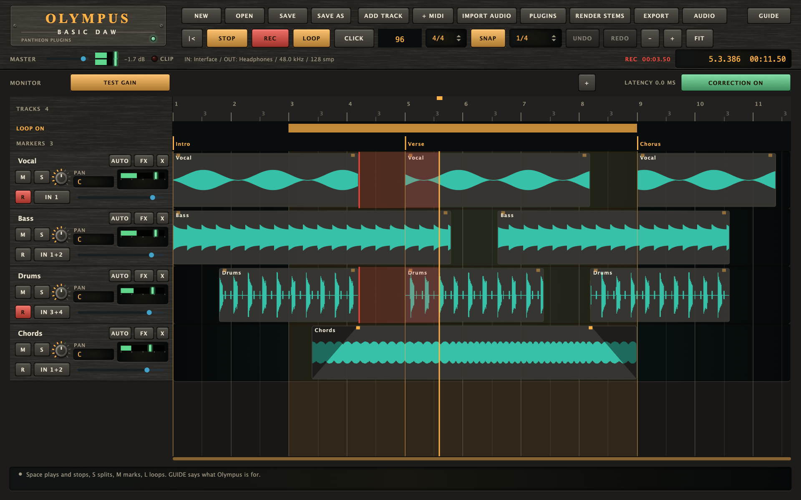

# Olympus Basic DAW

A **basic DAW for the Pantheon plugins**, as a standalone macOS app. Audio goes on tracks as clips on a timeline with a tempo map, a grid,
markers and a loop; each track has a chain of plugins (the suite's own, and any VST3 or, on macOS, Audio Unit plugin the scan finds); you set
the faders and pans, save the project, and write the stems out again with their chains. The window shows the arrangement (the clips on their
tracks, the ruler, the markers and the loop) under a transport bar. It records from an audio interface onto armed tracks (REC). The engine and the window are
covered by the automated tests; playback and recording on a real audio device have not yet been checked by ear. An AI agent can place the chains for you through the built-in **MCP server**, whose 31 tools cover
the same clips, tempo, markers, loop and master.

## Name origin

*Olympus* is the mountain where the Greek gods lived together; here it is the one place where the suite's plugins (Hermes, Hestia, Aegis and the others) sit side by side on a song.
(CMake targets and namespaces use the short name "Olympus". It is an app, not a plugin: it lives in `apps/`.)


*Headless render of the window (the hardware-style interface shared with the plugins) over a small song: four tracks cut from synthetic stems into clips, on a 96 bpm
timeline with the bars and beats on the ruler, three markers (Intro, Verse, Chorus), the loop lit from bar 3 to bar 9, and the snap on. The Chords clips have fades; the
Vocal track has one test plugin, which its FX button lists. Each track is a row in the left column: its name, FX (its plugins) and X (remove), mute and solo, the pan, the fader and
the meter; under them R (arm for recording) and IN (its input, here the default pair). The playhead is the amber line at 11 seconds (bar 5, beat 2), and the position read-out in the top
right says the same in bars and in time. The row under the transport names the audio device (none, in a headless render). The MONITOR row under the header holds the monitor chain: here one stand-in plugin (Test Gain, lit,
so it is on), CORRECTION ON in green, and the chain's latency (0.0 ms). A headphone correction plugin would sit there (see "Monitoring through headphone correction").
Regenerate with the command under "Development".*



*The same session while it records, in a headless render: Vocal (on IN 1) and Drums (on IN 3+4) are armed, so their R lamps are lit and their meters show the input (a 440 Hz tone the
render feeds to the device). REC is lit and reads the take's time in red (00:03.50), and the armed lanes carry a red strip from where the take began (8 seconds) to the playhead
(11.5 seconds). The row under the transport names the device, IN: Interface / OUT: Headphones / 48.0 kHz / 128 smp: the render has no audio device, so the device is a stand-in.
The MONITOR row is the same stand-in chain as in the picture above: the stand-in is on the headphones' playback only, and the take is not affected by it.
Regenerate with the command under "Development".*

## Core philosophy

- **Place now, edit later.** The point is to get the chains onto the stems quickly, by hand or by an agent, and to keep every setting in a project file, so nothing is final.
  Open any plugin from its chain, change it, save.
- **Any plugin it finds.** It hosts every VST3 (and, on macOS, Audio Unit) plugin the folders hold, the suite's own and third-party ones alike, and nothing else. Hestia's instances
  (which listen to each other) still work across the stems. The setting *scanSuiteOnly* in `settings.xml` narrows this to the suite's own plugins.
- **A basic DAW, not a full one.** There is no MIDI, no instruments and no automation, and no time-stretching: audio plays at its
  own speed, and when the tempo changes the grid moves, not the audio. It records from an audio interface onto tracks; software input monitoring,
  punch-in and comping stay in your own DAW.
- **Nothing is hidden from the agent.** The server reads and sets every setting of a plugin by the names the plugin gives them, loads its presets, and says why anything it cannot do failed.
- **Free, public, source only.** The repository holds the code, not a download, under the AGPL-3.0-or-later (see [the repository notes](../../NOTICE.md)).

## Features

| Area | What it does |
|---|---|
| **Tracks** | Any number of tracks, each with a name, a fader, a balance pan, mute and solo. A track is stereo at the session's rate, which is the device's (with no device running, the first file's); other files are resampled to it. A project opened at another rate is converted to the device's once, with its clips, markers and loop scaled and its undo steps cleared. A plugin is a stereo one: a sidechain is switched off, and a plugin that cannot run stereo is refused with the reason. A file longer than two hours is refused. |
| **Clips** | Audio files (WAV, AIFF, FLAC, MP3, M4A, Ogg, CAF) placed on a track at a position on the timeline. A clip can be moved (also to another track), split, trimmed, duplicated, deleted, renamed, given a gain and fades, and muted. Overlapping clips on a track are summed. A clip whose file is missing keeps its place and plays silence. Import puts each file on a track of its own at the playhead; a file dropped on a lane goes on that track. |
| **Tempo and grid** | One tempo map: tempo changes at a beat (20 to 300 bpm) and one time signature for the project. The grid (bar, 1/2 to 1/32) and snap are view settings, saved with the project. Audio is never time-stretched: a tempo change moves the grid, not the audio. The tempo field sets the tempo of a project with one tempo; with tempo changes it shows the tempo at the playhead. |
| **Markers, loop, metronome** | Named markers, one loop (start, end, on or off) and a metronome (a click on every beat, a higher one on the bar; not in the stems), all saved with the project. The plugins read the tempo, the position and the loop from the playhead. |
| **Fader, pan, master** | A fader and a balance pan for each track, after its chain (the far side of a pan is attenuated; the centre is unity). One master gain on the sum: it applies to playback and to `mix.wav`, never to the stems. A muted track, or any track not soloed when another is, is not played and gets no stem. |
| **Undo** | Undo and redo cover every timeline edit, track mix setting, master, tempo, time signature, marker, loop and metronome change; a fader drag is one step. Adding or removing a track or a plugin cannot be undone and clears the history. |
| **Chains** | Any plugin Olympus found, in any order, several of the same kind if you like. A track's FX button lists its plugins: each one opens its own window, can be bypassed, moved or removed, and `Add plugin...` puts a new one at the end. A plugin that is not installed on this machine stays in the chain, passes the audio through and keeps its settings. |
| **Devices** | **AUDIO** opens the system's audio device settings: the input and the output device, the sample rate and the buffer size (no MIDI). The top bar names the devices, the rate and the buffer; its tooltip gives the round trip, the input plus the output latency in samples and ms. The choice is saved in `settings.xml`, so the device comes back as it was chosen, and the default device is used when it cannot be opened. |
| **Recording** | Arm a track with **R**: its lamp lights, and its meter shows its input while the transport is stopped. **IN** chooses its device input, one input or a neighbouring pair (`In 1`, `In 1+2`); only the inputs switched on in AUDIO are offered, with the device's own name for an input where it has one (`In 2: Guitar`). REC is refused, naming the track and the input, when an armed track records an input that is off. **REC** (or the R key) starts playback from the playhead and records every armed track into a take: one 32-bit float WAV per track, written by a background thread and kept on disk. A take's WAV is on disk from its first block, in the recordings folder beside the project (`<name> Recordings`), or in Music/Olympus Recordings when the project has no file; the project is marked changed as soon as REC starts. After a crash, the take is not in the project: import its WAV by hand with **Import audio**. Stop (or Space, or REC again) places each take on its track as a clip, one undo step, starting the device's round trip (and the extra latency in the settings, the monitor chain's, and the longest track chain's, which the tracks are delayed by) earlier, so it lines up with what was heard. A take that begins before the start of the project keeps its sound: the part that falls before 0 is skipped. REC is refused, with the reason, when no track is armed or no device runs. While a take runs the loop does not wrap, the playhead goes on past the end of the audio and cannot be moved; a device that stops or changes ends the take with what it has. Takes go to `<project> Recordings/` beside the project file, or to `~/Music/Olympus Recordings/` for a project not saved yet. Quit, NEW or OPEN during a take stops it the same way first, so it is placed before the save question. The app never deletes a take that has audio. Recording has not been tried on a real interface yet. |
| **Monitoring** | The MONITOR strip under the header holds the plugins the headphones hear, such as a headphone correction plugin: one button per plugin (click opens its window, shift-click bypasses it, right-click gives Open, Bypass, Move left, Move right, Remove), `+` adds one, CORRECTION / BYPASS switches the whole chain, and the chain's latency is shown. They run on playback only, after the tracks; they are never in a render, the stems or the mix. The chain is saved in `monitor.xml` beside `settings.xml`, not in the project, and it is not an undo step. |
| **Playback** | From the playhead to the end of the audio, through each track's clips, chain, fader and pan, and the master, on the audio device. With the loop on, playback wraps from the loop's end to its start. The plugins read the same playhead. A plugin's reported latency is compensated across the tracks, so the stems stay in time. |
| **Project** | `.olympus`: a small XML file (version 2) with the tracks and their clips (a relative path to each audio file, and the absolute one as a fallback), faders, pans and mutes, the master, the tempo map, markers, loop and grid, and every plugin's complete state. A version 1 file opens as one clip at 0. A project opens without its plugins or audio (each is a warning) and saves again without losing what they held. A project from a newer version is refused. **Save prompt:** NEW, OPEN and quit with changes ask Save, Don't save or Cancel (Save on a project with no file goes through the Save As chooser, and the action goes on only once the file is written). **Autosave:** every 120 seconds while there are changes, the project is written beside its file as `<name>.olympus.autosave` (an untitled one as `autosave-untitled.olympus` beside `settings.xml`), without changing the project itself. A save deletes the project's autosave, and Save As the old project's too; NEW, a discard at Quit and an OPEN that succeeds delete the autosave of the work they drop, and a failed open keeps it. At the next start a named project's autosave is offered when it is newer than the project, and an untitled one whenever it exists: Open it loads it with its changes and saves to the project's own file, Ignore deletes it. An autosave error is shown once, and again only after an autosave has succeeded. |
| **Render stems** | One WAV per audible track, after its clips, chain, fader and pan, aligned with the audio (the chain's latency is taken off the front), named `01-Vocal.wav`, and `mix.wav`, the sum with the master. A dialog asks first: the bit depth (32-bit float by default, so a stem cannot clip and can be edited later; 24 or 16 bit on request) and **Mix only (no stems)**, which writes `mix.wav` alone, with the same bytes as the mix of a full render. The choice is remembered in `settings.xml`. Cancelling the progress window deletes the files that run had written and says nothing, and a failed render deletes its run's stems and reports the error; a render overwrites a same-named stem from an earlier render in that folder as soon as it starts; a finished render names the folder and the files it wrote, and reveals the folder. A tail of at most a minute for reverbs and delays; a render longer than three hours is refused. All tracks run together block by block, which Hestia's bus needs. While a render runs the window stays responsive: the arrangement shows what it showed before. |
| **MCP server** | `OlympusMcp`: the same session without a window, 31 tools (the clip, tempo, marker, loop and master ones go through the same editor as the window), over stdio (see below). |

## Where it finds the plugins

Olympus hosts **VST3** plugins and, on macOS, **Audio Units**, loading them at run time and linking none of their code. A scan reads what it finds in the system's VST3 folders, in the
folders you give it with **PLUGINS > Look in a folder...** (the choice is remembered, and the MCP server uses it too), in `OLYMPUS_PLUGIN_PATH`, and in `--plugins` for the server; the
Audio Units are the ones the system registers. Point it at this repository's `plugins/` folder and it finds the build folders under it, so `scripts/build.sh hermes vst3` is enough.

Third-party plugins are scanned on your machine, as you install them; nothing is sent anywhere. The result is kept beside the settings (`plugins.xml`), so the window starts from it and
reads the folders again only when the cache is empty or you choose **PLUGINS > Rescan plugins**. A plugin that crashes while it is being read is written to `plugin-scan.pedal` first, and
the next scan blacklists it and skips it (the blacklist is kept in `plugins.xml`; delete that file to try it again). A plugin that hangs in its read is only caught by the next run, once you
have quit. **PLUGINS > Forget blacklisted plugins** (shown only when there is a blacklist) clears it and rescans. A plugin that was missing from a project or the monitor chain is tried again after each scan. Two plugins with one name are both listed as `Name (Maker)`; a VST3 and an Audio Unit of one name show as the VST3.

## Starting safely

A plugin that crashes while it is loaded at start (a licence check, say) would crash Olympus on every start. So the monitor chain and the last project are each written with a pedal file beside `settings.xml` (`monitor-load.pedal`, `project-load.pedal`) while they load, and the pedal is removed when they are loaded. A pedal found at the next start means the last start died inside it: that one is skipped this time, its file is left as it is, and a note at the foot says so. **PLUGINS > Load saved monitor chain** tries the chain again; for the project, **OPEN** opens it. A settings file that cannot be read is kept as `settings.xml.bad`.
`suiteNames()` in `Source/Catalog.h` still lists the suite's own plugins, which a test compares with `plugins/`.

## Monitoring through headphone correction

The monitor chain is for a headphone correction plugin, or any other plugin that should sit on what the headphones hear and nowhere else. Add one with **+** in the MONITOR strip (it lists
the plugins the scan found, grouped by maker when there are many). If a plugin you have just installed is not listed, choose **PLUGINS > Rescan plugins** first. A correction plugin is
usually a VST3 (on macOS also an Audio Unit); for example Sonarworks SoundID Reference is added the same way, and it should be the last plugin of the chain.

- **It is for playback only.** The chain runs on what the device plays, after the tracks. It is never in a render, the stems or `mix.wav`, and it does not process what you record or the
  files you write. The takes are placed with the chain's latency taken off (so they line up with what you heard), but the chain itself is not recorded.
- **Bypass to compare.** CORRECTION / BYPASS on the strip switches the whole chain off, so the headphones hear the uncorrected mix; shift-click or the menu bypasses one plugin. Use the chain
  last, and bypass it to check the mix by ear without correction.
- **Its state is kept on this computer.** The chain is saved in `monitor.xml`, next to `settings.xml`, after each change, and when a plugin's window is closed (a profile or a licence changed
  there is kept). It is not part of the project, so NEW and OPEN leave the chain and its open windows alone. A plugin that is not installed on this machine stays on the strip in red and passes
  the audio through.
- **Latency.** The strip shows the chain's latency in ms beside CORRECTION. Above 30 ms a note at the foot says that a linear-phase correction adds delay: recording is compensated, playback
  alignment with the transport is not.
- **What is checked here.** Only with a stand-in plugin: the checks use a gain (and a delay) made in code, so the strip, the bypass, the file and the render are tested, but no real correction
  plugin has been loaded or heard on this machine.

## The MCP server

```
cmake --build build --target OlympusMcp       # in apps/olympus; or: scripts/build.sh olympus OlympusMcp
build/OlympusMcp_artefacts/Release/OlympusMcp [--plugins <folder>] [--project <file.olympus>]
```

For Claude Code, register it once (the path is where you built it):

```
claude mcp add olympus -- /path/to/pantheon-suite/apps/olympus/build/OlympusMcp_artefacts/Release/OlympusMcp
```

It speaks MCP (JSON-RPC 2.0, one message per line on stdin and stdout; diagnostics go to stderr). The tools: `list_plugins`, `project_info`, `new_project`, `open_project`, `save_project`,
`add_track`, `remove_track`, `set_track` (fader, pan, mute, solo, name), `add_clip` (a file at a position, in seconds or beats), `move_clip` (also to another track), `split_clip`,
`trim_clip`, `delete_clip`, `set_clip` (gain, fades, mute, name), `set_tempo`, `set_time_signature`, `add_marker`, `remove_marker`, `set_loop`, `set_master`, `add_plugin`, `remove_plugin`,
`move_plugin`, `bypass_plugin`, `set_chain`, `copy_chain` (the same chain, with its settings, onto other tracks), `list_parameters`, `set_parameter` (by value 0..1 or by the text the plugin shows),
`list_presets`, `load_preset` and `render_stems`. Tracks, clips, markers and slots are numbered from 0; a track may be named and a plugin given by the start of its name. A failed call comes back as an error result with the reason. It edits and renders; it does not play. A typical request: *"Add the four stems in
`~/song/`, put Hestia and Hermes on each, Aegis on the vocal, save it as `~/song/song.olympus` and render the stems."* Then open the project here.

## Development

Build and check with the script (it builds the targets in one go and runs the checks):

```bash
scripts/build.sh olympus            # OlympusTests and OlympusUiCheck
scripts/build.sh olympus snap       # docs/screenshot.png and docs/screenshot-record.png (the record picture is a headless take)
scripts/build.sh olympus app        # the app
OLYMPUS_PLUGIN_DIR=$PWD/plugins/hermes/build scripts/build.sh olympus tests   # also hosts a built plugin
```

`OlympusTests` (session, render, alignment, project file, MCP server) and `OlympusUiCheck` (the window driven with synthetic events) use plugins made in code, so they need no built plugin; set
`OLYMPUS_PLUGIN_DIR` to add the check against real ones. The same checks run in CI on Linux ([.github/workflows/olympus.yml](../../.github/workflows/olympus.yml)); a macOS build is not covered there.

Licence, contributions and security: see the repository root ([LICENSE](../../LICENSE), [NOTICE.md](../../NOTICE.md), [CONTRIBUTING.md](../../CONTRIBUTING.md), [SECURITY.md](../../SECURITY.md)).
