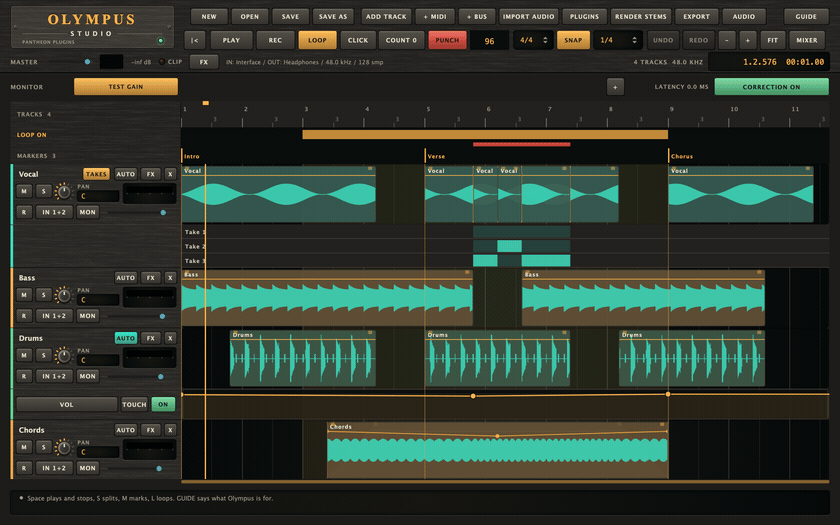
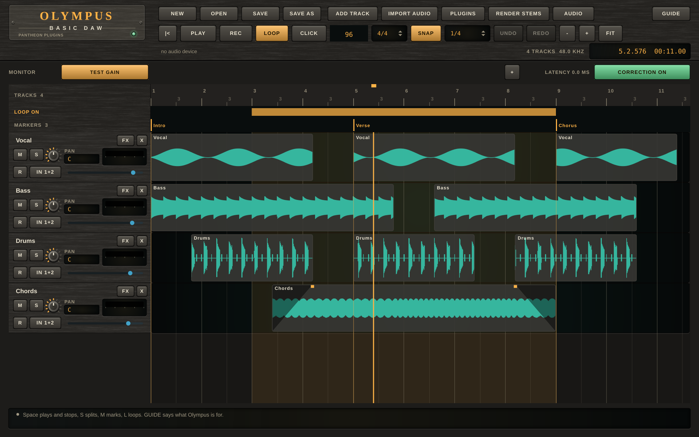

# Olympus Basic DAW

A basic DAW for the Pantheon plugins with audio and MIDI tracks, VST3/AU hosting, live recording, stem rendering, and a 38-tool MCP server.

**Format:** Standalone app (macOS · Linux CI; hosts VST3 + AU on macOS) + `OlympusMcp` stdio server



*Headless render of the arrangement, transport, meter strip, `MONITOR` headphone chain, and live recording take strip.*

## Theme

**Name origin:** *Olympus* is the mountain where the Greek gods live and act together; *Basic DAW* is an intentionally focused host — tracks, MIDI, automation, recording, stem render, and an MCP server — rather than a full-featured studio DAW. (CMake targets and namespaces use the short name `Olympus`. It is an app, not a plugin: it lives in `apps/`.)

### Core philosophy

- **Place now, edit later.** The point is to get the chains onto the stems quickly, by hand or by an agent, and to keep every setting in a project file, so nothing is final. Open any plugin from its chain, change it, save.
- **Any plugin it finds.** It hosts every VST3 (and, on macOS, Audio Unit) plugin the folders hold, the suite's own and third-party ones alike, and nothing else. Hestia's instances (which listen to each other) still work across the stems. The setting *scanSuiteOnly* in `settings.xml` narrows this to the suite's own plugins.
- **A basic DAW, not a full one.** No time-stretching (tempo changes move the grid, not audio), software input monitoring, punch-in, or comping — built around audio tracks, basic MIDI tracks (`BasicSynth` or MIDI plugins), automation curves, and dry interface recording.
- **Nothing is hidden from the agent.** The server reads and sets every setting of a plugin by the names the plugin gives them, loads its presets, and says why anything it cannot do failed.

## See it

| View | Preview | What to look at |
|---|---|---|
| **Arrangement & Mixer** |  | Four-track `96 bpm` song, bars/beats ruler, three markers, loop bar `3–9`, `MONITOR` strip. |
| **Recording a Take** |  | Armed Vocal/Drums tracks with lit `R` lamps, red take strip, `−1.7 dB` master meter. |

### UI colour legend

Uses the shared [root UI colour legend](../../README.md#ui-colour-legend-hardwareh) (`good` also marks the `CORRECTION ON` lamp; `bad` also flags the active take strip and missing plugins).

## Try it

See [Quick launch](../../README.md#quick-launch) to build and run Olympus (optionally passing a `.olympus` project file).

| Workflow | Action / Setting | What you see / hear / measure |
|---|---|---|
| **Build track chains & mix** | Drop stems (WAV/AIFF/FLAC/MP3/M4A/Ogg/CAF), `+ MIDI` for `BasicSynth`, click `FX` → `Add plugin...`, `AUTO` for curves | Stereo tracks auto-resample to device rate; double-click MIDI clip for **Piano Roll** & **Velocity Lane**. |
| **Headphone correction (`MONITOR`)** | Click `+` in `MONITOR` strip, add correction last, shift-click or `CORRECTION / BYPASS` to toggle | Runs on playback only (`monitor.xml`); never baked into stems or `mix.wav`; warns if latency `> 30 ms`. |
| **Record from interface** | Pick `IN` (`In 1`, `In 1+2`), arm `R` (meter shows live input), press `REC` (or `R`), stop (`Space` / `REC`) | Writes 32-bit float WAVs to `<project> Recordings/` (or `~/Music/Olympus Recordings/`); lands minus round-trip + monitor + max track latency. |
| **Render stems / export** | **Render stems** (`32-bit float` default, `24`/`16-bit`, or `Mix only`) or **Export** (`mix.wav`) | Writes `01-Vocal.wav` etc. + `mix.wav` aligned (chain latency trimmed, up to `1 min` tail); all tracks run block-by-block so Hestia listens across stems. |
| **Agent mixing (`OlympusMcp`)** | *"Add stems in `~/song/`, put Hestia and Hermes on each, Aegis on vocal, save `song.olympus`, render stems"* | `38` MCP tools edit via `Editor` undo; saving `.olympus` externally auto-reloads a clean window (or prompts if dirty). |

> [!TIP]
> **Shortcuts:** Double-click faders/knobs to reset to `0 dB`/default, shift-click a `MONITOR` plugin to bypass, and use `,` / `.` for markers (`Home` / `End` for audio bounds).

> [!NOTE]
> **No time-stretching & local monitor:** Changing tempo (`20–300 bpm`) moves the grid, never the audio; `monitor.xml` stays per-machine beside `settings.xml` and independent of `.olympus` projects.

> [!IMPORTANT]
> **Latency & sample-rate adopt:** Opening a project at a different device sample rate resamples buffers once, scales clips/markers/loop, and clears undo; takes subtract round-trip + monitor + longest track chain latency.

> [!WARNING]
> **Unverified hardware & crash guards:** Playback/recording on a real interface has not been checked by ear (`MONITOR` tested with stand-in `Test Gain`); `.pedal` files guard scans/startup (**PLUGINS > Forget blacklisted plugins**).

> [!CAUTION]
> **Watch `CLIP` and disk drop-outs:** `CLIP` latches red at `0 dBFS` before the device safety rail (pull faders down before `16/24-bit` WAV export); disk stalls during recording drop frames without padding.

## Reference

### Controls & capabilities

| Area | Details |
|---|---|
| **Tracks & Clips** | Unlimited stereo audio/MIDI tracks (`BasicSynth` 16-voice or MIDI plugins); sidechains disabled (non-stereo refused); files `> 2 hr` refused; clip move, split, trim, duplicate, rename, gain, fades, mute, `Cmd+C/X/V` clipboard; missing files keep place as silence. |
| **Automation & Tempo** | `AUTO` lane per track (`VOL`, `PAN`, any plugin parameter) with linear/smooth/step curves; tempo map (`20–300 bpm`), time signature, grid (`bar`, `1/2–1/32`), snap, named markers, loop, metronome (not in stems). |
| **Master, Undo & Project** | Track fader/pan (`-inf` to `+12 dB`), master fader (`-100` to `+12 dB`, applies to playback & `mix.wav` only), `2 s` peak readout & latched `CLIP`; `.olympus` XML v3 (v1/v2 load), `120 s` autosave (`.olympus.autosave` / `autosave-untitled.olympus`), external save reload, full structural & parameter undo/redo. |
| **Plugin Hosting & Safety** | Scans system VST3, macOS Audio Units, **PLUGINS > Look in a folder...**, `OLYMPUS_PLUGIN_PATH`, `--plugins`; caches in `plugins.xml` (`scanSuiteOnly` narrows to `suiteNames()`); `plugin-scan.pedal`, `monitor-load.pedal`, `project-load.pedal` skip crashing plugins; `Name (Maker)` disambiguates, VST3 wins over AU. |
| **MCP Server (`OlympusMcp`)** | JSON-RPC 2.0 over stdio (`38` tools): project/track/clip/tempo/marker/loop/master CRUD, `undo`/`redo`, `add/remove/move/bypass/set_plugin_wet/set_chain/copy_chain` (`≤ 64` plugins/chain, `≤ 128` target tracks), `list/set_parameter` (text readback verified), `list/load_preset`, `get/set_plugin_state` (base64), `plugin_notes`, `render_stems`, `analyze_audio`. |

### Signal flow

```
Audio Clips / MIDI (BasicSynth) ──► [Track FX Chain (stereo, latency-aligned)] ──► [Track Vol/Pan] ──┐
                                                                                                      ▼
Audio Inputs ──► [Recorder: 32-bit float WAV] ──(stop: -latency clip)──► Timeline        [Master Fader]
                                                                               ┌──────────────────────┴──────────────────────┐
                                                                               ▼                                             ▼
                                                           (Playback: MONITOR Chain ─► 0 dBFS Hold ─► Out)   (Render: Stems + mix.wav, ≤ 3 hr, ≤ 1 min tail)
```

### Measured

- **`OlympusTests` (61 test groups + `TempoTests.h`):** Session, `renderStems` alignment & mix-only byte parity, latency compensation across tracks (Hestia block-by-block), XML v1–v3 & relative paths, `38` MCP tools + `analyze_audio`, `Editor` undo/redo (timeline, MIDI `BasicSynth`, automation curves, structural track/plugin chains), `Recorder` start latch / `64`-input cap / chunk atomicity, clipboard, `Catalog` deduplication, `0 dBFS` rail / NaN recovery.
- **`OlympusUiCheck` (49 UI/lifecycle groups):** `MONITOR` strip/bypass/`monitor.xml`, recording inputs & latencies, safe-start `.pedal` guards, save/autosave/recovery, external reload, render cancel cleanup without UI lock wait, `Export` mix-only, Piano Roll & Velocity Lane, automation lane UI, and `16:10` window layout.
- **CI:** Runs `OlympusTests` + `OlympusUiCheck` on Linux ([.github/workflows/olympus.yml](../../.github/workflows/olympus.yml)) using stand-in `test::GainPlugin`; pass `OLYMPUS_PLUGIN_DIR=$PWD/plugins/hermes/build` to test a real VST3.

### Limits

- **No time-stretching, mixer view, or multi-select clip editing;** single clip selection only; fader/pan live in track headers; plugin UIs open in separate windows (no inline panel or per-slot wet/dry UI).
- **Recording & hardware unverified by ear:** Never tested on a real audio interface, macOS mic prompt, real disk stall (`~6 s` writer buffer; closing writers on stop can briefly block UI), or real third-party correction plugin; no software input monitoring, punch-in, loop recording, comping, or take lanes.
- **Scanning & UI details:** Plugin scanning runs on the message thread (hangs caught on next launch via `.pedal`); monitor add-plugin menu groups by maker past `25` plugins with no search box; no macOS CI job yet.

## Build & develop

See [root Build & develop](../../README.md#build--develop) for shared prerequisites and image-generation rules, [Quick launch](../../README.md#quick-launch) to run the app, and [CLAUDE.md](CLAUDE.md) for invariants.

```bash
scripts/build.sh olympus            # OlympusTests and OlympusUiCheck
scripts/build.sh olympus snap       # docs/screenshot.png and docs/screenshot-record.png
scripts/showcase.sh olympus         # regenerate docs/showcase.gif
scripts/build.sh olympus app        # standalone app
scripts/build.sh olympus OlympusMcp # 38-tool MCP stdio server
OLYMPUS_PLUGIN_DIR=$PWD/plugins/hermes/build scripts/build.sh olympus tests
```

Plain CMake & MCP registration (from `apps/olympus`):

```bash
cmake -S . -B build -DCMAKE_BUILD_TYPE=Release
cmake --build build --target Olympus OlympusMcp -j 10
./build/OlympusMcp_artefacts/Release/OlympusMcp [--plugins <folder>] [--project <file.olympus>]
claude mcp add olympus -- /path/to/pantheon-suite/apps/olympus/build/OlympusMcp_artefacts/Release/OlympusMcp
```

## Licence

AGPL-3.0-or-later, source only — see [root Licence](../../README.md#licence) and [NOTICE](../../NOTICE.md).
