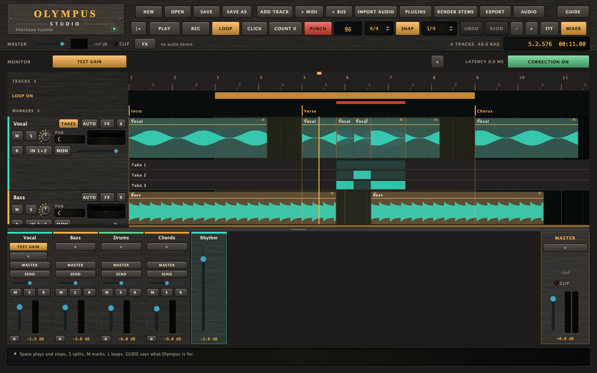

# Olympus Studio

A multitrack studio for the Pantheon plugins with audio and MIDI tracks, VST3/AU hosting, live recording, stem rendering, and a 48-tool MCP server.

**Format:** Standalone app (macOS · Linux CI; hosts VST3 + AU on macOS) + `OlympusMcp` stdio server


*Headless render of the window in 30 frames: the playhead runs through the session with the meters live, then the Vocal and Drums (with Bass, linked to Drums by the group `Rhythm`) record from `8 s`, the take in red.*

## Theme

**Name origin:** *Olympus* is the mountain where the Greek gods live and act together; *Studio* is where the work is made: tracks, MIDI, automation, recording, stem render and an MCP server, in one window. (CMake targets and namespaces use the short name `Olympus`. It is an app, not a plugin: it lives in `apps/`.)

### Core philosophy

- **Place now, edit later.** The point is to get the chains onto the stems quickly, by hand or by an agent, and to keep every setting in a project file, so nothing is final. Open any plugin from its chain, change it, save.
- **Any plugin it finds.** It hosts every VST3 (and, on macOS, Audio Unit) plugin the folders hold, the suite's own and third-party ones alike, and nothing else. Hestia's instances (which listen to each other) still work across the stems. The setting *scanSuiteOnly* in `settings.xml` narrows this to the suite's own plugins.
- **A studio that says what it does not do.** Audio and MIDI tracks, buses, sends, groups with VCA faders, layered clips with crossfades, automation written live (Read, Touch, Latch, Write), punch and loop recording with take lanes and comping, input monitoring, MIDI keyboards and MIDI files. Not here: time-stretching (a tempo change moves the grid, not the audio), a clip launcher, video or notation.
- **Nothing is hidden from the agent.** The server reads and sets every setting of a plugin by the names the plugin gives them, loads its presets, and says why anything it cannot do failed.

## See it

| View | Preview | What to look at |
|---|---|---|
| **Arrangement** |  | Four tracks at `96 bpm`, each in its own colour (the bar at the left of its header); Bass and Drums in the group `Rhythm`; the vocal's three takes in sub-lanes, take 3 lit, and a comp at `13–14 s` on the main lane, where take 2's sub-lane is lit (the comp plays) and take 3's is dark; the punch range `12–16 s` as the red bar above the ruler; the drums' volume lane in Touch; the chords' gain line dipping to `−6 dB` mid-clip. Look at the `TAKES` sub-lanes, the punch bar and the gain line. |
| **Recording a Take** |  | Vocal (`IN 1`) and Drums (`IN 3+4`) armed, so their `R` lamps are lit; Bass is armed too, through the group `Rhythm`. The take runs in red from `8 s` on the armed lanes; the Vocal's `MON` lamp is lit (MON Auto); the master meter and the `REC` clock in the top bar. The punch is off for this take, so its bar is dim. Look at the red `R` lamps, the `MON` lamp and the take strip. |
| **Mixer & VCA** |  | The same session with the mixer open: a strip per track in its colour, the VCA strip `Rhythm` at `−2.0 dB` (one fader over Bass and Drums), each track's fader and gain in dB, and the `Ø` (polarity) button at the foot of each strip, all off. Look at the `Rhythm` strip and the `Ø` buttons. The arrangement above is shorter here, so its lower tracks are cut off by the mixer panel. |

### UI colour legend

Uses the shared [root UI colour legend](../../README.md#ui-colour-legend-hardwareh) (`good` also marks the `CORRECTION ON` lamp; `bad` also flags the active take strip and missing plugins).

## Try it

See [Quick launch](../../README.md#quick-launch) to build and run Olympus (optionally passing a `.olympus` project file).

| Workflow | Action / Setting | What you see / hear / measure |
|---|---|---|
| **Build track chains & mix** | Drop stems (WAV/AIFF/FLAC/MP3/M4A/Ogg/CAF) or `.mid/.midi`, `+ MIDI` for `BasicSynth`, click `FX` → `Add plugin...`, `AUTO` for curves | Stereo tracks auto-resample to device rate; double-click MIDI clip for **Piano Roll** & **Velocity Lane**. |
| **Headphone correction (`MONITOR`)** | Click `+` in `MONITOR` strip, add correction last, shift-click or `CORRECTION / BYPASS` to toggle | Runs on playback only (`monitor.xml`); never baked into stems or `mix.wav`; warns if latency `> 30 ms`. |
| **Record from interface** | Pick `IN` (`In 1`, `In 1+2`), arm `R` (meter shows live input), set `MON` (`AUTO` or `IN`) to hear the input on headphones, optionally set `COUNT` (0, 1 or 2 bars of clicks) and `PUNCH` (`I` and `O` set its ends; needs layered clips), press `REC` (or `R`), stop (`Space` / `REC`). With the loop on and layered clips, `REC` records each pass of the loop as a take, one on top of the last: `TAKES` on the track header opens a lane per take, a drag across a take's lane comps that range, and a click on its `Take N` label puts that take on top. **MIDI keyboards:** turn on the keyboard's MIDI input in `AUDIO` (every MIDI input the device lists is on by default), arm a MIDI track, play it: it sounds live even while stopped; `REC` keeps its notes and puts them on the track as a MIDI clip at the stop | Audio writes 32-bit float WAVs to `<project> Recordings/` (or `~/Music/Olympus Recordings/`); lands minus round-trip + monitor + max track latency, trimmed to the punch range. A MIDI clip is placed earlier by the output and chain latencies only (the keyboard's own delay is not in it). A MIDI track alone is a valid REC: no file is written. |
| **Render stems / export** | **Render stems** (`32-bit float` default, `24`/`16-bit`, or `Mix only`) or **Export** (`mix.wav`) | Writes `01-Vocal.wav` etc. + `mix.wav` aligned (chain latency trimmed, up to `1 min` tail); all tracks run block-by-block so Hestia listens across stems. |
| **Agent mixing (`OlympusMcp`)** | *"Add stems in `~/song/`, put Hestia and Hermes on each, Aegis on vocal, save `song.olympus`, render stems"* | `48` MCP tools edit via `Editor` undo; saving `.olympus` externally auto-reloads a clean window (or prompts if dirty). |

> [!TIP]
> **Shortcuts:** Double-click faders/knobs to reset to `0 dB`/default, shift-click a `MONITOR` plugin to bypass, and use `,` / `.` for markers (`Home` / `End` for audio bounds).

> [!NOTE]
> **No time-stretching & local monitor:** Changing tempo (`20–300 bpm`) moves the grid, never the audio; `monitor.xml` stays per-machine beside `settings.xml` and independent of `.olympus` projects.

> [!IMPORTANT]
> **Latency & sample-rate adopt:** Opening a project at a different device sample rate resamples buffers once, scales clips/markers/loop, and clears undo; takes subtract round-trip + monitor + longest track chain latency.

> [!WARNING]
> **Unverified hardware & crash guards:** Playback/recording on a real interface has not been checked by ear (`MONITOR` tested with stand-in `Test Gain`); `.pedal` files guard scans/startup (**PLUGINS > Forget blacklisted plugins**).

> [!CAUTION]
> **Watch `CLIP` and disk drop-outs:** `CLIP` latches red at `0 dBFS` before the device safety rail (pull faders down before `16/24-bit` WAV export); disk stalls during recording drop frames without padding.

## Reference

### Controls & capabilities

| Area | Details |
|---|---|
| **Tracks & Clips** | Unlimited stereo audio/MIDI tracks (`BasicSynth` 16-voice or MIDI plugins); a MIDI track armed for `REC` records the notes of a hardware keyboard into a MIDI clip (notes only: the sustain pedal lengthens the notes it holds, and pitch bend is not kept); sidechains disabled (non-stereo refused); files `> 2 hr` refused; clip move, split, trim, duplicate, rename, gain, fades, mute, `Cmd+C/X/V` clipboard; layers (a new clip goes on top; raise to top and lower to bottom from the clip menu) with equal-power crossfades at an upper clip's edges (the crossfade length is set from the lane menu, default 10 ms; layered off for a version 3 file, which keeps its sum); a clip gain line (`G` or the lane menu shows it: click to add a point, drag to move, Alt-click to delete; -60 to +12 dB, kept on the audio through a trim or a split); missing files keep place as silence; `.mid/.midi` import as new MIDI tracks (file tempo optional over MCP), export of a clip, a track or all MIDI tracks as a type 1 file at 960 PPQ. |
| **Automation & Tempo** | `AUTO` lane per track (`VOL`, `PAN`, any plugin parameter) with linear/smooth/step curves; each lane's mode `READ` / `TOUCH` / `LATCH` / `WRITE` records the fader, pan or plugin control while the transport plays (one undo step per pass); tempo map (`20–300 bpm`), time signature, grid (`bar`, `1/2–1/32`), snap, named markers, loop, metronome (not in stems). |
| **Loop recording & takes** | With the loop on and layered clips, `REC` records each pass of the loop as a take (the loop's points are fixed at `REC`; the playhead moves to the loop's start first if it is outside it). The passes of one stop share a take group, numbered in order, and the last pass plays. `TAKES` on a track header (shown when a take group has two or more takes) opens one 22 px lane per take under the track, labelled `Take N`, dimmed where another take or a comp covers it and lit where it plays: a drag across a take's lane makes a comp of that range (one undo step, snapped to the grid when snap is on, with the layers' crossfade at its edges), and a click on the label puts the take on top. Without the loop a take is one clip in a group of its own. |
| **Punch & count-in** | `PUNCH` (red lamp on the transport): a take is recorded from two bars before the punch-in and trimmed to `[punch-in, punch-out]` when you stop, as one undo step; it needs layered clips, and a take that ends before the punch-in or starts after the punch-out is not placed and is named. `I` and `O` set the punch-in and punch-out at the playhead; the lane under the loop shows the range (red, dim while off) and is dragged like the loop. `COUNT` (`0`, `1` or `2` bars) plays clicks at the tempo of the record point before a take, with the transport held; the take starts when they end. The count-in is a setting of the machine, saved with its settings. |
| **Input monitoring (`MON`)** | Each audio track's `MON` (on its header, beside `IN`) cycles `OFF` → `AUTO` → `IN`: `AUTO` hears the track's device input while the transport is stopped or a take records, and its clips while it plays; `IN` always hears the input. The input runs through the track's plugins, fader and pan, so it is heard late by the chain's latency (the GUIDE warns past `20 ms`). It is never in a render, a freeze or `mix.wav`; the mode is saved per track (`monitor`) and undone. Use headphones: speakers feed back. |
| **Master, Undo & Project** | Track fader/pan (`-inf` to `+12 dB`), master fader (`-100` to `+12 dB`, applies to playback & `mix.wav` only), `2 s` peak readout & latched `CLIP`; `.olympus` XML v4 (v1 to v3 load, layered off), `120 s` autosave (`.olympus.autosave` / `autosave-untitled.olympus`), external save reload, full structural & parameter undo/redo. |
| **Colour, Ø & Groups** | Track colour (`Auto` by index, or one of twelve swatches: a strip on the track header, a tint on its clips, a cap on its mixer strip), `Ø` polarity (both channels inverted at the source, before the chain), and groups: a group links its members' faders (one dB step, kept within `-100` to `+12`), mute, solo and arm while it is active, `Alt` (Option) acts on one track alone, and its VCA fader (`-100` to `+12 dB`, double-click for `0`) is added to every member's fader and volume lane. The track menu is a right-click on the track's name; all of it is saved in `.olympus` and undone. |
| **Plugin Hosting & Safety** | Scans system VST3, macOS Audio Units, **PLUGINS > Look in a folder...**, `OLYMPUS_PLUGIN_PATH`, `--plugins`; caches in `plugins.xml` (`scanSuiteOnly` narrows to `suiteNames()`); `plugin-scan.pedal`, `monitor-load.pedal`, `project-load.pedal` skip crashing plugins; `Name (Maker)` disambiguates, VST3 wins over AU. |
| **MCP Server (`OlympusMcp`)** | JSON-RPC 2.0 over stdio (`48` tools): project/track/clip/tempo/marker/loop/master CRUD, `set_punch`, `comp_take` and `promote_take` (the take lanes' comp and promote), `undo`/`redo`, `set_track` colour, polarity, group and `monitor`, `add_group`/`set_group`/`remove_group`, `add/remove/move/bypass/set_plugin_wet/set_chain/copy_chain` (`≤ 64` plugins/chain, `≤ 128` target tracks), `list/set_parameter` (text readback verified), `list/load_preset`, `get/set_plugin_state` (base64), `plugin_notes`, `import_midi`/`export_midi`, `set_clip` gain line (`gain_envelope`) and layer, `set_layering`, `set_automation_mode`, `render_stems`, `analyze_audio`. |

### Signal flow

```
Audio Clips / MIDI (BasicSynth) ──► [Track FX Chain (stereo, latency-aligned)] ──► [Track Vol/Pan] ──┐
                                                                                                      ▼
Audio Inputs ──► [Recorder: 32-bit float WAV] ──(stop: -latency clip)──► Timeline        [Master Fader]
                                                                               ┌──────────────────────┴──────────────────────┐
                                                                               ▼                                             ▼
                                                           (Playback: MONITOR Chain ─► 0 dBFS Hold ─► Out)   (Render: Stems + mix.wav, ≤ 3 hr, ≤ 1 min tail)
```

### Measured

- **`OlympusTests` (74 test groups + `TempoTests.h`):** Session, `renderStems` alignment & mix-only byte parity, latency compensation across tracks (Hestia block-by-block), XML v1–v4 & relative paths, `48` MCP tools + `analyze_audio`, layered clips, crossfades and the clip gain line [71], track colour, polarity, groups and VCA, layered clips and the clip gain line, automation modes (Write, Touch, Latch), punch, input monitoring, MIDI input recording, loop takes and comping, `Editor` undo/redo (timeline, MIDI `BasicSynth`, automation curves, structural track/plugin chains), `Recorder` start latch / `64`-input cap / chunk atomicity, clipboard, MIDI files (round trip, type 1, file tempo), `Catalog` deduplication, `0 dBFS` rail / NaN recovery.
- **`OlympusUiCheck` (54 UI/lifecycle groups):** `MONITOR` strip/bypass/`monitor.xml`, recording inputs & latencies, safe-start `.pedal` guards, save/autosave/recovery, external reload, render cancel cleanup without UI lock wait, `Export` mix-only, Piano Roll & Velocity Lane, automation lane UI, track colours, groups and the VCA strip, layered clips, the automation mode button, the punch lane and count-in, `MON`, take lanes, and `16:10` window layout.
- **CI:** Runs `OlympusTests` + `OlympusUiCheck` on Linux ([.github/workflows/olympus.yml](../../.github/workflows/olympus.yml)) using stand-in `test::GainPlugin`; pass `OLYMPUS_PLUGIN_DIR=$PWD/plugins/hermes/build` to test a real VST3.

### Limits

- **No time-stretching;** fader/pan live in track headers; plugin UIs open in separate windows (no inline panel).
- **Loop recording:** needs layered clips (refused at `REC` otherwise); each pass is cut at the stop, and a pass under `100 ms` is dropped; a note held across the loop's wrap ends at the loop's end; a take with a punch is not a loop take (the punch wins).
- **Recording & hardware unverified by ear:** Never tested on a real audio interface, the macOS microphone prompt, a real disk stall (`~6 s` writer buffer; closing writers on stop can briefly block the UI) or a real third-party correction plugin. Punch-in, loop recording, comping, take lanes, input monitoring and MIDI keyboard input have not been played on real hardware either.
- **Scanning & UI details:** Plugin scanning runs on the message thread (hangs caught on next launch via `.pedal`); no macOS CI job yet.

## Build & develop

See [root Build & develop](../../README.md#build--develop) for shared prerequisites and image-generation rules, [Quick launch](../../README.md#quick-launch) to run the app, and [CLAUDE.md](CLAUDE.md) for invariants.

```bash
scripts/build.sh olympus            # OlympusTests and OlympusUiCheck
scripts/build.sh olympus snap       # docs/screenshot.png, screenshot-record.png and screenshot-mixer.png
scripts/showcase.sh olympus         # regenerate docs/showcase.gif
scripts/build.sh olympus app        # standalone app
scripts/build.sh olympus OlympusMcp # 48-tool MCP stdio server
OLYMPUS_PLUGIN_DIR=$PWD/plugins/hermes/build scripts/build.sh olympus tests
```

Plain CMake & MCP registration (from `apps/olympus`):

```bash
cmake -S . -B build -DCMAKE_BUILD_TYPE=Release
cmake --build build --target Olympus OlympusMcp -j 10
./build/OlympusMcp_artefacts/Release/OlympusMcp [--plugins <folder>] [--project <file.olympus>]
claude mcp add olympus -- /path/to/pantheon-suite/apps/olympus/build/OlympusMcp_artefacts/Release/OlympusMcp
```

## Licence

AGPL-3.0-or-later, source only — see [root Licence](../../README.md#licence) and [NOTICE](../../NOTICE.md).
