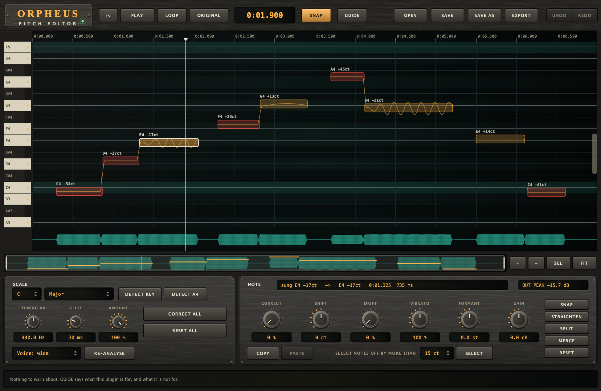
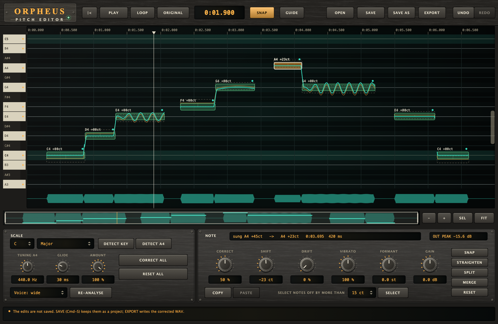

# Orpheus Pitch Editor

An **offline pitch editor for solo vocals**, as a standalone macOS app. Open a recording and it shows every note the
singer sang, on a piano roll, with the sung pitch drawn through it. Drag a note to where it should be, or let **Correct all** pull
every note onto a scale; the sound is rebuilt as you go and you can play it, loop it and flip back to the original at the same spot.
When it is right, export a WAV.

## Name origin

*Orpheus* is the singer of Greek myth, whose voice moved stones and rivers; here it is the voice that gets moved onto the note.
(CMake targets and namespaces use the short name "Orpheus". It is an app, not a plugin: it lives in `apps/`, not `plugins/`.)



*Headless render of the window (the hardware-style interface shared with the plugins) over a synthetic singer whose nine notes in C major are each
a little sharp or flat. The blobs are the notes, coloured by how far they are from the scale: **green** within 8 cents, **amber** up to 25,
**red** beyond. The amber line is the pitch as sung, every 5 ms. The selected note (white outline) has a vibrato, which the line shows and the blob
does not. Under the display, the waveform and the navigator; below them, the scale panel on the left (key, scale, tuning, glide, amount, and the voice range with
RE-ANALYSE) and the controls for the selected note on the right (the knobs, COPY / PASTE, SELECT of the notes still off the scale, and OUT PEAK, the loudest sample of the
result). Regenerate with the command under "Development".*



*The same phrase after **Correct all**. The notes are on the scale (teal); the teal line is the pitch after the edit, and the dashed
blobs show where each note was sung. One note (selected) was left half-way: its read-out says CORRECT 50 %, SHIFT -23 ct. The vibrato
of the third and seventh notes is kept, moved with the note. The strip at the foot says the edits are not saved.*

## Core philosophy

- **Precision you can read.** Every pitch is a number you can see and type: the name of the note and its distance in cents ("A3 +12ct") on every
  blob, under the pointer, and while you drag. The notes that are out of tune say so by their colour, so you see what is wrong before you
  hear it. The pitch that comes out is, by construction, the pitch that was planned (see "How it works"), and the tests measure it.
- **Easy by default.** The first thing it does with a recording is find the notes and guess the key. One button
  (**Correct all**) is a complete first pass; **Amount** says how far. Everything after that is a drag, a double-click or a number.
- **Your voice stays your voice.** Grains of the original are re-spaced, not resampled, so the vowel colour stays where it was, and
  consonants and breaths are never touched. A note you did not edit is **bit-for-bit the original**, so editing one word cannot
  harm the rest of the take.
- **Non-destructive.** The audio is never changed; an edit is a list of numbers per note. Undo is unlimited in practice (200 steps),
  a project file keeps the edit, and **ORIGINAL** plays the untouched recording at the same position at any moment.
- **One voice at a time.** It is built for a clean solo vocal (or any monophonic line: a bass, a horn) and says so. Chords and
  backing-vocal stacks are not what it is for.
- **Free, public, source only.** The repository holds the code, not a download, under the AGPL-3.0-or-later (see [the repository
  notes](../../NOTICE.md)).

## Features

| Area | What it does |
|---|---|
| **Notes** | The recording is cut into notes where the held pitch changes, or where the voice dips and comes back (the same note sung twice). A vibrato does not cut a note. **Split** (S) and **Merge** (M) fix what the automatic cut got wrong. |
| **Drag** | Drag a blob up or down. It moves from note to note of the scale (**SNAP**); hold **Shift** to move at a tenth of the speed (under a cent per pixel at the default zoom), hold **Alt** to reverse SNAP for that drag (free if SNAP is on, snapped if it is off). Several selected notes move together. |
| **Double-click** | Snaps the note onto the scale; a second double-click puts it back. |
| **Correct** (knob) | How far the selected notes are pulled to the nearest note of the scale. 100 % = onto the note, 50 % = half-way. |
| **Shift** (knob) | Where the note is, in cents from where it was sung. Click the number and type: `-23`, `+2st`, `150`. |
| **Drift** | Removes the slow wander of the pitch inside a note (the note that creeps sharp or sags) and keeps the vibrato. |
| **Vibrato** | Scales the fast modulation: 0 % = flat, 100 % = as sung, 200 % = twice as deep. |
| **Formant** | Moves the character of the voice without moving the pitch (a formant shift; 0 leaves it alone). |
| **Gain** | The level of the note. |
| **Key / Scale** | Twelve keys; major, minor, harmonic and melodic minor, the modes, pentatonics, blues, or **Chromatic** (tune each note to the nearest semitone). Rows of the roll outside the scale are dark, and the piano keys at the left show the scale. |
| **Detect key** | Finds the key from the notes you have (a pitch-class profile weighted by how long each note lasts), major or its relative minor. |
| **Tuning A4** / **Detect A4** | The reference pitch of the song. **Detect A4** reads it from where the notes sit between semitones, and refuses (and says so) when they are each off in their own way and there is no common reference to find. A singer who is 30 cents flat all the way through is read as 30 cents flat; correcting to that grid then leaves the take where it is. |
| **Amount / Correct all** | Pulls every note towards the scale by Amount; what you did to individual notes (drift, vibrato, formant, gain) is kept. |
| **Glide** | How long two neighbouring notes take to slide into each other when they are moved by different amounts. 0 = a step. |
| **Play / Loop / ORIGINAL** | Plays the corrected audio; Loop repeats the selected notes (or everything); ORIGINAL (Tab) swaps in the untouched recording with no gap. Edits are heard while it plays and while you drag. |
| **Navigator** | The bar under the display shows the whole recording, with a tick for every note and a bright window for the part on screen. Drag the window to scroll along the audio, drag its edges to zoom, click elsewhere on the bar to go there. **-**, **+** and **FIT** zoom the display; the scrollbar at the right edge of the display scrolls the pitch. |
| **Piano keys** | Click one to hear that pitch as a tone, to check a note by ear. |
| **Save / Save as / Open** | A project (`.orpheus`) keeps the notes, the key, the settings and the voice range, and points at the audio, which it does not copy: by its path, by its path relative to the project (so the two can be moved together), and by a fingerprint (its length and 4096 samples spread over it). A project whose audio is not the same take is refused with a message and nothing is opened; one from before the fingerprint still opens. **Save** (Cmd+S) writes to the project silently once it has one (the first time it asks where); **Save as** (Shift+Cmd+S) always asks. A star in the window title marks edits that are not saved (undoing back to the saved state clears it), and Open, a dropped file, Re-analyse and Quit ask before they would lose them. Open takes any audio file the system can decode, or a project; its menu lists the last eight files, and at launch without a file Orpheus reopens the last one (the list is `recent.txt` in the application data folder). A file that cannot be read leaves the open recording, and an analysis that is running, alone. |
| **Voice** / **Re-analyse** | The range the pitch tracker looks for: wide (65-1100 Hz, the default), low (65-400, bass and baritone), mid (100-700) or high (200-1100). A narrower range cannot jump an octave to a pitch outside it. It is used the next time the notes are found: **Re-analyse** finds them again (every edit is taken back, after asking), and it is saved in the project. |
| **Select** / **Sel** (Z) | **Select** picks the notes that are, as they are now, more than 5, 10, 15, 25 or 50 cents from the nearest note of the scale (the amber and red ones); **Sel** (Z) zooms the display to the selected notes, in time and in pitch. |
| **Copy / Paste** | Takes shift, drift, vibrato, formant and gain from the one selected note (Cmd+C) and puts them on the selected notes (Cmd+V). The shift is the same distance from each note's own pitch, not the same pitch. One undo takes a paste back. |
| **Guide and notes** | **GUIDE** (header) says what Orpheus is for and what it is *not* for: the pitch of one voice, not chords or a mix, not timing, not big leaps (past about 5 semitones the voice changes), and not a plugin. The strip at the foot of the window warns, in amber, when ORIGINAL is lit (you hear the take, not your edits), when edits are not saved, when the result peaks above 0 dB (it will clip in the WAV), and when a note is moved more than 5 semitones; it says what to open when nothing is, and that a note under 100 ms may be a mis-cut. The rules are in [Advice.h](Source/UI/Advice.h), checked by `OrpheusUiCheck`. |
| **Export** / **OUT PEAK** | A 24-bit WAV at the sample rate of the recording, mono or stereo, written to a temporary file and moved over the target when complete (a failed export leaves an existing file as it was). Gain up to +12 dB and the re-spaced grains can take the result past 0 dB, which a WAV cannot hold: OUT PEAK (red past 0 dB), the strip and a question at Export say so. |

### Keys and mouse

| | |
|---|---|
| Space | play / stop |
| Tab | original / corrected |
| L | loop the selection |
| Home | back to the start |
| Left / Right | previous / next note (and the playhead goes there) |
| Up / Down | move the selection a semitone; **Shift** 10 cents; **Alt** 1 cent |
| Enter | snap the selection to the scale |
| Backspace | take back everything done to the selection |
| S / M | split the note at the playhead / merge the selection |
| Cmd+A, Cmd+Z, Shift+Cmd+Z | select all, undo, redo |
| Cmd+O, Cmd+S, Shift+Cmd+S, Cmd+E | open, save the project, save as, export |
| Cmd+C, Cmd+V | copy the settings of the selected note, paste them onto the selected notes |
| F / Z | fit the display to the recording / zoom to the selected notes |
| Click a note / Shift-click | select / add or remove |
| Drag on empty space | select the notes in the box |
| Click the ruler or the waveform | move the playhead |
| Right-click | the same actions as a menu |
| Wheel | scroll along the recording (a mouse wheel, or a sideways swipe); **Shift + wheel** scrolls the pitch; **Cmd/Ctrl + wheel**, or a pinch, zooms time; **Alt + wheel** zooms pitch |
| + / - | zoom the time in / out |

Every knob works as in the plugins: drag it, double-click it to reset it, or click its read-out and type. A knob that shows
**mixed** is looking at notes whose values differ; moving it sets them all.

### How it works

`track (whole file) → cut into notes → plan per frame → resynthesise only what changed`

* **Pitch tracking** ([PitchAnalysis.h](Source/Dsp/PitchAnalysis.h)): the YIN difference function on a 16 kHz copy, four candidate periods per 5 ms
  frame, then a **Viterbi search over the whole recording** for the cheapest path through them: a jump in pitch costs in proportion to its
  size, so a lone octave error (a jump up and a jump back) is never taken, which a frame-by-frame decision cannot guarantee. Each frame is then refined at the full
  sample rate by the normalised correlation around its period with a parabola through the peak.
* **Notes** ([Segmenter.h](Source/Dsp/Segmenter.h)): the pitch is averaged over about 125 ms twice (which removes a vibrato) and cut by an exact
  piecewise-constant fit (dynamic programming, a fixed price for each new level); the cuts are then moved back onto the unsmoothed pitch, where
  a real change of note is a step, and the slide between two notes, a short piece at the edge of a phrase and a dip in loudness are told apart from a note.
* **Plan** ([Plan.h](Source/Dsp/Plan.h)): inside a note the sung pitch is a centre, a slow part (drift) and a fast part (vibrato). The planned
  pitch is `target + (1 - drift) * slow + vibrato * fast`, then smoothed over *Glide*. This is the only thing the renderer reads of the notes.
* **Resynthesis** ([Psola.h](Source/Dsp/Psola.h)): pitch-synchronous overlap-add. Marks are found once per file by following the waveform
  (matching the shape around the last mark against the signal a period later). Output marks are spaced **exactly** as the plan's pitch says, so
  whatever error the tracker made on the input cancels out of the pitch that comes out; each takes the grain (two periods under a Hann window) of the nearest
  input mark. A stretch that is edited is rebuilt whole and cross-faded in over 4 ms, and its loudness is matched to the input's (re-spaced grains add up to a
  different level otherwise: nine decibels for a shift of five semitones up). Only the stretches an edit touches are rebuilt, so a drag stays fast; everything
  else is copied.

### What has been measured

All of it by [Tests/Tests.cpp](Tests/Tests.cpp) and [Tests/UiCheck.cpp](Tests/UiCheck.cpp), on a synthetic singer whose pitch is known at every
sample (a harmonic series shaped by two formants), so the output is measured against the truth and not against another program.

| | |
|---|---|
| Steady tones, 41 to 81 MIDI, 44.1 / 48 / 96 kHz | every frame voiced; worst error **0.01 cent** |
| A vibrato of +-60 cents at 5.8 Hz | followed to **1.2 cents** rms, no octave error |
| White noise, silence | never voiced; a tone with breath noise 12 dB below it: 100 % voiced, worst error 8 cents |
| The notes of a phrase with vibrato, drift, a glide and a short note | all found; centres within 0.7 cent; a legato boundary within 15 ms; one note with a vibrato of +-100 cents stays one |
| The result of moving the notes by -7 to +7 semitones | follows the planned pitch frame by frame to **1.1 cents** rms (3.7 at worst); the centre of a note is exactly its target |
| Five notes 12 to 41 cents out of tune, snapped to C major | all within **0.12 cent** of the note |
| Level after a shift of up to 5 semitones | within 0.05 dB |
| Vowel colour after +4 semitones | spectral centroid moves 0.1 %; a resampling shifter would move it 26 % |
| Formant +4 semitones | the centroid moves 15 % and the pitch 0.00 cents |
| Vibrato 0 % / 200 %, Drift 100 % | the pitch range of the note 88 -> 19 / 156 cents; the wander 19 -> 4 cents |
| A note nobody edited, and the audio far from one that was | bit-for-bit the input |
| Rebuilding only what an edit touched | exactly the samples a full rebuild gives |
| Undo | the audio goes back bit-for-bit |
| Export | a 24-bit WAV that reads back within 1e-6 |
| Speed (20 s of audio, the development machine) | tracking 0.26 s, marks 0.10 s, a full resynthesis 0.04 s |

Also tried by hand, **not part of the tests**: speech and the singing and cello voices of macOS' speech synthesiser, shifted by +3 and -4 semitones. For
the sung voices the output follows the plan to a median of 1 to 3 cents; for speech the median is about 3 cents and the worst frames, at creaky or
breathy stretches, are tens of cents out. No recording of a real singer has been used, and nobody has listened to the results in a blind test.
Treat the numbers above as what the algorithm does on clean, steady, harmonic voices.

## Limits

- **Monophonic.** One note at a time. No chords, no stacked backing vocals, no choruses.
- **Pitch and loudness, not time.** A note cannot be moved or stretched in time yet, and there is no per-note envelope beyond Gain. The time of
  everything stays where it was sung.
- **A standalone app.** It does not run inside a DAW (no plugin, no host integration): export a WAV and bring it back.
- **A sibilant or a breath is left as it was**, by design: it has no pitch. A pitch edit of a word ends where the voicing ends.
- **A note stays within two octaves of where it was sung** (24 semitones; the Shift knob itself goes to 12). A drag, the arrow keys, the knobs and a loaded project are held to it, and
  the resynthesis refuses a plan more than four octaves away; past two octaves the grains are a few samples apart and the result is noise.
- **A large shift is audible.** A shift of a few semitones is transparent on a clean take; beyond about 5 to 7 semitones the character of the
  voice begins to change, as with any method that re-spaces grains. Formant can compensate by ear.
- **Segmentation is a guess.** A very short note (under about 100 ms) between two others in pitch, or a fall-off at the end of a phrase, can be read as part of the neighbour; Split (S) cuts it.
- **Run by hand on macOS only.** [orpheus.yml](../../.github/workflows/orpheus.yml) builds and runs both test programs on Linux; a macOS build of the app itself has been started and loaded a file, but not driven by hand through a whole editing session, and the sound has not been listened to.

## How to use

### Build and run (macOS)

Orpheus is source only: you build it yourself. Requires CMake and Xcode (clang + macOS SDK). JUCE is fetched automatically (the version
is set in `cmake/Juce.cmake` at the repository root); for an offline build put a checkout in `third_party/JUCE`.

```bash
export SDKROOT=$(xcrun --sdk macosx --show-sdk-path)   # needed where the Command Line Tools' SDK is what the linker finds
cd apps/orpheus
cmake -S . -B build -DCMAKE_BUILD_TYPE=Release
cmake --build build --target Orpheus -j 10
open build/Orpheus_artefacts/Release/Orpheus.app        # or run it with a file: .../Orpheus.app/Contents/MacOS/Orpheus take.wav
```

### A first pass

1. **Open** a recording (or drop it on the window). It is analysed in the background; a minute of audio takes about a second.
2. Press **Detect key** (and **Detect A4** if the song might not be at 440 Hz). Look at the colours: green notes are fine, red ones are between two notes.
3. Press **Correct all**. Press Play, then Tab to hear the original at the same place.
4. Fix what is wrong: select a note and type a **Shift** value, drag it, lower **Correct** (a note you want to keep a little bent), **Drift** for a note that sags,
   **Split** a note the cut got wrong.
5. **Export** (watch OUT PEAK: red means the WAV would clip), or **Save** the project (Cmd+S) to come back to it. If the notes are wrong from the start (an octave jump), pick the **Voice** range and **Re-analyse**.

### Development

```bash
cmake --build build --target OrpheusTests -j 10 && ./build/OrpheusTests_artefacts/Release/OrpheusTests
cmake --build build --target OrpheusUiCheck -j 10 && ./build/OrpheusUiCheck_artefacts/Release/OrpheusUiCheck
cmake --build build --target OrpheusSnapshot -j 10
./build/OrpheusSnapshot_artefacts/Release/OrpheusSnapshot docs/screenshot.png select=3
./build/OrpheusSnapshot_artefacts/Release/OrpheusSnapshot docs/corrected.png corrected select=6
./build/OrpheusSnapshot_artefacts/Release/OrpheusSnapshot out.png file=take.wav     # a real recording in the window
```

`OrpheusTests` needs no GUI and no audio device (the signal processing, on a synthetic singer); `OrpheusUiCheck` runs the session
(undo, project files and their relative path and fingerprint, export, the recent list), the player and the window driven with synthetic mouse events and keys. A dialog is never opened:
the window's questions and errors go through two replaceable functions.

See [CLAUDE.md](CLAUDE.md) for the layout, the rules that keep it correct and the mistakes already paid for.

## License and terms

AGPL-3.0-or-later; source only, no binaries. See [LICENSE](../../LICENSE), [NOTICE.md](../../NOTICE.md), [CONTRIBUTING.md](../../CONTRIBUTING.md) and
[SECURITY.md](../../SECURITY.md) at the root: they are the same for every part of the repository.
