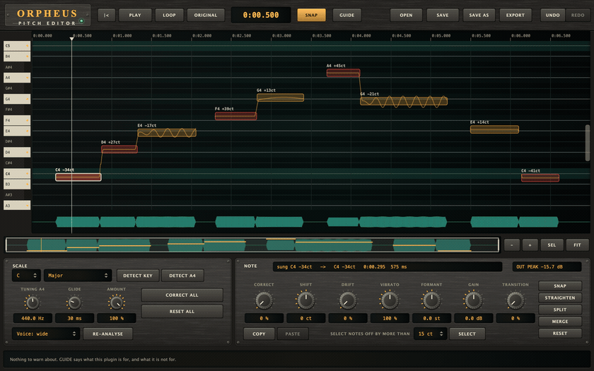
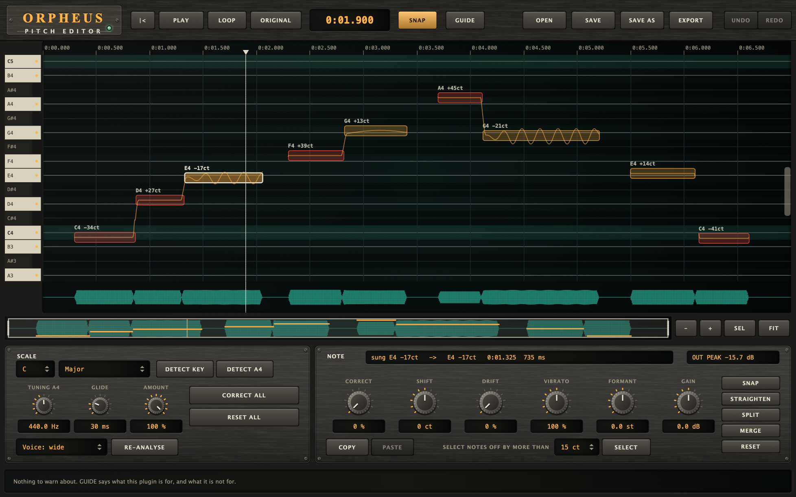
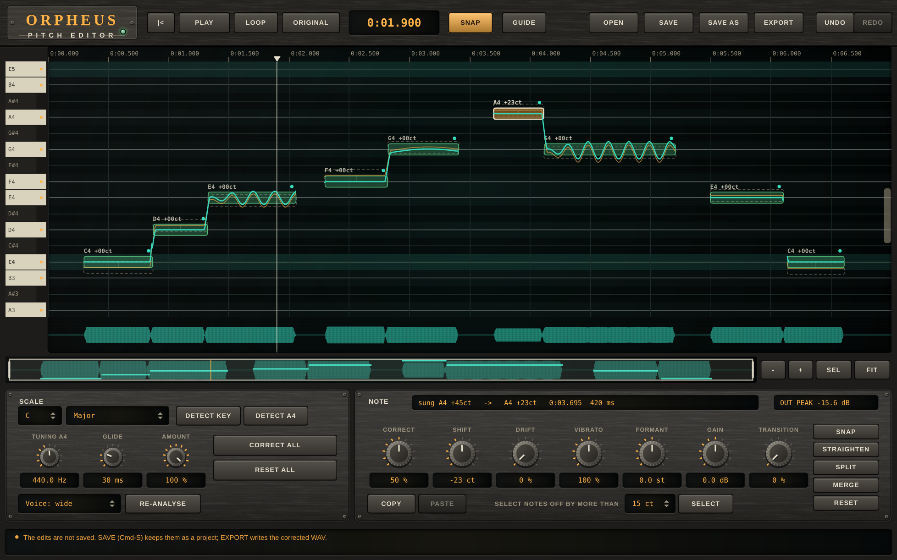

# Orpheus Pitch Editor

An offline pitch editor for solo vocals with Viterbi pitch tracking, piano-roll note editing, and transparent PSOLA resynthesis.

**Format:** Standalone app (macOS · Linux CI; offline 24-bit WAV export)



*Headless render of the pitch roll, sung/corrected pitch traces, scale panel, and per-note PSOLA controls.*

## Theme

**Name origin:** *Orpheus* is the singer of Greek myth, whose voice moved stones and rivers; here it is the voice that gets moved onto the note. (CMake targets and namespaces use the short name `Orpheus`. It is an app, not a plugin: it lives in `apps/`, not `plugins/`.)

### Core philosophy

- **Precision you can read.** Every pitch is a number you can see and type: the name of the note and its distance in cents ("A3 +12ct") on every blob, under the pointer, and while you drag. The notes that are out of tune say so by their colour, so you see what is wrong before you hear it. The pitch that comes out is, by construction, the pitch that was planned (see [Signal flow](#signal-flow)), and the tests measure it.
- **Easy by default.** The first thing it does with a recording is find the notes and guess the key. One button (**Correct all**) is a complete first pass; **Amount** says how far. Everything after that is a drag, a double-click or a number.
- **Your voice stays your voice.** Grains of the original are re-spaced, not resampled, so the vowel colour stays where it was, and consonants and breaths are never touched. A note you did not edit is **bit-for-bit the original**, so editing one word cannot harm the rest of the take.
- **Non-destructive.** The audio is never changed; an edit is a list of numbers per note. Undo keeps the last 200 steps, a project file keeps the edit, and **ORIGINAL** plays the untouched recording at the same position at any moment.
- **One voice at a time.** It is built for a clean solo vocal (or any monophonic line: a bass, a horn) and says so. Chords and backing-vocal stacks are not what it is for.
- **Analog look, digital brain.** Studio-hardware interface drawn entirely from code by the shared kit ([shared/ui](../../shared/ui)); no image, font or sound files ship.
- **Free, public, source only.** The repository holds the code, not a download, under the AGPL-3.0-or-later (see [NOTICE](../../NOTICE.md)).

## See it

| View | Preview | What to look at |
|---|---|---|
| **Detected Notes** |  | Nine C-major notes colour-coded by cent offset, `5 ms` amber pitch line, vibrato, and note knobs. |
| **After Correct All** |  | Teal snapped notes, dashed original ghosts, `50%` / `−23 ct` selected note, unsaved foot strip. |

### UI colour legend

| Swatch | Hex | UI Element | Meaning |
|---|---|---|---|
| 🩵 | `#37E3C5` | Corrected note blobs & pitch trace | Snapped/edited notes and resulting target pitch curve (`colours::accent`) |
| 🟡 | `#FFB347` | Sung pitch trace (`5 ms`), numeric LCDs, lit switches | Detected input pitch contour, readouts, and active controls (`colours::amber`) |
| 🟢 | `#5FD68C` | In-tune note blobs | Within `8 cents` of the chosen scale (`colours::good`) |
| 🟠 | `#F2A33A` | Slightly off-pitch blobs & foot warning strip | `8–25 cents` from scale; amber notes for `ORIGINAL`, unsaved edits, or `> 5 st` shifts (`colours::warn`) |
| 🔴 | `#EF4A3D` | Out-of-tune blobs & `OUT PEAK` overload | `> 25 cents` from scale; `OUT PEAK` red when output exceeds `0 dB` (`colours::bad`) |
| ⚪ | `#EAE3D0` | Faceplate labels, cent readouts, selected outline | Engraved silkscreen text, `"A3 +12ct"` labels, and active note outline (`colours::text`) |

## Try it

### Quick launch

```bash
./scripts/open.sh orpheus
./scripts/open.sh orpheus path/to/vocals.wav
```

| Workflow | Action / Setting | What you see / hear / measure |
|---|---|---|
| **First pass** | Open audio (`~1 s/min` analysis), click **Detect key** (+ **Detect A4**), click **Correct all** | Pulls every note toward scale by **Amount** (live until hand edit/key change); `Tab` flips `ORIGINAL` seamlessly. |
| **Fine-tune notes** | Drag blob (`Shift` `< 1 ct/px`, `Alt` toggles `SNAP`), or type `-23` / `+2st` in `Shift`; tweak `Drift`, `Vibrato` (`0–200%`), `Transition` (`40 ms`) | Rebuilds only touched stretches (`4 ms` crossfade, loudness matched); unedited notes stay bit-for-bit original. |
| **Fix cuts / octave jumps** | Pick **Voice** (`wide 65–1100`, `low 65–400`, `mid 100–700`, `high 200–1100 Hz`) + **Re-analyse**, or `S` (Split) / `M` (Merge) | Narrow range blocks octave jumps; notes `< 100 ms` show an info hint in the foot strip. |
| **Copy, save & export** | `Cmd+C` / `Cmd+V` (relative shift + knobs), check `OUT PEAK`, `Cmd+S` (`.orpheus`), `Cmd+E` (**Export**) | `.orpheus` saves relative audio path + `4096`-sample fingerprint; Export writes atomic 24-bit WAV at source rate. |

> [!TIP]
> **Fast shortcuts:** `Tab` toggles `ORIGINAL` live; hold `Shift` for tenth-speed drag (`< 1 cent/px`) or `Alt` to invert `SNAP`; click any knob readout to type `-23`, `+2st`, or `150`.

> [!NOTE]
> **Bit-for-bit untouched audio:** PSOLA re-spaces grains rather than resampling so vowel formants stay intact (unless **Formant** is turned), and unedited notes/breaths/sibilants copy verbatim.

> [!IMPORTANT]
> **Solo monophonic sources only:** Built strictly for one voice (or monophonic bass/horn), never chords or backing stacks; `.orpheus` projects refuse audio with a mismatched fingerprint.

> [!WARNING]
> **Large shifts & unverified listening:** Shifts past `5–7` semitones colour timbre (clamped at `24 st`; resynthesis refuses `> 4` octaves); `TRANSITION` (`40 ms`) is a design recipe and no real singer blind test has run.

> [!CAUTION]
> **Watch `OUT PEAK` before exporting:** Positive `Gain` (up to `+12 dB`) or re-spaced PSOLA grains can exceed `0 dB` (red `OUT PEAK` + foot strip warning), clipping a 24-bit WAV export.

## Reference

### Controls & shortcuts

| Panel / Mode | Controls | Purpose / Range |
|---|---|---|
| **Scale & Global** | `Key` (12) · `Scale` (major/minor/harmonic/melodic/modes/pentatonics/blues/Chromatic) · `Detect key` · `Tuning A4` / `Detect A4` · `Amount` · `Correct all` · `Glide` · `Voice` / `Re-analyse` | Scale grid (`Scales.h`), weighted key detection, A4 reference check (`kTuningStrengthNeeded`), global correction, note-to-note slide, tracker pitch band. |
| **Selected Note** | `Correct` (`0–100%`) · `Shift` (`±12 st` knob, `±24 st` drag/keys) · `Drift` · `Vibrato` (`0–200%`) · `Formant` · `Gain` (`≤ +12 dB`) · `Transition` (`0–100%`, `40 ms` onset blend) | Per-note edits (`NoteModel.h`); `mixed` displays when multi-selected notes differ; `Copy / Paste`, `Select` (`> 5/10/15/25/50 ct`), `Sel (Z)`. |
| **Transport & File** | `Play` (`Space`) · `Loop` (`L`) · `ORIGINAL` (`Tab`) · `Navigator` (`-`, `+`, `FIT`) · `Piano keys` · `Open` (last `8` in `recent.txt`) · `Save` / `Save as` · `Export` · `OUT PEAK` · `GUIDE` | Gapless playback, audition tones, `200`-step undo, star dirty title (`Session::dirty()`), atomic 24-bit WAV export. |

- **Keys & mouse:** `Left`/`Right` step notes; `Up`/`Down` move `1 st` (`Shift` `10 ct`, `Alt` `1 ct`); `Enter` snap; `Backspace` reset note; `S`/`M` split/merge; `F`/`Z` fit/zoom selection; `Cmd+A/Z/Shift+Z/O/S/Shift+S/E/C/V`; Wheel scrolls time (`Shift` pitch, `Cmd/Ctrl` zoom time, `Alt` zoom pitch).

### Signal flow

```
Audio (16 kHz YIN + full-file Viterbi + full-rate refine, PitchAnalysis.h)
  └─► [Double 125 ms smooth + exact DP piecewise-constant cut, Segmenter.h]
        └─► [Plan per 5 ms frame: centre + drift + vibrato + Glide + 40 ms Transition, Plan.h]
              └─► [PSOLA only on active stretches + matchLoudness + applyGain; untouched = bit-exact copy, Psola.h]
```

### Measured

Measured by `Tests/Tests.cpp` and `Tests/UiCheck.cpp` on a synthetic two-formant harmonic singer:

| Test case | Measured result |
|---|---|
| Steady tones (`41–81 MIDI`, `44.1 / 48 / 96 kHz`) | `100%` voiced; worst error **`0.01 cent`** |
| Vibrato (`±60 ct` @ `5.8 Hz`) · Breath noise (`−12 dB`) · White noise/silence | **`1.2 ct` rms** (0 octave errors) · `100%` voiced (`≤ 8 ct`) · `0%` voiced |
| Phrase (vibrato, drift, glide, short note) · `±100 ct` vibrato | All found; centres `≤ 0.7 ct`; legato `≤ 15 ms`; `±100 ct` stays 1 note |
| Shifts `−7` to `+7 st` · 5 notes (`12–41 ct`) snapped to C major | **`1.1 ct` rms** (`3.7 ct` worst) · snapped within **`0.12 cent`** |
| Level (`≤ 5 st`) · Vowel centroid (`+4 st`) · Formant (`+4 st`) | **`≤ 0.05 dB`** · **`0.1%`** shift (vs `26%` resampling) · centroid `+15%`, pitch **`0.00 ct`** |
| Vibrato `0% / 200%` · Drift `100%` · Bit-exactness · Undo · 24-bit WAV | Range `88 → 19 / 156 ct`; wander `19 → 4 ct`; unedited/partial = bit-exact; WAV `≤ 1e-6` |
| `TRANSITION` `0%` (`841` frames) · `60 ms` slide (`100%` vs `0%`) · Centres | `0%` bit-identical (test `10a`); `100%` start **`0.0000 ct`** (`0.0002 ct` worst) vs `52.4 ct`; centres **`0.0000 ct`** |
| Speed (`20 s` audio) · Hand-tried macOS synth voices (`+3 / −4 st`) | Track `0.26 s`, marks `0.10 s`, full render `0.04 s` · Singing/cello `1–3 ct` median; speech `~3 ct` median |

### Limits

- **Monophonic only:** One note at a time; no chords, stacked backing vocals, or choruses.
- **Pitch and loudness, not time:** Notes cannot move or stretch in time; no per-note envelope beyond `Gain`.
- **Standalone app:** No DAW plugin or host integration — export a 24-bit WAV and import back.
- **Unvoiced audio & shift cap:** Sibilants/breaths copy untouched; shifts clamp to `±24 st` (`Shift` knob `±12 st`; resynthesis refuses `> 4` octaves); beyond `5–7 st` timbre changes.
- **TRANSITION (`40 ms`) is a design recipe:** Smoothstep acts on the first `40 ms` (reaching target at `35 ms`) of note starts only, not ends; unverified by ear.
- **Segmentation & macOS listening:** Notes `< 100 ms` or phrase fall-offs can merge into neighbours (`S` splits); CI runs on Linux ([orpheus.yml](../../.github/workflows/orpheus.yml)) and real-singer audio has not been blind-tested.

## Build & develop

Requires CMake, Xcode (clang + macOS SDK), and `ffmpeg` (for `showcase.sh`). JUCE is fetched via [cmake/Juce.cmake](../../cmake/Juce.cmake) (or place checkout in `third_party/JUCE`). See [CLAUDE.md](CLAUDE.md).

```bash
./scripts/open.sh orpheus                 # build if needed and launch
./scripts/open.sh orpheus take.wav        # launch with recording
scripts/build.sh orpheus                  # OrpheusTests and OrpheusUiCheck
scripts/build.sh orpheus snap             # docs/screenshot.png and docs/corrected.png
scripts/showcase.sh orpheus               # regenerate docs/showcase.gif
scripts/build.sh orpheus app              # Orpheus.app
```

Plain CMake (from `apps/orpheus`, setting `SDKROOT` if Command Line Tools' SDK is picked first):

```bash
export SDKROOT=$(xcrun --sdk macosx --show-sdk-path)
cmake -S . -B build -DCMAKE_BUILD_TYPE=Release
cmake --build build --target Orpheus -j 10 && open build/Orpheus_artefacts/Release/Orpheus.app
cmake --build build --target OrpheusTests -j 10 && ./build/OrpheusTests_artefacts/Release/OrpheusTests
cmake --build build --target OrpheusUiCheck -j 10 && ./build/OrpheusUiCheck_artefacts/Release/OrpheusUiCheck
cmake --build build --target OrpheusSnapshot -j 10
./build/OrpheusSnapshot_artefacts/Release/OrpheusSnapshot docs/screenshot.png select=3
./build/OrpheusSnapshot_artefacts/Release/OrpheusSnapshot docs/corrected.png corrected select=6
```

## Licence

AGPL-3.0-or-later, source only. See [LICENSE](../../LICENSE), [NOTICE.md](../../NOTICE.md), [CONTRIBUTING.md](../../CONTRIBUTING.md), and [SECURITY.md](../../SECURITY.md).
