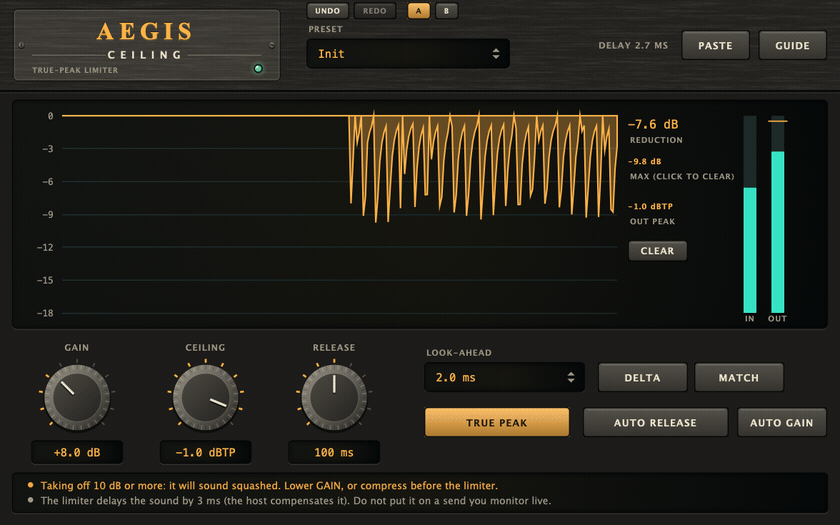
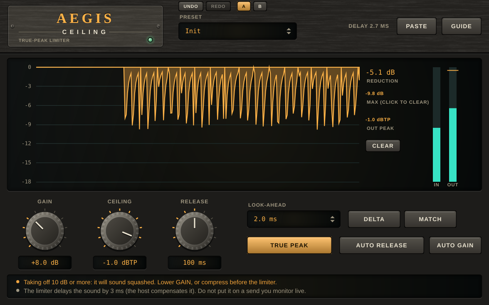

# Aegis Ceiling

True-peak look-ahead limiter for mastering: raises loudness and holds every sample and inter-sample peak under the ceiling without stereo shift.

`VST3 + AU + Standalone`



*Live editor over a beat-driven programme: amber reduction trace over 9 s (`-18` to `0 dB`), IN/OUT bars in teal, and latched MAX / OUT PEAK readouts.*

## Theme

**Name origin:** The *aegis* is the shield of Zeus and Athena: what the blow cannot get through. (CMake targets, namespaces and plugin codes use the short name "Aegis".)

**Core philosophy:**
- **True-peak ceiling first, transparent stereo always.** Reads 7 points between every two samples (8x, 64-tap windowed sinc) with look-ahead and one stereo-linked gain so peaks never sneak through and the image never shifts.
- **Bit-exact when idle, guarded against bad input.** Audio below the ceiling passes delayed bit for bit, NaN and infinity become silence, and a final sample clamp backs up the gain math.
- **Limiter, not compressor or loudness meter.** Reduction of `6 dB` or more sounds squashed and **Release** under `40 ms` distorts bass; compress upstream and meter BS.1770 loudness in [Themis](../themis/README.md) after it.
- **Analog look, digital brain.** Studio-hardware interface drawn entirely from code by the shared kit ([shared/ui](../../shared/ui)); no image, font or sound files ship.
- **Free, public, source only.** The repository holds the code, not a download, under the AGPL-3.0-or-later (see [NOTICE](../../NOTICE.md)).

## See it

| View | Capture | What to look at |
|---|---|---|
| **Main Editor** |  | Gain `+8 dB`, `-1.0 dBTP` ceiling: amber reduction hits `-9.8 dB` MAX; strip warns squashed. |

**UI colour legend** — exact hex values from [`Hardware.h`](../../shared/ui/include/pantheon/ui/Hardware.h) (`AegisUi.h` sets `-18 dB` reduction depth and `-36 dBFS` bar floor):

| Swatch | Hex | UI Element | Meaning |
|---|---|---|---|
| 🟡 | `#FFB347` | Reduction trace, `REDUCTION` / `MAX` / `OUT PEAK` read-outs, ceiling mark on `OUT` bar, lit switches (`TRUE PEAK`, `A / B`, `UNDO`), glass border | Active gain reduction (hanging from top over last 9 s), digital read-outs, ceiling threshold marker, and engaged controls |
| 🔵 | `#37E3C5` | `IN` and `OUT` level bars | Live input and output peak levels (floor `-36 dBFS`) when below `0 dBFS` / ceiling |
| 🔴 | `#EF4A3D` | `OUT PEAK` read-out & `OUT` / `IN` bar clipping | `OUT PEAK` exceeded the ceiling (held until **CLEAR** or ceiling/true-peak change), or `IN` level exceeded `0 dBFS` |
| 🟠 | `#F2A33A` | Warning notes in bottom advice strip | Actionable warnings: `TRUE PEAK` off, `DELTA` or `MATCH` left on, ceiling above `-0.3 dBTP`, or `>= 6 dB` reduction |
| ⚪ | `#EAE3D0` | Silkscreen labels & primary text | Control titles and bright text |
| 🔘 | `#9F9680` | Secondary labels, inactive switches, info notes | Graticule labels, latency read-out, `CLEAR` / unlit buttons, and informational strip notes |

## Try it

| Recipe / Setting | What you see / hear / measure |
|---|---|
| `CEILING -1.0 dBTP`, `LOOK-AHEAD 2.0 ms`, `TRUE PEAK On`, press **AUTO GAIN** (4 s loudest section) | Sets **Gain** once (one undo step) so the loudest part takes ~`3 dB` off (`+8.00 dB` on `-6 dBFS` sine at `-1` ceiling). |
| Toggle **MATCH** on during loudness pushes | Output attenuates to input RMS (~`1 s` window, never up) so raising **Gain** does not win A/B by being louder. |
| Toggle **DELTA** on while limiting | Hears `(sound after Gain) - output` latency-aligned; if you hear music instead of transients, back off **Gain**. |
| `TRUE PEAK Off` vs `On` on `fs/4` `+4.1 dBFS` off-sample tone | With it off, samples hold at `-1 dBFS` while true peak hits `+2.0 dBTP`; with it on, output stays at `-1.000 dBTP`. |
| Copy ceiling/loudness item in [Themis](../themis/README.md), click **PASTE** | Sets **Ceiling**, forces **True Peak** on, and shifts **Gain** by Themis' measured change (clamped `0..+24 dB`) as one undo step. |

> [!TIP]
> **Quick-start sweet spot:** Leave **TRUE PEAK** on, set **CEILING** to `-1.0 dBTP`, **LOOK-AHEAD** to `2.0 ms`, and press **AUTO GAIN** over 4 s of the loudest section for ~`2–4 dB` reduction.

> [!NOTE]
> **Look-ahead & latency:** **LOOK-AHEAD** (`0.5`, `1`, `2`, `5 ms`) plus the 32-sample true-peak detector equals **56, 80, 128, or 272 samples** of host-compensated delay at 48 kHz; changing it while playing restarts the limiter.

> [!IMPORTANT]
> **Fair A/B and listening checks:** Use **MATCH** (turns down only, ceiling holds) and **DELTA** to judge limiting cleanly without loudness bias.

> [!WARNING]
> **Before you bounce:** **DELTA** and **MATCH** are saved with the session (presets switch them off); turn both off and keep **TRUE PEAK** on before exporting.

> [!CAUTION]
> **What Aegis is NOT for:** Taking off `>= 6 dB` sounds squashed and **RELEASE** `< 40 ms` distorts bass; compress upstream and put [Themis](../themis/README.md) after Aegis for LUFS.

## Reference

### Controls

| Control | Range / Default | What it does |
|---|---|---|
| **Gain** | `0` to `+24 dB` / `0.0 dB` | Input gain before the detector and ceiling; reduction equals what is needed to keep output under **Ceiling**. |
| **Ceiling** | `-12` to `0 dBTP` / `-1.0 dBTP` | Maximum output peak (`dBTP` with **True Peak** on; `dBFS` when off). |
| **Release** | `10 ms` to `1.00 s` / `100 ms` | Exponential recovery time (63% back toward unity) after a peak passes. |
| **Look-ahead** | `0.5`, `1.0`, `2.0`, `5.0 ms` / `2.0 ms` | How far ahead gain drops before a peak lands (`56`–`272` samples total latency at 48 kHz). |
| **True Peak** | `On` / `Off` (`On`) | Enables 8x (64-tap windowed-sinc) inter-sample peak detection; off reads sample peaks only. |
| **Auto Release** | `On` / `Off` (`Off`) | Short peaks release at `1/5` of **Release** (`>= 2 ms`); sustained reductions (`~4.4 dB` mean over `150 ms`) release at full **Release**. |
| **Auto Gain** | One-shot button | Listens for 4 s and sets **Gain** once (one undo step) so the loudest part takes ~`3 dB` off at **Ceiling**; leaves **Gain** untouched on silence. |
| **Delta** | `On` / `Off` (`Off`) | Outputs `(sound after Gain) - output`, latency-aligned, to audition removed peaks. |
| **Match** | `On` / `Off` (`Off`) | Attenuates output to match input RMS (~1 s window) without ever exceeding the ceiling. |
| **Paste** | Button | Reads a `limiter` hand-off from [Themis](../themis/README.md): sets **Ceiling**, enables **True Peak**, and shifts **Gain** by measured change. |
| **Undo / Redo & A/B** | Header (`Cmd+Z` / `Shift+Cmd+Z`) | Parameter undo/redo (presets, Auto Gain, Paste included) and dual-slot A/B comparison (excludes **Delta** and **Match**; active slot only saved). |
| **Presets** | 6 presets (`Init`) | *Init*, *Streaming Master*, *Loud Master*, *Gentle Peak Catch*, *Broadcast Safe*, *Tracking Safety* (music presets enable **Auto Release**; **Delta** & **Match** off). |
| **Clear / Max** | Display buttons | **CLEAR** resets **OUT PEAK** and **MAX** (also on Ceiling/True Peak change); click **MAX** to clear max reduction alone. |

### Signal Flow

```text
input ─► Gain ─┬─► 8x True-Peak Detector (64-tap sinc, 32-sample delay) ─► ceiling / peak ─► Monotonic Queue Hold (look-ahead + 1)
               │                                                                                    │
               │                                                                                    ▼
               └─► Delay Line (look-ahead + 32 samples) ────────────────────────► × Gain ◄── Release + 2x Running-Mean Smooth
                                                                                     │
                                                                                     ▼
                                                                          Final Sample Clamp ─► Delta / Match ─► output
```

- **Stereo-linked detection:** Louder channel sets `ceiling / peak` (`1` below ceiling) across `look-ahead + 1` held samples, then two running means (~half look-ahead each) round the drop without re-creating inter-sample overs.
- **Output metering:** **OUT PEAK** reads after the final clamp and before **Delta** / **Match** using the same 8x `TruePeakReader`.

### Measured (`AegisTests`, 48 kHz)

- **Ceiling accuracy:** Over 2 s programme (band-limited noise bursts, bass note, full-scale clicks) driven `+12 dB` at `-0.3`, `-1`, `-6 dB` ceilings and `0.5`, `2`, `5 ms` look-ahead: sample peak within `0.001 dB`, independent 8x 64-pt Hann-sinc check within `0.02 dB`, final clamp never acts.
- **Inter-sample (`fs/4`, 45 deg off-sample, `+4.1 dBFS`):** Every sample is `0.707` of true peak; **True Peak** on holds `-1.000 dBTP`, off holds `-1 dBFS` while true peak reaches `+2.0 dBTP`.
- **Nyquist-band noise (`+12 dB` drive, `-1 dB` ceiling):** True peak reads `-0.99 dBTP` (a 32-tap reader missed by `0.7 dB`, motivating 64 taps).
- **Bit-exact & block-invariant:** Below ceiling equals delayed input bit for bit; identical bit-for-bit across block sizes `1`, `7`, `64`, `333`, `512`, `4096`.
- **Auto Gain (`1 kHz` sine at `-6 dBFS`):** Sets `+8.00 dB` at `-1 dB` ceiling (`3.00 dB` cut) and `+3.00 dB` at `-6 dB` (`3.00 dB` cut); caps at `+24 dB` on quiet passages; silence leaves **Gain** untouched.
- **Step & Release:** Full-scale step lands at `-6.00 dB` (for `-6 dB` ceiling) on exact sample; at `200 ms` Release, gain deficit is `0.37` (`1/e`) at `200 ms`.
- **Auto Release (`400 ms` Release, `25 ms` burst `+6 dB`):** `250 ms` later, deficit is `0.064` with Auto vs `0.268` without; after `1 s` sustained burst, `0.264` vs `0.268`.
- **OUT PEAK (`-1 dB` ceiling):** Reads `-1.000 dB` vs `-0.998 dB` on independent 8x Hann-sinc check (`True Peak` on), and `-1.000` / `-1.000` (`True Peak` off).
- **Delta & Match:** `delta + output` equals post-Gain audio at `128` samples (max diff `6e-8`); unlimited Delta is silent. On `7 dB`-limited programme: input `-20.78 dB` RMS, limited `-13.37 dB`, matched `-20.74 dB`; plain `+9 dB` Gain matches within `0.01 dB`; both off = bit-identical.
- **Bypass, latency & safety:** Host bypass delays by exact latency (impulse at sample `10` lands at `138` for `128` samples); reported latencies are `56`, `80`, `128`, `272` samples for `0.5`, `1`, `2`, `5 ms`. Stereo ratio preserved (`0.1000` in -> `0.1000` out); NaN/inf -> silence.

### Limits

- **Limits, does not compress:** Reduction `>= 6 dB` sounds squashed; **Release** `< 40 ms` distorts bass.
- **8x true-peak margin:** Doubles ITU-R BS.1770 4x oversampling, yet external DACs/codecs can vary by a few hundredths of a dB—hence `-1 dBTP` default.
- **Latency & switching:** Delays audio by `look-ahead + 32` samples (host-compensated); changing **Look-ahead** during playback restarts the limiter.
- **Auto Gain:** Divides out active **Gain** over the 4 s listen—leave **Gain** untouched while listening.
- **Listening aids & session state:** **Delta** and **Match** persist in sessions (presets switch off); **Match** uses plain RMS, not BS.1770 LUFS. A/B slot contents and undo history are not saved (active slot only saved; first switch to B copies loaded state).
- **No loudness meter or clipper:** Put [Themis](../themis/README.md) after Aegis for LUFS and COPY/PASTE (shares `pdsp::TruePeakReader` so true peaks match **OUT PEAK**).
- **Platform verification:** Builds on macOS (VST3 + AU, manually verified 2026-11-13) and passes `auval -v`; not in macOS CI yet and has no `HostCheck`.

## Build & develop

Requires CMake 3.22+ and a C++20 compiler (JUCE fetched via [cmake/Juce.cmake](../../cmake/Juce.cmake)).

```bash
# Fast build & check from repository root (Ninja + ccache if installed)
./scripts/build.sh aegis            # build & run AegisTests + AegisUiCheck
./scripts/build.sh aegis all        # tests, ui, snap, vst3, au, app
./scripts/showcase.sh aegis         # regenerate docs/showcase.gif (requires ffmpeg)
```

Manual CMake from `plugins/aegis/` (add `-DAEGIS_INSTALL_AFTER_BUILD=ON` on macOS to install):

```bash
cmake -S . -B build -DCMAKE_BUILD_TYPE=Release
cmake --build build --target Aegis_VST3 Aegis_AU Aegis_Standalone -j 10
cmake --build build --target AegisTests && ./build/AegisTests_artefacts/Release/AegisTests
cmake --build build --target AegisUiCheck && ./build/AegisUiCheck_artefacts/Release/AegisUiCheck
cmake --build build --target AegisSnapshot && ./build/AegisSnapshot_artefacts/Release/AegisSnapshot docs/screenshot.png
```

`docs/screenshot.png` and `docs/showcase.gif` are generated by `AegisSnapshot` / `scripts/showcase.sh` (never edited by hand). See [CLAUDE.md](CLAUDE.md) for invariants.

## Licence

AGPL-3.0-or-later, source only. See [LICENSE](../../LICENSE), [NOTICE.md](../../NOTICE.md) (third-party software, trademarks, the source-only policy), [CONTRIBUTING.md](../../CONTRIBUTING.md) and [SECURITY.md](../../SECURITY.md).
