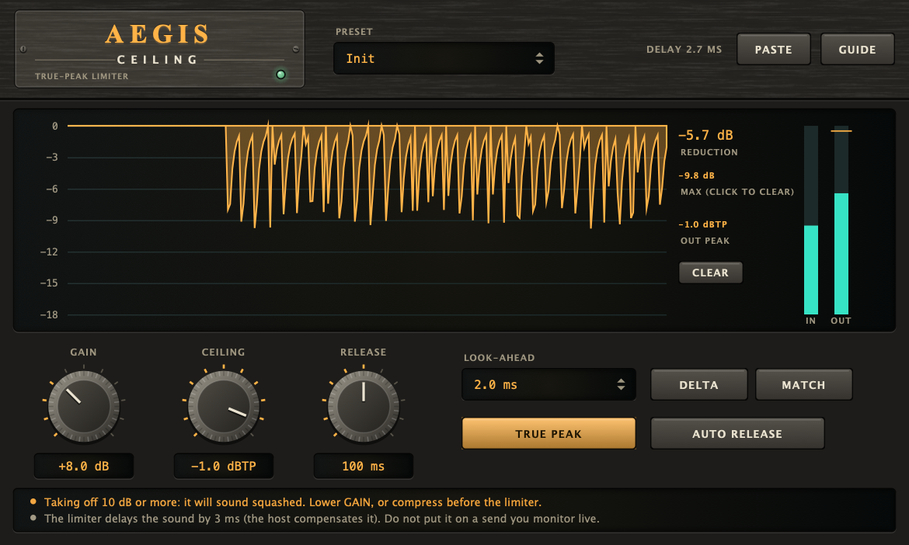

# Aegis Ceiling

A **true-peak limiter** (VST3 + AU + Standalone) for the last stage of a master: it raises the level and keeps every peak, **the peaks between the samples
included**, under a ceiling, so a converter or a lossy codec after it cannot go over. It looks ahead and turns the sound down before a peak arrives
(no click), and both channels share one gain, so the stereo image does not move.

## Name origin

The *aegis* is the shield of Zeus and Athena: what the blow cannot get through. (CMake targets, namespaces and plugin codes use the short name "Aegis".)



*Headless render of the editor (the hardware-style interface shared with the other plugins). A loud programme with a beat, GAIN +8 dB, CEILING -1.0 dBTP, RELEASE 100 ms, look-ahead 2 ms and TRUE PEAK on. The amber trace is the reduction over the last seconds (-5.1 dB now, down to about -10 dB on the peaks); OUT PEAK reads -1.0 dBTP, held until CLEAR, MAX REDUCTION -9.8 dB; the IN and OUT bars are on the right. The strip under the controls warns that taking off 10 dB or more will sound squashed and says what the look-ahead costs in delay. Regenerate with the command under "Development".*

## What it does

| | |
|---|---|
| **Gain** | 0 to +24 dB, 0 by default: how much the sound is raised before the ceiling. The reduction is what it takes to keep it under. |
| **Ceiling** | -12 to 0 dBTP, -1 by default: the most the output reaches. With TRUE PEAK off it is in dBFS. |
| **Release** | 10 ms to 1 s, 100 ms by default: how long the gain takes to come back 63% of the way after a peak. |
| **Look-ahead** | 0.5, 1, 2 (default) or 5 ms: how long before a peak the gain starts going down. Longer is smoother; it is also the delay. |
| **Auto release** | Off by default (the gain always comes back at RELEASE). On: a short peak is let go sooner (a fifth of RELEASE, never under 2 ms), a reduction that has lasted about 4 dB for 150 ms or so is let go at RELEASE, which is then the slow end. Smoother on music with transients; the ceiling does not depend on it. |
| **True peak** | On by default: the detector reads 7 points between every two samples (8x) with a 64-tap windowed sinc. Off: only the samples. |
| **Presets** | Six starting points (Init, Streaming Master, Loud Master, Gentle Peak Catch, Broadcast Safe, Tracking Safety; the first three of the music ones have AUTO RELEASE on). A preset sets every control, GAIN included; what it does not list goes back to its default. Set GAIN by ear afterwards. |
| **Delta** | Off by default. Listen to what the limiter takes away: the sound after GAIN minus the output, aligned by the latency (the delta plus the output is the delayed sound). If you hear the music and not only the peaks, the limiter is working too hard. Presets switch it off. |
| **Match** | Off by default. Turns the output down to the loudness of the input (the RMS of both channels over about a second), so raising GAIN does not win an A/B only by being louder. It only turns down, so the ceiling holds; with the input quieter than the limited output it does nothing more than take GAIN back. Presets switch it off. |
| **Paste** | **PASTE** takes the limiter setting that [Themis](../themis/README.md) copied from its master plan (COPY on the ceiling or the loudness item): it sets CEILING (and switches TRUE PEAK on, because a ceiling in dBTP needs it) and moves GAIN by the amount Themis measured, stopping at the ends of GAIN's range and saying so. Anything else on the clipboard changes nothing. |

The display is the reduction of the last nine seconds (hanging from the top, in dB), the number now, the input level, and **OUT PEAK**: the highest true peak that has left (read the way the detector reads, a bar beside IN with a mark at the ceiling), held until **CLEAR** or until CEILING or TRUE PEAK changes, red if it is ever over the ceiling. **MAX** under the reduction number is the most the limiter has taken off since then; click it to clear it alone. OUT PEAK reads the limiter's output before DELTA and MATCH.

## How it works

1. **Detect.** The input, after GAIN, goes through the true-peak reader (a 64-tap, 8x interpolator, one for each channel); the larger of the two channels'
   peaks gives the gain each moment needs: `ceiling / peak` when the peak is over, else 1. One gain for both channels.
2. **Hold.** The smallest of the needs of the last `look-ahead + 1` samples (a monotonic queue, a few comparisons a sample) is kept, so the gain is already
   down when the peak arrives, and stays down until it has passed.
3. **Release.** The held gain falls at once and comes back exponentially, at RELEASE (never above the held value).
4. **Smooth.** Two running means, each over about half the look-ahead, spread every fall over the look-ahead with a rounded shape. A mean never exceeds the
   smallest value it covers, so the ceiling holds; the rounded shape is what keeps the gain from making new peaks between the samples.
5. **Apply** to the sound, which has waited for look-ahead + the reader's delay (32 samples) in a delay line. A final clamp on the samples is the end of the
   line (a counter says if it ever acted: in the tests it never does).

## Measured (`AegisTests`, 48 kHz)

- The ceiling: over 2 s of a programme (band-limited noise in bursts, a bass note and lone full-scale clicks) driven 12 dB, with the ceiling at -0.3, -1 and -6 dB
  and each look-ahead of 0.5, 2 and 5 ms: the sample peak is at the ceiling to 0.001 dB, the true peak (measured with a different reader: 8x, a 64-point Hann sinc)
  is within 0.02 dB of it, and the final clamp never acts.
- A tone at a quarter of the sample rate, 45 degrees off the samples (every sample reads 0.707 of the true peak), at +4.1 dBFS: with TRUE PEAK on the output is at -1.000 dBTP; with it
  off the samples are held to -1 dBFS and the tone's true peak is +2.0 dBTP.
- White noise up to Nyquist driven 12 dB (the worst case for any interpolator): true peak -0.99 dBTP with the ceiling at -1 (a 32-tap reader missed by 0.7 dB; this is why it has 64).
- With nothing to limit the output is the input, delayed, bit for bit. The same output for blocks of 1, 7, 64, 333, 512 and 4096 samples, bit for bit.
- A step to full scale arrives at the ceiling (-6.00 dB for a ceiling of -6) at the sample it is heard, with the gain having come down over the look-ahead.
- AUTO RELEASE (RELEASE 400 ms, a burst of 25 ms at 6 dB over the ceiling): 250 ms later the deficit of the gain is 0.064 with AUTO against 0.268 without; after 1 s of the same burst it is 0.264 against 0.268 (it releases at RELEASE). The ceiling test above also runs with AUTO on.
- OUT PEAK against an independent reading of the output (8x, a 64-point Hann sinc): -1.000 and -0.998 dB with the ceiling at -1 (TRUE PEAK on); -1.000 and -1.000 with it off.
- RELEASE 200 ms: 200 ms after a burst the deficit of the gain is 0.37 of what it was (1/e).
- DELTA plus the output equals the sound after GAIN, aligned by the 128 samples of latency (largest difference 6e-8); DELTA of a sound that is not limited is silent. MATCH on a programme limited by 7 dB: the input reads -20.78 dB RMS, the limited output -13.37 dB, matched -20.74 dB; a plain +9 dB of GAIN with nothing to limit is taken back to within 0.01 dB. With both off the output is bit for bit what it was before they existed.
- Bypassed by the host, the sound is delayed by the reported latency (an impulse at sample 10 is heard at 138 with 128 samples of latency), so the track does not jump against the rest of the mix.
- Latency, as reported to the host: 56, 80, 128 and 272 samples for 0.5, 1, 2 and 5 ms (look-ahead + 32), an impulse is heard exactly that late.
- A loud left and a quiet right keep their ratio (0.1000 in, 0.1000 out). NaN and infinity in the input are silence.

## Limits

- **It limits; it does not compress.** More than about 6 dB of reduction sounds squashed, and a RELEASE under about 40 ms follows the bass and distorts it. Compress before it.
- **The true peak is read at 8x.** That is the standard's 4x with a margin; a converter or a codec that reconstructs differently can still differ by a few hundredths of a dB. -1 dBTP is the usual ceiling for that reason.
- **It delays the sound** by the look-ahead + 32 samples (the host compensates it); changing LOOK-AHEAD while playing restarts the limiter.
- **DELTA and MATCH are for listening** and are saved with the session; presets switch them off, and notes remind you to do so before a bounce. MATCH is a plain RMS, not a BS.1770 loudness (Hermes and Themis measure that).
- It does not measure loudness and does not clip. Loudness is Themis' job: put Themis after it, read its plan, COPY the ceiling or loudness item and PASTE it here. Themis' true peak is a 4x reading, so it reads the same or a little under what OUT PEAK reads.
- It builds on macOS (VST3 and AU, run by hand on 2026-11-13) and `auval -v` passes for the AU; it is not in a macOS CI job, and it has no `HostCheck` (see "Not yet in line" in the repository's [CLAUDE.md](../../CLAUDE.md)).

## Building

Requires CMake 3.22 or newer and a C++20 compiler. JUCE is fetched by CMake (see [cmake/Juce.cmake](../../cmake/Juce.cmake)).

```bash
cmake -S . -B build -DCMAKE_BUILD_TYPE=Release
cmake --build build --target Aegis_VST3 Aegis_AU Aegis_Standalone -j 10
```

Building does **not** install the plugins; add `-DAEGIS_INSTALL_AFTER_BUILD=ON` for that (macOS).

## Development

```bash
cmake --build build --target AegisTests && ./build/AegisTests_artefacts/Release/AegisTests            # DSP: no plugin, no GUI
cmake --build build --target AegisUiCheck && ./build/AegisUiCheck_artefacts/Release/AegisUiCheck      # the editor on the real processor
cmake --build build --target AegisSnapshot && ./build/AegisSnapshot_artefacts/Release/AegisSnapshot docs/screenshot.png
```

`docs/screenshot.png` is the output of `AegisSnapshot` (arguments in the file's header), never edited by hand. See
[CLAUDE.md](CLAUDE.md) for the rules that keep the plugin correct.

## Licence

AGPL-3.0-or-later, source only. See [LICENSE](../../LICENSE), [NOTICE.md](../../NOTICE.md) (third-party software, trademarks,
the source-only policy), [CONTRIBUTING.md](../../CONTRIBUTING.md) and [SECURITY.md](../../SECURITY.md).
