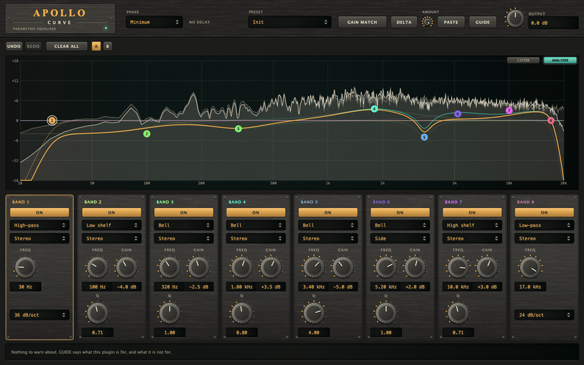
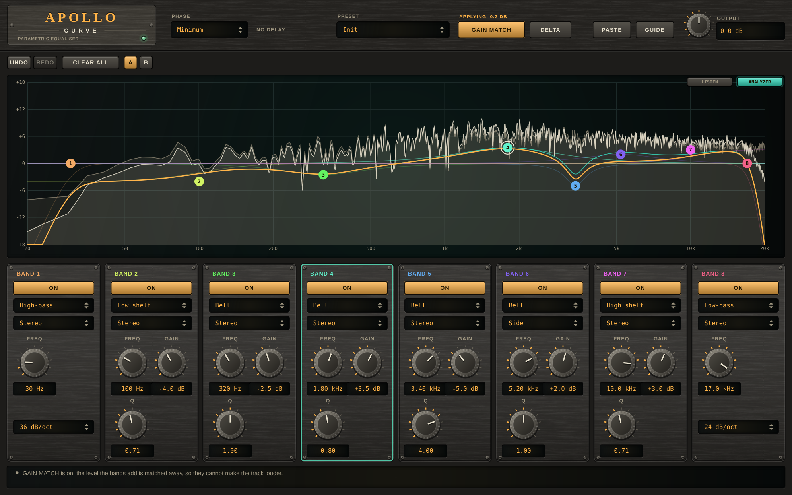
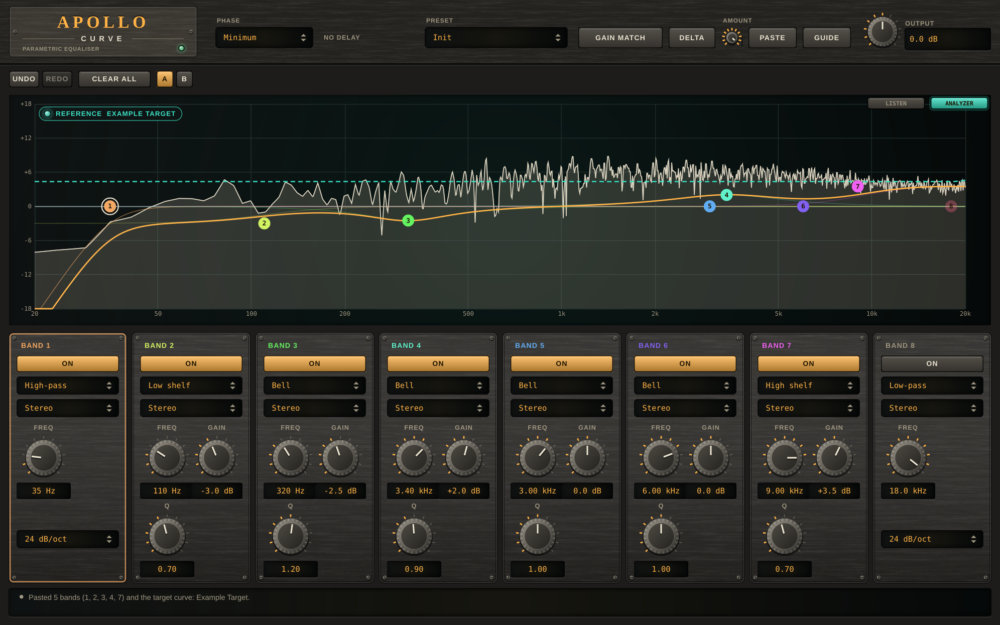
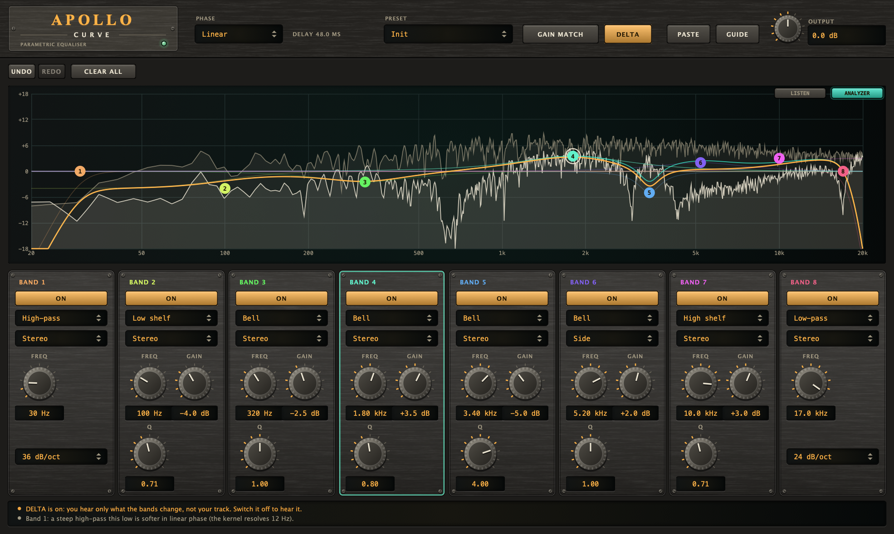

# Apollo Curve

Eight-band parametric equaliser for mixing and mastering with Minimum or Linear phase, Stereo/Mid/Side routing, pre/post analyser, Gain Match, Delta, and Themis paste.

`VST3 + AU + Standalone`



*Live editor on the `-18` to `+18 dB` glass: dragging nodes updates the amber composite curve, per-band responses, and pre/post spectrum traces.*

## Theme

**Name origin:** *Apollo* is the god of music, proportion, and measure; *Curve* is the frequency response shape sculpted by its eight parametric bands. (CMake targets, namespaces, and plugin codes use the short name "Apollo".)

**Core philosophy:**
- **Proportion in phase and tone.** Eight bands switch between zero-latency **Minimum** phase and zero-phase-shift **Linear** phase, routing Stereo, Mid, or Side via difference addition so untouched audio stays untouched.
- **Bit-exact idle, click-free bypasses.** Bands off or under `0.005 dB` exit the chain bit-exact (even under FMA), disabled bands fade out before removal, and NaN/inf inputs become silence.
- **Static EQ with honest limits.** Performs no dynamic modulation (use [Iris Prism](../iris/README.md) for dynamic/match EQ); Linear phase resolves ~`12 Hz` (`48.0 ms` delay, softer below `60 Hz`) and narrow high-Q Minimum boosts ring.

## See it

| View | Capture | What to look at |
|---|---|---|
| **Main Editor** |  | Gain Match active, cream post-EQ and dim pre-EQ traces, and teal Side bell. |
| **Paste from Themis** |  | PASTE fills free bands and draws the dashed teal Themis reference curve behind the analyser. |
| **Linear Phase + Delta** |  | Linear phase (`48.0 ms` delay) with DELTA on: bright trace shows only output minus input. |

**UI colour legend** — see [root UI colour legend](../../README.md#ui-colour-legend-hardwareh) for shared `Hardware.h` hex codes (`ApolloUi.h` assigns each band HSV hue `fromHSV(fmod(0.08 + 0.125 * band, 1), 0.6, 0.95)`):

| Swatch | Hex | UI Element | Meaning |
|---|---|---|---|
| 🟡 | `#FFB347` | Composite Stereo/Mid EQ curve, `GAIN MATCH` gain readout, lit `LISTEN` / `DELTA` / `A / B` / `UNDO` buttons | Combined filter magnitude actually running on Stereo/Mid; active monitoring & loudness compensation |
| 🔵 | `#37E3C5` | Side EQ curve, dashed Themis reference curve, `ANALYZER` button & `TARGET` pill | Side-channel filter response (shown when any band targets Mid/Side), pasted Themis target shape, and analyser toggle |
| ⚪ | `#EAE3D0` | Selected node outer ring, post-EQ analyser trace | Currently selected band (`#1–8`) and live spectrum *after* the EQ |
| 🔘 | `#9F9680` | Pre-EQ analyser trace, disabled band labels | Live spectrum *before* the EQ and bypassed band strips |
| 🟠 | `#F2A33A` | Warning notes in bottom advice strip | Active `DELTA` or `LISTEN` monitor warning, single-band boosts `>= 9 dB`, or overlapping octave boosts `>= 12 dB` |

## Try it

| Recipe / Gesture | What you see / hear / measure |
|---|---|
| Double-click empty glass / drag node / wheel over node / `Delete` | Enables first free band there / sweeps **Freq** & **Gain** / adjusts **Q** / disables selected band (`CLEAR ALL` bypasses all in one undo step). |
| Copy EQ in [Themis](../themis/README.md), set **AMOUNT** (`50%` or `100%`), click **PASTE** | Places bands in free slots scaled by **Amount** (`-4 dB` bell -> `-2.00 dB` at `50%`), draws dashed teal reference curve (right-click glass to clear). |
| Toggle **GAIN MATCH** while boosting (`+9 dB` shelf on noise) | Settles in ~`0.6 s` (`±12 dB` cap), returning level to `+0.03 dB` (Min) / `+0.02 dB` (Linear) so loudness does not fool your ear. |
| Switch **Phase** to `Linear`, engage **DELTA** | Header displays `Delay 48.0 ms` (`2304` samples at 48 kHz); bright trace and audio output only `output - input` aligned by latency. |
| Click **LISTEN** (`+6 dB` `1 kHz` bell selected) | Solos selected band through a bandpass (`1 kHz` `+6.00 dB`, `100 Hz` / `10 kHz` ~`26 dB` down); follows selection and exits when window closes. |

> [!TIP]
> **Glass workflow:** Drag nodes for **Freq/Gain**, scroll wheel for **Q**, double-click empty glass to add a band, or double-click a node to toggle **On/Off**.

> [!NOTE]
> **Minimum vs Linear phase:** **Minimum** has `0` latency down to `20 Hz`; **Linear** removes phase shift (`2304` samples / `48.0 ms` at 48 kHz) and resolves at ~`12 Hz`, softening curves below `60 Hz`.

> [!IMPORTANT]
> **Themis hand-offs:** **PASTE** scales pasted bell/shelf gains by **AMOUNT** (`0–100%`) without altering cuts, the dashed reference curve, or bands already in use.

> [!WARNING]
> **Monitor checks:** **GAIN MATCH** equalises unweighted RMS over ~`0.6 s` (`±12 dB`); **DELTA** and **LISTEN** replace main output while open (not saved, turn off when the window closes).

> [!CAUTION]
> **What Apollo is NOT for:** Apollo is static—use [Iris Prism](../iris/README.md) for dynamic or live match-EQ, and avoid narrow `Q >= 6` boosts in Minimum phase (cut or use Linear phase instead).

## Reference

### Controls

| Control | Range / Default | What it does |
|---|---|---|
| **Band On** (`1–8`) | `On` / `Off` (`1, 8` Off; `2–7` On at `0 dB`) | Enables/bypasses the band cleanly (fades out before removing from signal path). |
| **Type** | `Bell`, `Low shelf`, `High shelf`, `High-pass`, `Low-pass`, `Notch` | Defaults: B1 `High-pass`, B2 `Low shelf`, B3–6 `Bell`, B7 `High shelf`, B8 `Low-pass`. |
| **Freq** | `20 Hz` to `20 kHz` (skewed `1 kHz`) | Band centre/corner (`30`, `100`, `250`, `1k`, `3k`, `6k`, `10k`, `18k Hz`). |
| **Gain** | `-18.0` to `+18.0 dB` / `0.0 dB` | Boost/cut for Bell and Shelf types (bands within `0.005 dB` of `0` are skipped bit-exact). |
| **Q** | `0.10` to `10.00` (`0.707` shelves/passes, `1.0` bells) | Width of bells/notches or shelf transition slope. |
| **Slope** | `12`, `24`, `36`, `48 dB/oct` (`24` on HP/LP) | Butterworth cascade order (`-3 dB` at corner) for High-pass and Low-pass. |
| **Channels** | `Stereo`, `Mid`, `Side` / `Stereo` | Routes band to full stereo, Mid `(L+R)/2` only, or Side `(L-R)/2` only. |
| **Phase** | `Minimum`, `Linear` / `Minimum` | Minimum-phase biquads (`0` latency) or 4096-pt linear-phase overlap-save FIR (`48.0 ms` at 48 kHz). |
| **Output** | `-24.0` to `+24.0 dB` / `0.0 dB` | Post-EQ and post-Gain-Match output trim. |
| **Gain Match** | `On` / `Off` (`Off`) | Matches post-EQ RMS to input RMS (~`0.6 s` window, `±12 dB` max) with live readout. |
| **Paste / Amount** | `0` to `100 %` / `100 %` | **PASTE** imports Themis bands into free slots + target curve; **Amount** scales pasted bell/shelf gains (not cuts or curve). |
| **Clear All / Undo / Redo / A/B** | Header row (`Cmd+Z` / `Shift+Cmd+Z`) | Bypass all bands in one undo step; undo/redo any edit; dual A/B comparison (keeps Output, Phase, Gain Match, Paste Amount). |
| **Delta / Listen / Analyzer** | Header / Glass buttons | **DELTA**: output minus input; **LISTEN**: bandpass-solo selected band; **ANALYZER**: toggle 8192-pt pre/post FFT (`4.5 dB/oct` tilt, `90 dB` range). |
| **Presets** | 9 presets (`Init`) | *Init*, *Low Cut*, *Vocal Presence*, *Mud Cut*, *Air Lift*, *Bass Weight*, *Master Smile*, *Sides Open Top*, *Telephone* (keeps Phase, Output, Gain Match, Paste Amount). |

### Signal Flow

```text
                  ┌─► Minimum Phase: double-precision RBJ / Butterworth cascade (M/S adds diff back; 0-dB bands skipped)
input ─► Phase ───┤
                  └─► Linear Phase:  4096-pt mag grid -> symmetric 3585-tap Hann IR -> FFT overlap-save (hop 512, 2304-samp delay)
                         │
                         ▼
               Gain Match (0.6 s RMS, ±12 dB) ─► Output Trim ─► Delta / Listen ─► output
```

- **64-sample tick & fades:** Log-freq, gain, and Q smooth over `20 ms` every `64` samples; disabled HP/LP/notch bands fade `mix` before removal.
- **Reference curve alignment:** Themis' `curve` (`0 dB` mean over `200 Hz–5 kHz`) anchors to input analyser level so you compare tilt, not loudness.

### Measured (`ApolloTests`, 48 kHz)

- **Filter precision:** Bell `+9 dB`, bell `-12 dB` (`Q 3`), low shelf `+6`, high shelf `-6`, `24 dB/oct` HP, `48 dB/oct` LP, and notch match `responseDb` across 7 frequencies to `0.000 dB` (`+9.00 dB` at `1 kHz` / `< 0.5 dB` at `100 Hz` for `1 kHz` bell; `-3 dB` at `100 Hz` / ~`-24 dB` at `50 Hz` for `24 dB/oct` HP).
- **Bit-exact idle & block invariance:** Eight `0 dB` bells give bit-identical input (Min) or exact `2304`-sample delay (Linear); bit-identical across block sizes `1`, `7`, `64`, `333`, `512`, `4096` in both modes.
- **Linear phase:** Matches Min magnitude within `0.007 dB` (`100 Hz–12 kHz`, 4 bands); `24 dB/oct` HP at `40 Hz` + shelf is `0.59 dB` off at `50 Hz` (~`12 Hz` resolution); impulse symmetric to `1e-5`. Latency: `2304` samples (`48.0 ms` at 48 kHz = `1792` kernel + `512` hop; `48.0–52.2 ms` across other rates).
- **Mid / Side:** Mid `+9 dB` bell lifts centre `+9.00 dB`, touches side-only `<= 0.1 dB` (and reverse for Side); Stereo bell lifts left-only `+9 dB` in both modes.
- **Click-free bypass fades:** Switching off `+12 dB` bell mid-`1 kHz` tone gives max step `0.1297` vs `0.1299` steady-state (`+0.001 dB` residual). Off notch / `48 dB` HP / `48 dB` LP gives max step `0.0327` (Min) and `<= 0.05` (Linear, vs `0.25` unsmoothed); notch on exact FFT bin (`3000 Hz`) produces no NaN.
- **Listen, Bypass, Safety:** **LISTEN** on `+6 dB` `1 kHz` bell passes `1 kHz` at `+6.00 dB`, `100 Hz` / `10 kHz` ~`26 dB` down (`7` and `512` blocks match); host bypass in Linear delays impulse by `2304` samples (`ApolloUiCheck`). NaN/inf -> silence; Output `+6 dB` = `+6.00 dB`.
- **Gain Match:** `+9 dB` low shelf at `4 kHz` on noise (`+3.01 dB` raw) settles in `5 s` to `+0.03 dB` (Min) / `+0.02 dB` (Linear) with readout `-3.00 dB`. `18 dB` cut recovers to `-5.96 dB` (Min) / `-5.95 dB` (Linear) hitting `12 dB` cap; Output `+6 dB` adds on top (`+6.03 dB`). Bit-identical across `1`, `7`, `333`, `4096`, `512` blocks.
- **Delta & Paste Amount:** Delta on `+9 dB` bell leaves `+5.19 dB` (`20 log10(10^(9/20) - 1)`); idle Delta max sample is `0`. `ApolloUiCheck` pins `-4 dB` pasted bell lands at `-4.00 dB` (`100%`), `-2.00 dB` (`50%`), `0.00 dB` (`0%`) while preserving existing bands.

### Limits

- **Linear-phase low-end resolution (~12 Hz):** Bands or steep high-passes below ~`60 Hz` roll off softer than drawn; use Minimum phase there.
- **Linear-phase latency & pre-ringing:** Adds ~`48 ms` delay (host-compensated); switching Phase while playing restarts EQ (clicks); sharp linear boosts show natural pre-ringing.
- **Minimum-phase ringing:** Narrow strong bells ring in Minimum phase—cut instead of boosting, or use Linear phase.
- **Gain Match is RMS-based:** Slow unweighted full-band RMS (~`0.6 s`, `±12 dB` cap) tracks sections rather than notes; verify by ear and **DELTA**.
- **PASTE is not live match-EQ:** Imports Themis' bands and static reference curve rather than matching live audio (use [Iris Prism](../iris/README.md) for live match/dynamic EQ); L/R-only Iris bands and Hephaestus fill bands are skipped.
- **Static EQ & visual analyser:** No dynamics; `8192`-pt FFT (`90 dB` scale, `4.5 dB/oct` tilt) is visual only (tilt shifts levels) and runs only while open (`ANALYZER` toggles it, saved in session).
- **Platform verification:** See [CI & platform status](../../CLAUDE.md#not-yet-in-line).

## Build & develop

See [root Build & develop](../../README.md#build--develop) for shared prerequisites and image-generation rules, and [CLAUDE.md](CLAUDE.md) for invariants.

```bash
# Fast build & check from repository root
./scripts/build.sh apollo           # build & run ApolloTests + ApolloUiCheck
./scripts/build.sh apollo all       # tests, ui, snap, vst3, au, app
./scripts/showcase.sh apollo        # regenerate docs/showcase.gif
```

Manual CMake from `plugins/apollo/` (add `-DAPOLLO_INSTALL_AFTER_BUILD=ON` on macOS to install):

```bash
cmake -S . -B build -DCMAKE_BUILD_TYPE=Release
cmake --build build --target Apollo_VST3 Apollo_AU Apollo_Standalone -j 10
cmake --build build --target ApolloTests && ./build/ApolloTests_artefacts/Release/ApolloTests
cmake --build build --target ApolloUiCheck && ./build/ApolloUiCheck_artefacts/Release/ApolloUiCheck
cmake --build build --target ApolloSnapshot && ./build/ApolloSnapshot_artefacts/Release/ApolloSnapshot docs/screenshot.png match select=4
./build/ApolloSnapshot_artefacts/Release/ApolloSnapshot docs/themis.png themis select=2
./build/ApolloSnapshot_artefacts/Release/ApolloSnapshot docs/delta.png delta linear select=4
```

## Licence

AGPL-3.0-or-later, source only — see [root Licence](../../README.md#licence) and [NOTICE](../../NOTICE.md).
