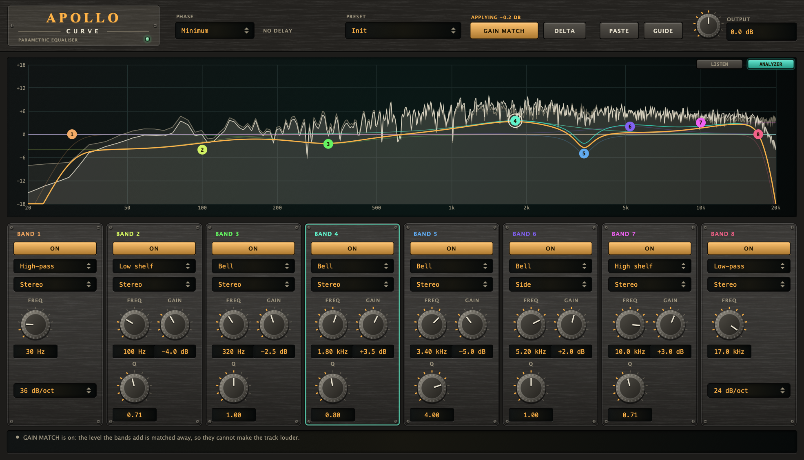
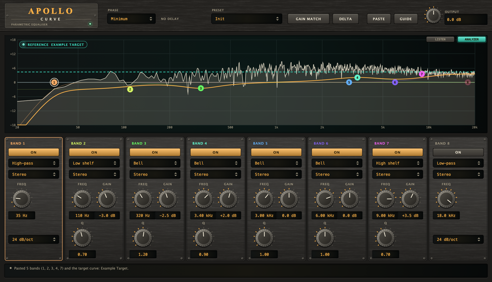
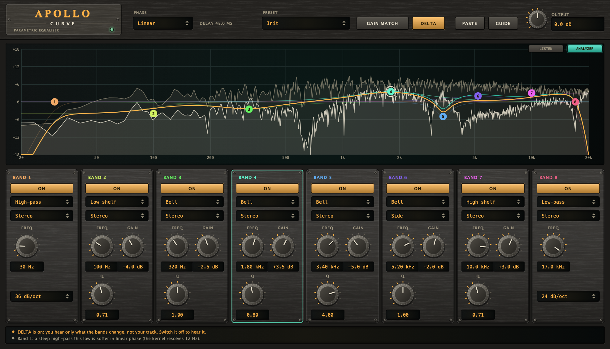

# Apollo Curve

A **parametric equaliser** (VST3 + AU + Standalone) for mixing and mastering: eight bands, each a bell, a low or high shelf, a notch, or a high or low-pass of 12 to
48 dB per octave, each working on the whole sound, only the middle, or only the sides; and a choice between the usual **minimum-phase** equaliser and a
**linear-phase** one that shifts no phase at all. You drag the bands on a display of the curve, **GAIN MATCH** and **DELTA** let you judge what you did without being fooled
by loudness, and **PASTE** takes the bands and the target curve that [Themis](../themis) copies from a master.

## Name origin

*Apollo* is the god of music and of harmony: of things in proportion. (CMake targets, namespaces and plugin codes use the short name "Apollo".)



*Headless render of the editor (the hardware-style interface shared with the other plugins) over a programme of a low note with its harmonics on noise that
falls with frequency. Band 1 is a 36 dB/oct high-pass, band 2 a low shelf of -4 dB, band 4 (selected, ringed) a bell of +3.5 dB at 1.8 kHz, band 5 a narrow dip at 3.4 kHz
and band 6 a bell on the **Side** only, whose response is the teal curve; the amber curve is the response of the settings, and the cream and dim traces are the analyser after
and before the bands. **GAIN MATCH** is on and says what it is applying in the header (a fraction of a dB here: the cuts and the boosts nearly cancel). **LISTEN** (off) and ANALYZER are the two buttons in the display's corner. Regenerate with the commands
under "Development".*



*What PASTE does with Themis' **Copy EQ**: a low cut, a low shelf, two bells and a high shelf went into the free bands (1, 2, 3, 4 and 7, the first one selected), and the
target curve that came with them is the dashed teal line behind the analyser, drawn at the level of this track (a flat line here, because the example target falls at
the same 4.5 dB per octave as the analyser's tilt). The strip under the bands says what was pasted for eight seconds. The target here is made up by the snapshot, in the format
Themis writes (see [BandLink.h](../../shared/dsp/include/pantheon/dsp/BandLink.h)); it is not one of Themis' own.*



*The same bands in **Linear** phase with **DELTA** on: the analyser's bright trace is only what the bands change (output minus input), the header says
"Delay 48.0 ms" and the strip warns that you are not hearing your track. The input is delayed by the same 2304 samples, so the difference is exact.*

## What it does

| | |
|---|---|
| **Bands** | Eight. A new instance opens with a high-pass and a low-pass at the ends (off), two shelves and four bells, all at 0 dB, so dragging a node does something at once. |
| **Type** | Bell (raises or cuts around a frequency), Low shelf, High shelf, High-pass, Low-pass, Notch. |
| **Freq / Gain / Q** | 20 Hz to 20 kHz; -18 to +18 dB (bells and shelves); Q 0.1 to 10 (the width of a bell or notch, the turn of a shelf). |
| **Slope** | For a high-pass or low-pass: 12, 24, 36 or 48 dB per octave (Butterworth; -3 dB at the corner). |
| **Channels** | Stereo (left and right alike), Mid (only what both channels share) or Side (only what differs between them). |
| **Phase** | Minimum (no delay) or Linear (no phase shift; about 48 ms of delay, and a softer low end). |
| **Output** | -24 to +24 dB after every band (and after GAIN MATCH). |
| **Gain Match** | Takes the level the bands add or take away off again, slowly (about 0.6 s), by at most 12 dB either way, so a boost that is merely louder is not mistaken for better. Off by default; while it is on, the gain it applies is read out above its button. Kept by presets. |
| **Delta** | Plays only what the bands change (output minus input). Not saved, not automatable, off when the window closes. In linear phase the input is delayed like the output, so it is exact. |
| **Listen** | **LISTEN** (a button in the corner of the display, beside ANALYZER) plays the selected band's region alone: the sound after the bands through a band-pass at that band's frequency and width, and it follows the selected band. Not saved, not automatable, off when the window closes. |
| **Paste** | **PASTE** (header) takes what Themis copied: **COPY** on a master-plan item or **Copy EQ**. Each band goes into a free band (one that does nothing) with its type, frequency, gain, Q, slope and channels (Mid or Side stays Mid or Side; a low cut is a high-pass); a harmonic-fill band (Hephaestus') and a band on the left or right alone (Iris') are left out, and the strip says so. The target curve of Copy EQ becomes a dashed **reference** behind the analyser, at the level of this track; right-click the display to clear it. Kept with the session. |
| **Presets** | Nine starting points (Init, Low Cut, Vocal Presence, Mud Cut, Air Lift, Bass Weight, Master Smile, Sides Open Top, Telephone). A preset sets the bands it needs; the others go back to 0 dB. PHASE, OUTPUT and GAIN MATCH are kept. |

On the display, drag a node sideways for the frequency and up and down for the gain; the wheel over a node changes the Q; a double click on a node switches the band
on or off, and a double click on empty glass adds a bell there in the first free band. The amber curve is the response of the settings; a teal one appears when a band works on the sides only (it is the sides' response). The curve is the
filter that runs, not a drawing of it.

## How it works

1. **Minimum phase.** Each band is a biquad (an RBJ design) or a Butterworth cascade, in double precision, run in order. A Mid or Side band transforms the sound to
   mid and side, filters one of them, and adds the *difference* back, so what it does not touch is not touched at all.
2. **Smoothing.** Everything that changes with time steps every 64 samples, counted from the start: the frequency (in the log domain), the gain and the Q of each band
   are moved toward the knob by a one-pole of 20 ms, and the coefficients are redesigned (the states stay). A band switched off or taken to 0 dB fades first, then
   is no longer run: a bell or shelf fades its gain, a high-pass, low-pass or notch (which has none) fades its mix with the plain input (in linear phase, the kernel's magnitude to that power).
3. **A band that does nothing is not run.** Off, or a bell or shelf under 0.005 dB: it is not in the chain, so the sound is the input bit for bit even in a build that fuses
   multiplies and adds (a bell "at 0 dB" is the identity only on paper).
4. **Linear phase.** The magnitude of all the bands that reach the mid (and, separately, the side) is sampled on a grid of 4096 points (at 48 kHz; the frame scales with the
   sample rate so the resolution is the same 12 Hz), made into a real, symmetric impulse response with an inverse FFT, windowed (Hann, 3585 taps) and run by FFT overlap-save
   with a hop of 512. Left and right are run as mid and side, so a Stereo band, which is in both, treats the channels alike. The kernel is remade at most once a hop.
   With no band running the sound is only delayed, exactly (the same delay, an integer delay line), so the idle plug-in is bit-exact in this mode too.

5. **Gain match.** Every sample's energy, in and out of the bands (the input delayed like the output in linear phase), is averaged with a time constant of 0.6 s; the gain that makes them equal, within +-12 dB, is
   followed with 0.15 s and stepped on the same 64-sample tick as everything else (so it is the same for any block size). With GAIN MATCH off the gain is exactly 1.
6. **Reference.** Themis' target curve is a shape with no level of its own (0 dB is its mean from 200 Hz to 5 kHz). It is drawn at the level this track has there, from the analyser's reading of what goes in
   (without the display's tilt, which is added back), so what you compare is the shape of the spectrum and not how loud it is.

## Measured (`ApolloTests`, 48 kHz)

- The bands: for each of a bell +9 dB, a bell -12 dB (Q 3), a low shelf +6, a high shelf -6, a 24 dB/oct high-pass, a 48 dB/oct low-pass and a notch, a tone's gain at seven frequencies is the
  response `responseDb` draws, to 0.000 dB. A +9 dB bell at 1 kHz is +9.00 dB there and under 0.5 dB at 100 Hz; a 24 dB/oct high-pass at 100 Hz is -3 dB at its corner and about -24 dB an octave below.
- Eight bells at 0 dB: the input, bit for bit (minimum phase), and the input delayed by 2304 samples, bit for bit (linear phase).
- Linear phase: the same magnitude as minimum phase within 0.007 dB from 100 Hz to 12 kHz for four bands in use; at 50 Hz, with a 24 dB/oct high-pass at 40 Hz and a shelf in it, 0.59 dB off (the kernel
  resolves about 12 Hz). An impulse comes out symmetric around its centre to 1e-5: no phase shift. Latency, as reported to the host: 2304 samples (48.0 ms at 48 kHz: 1792 for the kernel and 512 for the hop), and 48.0 to 52.2 ms at the other rates.
- Mid and Side: a Mid bell of +9 dB lifts a centred sound by 9.00 dB and leaves a side-only sound within 0.1 dB; a Side bell the reverse; a Stereo bell lifts a left-only sound by 9 dB too, in both phase modes.
- The same output for blocks of 1, 7, 64, 333, 512 and 4096 samples, bit for bit, in both phase modes.
- A +12 dB bell switched off while a 1 kHz tone plays: the largest sample-to-sample step is 0.1297 against 0.1299 for the steady tone, so there is no click; afterwards the tone is back at its level (+0.001 dB).
- A notch, a 48 dB high-pass and a 48 dB low-pass switched off while a tone plays fade as well: the largest step is that of the steady tone in minimum phase (0.0327) and 0.05 at most in linear phase (the kernel is remade once a hop), where a cut would be 0.25. A notch exactly on a bin of the linear-phase grid (3000 Hz at 48 kHz) is a notch, not NaN.
- LISTEN to a +6 dB bell at 1 kHz: a tone at 1 kHz comes through at +6.00 dB, 100 Hz and 10 kHz about 26 dB down; with it off the sound is as it was; the same output for blocks of 7 and 512 samples. Bypassed by the host in linear phase, an impulse comes out exactly the reported 2304 samples late (`ApolloUiCheck`).
- NaN and infinity in the input are silence. OUTPUT +6 dB with every band off is +6.00 dB.
- Gain Match: a +9 dB low shelf at 4 kHz on noise is 3.01 dB louder; with GAIN MATCH on it is +0.03 dB (minimum phase) and +0.02 dB (linear) after 5 s, the readout saying -3.00 dB. A tone cut by 18 dB comes out
  -5.96 dB (minimum) and -5.95 dB (linear): the match made up 12 dB and no more. OUTPUT +6 dB on top of the match is +6.03 dB. With it on, blocks of 1, 7, 333 and 4096 samples give the output of 512, bit for bit, in both phase modes.
- Delta: a +9 dB bell on a tone at its own frequency leaves +5.19 dB (the wanted 20 log10 (10^(9/20) - 1)), in both phase modes; with no band on it is silence, exactly (largest sample 0).

## Limits

- **Linear phase resolves about 12 Hz** (4096 points at 48 kHz). A band below about 60 Hz, or a steep high-pass there, is softer than the curve shows. Use minimum phase down there.
- **Linear phase delays the sound** by about 48 ms (the host compensates it); switching phase mode while playing restarts the equaliser (it clicks). It also has a little pre-ringing before a sharp boost: that is what linear phase is.
- **A narrow, strong bell rings in minimum phase.** That is the filter, not a fault; cut instead of boosting, or use linear phase.
- **Gain Match is slow and is not a loudness meter.** It equals the RMS of the whole sound (about 0.6 s to settle, so it follows a section, not a note), stops at 12 dB, and does not weigh frequencies as an ear does; it makes the
  comparison fairer, not exact. Judge by ear, and DELTA, with the same level.
- **PASTE brings what Themis measured, not a match.** It does not make bands from a reference you play (Iris' MATCH EQ does); the reference line is for you to follow with the nodes. A band on the left or right alone cannot be pasted (Apollo has Stereo, Mid and Side).
- **It is static.** It does what the curve says, always; there is no dynamics (Iris is the dynamic equaliser). The analyser behind the curve (the sound before the bands, dim, and after them, bright; 8192-point FFT, 90 dB scale, 4.5 dB per octave tilt, the same as Iris and Hephaestus) is for looking, not measuring: the tilt moves the levels, and it only runs while the editor is open. ANALYZER in the corner of the display turns it off (kept with the session).
- It builds on macOS (VST3 and AU, run by hand on 2026-11-13) and `auval -v` passes for the AU; it is not in a macOS CI job, and it has no `HostCheck` (see "Not yet in line" in the repository's [CLAUDE.md](../../CLAUDE.md)).

## Building

Requires CMake 3.22 or newer and a C++20 compiler. JUCE is fetched by CMake (see [cmake/Juce.cmake](../../cmake/Juce.cmake)).

```bash
cmake -S . -B build -DCMAKE_BUILD_TYPE=Release
cmake --build build --target Apollo_VST3 Apollo_AU Apollo_Standalone -j 10
```

Building does **not** install the plugins; add `-DAPOLLO_INSTALL_AFTER_BUILD=ON` for that (macOS).

## Development

```bash
cmake --build build --target ApolloTests && ./build/ApolloTests_artefacts/Release/ApolloTests            # DSP: no plugin, no GUI
cmake --build build --target ApolloUiCheck && ./build/ApolloUiCheck_artefacts/Release/ApolloUiCheck      # the editor on the real processor
cmake --build build --target ApolloSnapshot && ./build/ApolloSnapshot_artefacts/Release/ApolloSnapshot docs/screenshot.png match select=4
./build/ApolloSnapshot_artefacts/Release/ApolloSnapshot docs/themis.png themis select=2
./build/ApolloSnapshot_artefacts/Release/ApolloSnapshot docs/delta.png delta linear select=4
```

The images in `docs/` are the output of `ApolloSnapshot` (arguments in the file's header), never edited by hand. See
[CLAUDE.md](CLAUDE.md) for the rules that keep the plugin correct.

## Licence

AGPL-3.0-or-later, source only. See [LICENSE](../../LICENSE), [NOTICE.md](../../NOTICE.md) (third-party software, trademarks,
the source-only policy), [CONTRIBUTING.md](../../CONTRIBUTING.md) and [SECURITY.md](../../SECURITY.md).
