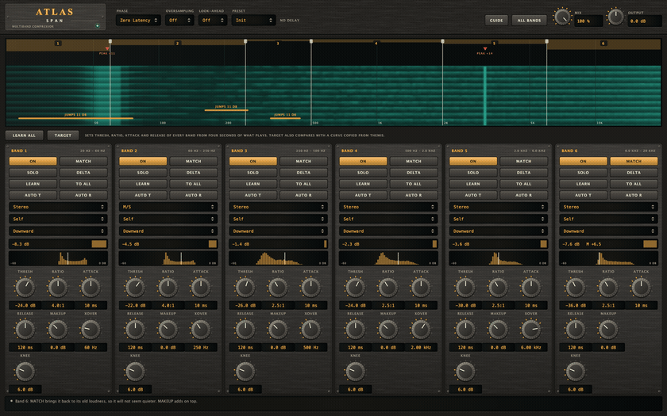
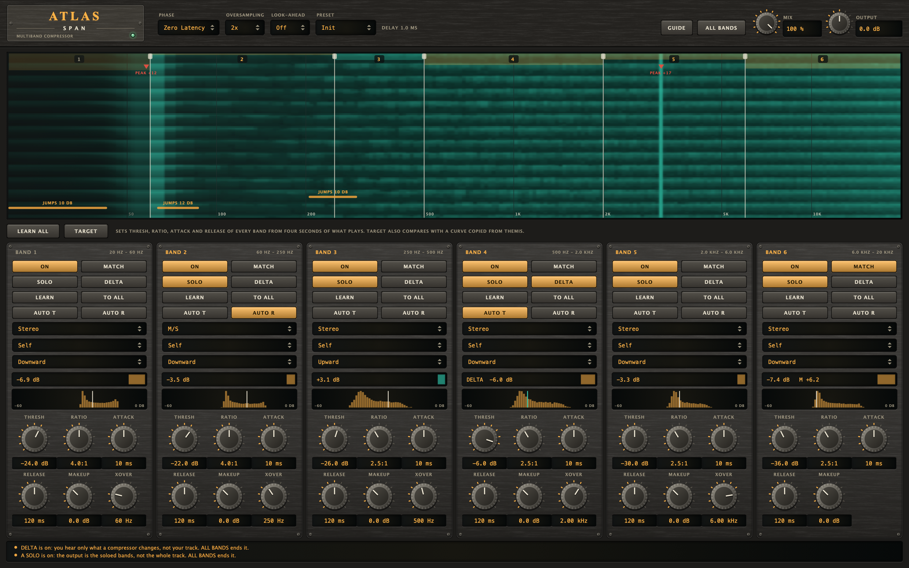

# Atlas Span

One-to-six-band dynamic processor on a live spectrogram with PEAK/JUMPS detection, upward/downward compression, Zero Latency or Linear phase, oversampling, and sidechain.

`VST3 + AU + Standalone`



*Live spectrogram scrolling downward over 6 s while amber downward reduction and teal upward lift shade each band from the top.*

## Theme

**Name origin:** *Atlas* is the Titan who carries the sky on his shoulders: he holds the weight wherever it presses. A *Span* is what he holds up, from one end to the other, here the spectrum from the sub-bass to the air. (CMake targets, namespaces and plugin codes use the short name "Atlas".)

**Core philosophy:**
- **Spectrum-driven splits, visual trouble pointers.** Starts on the six `pdsp::bands` and splits or joins 1–6 bands on a 6-second spectrogram that flags sustained **PEAK** resonances and leaping **JUMPS** regions.
- **Difference-added bands, zero-cost idle.** Compresses downward or upward per band on Stereo, L/R, M/S, or single channels; only `band × (gain - 1)` enters oversampling, so unity gain is bit-exact.
- **Dynamics band by band, not a limiter.** Look-ahead delays audio relative to the RMS detector without clipping peaks (follow with [Aegis Ceiling](../aegis/README.md)); upward mode caps at `+12 dB` and gates 30–40 dB below threshold to spare noise.

## See it

| View | Capture | What to look at |
|---|---|---|
| **Main Editor** |  | Six bands on live spectrogram: red PEAK, orange JUMPS, teal Upward band 3, amber reduction. |

**UI colour legend** — see [root UI colour legend](../../README.md#ui-colour-legend-hardwareh) for shared `Hardware.h` hex codes (`AtlasUi.h` sets `kMeterRangeDb = 24.0f`; spectrogram maps `#090D0D` -> `#37E3C5` -> `#FFB347` -> `#EAE3D0` via `Spectrogram.h`):

| Swatch | Hex | UI Element | Meaning |
|---|---|---|---|
| 🟡 | `#FFB347` | Downward reduction shade & meter bar, heard band numbers, histogram bars, active strip buttons | Downward gain reduction hanging from top of band (`0..24 dB`), band level histogram (`-60..0 dB`), and engaged switches |
| 🔵 | `#37E3C5` | Upward lift shade & `+x dB` meter readout, `AUTO T` threshold marker line, spectrogram mid-energy | Upward compression lifting quiet passages (`<= +12 dB`), dynamic threshold line when **AUTO T** is active |
| 🔴 | `#EF4A3D` | `PEAK +x` triangles on spectrogram | Narrow sustained resonance (`>= 6 dB` above `1/6–1/2 oct` neighbourhood over 3 s, up to 4 markers) — pointer only, no audio change |
| 🟠 | `#F2A33A` | `JUMPS x dB` underline bars, learning/notice text, warning notes in advice strip | Region leaping `>= 10 dB` over its 3 s average (`>= 1/4 oct`, up to 3 markers; **click to split & learn**), plus strip warnings (`>= 12 dB` cut, upward+MATCH, etc.) |
| ⚪ | `#EAE3D0` | Band divider handles/lines, fixed `THRESH` line on histogram, spectrogram peak intensity | Crossover handles (`40 Hz–16 kHz`), static threshold indicator on `-60..0 dB` histogram |
| 🔘 | `#9F9680` | Muted/un-soloed band numbers | Bands muted by another band's **SOLO** |

## Try it

| Recipe / Gesture | What you see / hear / measure |
|---|---|
| Play track, press **LEARN ALL** (8 s) | First 4 s calibrates **THRESH**, **RATIO**, **ATTACK**, **RELEASE** per band; next 4 s sets **OUTPUT** to match input loudness (`-0.028 dB` on noise). |
| Copy `curve` from [Themis](../themis/README.md), press **TARGET** | Lowers **THRESH** on over-target bands (up to `12 dB` cut) and sets **OUTPUT** to equal loudness; leaves under-target bands alone. |
| Double-click band / drag divider / double-click divider / click **JUMPS** | Splits band / moves crossover (`40 Hz–16 kHz`, min `1.2x` apart) / joins bands / creates splits around leaping region and runs **LEARN**. |
| Switch band to **Upward**, `2:1`, `-30 dB` **THRESH** | Lifts levels below threshold (teal shade & `+x dB` meter, `+5 dB` at `10 dB` under, capped `+12 dB`, gated `30–40 dB` under). |
| Enable **AUTO T** (`-6 dB`) + **AUTO R** (`200 ms`) | **AUTO T** tracks 3 s band level (`4.49 dB` cut even `20 dB` quieter); **AUTO R** recovers `0.25x` on hits (`48 ms`) vs `2.5x` on sustained (`339 ms`). |

> [!TIP]
> **1-click calibration:** Play your track and press **LEARN ALL** (8 s two-pass calibration) or paste a [Themis](../themis/README.md) `curve` (`Copy EQ`) and press **TARGET**.

> [!NOTE]
> **Spectrogram gestures:** Double-click a band to split, drag cream dividers (`40 Hz–16 kHz`, min `1.2x` ratio) to move crossovers, double-click a divider to join, or click **JUMPS** to split and learn.

> [!IMPORTANT]
> **Upward safety:** Upward mode caps at `+12 dB` and fades out `30–40 dB` below **THRESH** to spare noise; leave **MATCH** off on upward bands or it pulls the lift back down.

> [!WARNING]
> **Before bouncing & mode changes:** **SOLO** and **DELTA** are not saved; splitting/joining resets envelopes and clears solos/deltas; switching **Phase**, **OS**, or **Look-ahead** restarts bands and changes latency.

> [!CAUTION]
> **What Atlas is NOT for:** Look-ahead (`Off..10 ms`) is a compressor delay, not a limiter (follow with [Aegis Ceiling](../aegis/README.md)); upward mode lifts existing energy and cannot create missing harmonics ([Hephaestus Forge](../hephaestus/README.md)).

## Reference

### Controls

| Control | Range / Default | What it does |
|---|---|---|
| **Bands & Crossovers** | `1–6` bands / `6` (`60`, `250`, `500`, `2k`, `6k Hz`) | `pdsp::bands` starting points; crossovers `40 Hz–16 kHz` (min `1.2x` ratio apart). |
| **On / Channels** | `On` / `Stereo`, `L/R`, `M/S`, `Left`, `Right`, `Mid`, `Side` | **Stereo** links L/R; **L/R** & **M/S** run dual detectors; single-channel modes leave the opposite component untouched. |
| **Listen / Direction** | `Self` / `Sidechain`; `Downward` / `Upward` | **Sidechain** keys off the same band of external sidechain bus; **Upward** boosts below **Thresh** (`<= +12 dB`, gated `-30..-40 dB` under). |
| **Thresh / Auto T** | `-60.0` to `0.0 dB` / `0.0 dB`; **Auto T** `Off` | Level threshold (or dB *below* 3 s non-silent band average when **Auto T** is on, e.g. `-6 dB`). |
| **Ratio / Knee** | `1.0:1` to `20.0:1` / `2.0:1`; `0.0` to `24.0 dB` / `6.0 dB` | Compression slope and soft-knee width centred on **Thresh** (`0 dB` = hard knee). |
| **Attack / Release / Auto R** | `0.1–200 ms` / `10 ms`; `5–2000 ms` / `120 ms`; **Auto R** `Off` | Gain-domain envelope times; **Auto R** blends `0.25x` (transient) to `2.5x` (sustained `>= 6 dB` over `0.4 s`). |
| **Makeup / Match** | `-12.0` to `+24.0 dB` / `0.0 dB`; **Match** `Off` | Manual band trim plus automatic `0.4 s` band loudness match (`<= ±12 dB`). |
| **Learn / To All / Learn All / Target** | Action buttons | Per-band 4 s **LEARN**; **TO ALL** copies Thresh/Ratio/Attack/Release/Knee; **LEARN ALL** calibrates all bands + **Output** (8 s); **TARGET** cuts from clipboard `curve` (`<= 12 dB`). |
| **Solo / Delta / All Bands** | Per-band & footer switches | **SOLO** auditions bands (sums flat); **DELTA** outputs `band_out - band_in`; **ALL BANDS** clears all solos & deltas. |
| **Phase / Oversampling** | `Zero Latency`, `Linear` / `Off`, `2x`, `4x` | LR4 crossovers (`0` delay) or `64 ms` Linear-phase (`3072` samples at 48 kHz); oversampled difference path (`+49 / +61` samples). |
| **Look-ahead / Mix / Output** | `Off, 1, 2, 5, 10 ms`; `0–100%` (`100%`); `-24..+24 dB` (`0`) | Peak look-ahead; latency-aligned parallel **Mix**; master post-sum **Output** trim. |
| **Presets & Guide** | 10 presets (`Init`) + **GUIDE** | *Init*, *Mastering Glue*, *Tame the Low End*, *Steady Low-Mids*, *De-Harsh Upper-Mid*, *De-Ess*, *Mid/Side Control*, *Lift the Low-Mids*, *Lift the Air*, *Kick Ducks Bass* (keeps global Phase, OS, Look-ahead, Output, Mix). |

### Signal Flow

```text
input ─► Split (1–6 bands, LR4 Zero Latency or 64 ms Linear)
           │
           ▼  [per band]
     Level Detector (band or sidechain, ~1 cycle low-edge RMS) ─► Gain Computer (Down/Up, Knee) ─► Attack / Release (Auto R)
           │                                                                                               │
           └─► Delay (look-ahead) ──────────────────────────────────────────────► band + band × (gain - 1) ◄─┘ (2x/4x OS on diff)
                                                                                         │
                                                                                         ▼
                                                                   Makeup / Match ─► Solo / Delta ─► Mix (dry/wet) ─► Sum ─► Output
```

- **Difference path:** Only `band × (gain - 1)` passes through oversampling—at unity gain, oversampling is an exact integer delay.
- **Crossover overlap:** Bands cross at `-6.06 dB`; a `1 kHz` tone sits `-1.08 dB` in Midrange and shares energy with neighbours (`-14.2 dB` in Midrange yields `-10.8 dB` total drop).

### Measured (`AtlasTests`, 48 kHz)

- **Beginner's note (`AtlasTests` [17], `AtlasUiCheck`):** Fresh default instance displays *"Nothing compresses yet: play your track, then press LEARN ALL, which sets THRESH, RATIO, ATTACK and RELEASE."* replacing the six top-threshold warnings until a control moves, **LEARN ALL** runs, or a session loads.
- **Split & phase:** Zero-latency idle flat within `0.0000 dB` (`30 Hz–12 kHz`). Linear idle outputs delayed input by `3072` samples (`64 ms`) within `-135 dB`; click impulse is symmetric. Midrange soloed reads `-1.08 dB` at `1 kHz`, `-6.06 dB` at `2 kHz`, `< -50 dB` at `8 kHz` and `125 Hz`.
- **Compressor & channels:** `-30 dB` / `4:1` on `-11.08 dB` band tone cuts `14.21 dB` (law `14.19`); below threshold is bit-exact. `100 ms` attack hits `3.0 dB` of `18 dB` cut at `15 ms` (1-pole `2.5`); `400 ms` release reaches `-1.87 dB` at `900 ms` (curve `-1.89`). Left-only loud tone: `-14.21 / -14.21 dB` (Stereo), `-14.21 / 0.000 dB` (L/R), right untouched (Left), `-14.21` centre / `+0.0000 dB` side (Mid).
- **Solo, Delta, Match:** `3 soloed + other 3` equals plain output; `input + delta = output` (within `6e-8`); releasing solo restores bit-exact output. Band cut `10.5 dB` with **Match** gets `+10.46 dB` (`0.00 dB` vs input, `12 dB` cap).
- **Oversampling & bands:** Idle `2x` / `4x` delay by `49` / `61` samples bit for bit. Fast-compressed `11 kHz` aliasing at `15 / 7 kHz` drops `-89 / -92 dB` (`1x`) -> `-134 / -136 dB` (`2x`) -> `-150 / -142 dB` (`4x`). Unsplit `-30 dB` / `4:1` on `-10 dB` `1 kHz` cuts `15.00 dB` (law `15.00`); single split at `250 Hz` cuts `4 kHz` by `15.00 dB`, `60 Hz` `+0.000 dB`.
- **Finder (`30` cols/s):** Steady signal = `0` markers; `12 dB` `3 kHz` resonance -> PEAK at `2958 Hz` (`12.0 dB`); `80 Hz` `18 dB` jumps (`2/s`) -> JUMPS `63–102 Hz`; silent / first `2 s` = `0` markers.
- **Upward:** `2:1` at `-30 dB` lifts `+5 dB` at `10 dB` under, `+0.375 dB` at thresh, `+12 dB` cap at `20 dB` under (`20:1`), `0 dB` at `45 dB` under (`+6 dB` at `35 dB` under). Midrange `-42.1 dB` lifts `+6.03 dB` (law `+6.04`, meter `-6.03 dB`); `-11.1 dB` gives `+0.000 dB`; `-57.1 dB` (`20:1`) lifts `+12.00 dB`; `-77.1 dB` (`47 dB` under) lifts `+0.000 dB`. Release `400 ms` / Attack `5 ms`: `+7.5 dB` at `400 ms` (exp `+7.6`), `+11.6 dB` settled, `+0.00 dB` `200 ms` after loud return; all-above-thresh settles bit-exact (`4e-6` in first `0.5 s`); `2x` OS / `512` & `61` blocks / off = bit-exact.
- **Look-ahead & Knee:** Look-ahead `1, 2, 5, 10 ms` (`48, 96, 240, 480` samples) idle = bit-exact sum; `1 kHz` `-6 dB`, `5 ms` attack, `20:1`, Midrange soloed: first `2 ms` peak `-8.1 dB` (off) vs `-20.2 dB` (`5 ms`), `-28.87 dB` settled (`512 / 61` blocks at `2 ms` + `2x` bit-exact). Soft knee (`4:1`, `-30 dB`): `0 dB` knee gives `0` at `0.5 dB` under, `0.75 dB` at `1 dB` over, `15 dB` at `20 dB` over; `6 dB` knee gives `0.391 dB` at `0.5 dB` under and is bit-identical to pre-KNEE engine; continuous within `1e-7 dB` (`2, 6, 12 dB`, max step `7.5e-8 dB`); `-31 dB` tone (`-32.1 dB` Midrange) cuts `0.49 dB` (`12 dB` knee, law `0.48`) vs `0.00 dB` (`0 dB`), `-10 dB` cuts `14.21 dB` within `0.05`.
- **AUTO T, AUTO R, Histogram, TARGET:** **AUTO T** `-6 dB` / `4:1` holds `4.49 dB` cut on `-20 dB` tone and `4.48 dB` `20 dB` quieter after `30 s` (fixed `-27 dB` = `0.00 dB`); LEARN on AUTO T steady = `-3.0 dB`. **AUTO R** (`200 ms`): half-way in `48 ms` (`50 ms` hit) vs `339 ms` (`2 s` stretch) vs `145 / 145 ms` fixed. Steady tone fills `100%` of histogram in `-13.5` bin (`-13.1` band). **TARGET**: `10 dB` louder of 3 bands shifts `6.67 dB`, `30 dB` caps at `12 dB`, 1 band = `0`.
- **LEARN & LEARN ALL:** `10 ms` / `100 ms` (`30 dB`) -> `4.0 ms` (`2 ms` ideal, `1.3 ms` tick) / `60 ms`; `60 ms` / `600 ms` -> `13.3 ms` / `360 ms`, `-29.8 dB` (`-10` hits, `-40` floor), `4.0:1`. Steady `-20 dB` -> `-22.1 dB`, `1.37:1`, `20 ms / 250 ms`; upward floor `-39.3 dB`; silent = no answer. `1 kHz` `28 ms` per `6 dB` decay -> `5.3 ms / 88 ms`; steady `-12 dB` -> `-16.0 dB` (`3 dB` under `-13.1 dB`); audio bit-exact while listening. **LEARN ALL**: `0.25` sine (`-12.04 dB`) sets **OUTPUT** `+9.85 dB` (`+9.850 dB` with solo, `-0.000 dB` match); `4 s` noise sets `+0.40 dB` (`-0.028 dB` match); silence keeps `3.00 dB`; THRESH `-45.2` to `-17.1 dB`.
- **Mix, Bypass, Sidechain, Robust:** **Mix** `0%` bit-exact dry, `50%` within `6e-8`, `64 / 192` blocks mid-change bit-exact. Host bypass with Linear + `4x` + `10 ms` delays impulse by exact `3613` samples. Sidechain with none connected = self bit-exact; `-45 dB` tone + `-10 dB` key (`-11.1 dB` band) cuts `14.21 dB` (law `14.19`), alone `+0.000 dB`, silent key `0` cut, mono key = stereo dual-mono, `512 / 61` blocks (`2x` + look-ahead) bit-exact, NaN/inf safe. Bit-identical across `512 / 377 / 1` blocks; NaN/inf -> silence; runs at `44.1 / 96 / 192 kHz`.

### Limits

- **LEARN ALL / LEARN are one-shot:** Output match reflects the 4 s listen window (not continuous loudness tracking); `1.3 ms` tick quantizes faster rises; **Makeup** is not learned.
- **AUTO T / AUTO R bounds:** **AUTO T** tracks over ~`3 s` (lags sudden level jumps); **AUTO R** interpolates between fixed `0.25x` and `2.5x` endpoints.
- **Upward noise & gating:** Lifts existing noise up to `+12 dB` until gated out `30–40 dB` below threshold.
- **Not a limiter:** Detector uses smoothed mean square without clipping; peaks can still exceed `0 dBFS`.
- **Sidechain & Finder:** Sidechain splits with band crossovers without its own filter or gain trim. **PEAK** / **JUMPS** require editor open and monitor input only (`12 dB` / `10 dB` rules of thumb).
- **Crossovers & Linear floor:** Splitting/joining mid-compression can click and clears solos/deltas; unused Zero-Latency crossovers park above `16 kHz` (turning phase slightly); Linear FFT runs in single precision (`~-135 dB` floor) and stops at `40 Hz`.
- **Mode switches:** Changing **Phase**, **Oversampling**, or **Look-ahead** while playing restarts bands from silence and changes host latency.
- **Platform verification:** See [CI & platform status](../../CLAUDE.md#not-yet-in-line).

## Build & develop

See [root Build & develop](../../README.md#build--develop) for shared prerequisites and image-generation rules, and [CLAUDE.md](CLAUDE.md) for invariants.

```bash
# Fast build & check from repository root
./scripts/build.sh atlas            # build & run AtlasTests + AtlasUiCheck
./scripts/build.sh atlas all        # tests, ui, snap, vst3, au, app
./scripts/showcase.sh atlas         # regenerate docs/showcase.gif
```

Manual CMake from `plugins/atlas/` (add `-DATLAS_INSTALL_AFTER_BUILD=ON` on macOS to install):

```bash
cmake -S . -B build -DCMAKE_BUILD_TYPE=Release
cmake --build build --target Atlas_VST3 Atlas_AU Atlas_Standalone -j 10
cmake --build build --target AtlasTests && ./build/AtlasTests_artefacts/Release/AtlasTests
cmake --build build --target AtlasUiCheck && ./build/AtlasUiCheck_artefacts/Release/AtlasUiCheck
cmake --build build --target AtlasSnapshot && ./build/AtlasSnapshot_artefacts/Release/AtlasSnapshot docs/screenshot.png solo=62 delta=8 os=1 upward=3 autot=4 autor=2
```

## Licence

AGPL-3.0-or-later, source only — see [root Licence](../../README.md#licence) and [NOTICE](../../NOTICE.md).
