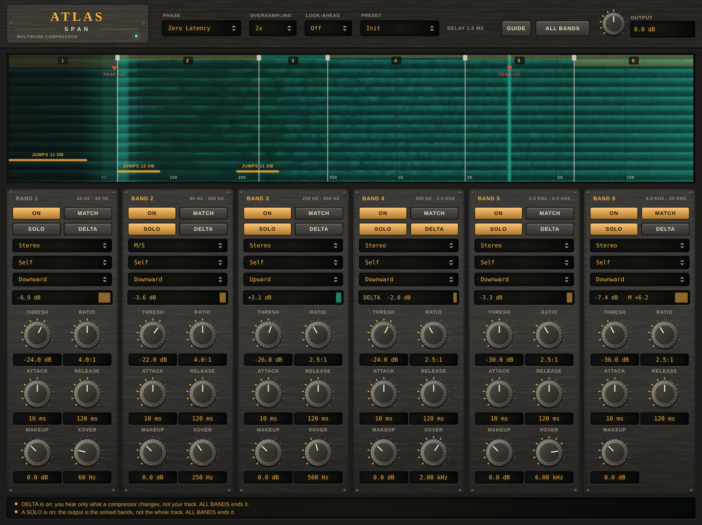

# Atlas Span

A **multiband compressor** (VST3 + AU + Standalone) for mixing and mastering, with **one to six bands that you make on a
spectrogram**: double-click to split a band, drag an edge, double-click an edge to join two. It starts on the six main bands
of music (Sub, Bass, Low-Mid, Midrange, Upper-Mid, High), the same ones the other plugins of this repository solo by. The
display also points at trouble: **PEAK** marks a narrow region that stands out and stays, **JUMPS** a region whose level keeps
leaping over its own average, and a click on a JUMPS marker makes that region a band. Each band has its own compressor, working on **Stereo**, **L/R**, **M/S**, or on Left, Right, Mid or Side alone;
its own **SOLO** and **DELTA**; and its own **gain MATCH**. The split is **Zero Latency** or **Linear** phase, and the
compressors can run **oversampled** (2x, 4x).

## Name origin

*Atlas* is the Titan who carries the sky on his shoulders: he holds the weight wherever it presses. A *Span* is what he holds
up, from one end to the other, here the spectrum from the sub-bass to the air. (CMake targets, namespaces and plugin codes use
the short name "Atlas".)



*Headless render of the editor (the hardware-style interface shared with the other plugins) over a programme with a beat, a
55 Hz kick and a ringing tone at 3.1 kHz. The display is the input over the last six seconds, low to high across, newest at the
bottom: the beat is the horizontal stripes, the two PEAK markers are the kick's note and the ringing tone, and the JUMPS markers
are the regions the beat leaps in. The white lines are the band edges, the amber shade at the top of a band is what its
compressor is taking off. Bands 2 to 6 are soloed (band 1 is dimmed), band 4 is on DELTA, band 2 works on M/S and band 6 has
MATCH on. Regenerate with the command under "Development".*

## What it does

| | |
|---|---|
| **One to six bands** | Sub 20–60 Hz, Bass 60–250 Hz, Low-Mid 250–500 Hz, Midrange 500 Hz–2 kHz, Upper-Mid 2–6 kHz, High 6–20 kHz to start with. On the display: **double-click** splits the band there (both halves keep its settings), **drag** an edge to move it (also **XOVER** on the strip), **double-click an edge** joins the two bands (the lower one's settings stay). Edges go from 40 Hz to 16 kHz and stay at least a ratio of 1.2 apart. With no split it is a plain single-band compressor. There is a strip for each band, in the order of the spectrum. |
| **The display** | A spectrogram of the input: frequency across, the last six seconds running down. The amber shade hanging from the top of a band is the dB its compressor is taking off; a band that is not heard (another is soloed) is dimmed. |
| **PEAK** | A narrow region that stands at least 6 dB above its neighbourhood (1/6 to 1/2 octave either side) on a 3 s average: a ringing note, a room mode, a harsh formant. Up to four. It is a pointer for an equaliser or a narrow band; nothing is changed. |
| **JUMPS** | A region at least 1/4 octave wide whose level keeps leaping 10 dB or more over its own 3 s average: a kick that pokes out, a voice that leaps, sibilance. Up to three. **Click the marker** and the region becomes a band (splits are added at its edges where there is room), switched on; the band is then listened to for two seconds and its threshold is set half the jump under the loudest level it read. Ratio and times stay as they were. |
| **Per band** | **ON**, **THRESH**, **RATIO**, **ATTACK**, **RELEASE**, **MAKEUP**, and a meter of the dB taken off. The knee is 6 dB wide. A band that is off passes as it is. |
| **Channels** | **Stereo**: left and right with one gain (the louder decides), so the image does not move. **L/R**: left and right, each with its own gain. **M/S**: the centre and the sides, each with its own gain. **Left / Right / Mid / Side**: that one only; the rest of the band is untouched. |
| **SOLO** | Hear the band alone, as it comes out. Click more to hear them together; any combination adds up flat. Not saved with the session. |
| **DELTA** | Hear only what that band's compressor changes: its output minus its input. Not saved with the session. **ALL BANDS** ends every solo and delta. |
| **MATCH** | Brings the band back to the loudness it had before its compressor (a 0.4 s window, never more than 12 dB), so the band is not judged by being quieter. MAKEUP adds to it. |
| **Phase** | **Zero Latency**: Linkwitz-Riley crossovers (24 dB per octave), no delay; the bands add to the input with its phase turned around each edge, as any such crossover does. **Linear**: the same bands with no phase shift, so the bands add to the input itself, only later (64 ms at 48 kHz, reported to the host). |
| **Downward / Upward** | Under the sidechain choice each band has **Downward** (an ordinary compressor: turns the band down while it is over THRESH) or **Upward**: it lifts the band while it is *under* THRESH, by (1 - 1/ratio) dB for every dB it is under, through the same 6 dB knee, **never by more than 12 dB**, and **not at all for a level more than 30 dB under the threshold** (it fades out between 30 and 40 dB): noise and silence stay as they are, which is what keeps an upward compressor from hissing. ATTACK is how fast the lift gives way to a louder band and RELEASE how fast it comes back (a slow release is a slow lift). The meter and the band's shade on the display turn teal and read **+x dB** while it lifts. It makes what is there louder: it cannot create energy that is not in the band (that is Hephaestus' fill), and MATCH on an upward band undoes the lift, so it is warned about. |
| **Look-ahead** | **Off, 1, 2, 5 or 10 ms** (header). The compressors read the sound that long before it is heard, so a fast peak is already being turned down when it reaches the output: set it to about the attack time. The whole sound is delayed by it (reported to the host, added to the phase mode's and the oversampling's); it is a choice and not a knob because a latency that moved with a knob would re-align the host's track on every turn. Changing it while playing restarts the bands (a short gap). |
| **Sidechain** | A second input (off until the host connects it). Each band has **Self / Sidechain** under its channels: set to Sidechain, its compressor reads the *same band of the sidechain input* (split with the same crossovers, in either phase mode) instead of its own, so another track decides when this band is turned down: the kick on the sidechain ducks the sub and bass. The sidechain is never heard, and with none connected a band set to it listens to itself. A mono sidechain is used on both sides. |
| **Presets** | Ten (header): *Init*, *Mastering Glue*, *Tame the Low End*, *Steady Low-Mids*, *De-Harsh Upper-Mid*, *De-Ess*, *Mid/Side Control*, *Lift the Low-Mids*, *Lift the Air* and *Kick Ducks Bass*. They set the bands (their thresholds suit a master around -14 LUFS: a band's own level decides, so set THRESH where its meter first moves); phase, oversampling, look-ahead and output are kept. Hover the box for what the chosen one is for and what it is not. |
| **Guide and notes** | **GUIDE** (header) says what Atlas is for and what it is *not* for: dynamics band by band, not limiting (look-ahead helps, but there is no true-peak reading), not a tonal fix, not adding what is missing. The strip under the bands warns, in amber, when DELTA or a solo is on, when every band is off, and, band by band, when a threshold is still at the top (it hardly compresses), a ratio is 1:1, a band is taking off 12 dB or more, a ratio of 10:1 or more is used as a limiter, a band is set to the sidechain with none connected, an upward band lifts the whole band, lifts 9 dB or more, or has MATCH on; it notes an attack longer than the look-ahead, a fast attack on bass, L/R on a band (the image can drift), MATCH, and the delay of Linear. Each note restates a limit under [Limits](#limits); the rules are in [Advice.h](Source/Advice.h). |
| **Oversampling** | Off, 2x, 4x: the compressors' gain is made and applied at that rate, so a fast gain on high notes does not fold back as false tones. Adds 49 / 61 samples of delay at 48 kHz, reported to the host. |

## How it works

```
input -> split into six bands -> per band:  level (the band's, or the sidechain's) -> gain computer -> attack / release
                                              -> band + (the band, look-ahead later) x (gain - 1)
      -> makeup, gain match -> solo / delta -> sum -> output gain
```

- **The level** of a band is its mean square, smoothed over about a cycle of the band's lowest frequency and read as the peak
  of a sine of the same power, so "-20 dB" means a sine whose peak is at -20 dBFS and the threshold means the same for any
  attack. That is also the limit on how fast a band can react: a short click is read lower than its peak, and the Sub band
  cannot move inside a cycle of 20 Hz, which is what keeps it from distorting the bass.
- **Attack and release act on the gain**, in dB, after the level: the times you set are the times it takes. With 100 ms the gain is
  3.0 dB of an 18 dB reduction 15 ms in (a single-pole curve gives 2.5); with a 400 ms release it is at -1.87 dB 900 ms after
  the signal stops (the curve gives -1.89).
- **A band adds its difference.** What the compressor takes off (`band x (gain - 1)`) is added to the band, so a band whose
  gain is 1 is its input bit for bit, and only the difference goes through the oversampling filters: with nothing compressing,
  oversampling is a delay and nothing else.
- **A tone is in more than one band.** A 1 kHz tone is 1.08 dB down in the Midrange band and the rest of it is in the
  neighbours, so taking the band down 14.2 dB takes the whole output down 10.8 dB. That is how any multiband compressor behaves;
  SOLO shows the band's own gain.

## Measured (`AtlasTests`, 48 kHz)

- **Split.** Zero latency, every band off: flat within 0.0000 dB from 30 Hz to 12 kHz. Linear, every band off: the input
  3072 samples (64 ms) later, within -135 dB. Both modes cut at the same places: the Midrange soloed gives -1.08 dB at 1 kHz,
  -6.06 dB at its 2 kHz edge, and less than -50 dB at 8 kHz and 125 Hz. A click through a linear band comes out symmetric.
- **Compressor.** At -30 dB and 4:1 a tone at -11.08 dB in the band is taken down 14.21 dB (the law gives 14.19); under the
  threshold the output is unchanged bit for bit. Attack and release as quoted above.
- **Channels.** Stereo: -14.21 / -14.21 dB with the tone loud on the left only. L/R: -14.21 / 0.000 dB. Left: the right
  untouched. Mid: the centre -14.21 dB, the side +0.0000 dB; M/S: each its own gain.
- **Solo and delta.** Three bands soloed plus the other three is the plain output; input + delta = output (both within 6e-8);
  after a solo is released the output is the plain output again, bit for bit.
- **Gain match.** A band taken down 10.5 dB gets +10.46 dB and the output is within 0.00 dB of the input; never more than 12 dB.
- **Oversampling.** With the bands off, 2x and 4x are the plain output 49 and 61 samples later, bit for bit. An 11 kHz tone
  compressed with the fastest times: the harmonics that fold back to 15 and 7 kHz are 89 / 92 dB under the tone without
  oversampling, 134 / 136 dB at 2x, 150 / 142 dB at 4x.
- **Bands.** With no split, -30 dB and 4:1 take a 1 kHz tone at -10 dB down 15.00 dB on the whole output (the law gives 15.00).
  With one split at 250 Hz and the upper band compressing, 4 kHz is taken down 15.00 dB and 60 Hz +0.000 dB. Joined bands
  still add to the input (linear, bands off) and give the same output for any host block.
- **The finder** (synthetic spectrogram columns, 30 per second). A steady programme: nothing. A 12 dB resonance at 3 kHz: one
  peak, at 2958 Hz (the nearest 1/24-octave step), 12.0 dB over its neighbourhood. A region around 80 Hz leaping 18 dB twice a second: one
  region, 63 to 102 Hz. Nothing in the first two seconds; silence says nothing.
- **Upward.** The gain computer at 2:1 and -30 dB gives +5 dB at 10 dB under, 0 dB over the knee, +0.375 dB at the threshold, the cap of 12 dB at 20 dB under with 20:1, 0 dB at 45 dB under and half the cap at 35 dB under. A tone at -42.1 dB in the Midrange is lifted +6.03 dB (the law gives +6.04) and the reduction meter reads -6.03 dB; at -11.1 dB, over the threshold, +0.000 dB. At 20:1 a tone at -57.1 dB is lifted +12.00 dB; one at -77.1 dB, 47 dB under the threshold, +0.000 dB. Release 400 ms, attack 5 ms: +7.5 dB 400 ms after the tone falls quiet (an exponential gives +7.6), +11.6 dB settled, +0.00 dB 200 ms after the loud tone returns. A band whose levels are all over its threshold changes nothing once it has settled, bit for bit (the first half second differs by at most 4e-6: the level passes through the quiet range on its way up from zero). At 2x oversampling the same lift; blocks of 512 and 61 give the same output, bit for bit; a band switched off after lifting is the plain output again, bit for bit.
- **Look-ahead.** With the bands off, every look-ahead (1, 2, 5 and 10 ms = 48, 96, 240 and 480 samples) at every oversampling is the plain output that many samples later, bit for bit, and the latency reported is the sum. A 1 kHz tone at -6 dB that starts at once, attack 5 ms, ratio 20:1, the Midrange soloed: its first 2 ms at the output reach -8.1 dB without look-ahead and -20.2 dB with 5 ms; settled, both are at -28.87 dB. The same output for blocks of 512 and 61 with 2 ms and 2x oversampling, bit for bit.
- **Sidechain.** A band set to the sidechain with none connected is the band listening to itself, bit for bit. A quiet 1 kHz tone (-45 dB) with a -10 dB key (-11.1 dB in the band) is taken down 14.21 dB (the law gives 14.19), at 2x oversampling and in the linear mode too; alone it passes at +0.000 dB. A loud tone with a silent key: nothing is taken, bit for bit. Silence with a loud key: silence out. A mono key is the same as the same signal on both channels; blocks of 512 and 61 give the same output with a noise key, 2x and look-ahead; a NaN and an inf in the key leave the output finite.
- **Robust.** The output is the same, bit for bit, for host blocks of 512, 377 and 1 samples in every mode; an inf or a NaN in the
  input does not get through; it runs at 44.1, 96 and 192 kHz; the modes can be switched while playing.

## Limits

- The times are not automatic. **An upward band lifts what is there, noise included** (up to 12 dB, and not what is 30 dB under the threshold): the cap and the gate are fixed, not settings. A lift is read by the same detector as a compression, so it follows the band's level with its smoothing. **Look-ahead is a delay, not a true-peak limiter**: the level is read as a smoothed mean square and nothing is clipped, so a peak can still pass; use a limiter after it. The sidechain is split with the band's own crossovers and read by the same detector, so it is the key's level *in that band*; it has no filter or level of its own.
- PEAK and JUMPS read the display's analyzer on the editor's timer: they need the editor open, they see the input (not what the
  compressors did), and their limits are rules of thumb. A threshold set from a JUMPS marker is a starting point.
- Splitting or joining bands while they are compressing can click (the gains start again), and ends every solo and delta.
  In Zero Latency a split that is switched off is parked at the top of the spectrum, where its crossover still turns the phase a little above 16 kHz.
- Linear mode resolves a crossover down to 40 Hz, which is why XOVER stops there. Its FFT is single precision: the floor is about -135 dB.
- Changing Phase, Oversampling or Look-ahead while playing restarts the bands from silence (a short gap) and changes the latency.
- Not yet built on macOS, run through `auval` or loaded in a host by a check tool; there is no `HostCheck` yet. CI builds the VST3 on Linux.

## Building

Requires CMake 3.22 or newer and a C++20 compiler. JUCE is fetched by CMake (see [cmake/Juce.cmake](../../cmake/Juce.cmake)).

```bash
cmake -S . -B build -DCMAKE_BUILD_TYPE=Release
cmake --build build --target Atlas_VST3 Atlas_AU Atlas_Standalone -j 10
```

Building does **not** install the plugins; add `-DATLAS_INSTALL_AFTER_BUILD=ON` for that (macOS).

## Development

```bash
cmake --build build --target AtlasTests && ./build/AtlasTests_artefacts/Release/AtlasTests            # DSP: no plugin, no GUI
cmake --build build --target AtlasUiCheck && ./build/AtlasUiCheck_artefacts/Release/AtlasUiCheck      # the editor on the real processor
cmake --build build --target AtlasSnapshot && ./build/AtlasSnapshot_artefacts/Release/AtlasSnapshot docs/screenshot.png solo=62 delta=8 os=1 upward=3
```

`docs/screenshot.png` is the output of `AtlasSnapshot` (arguments in the file's header), never edited by hand. See
[CLAUDE.md](CLAUDE.md) for the rules that keep the plugin correct.

## Licence

AGPL-3.0-or-later, source only. See [LICENSE](../../LICENSE), [NOTICE.md](../../NOTICE.md) (third-party software, trademarks,
the source-only policy), [CONTRIBUTING.md](../../CONTRIBUTING.md) and [SECURITY.md](../../SECURITY.md).
