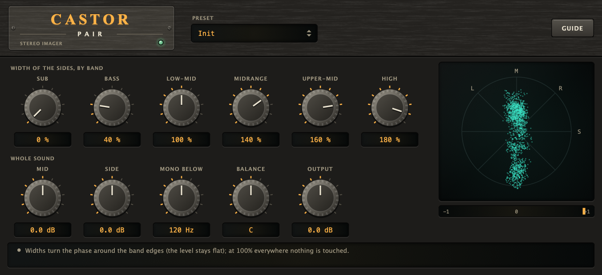

# Castor Pair

A **stereo imager** (VST3 + AU + Standalone) for mixing and mastering: the **width of the sides in each of the six bands of music**, the level of the middle and
of the sides as a whole, a **mono bass** that takes the sides away below a frequency, a balance, and a **goniometer** and **correlation** meter that show what the image is doing.

## Name origin

*Castor* is one of the Dioscuri, the twins: two that are one. The plugin works on what is the same in both channels and what is different. (CMake targets,
namespaces and plugin codes use the short name "Castor".)



*Headless render of the editor (the hardware-style interface shared with the other plugins). A stereo programme through the width of the sides set per band: Sub 0%, Bass 40%, Low-Mid 100%, Midrange 140%, Upper-Mid 160% and High 180%, MONO BELOW at 120 Hz. The goniometer on the right plots the output (M up, S across, L and R on the diagonals) and the correlation meter is under it; the strip says what a width other than 100% does to the phase. Regenerate with the command under "Development".*

## What it does

| | |
|---|---|
| **Width, six bands** | Sub (20-60 Hz), Bass (60-250), Low-Mid (250-500), Midrange (500-2 k), Upper-Mid (2-6 k) and High (6-20 k): the bands of music of `shared/dsp`. Each band's *sides* (what differs between left and right) are scaled by 0 to 200%: 0% is mono, 100% as it is, 200% twice the sides. |
| **Mid / Side** | -12 to +12 dB each, 0 by default: the level of the middle (what is the same in both channels) and of the sides, after the widths. |
| **Mono below** | 20 Hz (off) to 500 Hz: the sides go through a 24 dB/oct high-pass at this frequency, so below it the sound is in the middle: safe for mono playback, club systems and vinyl. |
| **Balance** | L 100 to R 100: turns one channel down (not a pan). |
| **Output** | -12 to +12 dB. |
| **Presets** | Seven starting points (Init, Mono Bass, Club Safe, Widen Highs, Wide Master, Narrow Mix, Vocal Forward). A preset sets the widths, MID, SIDE and MONO BELOW; BALANCE and OUTPUT are kept. |

The goniometer draws the last 1536 samples of the output as a cloud, left and right turned a quarter (a vertical line is mono, a horizontal one out of phase); the bar under it is the
correlation of the output over 0.3 s: +1 mono, 0 wide, -1 out of phase.

## How it works

1. **The sides, band by band.** Each channel is split into the six bands by the `shared/dsp` splitter (`pdsp::BandSplitter`: Linkwitz-Riley crossovers; the bands are in phase with each other, so any sum of them keeps the
   magnitude of the sound). In each band the middle `(L + R) / 2` is kept and the side `(L - R) / 2` is multiplied by that band's width; the bands are added again.
2. **100% everywhere is the input.** The split has its own phase (the all-pass of the crossovers), so when every width is 100% the plug-in does not use it: the sound goes through as it is. When a width leaves
   100% (or comes back) the two are crossfaded over 10 ms.
3. **The rest adds the difference.** MID, SIDE and MONO BELOW are applied to the sound as `difference = new - old` added to left and (for the sides, subtracted from) right, and BALANCE and OUTPUT are gains: all of them
   exactly nothing at their neutral value, so the plug-in is the input bit for bit when nothing is changed.

## Measured (`CastorTests`, 48 kHz)

- Nothing changed: the input, bit for bit, with no delay.
- All six widths at 200%: the sides are +6.02 dB at 60 Hz, 1 kHz and 8 kHz (6.021 each: the bands add up to the side itself). All at 0%: the sides are gone (-225 dB): mono.
- One band: Midrange at 0%: the sides are -18.7 dB at 1 kHz, -0.000 dB at 50 Hz and -0.013 dB at 9 kHz. Sub at 0% and High at 150%: -15.7 dB at 40 Hz and +3.44 dB at 12 kHz (3.52 for 150%). The edges between bands are not brick walls.
- MID +6 dB lifts a centred sound by 6.00 dB and a side-only sound by 0.000 dB; SIDE -6 dB is -6.00 dB on the sides.
- MONO BELOW 120 Hz: the sides are -38.2 dB at 40 Hz, -3.01 dB at 120 Hz, -0.00 dB at 480 Hz and +0.000 dB at 2 kHz; a centred bass is untouched, bit for bit.
- BALANCE +50%: the left is -6.02 dB, the right untouched. OUTPUT +6 dB is +6.02 dB.
- The correlation meter: +1.000 for a centred sound, -1.000 for an out-of-phase one, -0.002 for independent noise; +1.000 with every width at 0%.
- The same output for blocks of 1, 7, 64, 333, 512 and 4096 samples, bit for bit. NaN and infinity in the input are silence.

## Limits

- **It cannot make stereo from mono.** A mono recording has no sides: a width of 200% of nothing is nothing. And no widener fixes a mix whose elements sit on top of each other: it moves what is already different.
- **Wide is fragile.** Sides above 150%, SIDE above +6 dB and a wide bass can collapse or vanish in mono; the correlation bar and a note say so. Always listen in mono.
- **With a width off 100% the phase turns around the band edges** (the magnitude is flat, the all-pass of the crossovers is in the sound). It is the same for left and right, so the image does not move, but a transient in a
  band edge is slightly smeared. At 100% everywhere the sound is not touched at all.
- **The six bands are fixed** (the bands of music of `shared/dsp`), not movable.
- It has no delay and does not clip or limit: a wider image can raise the peaks.
- It builds on macOS (VST3 and AU, run by hand on 2026-11-13) and `auval -v` passes for the AU; it is not in a macOS CI job, and it has no `HostCheck` (see "Not yet in line" in the repository's [CLAUDE.md](../../CLAUDE.md)).

## Building

Requires CMake 3.22 or newer and a C++20 compiler. JUCE is fetched by CMake (see [cmake/Juce.cmake](../../cmake/Juce.cmake)).

```bash
cmake -S . -B build -DCMAKE_BUILD_TYPE=Release
cmake --build build --target Castor_VST3 Castor_AU Castor_Standalone -j 10
```

Building does **not** install the plugins; add `-DCASTOR_INSTALL_AFTER_BUILD=ON` for that (macOS).

## Development

```bash
cmake --build build --target CastorTests && ./build/CastorTests_artefacts/Release/CastorTests            # DSP: no plugin, no GUI
cmake --build build --target CastorUiCheck && ./build/CastorUiCheck_artefacts/Release/CastorUiCheck      # the editor on the real processor
cmake --build build --target CastorSnapshot && ./build/CastorSnapshot_artefacts/Release/CastorSnapshot docs/screenshot.png
```

`docs/screenshot.png` is the output of `CastorSnapshot` (arguments in the file's header), never edited by hand. See
[CLAUDE.md](CLAUDE.md) for the rules that keep the plugin correct.

## Licence

AGPL-3.0-or-later, source only. See [LICENSE](../../LICENSE), [NOTICE.md](../../NOTICE.md) (third-party software, trademarks,
the source-only policy), [CONTRIBUTING.md](../../CONTRIBUTING.md) and [SECURITY.md](../../SECURITY.md).
