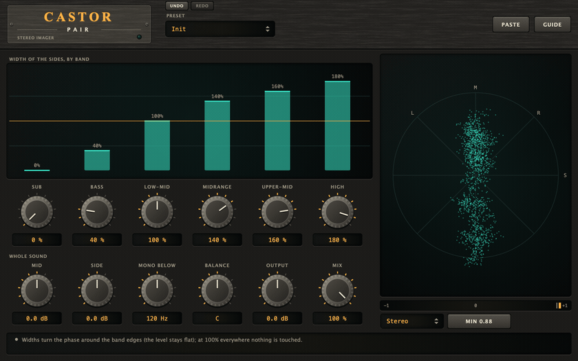
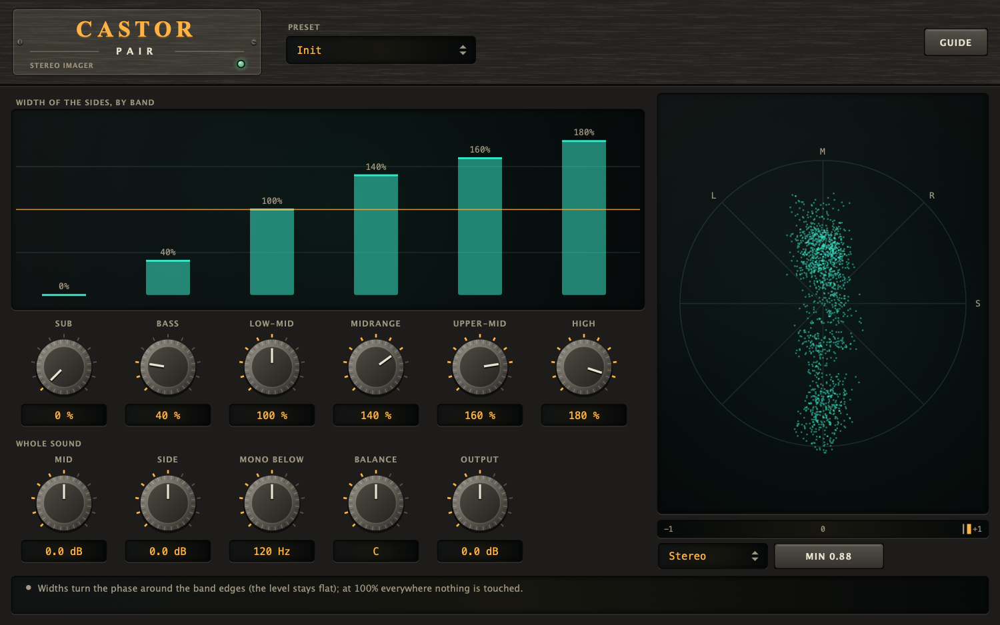

# Castor Pair

Six-band stereo imager for mixing and mastering with per-band side width, Mid/Side trims, Mono Below, parallel Mix, goniometer, and correlation meter.

`VST3 + AU + Standalone`



*Live editor: 6-band side width bars over the knobs update alongside the goniometer cloud (M vertical, S horizontal) and correlation meter.*

## Theme

**Name origin:** *Castor* is one of the Dioscuri twins, inseparable in myth; *Pair* is the stereo left/right and mid/side channel pair the imager balances, widens, or folds to mono. (CMake targets, namespaces, and plugin codes use the short name "Castor".)

**Core philosophy:**
- **Separate what is shared from what differs.** Shapes Side width (`0–200%`) across the six `pdsp::bands`, trims global Mid/Side, and centres bass with **Mono Below** while checking phase on a goniometer and correlation meter.
- **Bit-exact at 100%, difference-added elsewhere.** When all widths sit at `100%`, the Linkwitz-Riley splitter is bypassed with zero latency; off `100%`, phase turns symmetrically around band edges with a `10 ms` crossfade.
- **Moves existing width, never invents or limits it.** Cannot create stereo from mono, adds zero delay, and does not clip peaks raised by widening; check **Listen = Mono** and correlation before bouncing.

## See it

| View | Capture | What to look at |
|---|---|---|
| **Main Editor** |  | Sub 0% to High 180%, Mono Below 120 Hz, width bars, goniometer cloud, correlation 0.88. |

**UI colour legend** — see [root UI colour legend](../../README.md#ui-colour-legend-hardwareh) for shared `Hardware.h` hex codes (`CastorUi.h` defines the `Castor Pair` nameplate):

| Swatch | Hex | UI Element | Meaning |
|---|---|---|---|
| 🔵 | `#37E3C5` | Width bars above knobs, goniometer point cloud, `MIN` correlation mark (when safe) | Band side-width profile (`0–200%`) and live stereo vectorscope (`M` up, `S` across, `L/R` diagonals) |
| 🟡 | `#FFB347` | `100%` unity line on width display, correlation meter bar (safe range), lit `UNDO` / `LISTEN` buttons | Recorded side width reference (`100%`), positive/safe correlation (`-0.1` to `+1.0`), and active header controls |
| 🔴 | `#EF4A3D` | Correlation bar & `MIN` hold when `< -0.1` | Out-of-phase audio (`correlation < -0.1`) that thins out or cancels when summed to mono |
| 🟠 | `#F2A33A` | Warning notes in bottom advice strip | `LISTEN` not set to `Stereo`, correlation `< -0.1`, bass band `> 150%` with `MONO BELOW` off, or `SIDE > +6 dB` |

## Try it

| Recipe / Setting | What you see / hear / measure |
|---|---|
| `Sub 0%`, `Bass 40%`, `MONO BELOW 120 Hz`, `Midrange–High 140–180%` | Low-end sides drop (`-38.2 dB` at `40 Hz`, `-3.01 dB` at `120 Hz`) while upper bands widen; centred bass stays bit-identical. |
| All six widths at `100%` (default) | Linkwitz-Riley splitter is bypassed bit for bit with `0` samples latency; moving off `100%` crossfades over `10 ms`. |
| Copy width or low-end mono item in [Themis](../themis/README.md), click **PASTE** | Sets named band widths and/or **Mono Below** frequency in one undo step (ignores slope; **Mono Below** is `24 dB/oct`). |
| Toggle **LISTEN** to `Mono` or `Side` | Plays `(L+R)/2` (`Mono`) or `(L-R)/2` (`Side`) in both channels while goniometer and correlation still read the stereo output. |
| Dial **MIX** `50%` (`0` latency) | Blends dry and processed widths/Mid/Side/Mono Below cleanly without comb filtering (`10 ms` smoothing on changes). |

> [!TIP]
> **Club-safe low end:** Keep **Sub** (`20–60 Hz`) and **Bass** (`60–250 Hz`) narrow or set **MONO BELOW** (`80–120 Hz`) while widening **Midrange–High** (`120–160%`) for air.

> [!NOTE]
> **Bit-exact when neutral:** At `100%` across all bands, Castor bypasses the 6-band splitter with zero latency (and crossfades over `10 ms` when engaged).

> [!IMPORTANT]
> **Themis hand-offs:** Paste each width or low-end mono item into **one** of Iris, Apollo, or Castor so you do not double the adjustment.

> [!WARNING]
> **Check in Mono before bouncing:** **LISTEN** (`Stereo` / `Mono` / `Side`) persists in sessions; reset it to **Stereo** (or watch the advice warning) before exporting.

> [!CAUTION]
> **What Castor is NOT for:** Cannot widen a mono signal (`200%` of zero side is zero), and does not limit peaks raised by widening.

## Reference

### Controls

| Control | Range / Default | What it does |
|---|---|---|
| **Width (6 bands)** | `0` to `200 %` / `100 %` | Side gain per `pdsp::bands` band: Sub (`20–60 Hz`), Bass (`60–250`), Low-Mid (`250–500`), Midrange (`500–2 k`), Upper-Mid (`2–6 k`), High (`6–20 k`). `0%` = mono, `200%` = `2x` sides. |
| **Mid** | `-12.0` to `+12.0 dB` / `0.0 dB` | Adjusts `(L + R) / 2` level after band widths. |
| **Side** | `-12.0` to `+12.0 dB` / `0.0 dB` | Adjusts `(L - R) / 2` level after band widths. |
| **Mono Below** | `20 Hz` (`Off`) to `500 Hz` / `Off` | `24 dB/oct` high-pass filter on the side signal only, keeping low end centred. |
| **Mix** | `0` to `100 %` / `100 %` | Blends dry input with processed widths/Mid/Side/Mono Below before Balance and Output (`0` latency = no combing). Presets reset to `100%`. |
| **Balance** | `L 100` to `R 100` / `C` (`0`) | Attenuates opposite channel (`-100..+100`); ignored on a mono bus. |
| **Output** | `-12.0` to `+12.0 dB` / `0.0 dB` | Final post-Balance output trim. |
| **Listen** | `Stereo`, `Mono`, `Side` / `Stereo` | Post-Output monitor check: `(L+R)/2` (`Mono`) or `(L-R)/2` (`Side`) in both channels. Goniometer & correlation read the un-monitored output. |
| **Paste / Undo / Redo** | Header (`Cmd+Z` / `Shift+Cmd+Z`) | **PASTE** applies Themis' width line and/or side `lowcut` (`Mono Below`) as one undo step; **UNDO/REDO** covers every control change. |
| **Presets & Min** | 7 presets (`Init`) + **MIN** button | *Init*, *Mono Bass*, *Club Safe*, *Widen Highs*, *Wide Master*, *Narrow Mix*, *Vocal Forward* (keeps Balance & Output); click **MIN** to reset lowest correlation hold. |

### Signal Flow

```text
input ─┬─► [widths != 100%] ─► 6-Band LR Splitter (pdsp::BandSplitter) ─► Side × Width[b] ─► Sum ─┐
       │                                                                                          ├─► 10 ms Crossfade ─► +Diff (Mid/Side/Mono Below)
       └─► [all widths == 100%] ──────────────────────────────────────────────────────────────────┘                         │
                                                                                                                            ▼
                                                       output ◄─ Listen (Stereo/Mono/Side) ◄─ Balance / Output ◄─ Mix (dry/wet)
```

- **Zero-phase bypass at 100%:** When all six widths sit at `100%`, the Linkwitz-Riley splitter is bypassed (`10 ms` crossfade when leaving or returning to `100%`).
- **Difference addition:** **Mid**, **Side**, and **Mono Below** add `new - old` so neutral settings stay bit-identical to input.

### Measured (`CastorTests`, 48 kHz)

- **Bit-exact neutral & zero latency:** Defaults pass input bit for bit with `0` delay; bit-identical across block sizes `1`, `7`, `64`, `333`, `512`, `4096`; NaN/inf -> silence.
- **6-band side scaling:** All widths `200%` lift sides `+6.02 dB` at `60 Hz`, `1 kHz`, `8 kHz` (`6.021` each—bands sum flat); all at `0%` cut sides to `-225 dB` (mono).
- **Band isolation:** Midrange `0%` cuts sides `-18.7 dB` (`1 kHz`), `-0.000 dB` (`50 Hz`), `-0.013 dB` (`9 kHz`). Sub `0%` + High `150%` gives `-15.7 dB` (`40 Hz`) and `+3.44 dB` (`12 kHz`, `3.52` ideal for `150%`).
- **Mid, Side, Mono Below:** **Mid** `+6 dB` lifts centred `+6.00 dB`, side-only `0.000 dB`; **Side** `-6 dB` cuts sides `-6.00 dB`. **Mono Below** `120 Hz` cuts sides `-38.2 dB` (`40 Hz`), `-3.01 dB` (`120 Hz`), `-0.00 dB` (`480 Hz`), `+0.000 dB` (`2 kHz`), leaving centred bass bit-identical.
- **Mix, Balance, Output:** **Mix** `0%` bit-identical dry, `50%` mean within `6e-8`, `100% -> 0%` smoothed over `10 ms` (`0.0006` max step). **Balance** `+50%` sets left `-6.02 dB`, right untouched (`+100` unchanged on mono bus); **Output** `+6 dB` = `+6.02 dB`.
- **Correlation & Listen:** Correlation reads `+1.000` (centred or `0%` widths), `-1.000` (out of phase), `-0.002` (independent noise); **MIN** latches `-0.68` (`0.5 s` out-of-phase burst) when live recovers to `+0.94`. **Listen** `Mono` silences side-only tones; `Side` outputs `(L-R)/2` cleanly.

### Limits

- **No stereo from mono:** Requires existing L/R difference; cannot un-clutter colliding mono elements.
- **Wide is fragile in mono:** Widths `> 150%`, **Side** `> +6 dB`, or wide bass can collapse or vanish in mono—check **Listen = Mono** and correlation.
- **Crossover phase shift off 100%:** Any width off `100%` introduces symmetric all-pass phase rotation around band edges (image stays centred, edge transients smear slightly).
- **Fixed bands:** Six `pdsp::bands` edges (`60`, `250`, `500`, `2k`, `6k Hz`) cannot move (unlike [Atlas Span](../atlas/README.md)).
- **Saved Listen state & no limiter:** **Listen** persists in sessions (reset to **Stereo** before bounce); Castor has `0` delay and does not clip/limit widened peaks.
- **Platform verification:** See [CI & platform status](../../CLAUDE.md#not-yet-in-line).

## Build & develop

See [root Build & develop](../../README.md#build--develop) for shared prerequisites and image-generation rules, and [CLAUDE.md](CLAUDE.md) for invariants.

```bash
# Fast build & check from repository root
./scripts/build.sh castor           # build & run CastorTests + CastorUiCheck
./scripts/build.sh castor all       # tests, ui, snap, vst3, au, app
./scripts/showcase.sh castor        # regenerate docs/showcase.gif
```

Manual CMake from `plugins/castor/` (add `-DCASTOR_INSTALL_AFTER_BUILD=ON` on macOS to install):

```bash
cmake -S . -B build -DCMAKE_BUILD_TYPE=Release
cmake --build build --target Castor_VST3 Castor_AU Castor_Standalone -j 10
cmake --build build --target CastorTests && ./build/CastorTests_artefacts/Release/CastorTests
cmake --build build --target CastorUiCheck && ./build/CastorUiCheck_artefacts/Release/CastorUiCheck
cmake --build build --target CastorSnapshot && ./build/CastorSnapshot_artefacts/Release/CastorSnapshot docs/screenshot.png
```

## Licence

AGPL-3.0-or-later, source only — see [root Licence](../../README.md#licence) and [NOTICE](../../NOTICE.md).
