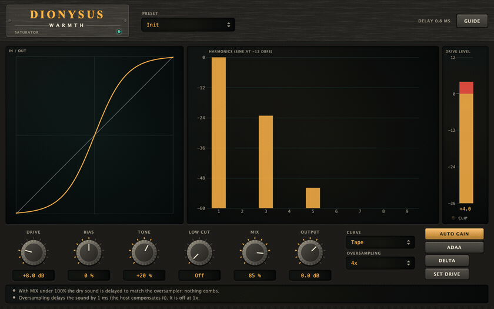
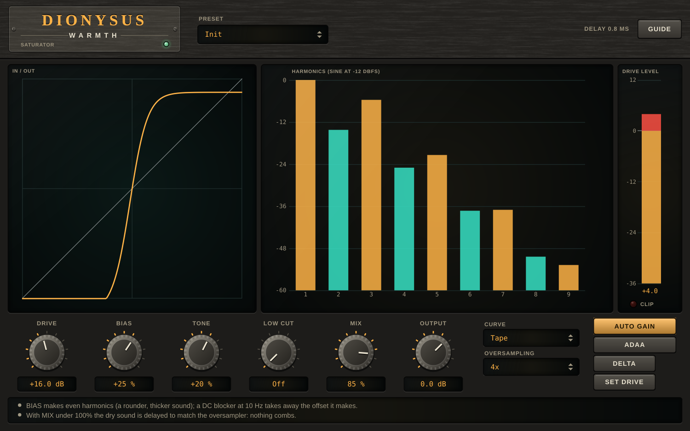

# Dionysus Warmth

Six-curve harmonic saturator for mixing and mastering with asymmetric bias, wet-only low cut, tone tilt, auto gain, ADAA, and 8x oversampling.

`VST3 + AU + Standalone`



*IN/OUT transfer curve, odd/even harmonic bars (`-60..0 dB`), and `DRIVE LEVEL` meter animate as curve, drive, and bias change.*

## Theme

### Name origin

*Dionysus* is the god of wine, fire, and excess; *Warmth* is the tamed, musical side of that excess — harmonic saturation from subtle tape/tube glow to hard fold and clip. (CMake targets, namespaces, and plugin codes use the short name "Dionysus".)

### Core philosophy

- **Warmth first, never clipping for loudness.** Six curves round off peaks and add harmonics (`slope 1` at `0`); drives of `24 dB+` distort, and [Aegis Ceiling](../aegis/README.md) handles true-peak limiting.
- **Judge tone, not level.** **Auto Gain** matches `-12 dBFS` RMS across curve, drive, and bias changes, while **Delta** isolates only what the saturator added.
- **Zero-comb parallel shaping.** **Low Cut** filters only the wet path, and the dry path waits in an exact integer delay (`0–44` samples) matching the oversampler.
- **Clean aliasing control, honest trade-offs.** Half-band oversampling (`2x–8x`) cuts fold-back by up to `44.8 dB`; `1x` **ADAA** gives `0` latency at the cost of a `-2 dB` @ `10 kHz` low-pass.

## See it

| View | What to look at |
|---|---|
|  | Tape `+16 dB` drive, `+25%` bias, `85%` mix, `4x` OS: odd amber, even teal harmonics. |

### UI colour legend

See [root UI colour legend](../../README.md#ui-colour-legend-hardwareh) for shared `Hardware.h` hex codes (`DionysusUi.h` sets `kHarmonicFloorDb = -60.0f` for the harmonic bars):

| Swatch | Hex | UI Element | Meaning |
|---|---|---|---|
| 🟡 | `#FFB347` | Transfer curve (`IN / OUT`), odd harmonic bars (`3rd, 5th, 7th...`), `DRIVE LEVEL` bar (`<= 0 dB`) & text readout, lit switches (`AUTO GAIN`, `DELTA`, etc.) | Static saturation waveshaper, symmetric odd-order harmonics, and drive level up to the curve's `0 dB` turnover point |
| 🔵 | `#37E3C5` | Even harmonic bars (`2nd, 4th, 6th...`), transfer curve glass border | Asymmetric even-order harmonics introduced by **BIAS** or the **Diode** curve |
| 🔴 | `#EF4A3D` | `DRIVE LEVEL` bar above `0 dB` & `CLIP` lamp (`0 dBFS` hold, 1 s) | Signal hitting the curve's nonlinear turnover/saturation zone (`> 0 dB`), or output reaching `0 dBFS` |
| 🟠 | `#F2A33A` | Warning notes in bottom advice strip | `DELTA` left on, `MIX` at `0%`, or hard curves (**Clip / Fold / Transformer**) at `>= 12 dB` Drive without oversampling |

## Try it

| Setting | What you see / hear / measure |
|---|---|
| Play track → press **Set Drive** | Listens `1 s` before **Drive**; sets **Drive** so loudest peak hits `0 dB` on meter (`NO AUDIO` on silence). |
| **Tape** (`+14 dB` Drive, `0%` Bias, `8x`) | Odd harmonics only: `3rd -9.1 dB`, `5th -27.4 dB`, `2nd -228 dB` (amber bars only); RMS stays within `0.008 dB` with **Auto Gain**. |
| **Tape** (`+14 dB` Drive, `60%` Bias, `8x`) | Teal even bars appear (`2nd -8.0 dB`); `10 Hz` HPF strips DC (`mean 2e-9`). |
| *Parallel Grit* (`120 Hz` **Low Cut**, **Mix** `< 100%`) | Bass `< 120 Hz` stays clean via delayed dry path; only `> 120 Hz` saturates with zero combs. |
| **Clip** (`+24 dB` Drive, `7 kHz` sine) across OS modes | `13 kHz` alias drops from `-12.2 dB` (`1x`) → `-23.3 dB` (`1x ADAA`) → `-44.5 dB` (`2x`) → `-54.8 dB` (`4x`) → `-57.0 dB` (`8x`). |

> [!TIP]
> **1-click gain staging:** Press **SET DRIVE** during playback to target `0 dB` on the **DRIVE LEVEL** meter, then dial **Mix** back for parallel warmth.

> [!NOTE]
> **Odd vs Even harmonics:** **Bias** (or **Diode**) shifts the working point for teal even harmonics; a `10 Hz` high-pass strips the DC offset automatically.

> [!IMPORTANT]
> **Oversampling vs ADAA:** Hard curves at `>= 12 dB` alias at `1x`—prefer **2x–8x** (`32 / 40 / 44` samples, host-compensated); `1x` **ADAA** adds `-2 dB` @ `10 kHz` roll-off and is ignored at `2x–8x`.

> [!WARNING]
> **Wet-only Low Cut:** **Low Cut** (`20–500 Hz`) filters only the saturated path—lower **Mix** below `100%` so clean bass returns via the dry path.

> [!CAUTION]
> **Not a limiter:** Drives of `24 dB+` distort; keep **Auto Gain** on to judge tone fairly, and use [Aegis Ceiling](../aegis/README.md) for true-peak limiting.

## Reference

### Controls

| Control | Range / Default | What it does |
|---|---|---|
| **Drive** | `0.0` to `+36.0 dB` / `+12.0 dB` | Gain (`5 ms` smoothed) pushing signal into the saturation curve. |
| **Curve** | `Tape`, `Tube`, `Transformer`, `Diode`, `Fold`, `Clip` / `Tape` | *Tape* (`tanh`), *Tube* (`x/(1+\|x\|)`), *Transformer* (cubic, thick 3rd), *Diode* (uneven `0.7` negative knee), *Fold* (`sin x`), *Clip* (hard). All have slope `1` at `0`. |
| **Bias** | `-100` to `+100 %` / `0 %` | Shifts working point (up to `0.5` units) for even harmonics; steady offset subtracted + `10 Hz` DC blocker. |
| **Tone** | `-100` to `+100 %` / `0 %` | Post-curve tilt EQ at `1 kHz` (`±6 dB` opposite low/high shelves = `12 dB` max tilt; `+` brighter). |
| **Low Cut** | `20 Hz` (`Off`) to `500 Hz` / `Off` | 2nd-order high-pass on saturated path only (keeps bass clean when blended with dry **Mix**). |
| **Mix** | `0` to `100 %` / `100 %` | Blends dry (latency-aligned to oversampler) with wet saturated path; `100%` is pure wet. |
| **Set Drive** | One-shot button | Listens `1 s` before Drive and sets **Drive** (`0..+36 dB`) so peak hits `0 dB` (`NO AUDIO` on silence). |
| **Auto Gain** | `On` / `Off` (`On`) | Compensates output level so a `-12 dBFS` sine keeps its AC RMS across Curve/Drive/Bias changes. |
| **Oversampling** | `Off` (`1x`), `2x`, `4x`, `8x` / `2x` | Linear-phase half-band Sinc (`65`-tap + `33`-tap stages), adding `0, 32, 40, 44` samples delay. |
| **ADAA** | `On` / `Off` (`Off`) | `1x`-only antiderivative anti-aliasing (Parker, Zavalishin, Le Bivic, DAFx 2016) with `0` reported latency; ignored at `2x–8x`. |
| **Output / Delta** | `-24.0` to `+12.0 dB` / `0.0 dB`; **Delta** `Off` | Final trim; **DELTA** outputs `output - delayed_input` (unsaved, not automatable, off when editor closes). |
| **Drive Level / Clip** | Peak meter + `0 dBFS` hold (`1 s`) | Peak reaching curve (`0 dB` turnover, red above) and `CLIP` lamp at `0 dBFS` output. |
| **Presets** | 8 presets (`Init`) | *Init*, *Tape Warmth*, *Tube Glow*, *Transformer Thick*, *Parallel Grit* (`120 Hz` Low Cut), *Bass Harmonics*, *Fold Fuzz*, *Hard Clip Edge*. |

### Signal flow

```text
input ─┬─► [Wet] Low Cut (20–500 Hz) ─► Drive (+5 ms smooth) ─► Upsample (1x–8x, ×2 gain) ─► Curve (+ Bias / ADAA at 1x) ─► Downsample ─► 10 Hz DC Block ─► Tone Tilt ─┐
       │                                                                                                                                                                   ├─► Mix ─► Auto Gain + Output ─► Delta ─► output
       └─► [Dry] Integer Delay Line (0, 32, 40, or 44 samples) ────────────────────────────────────────────────────────────────────────────────────────────────────────────┘
```

- **Matched half-band delay:** Blackman-windowed sinc half-band filters (`65`-tap first stage, `33`-tap subsequent stages) yield exact integer round-trip latency (`0, 32, 40, 44` samples), matched bit-for-bit on the dry path.
- **Live DFT display:** The harmonic display evaluates one cycle of a `-12 dBFS` sine through `saturate()` (always the static curve, even when `1x` ADAA runs `saturateAdaa()`).

### Measured

`DionysusTests` (`48 kHz`) and `DionysusUiCheck`:

| Curve (`+14 dB`, `-12 dBFS` sine, `8x`, dB re input) | 2nd | 3rd | 5th |
|---|---|---|---|
| **Tape** | none (`-228 dB`) | `-9.1` | `-27.4` |
| **Tube** | none | `-10.4` | `-20.9` |
| **Transformer** | none | `-4.9` | `-25.0` |
| **Diode** | `-14.3` | `-7.9` | `-23.5` |
| **Fold** | none | `-10.5` | `-44.2` |
| **Clip** | none | `-8.4` | `-16.2` |

- **Curve & Bias:** Every curve has slope `1` at `0` and stays within `±1`; Tape `+14 dB` (`8x`) fundamental `+11.37 dB`, 3rd `-9.07 dB`, 2nd `-228 dB`; `60%` Bias 2nd `-8.0 dB` (curve `-8.0`) and DC mean `2e-9`.
- **Aliasing (`7 kHz` `-6 dBFS`, Clip `+24 dB`):** 5th harmonic (`35 kHz`) folds to `13 kHz` at `-12.2 dB` (`1x`), `-44.5 dB` (`2x`), `-54.8 dB` (`4x`), `-57.0 dB` (`8x`); fundamental identical at `-6.519 dB`.
- **Delay & Mix `0%`:** `Mix 0%` equals input delayed by `0, 32, 40, 44` samples (`1x, 2x, 4x, 8x`), bit for bit; impulse peaks at `44` samples (`8x`); host bypass at `8x` delays impulse by `44` samples (`DionysusUiCheck`).
- **Auto Gain:** `-12 dBFS` sine matches input RMS within `0.008 dB` across all curves at `6, 18, 30 dB` Drive (`0.18 dB` with `1x` ADAA).
- **ADAA (`1x` only):** Antiderivatives match derivatives within `7e-10` across `2000` points in `[-6, 6]` (Diode: `0.49 ln cosh(x / 0.7)`). On `7 kHz` Clip `+24 dB`, `13 kHz` alias drops `11.1 dB` (`-12.2` → `-23.3 dB`), Fold `5.3 dB` lower, Transformer `10.8 dB` lower (fundamental `+2.09` → `+1.75 dB`). Linear-region low-pass matches `|cos(pi f / fs)|`: `-0.02 dB` (`1 kHz`), `-2.01 dB` (`10 kHz`); `50%` Mix `(1 - m/2) x[n] + (m/2) x[n-1]`: `-0.01 dB` (`1 kHz`), `-1.41 dB` (`10 kHz`), `-5.23 dB` (`20 kHz`). Silence at `60%` Bias = `0` out; off or `2x–8x` is bit-identical to pre-ADAA.
- **Tone, Low Cut, Delta, Set Drive, Stability:** **Tone** `+100%`: `100 Hz` `-6.0 dB`, `8 kHz` `+6.0 dB` (`12.0 dB` tilt; `0%` flat). **Low Cut** `500 Hz`: `50 Hz` wet `-40.0 dB`, `0%` Mix `+0.00 dB`, `50%` Mix `-6.1 dB`, `20 Hz` (Off) bit-exact. **Delta** + `32`-sample delayed input = output (`7.5e-09` max diff; 3rd `0.000 dB`; `0%` Mix = silence). **Set Drive** (`-12 dBFS` at `+6 dB`) sets `12.0 dB` (`+0.00 dB` on curve, meter `1.000`; test [9]). Bit-identical across `1, 7, 64, 333, 512, 4096` blocks; NaN/inf treated as silence.

### Limits

- **Not a loudness clipper or limiter:** Drives `>= 24 dB` distort; compare at equal loudness with **Auto Gain** on, and use [Aegis Ceiling](../aegis/README.md) to limit.
- **Hard-curve aliasing:** Clip, Fold, and Transformer `>= 12 dB` alias without oversampling, and transition-band harmonics near Nyquist still leak partly even at `8x`.
- **ADAA trade-offs:** `1x`-only (ignored at `2x–8x`); adds a first-order low-pass (`-2 dB` at `10 kHz` wet; `0.5`-sample uncompensated group delay) and removes less aliasing than `2x` oversampling (`11 dB` vs `32 dB` on clipped `7 kHz` sine).
- **Oversampling cost & switching:** Adds up to `44` samples latency and CPU; changing **Oversampling** while playing restarts the saturator (clicks).
- **Wet-only Low Cut:** Filters only the saturated path (`2nd`-order phase shift relative to dry around cutoff).
- **Unlinked stereo:** Channels saturate independently; harmonics are not stereo-linked.
- **Platform verification:** See [CI & platform status](../../CLAUDE.md#not-yet-in-line).

## Build & develop

See [root Build & develop](../../README.md#build--develop) for shared prerequisites and image-generation rules, and [CLAUDE.md](CLAUDE.md) for invariants.

```bash
# Fast build & check from repository root
./scripts/build.sh dionysus         # build & run DionysusTests + DionysusUiCheck
./scripts/build.sh dionysus all     # tests, ui, snap, vst3, au, app
./scripts/showcase.sh dionysus      # regenerate docs/showcase.gif
```

Manual CMake from `plugins/dionysus/`:

```bash
cmake -S . -B build -DCMAKE_BUILD_TYPE=Release
cmake --build build --target Dionysus_VST3 Dionysus_AU Dionysus_Standalone -j 10  # add -DDIONYSUS_INSTALL_AFTER_BUILD=ON on macOS to install
cmake --build build --target DionysusTests && ./build/DionysusTests_artefacts/Release/DionysusTests
cmake --build build --target DionysusUiCheck && ./build/DionysusUiCheck_artefacts/Release/DionysusUiCheck
cmake --build build --target DionysusSnapshot && ./build/DionysusSnapshot_artefacts/Release/DionysusSnapshot docs/screenshot.png
```

## Licence

AGPL-3.0-or-later, source only — see [root Licence](../../README.md#licence) and [NOTICE](../../NOTICE.md).
