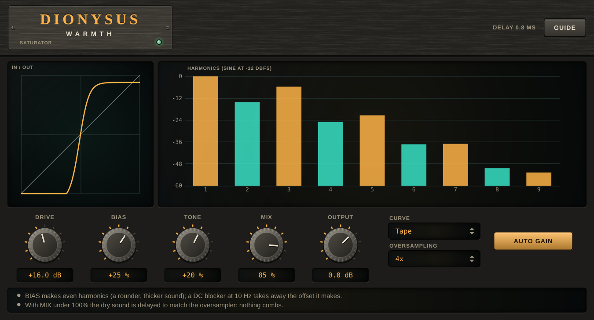

# Dionysus Warmth

A **saturator** (VST3 + AU + Standalone) for mixing and mastering: six curves (tape, tube, transformer, diode, fold, clip) that round off or fold the peaks and add harmonics,
a **bias** that adds even harmonics, a **tone** tilt, a parallel **mix**, an **auto gain** that keeps the loudness the same so you judge the tone and not the level, and
**oversampling** up to 8x so the harmonics above half the sample rate do not fold back as tones that were never there. The display shows the curve and the harmonics a sine gets.

## Name origin

*Dionysus* is the god of wine and of excess: the tame form of it is warmth. (CMake targets, namespaces and plugin codes use the short name "Dionysus".)



*Headless render of the editor (the hardware-style interface shared with the other plugins). The tape curve at +16 dB of drive with BIAS +25%, TONE +20%, MIX 85%, 4x oversampling and AUTO GAIN on. On the left, the curve the signal goes through (input across, output up); on the right, the harmonics it makes from a sine at -12 dBFS, odd ones amber and even ones teal (the bias is what brings the even ones). The strip explains the bias' DC blocker and the delayed dry sound under 100% MIX. Regenerate with the command under "Development".*

## What it does

| | |
|---|---|
| **Drive** | 0 to +36 dB, 12 by default: how hard the sound is pushed into the curve. |
| **Curve** | *Tape* (tanh: symmetric, gentle), *Tube* (`x / (1 + |x|)`: softer onset, more high harmonics as it is driven), *Transformer* (a cubic: thick, strong 3rd), *Diode* (uneven: a tanh with a knee of 0.7 on the negative side: even harmonics of its own), *Fold* (`sin x`: peaks turn back on themselves), *Clip* (hard). Every curve has a slope of 1 at 0, so a quiet sound passes unchanged. |
| **Bias** | -100 to +100%: moves the working point of the curve before it (up to 0.5 in the curve's units), which adds even harmonics. What the curve gives for that offset alone is taken off, so silence stays silence, and a 10 Hz high-pass takes the rest of the DC away. |
| **Tone** | -100 to +100%: after the curve, a low shelf and a high shelf at 1 kHz turning opposite ways, 6 dB each: a tilt of 12 dB at the ends. + is brighter. |
| **Mix** | 0 to 100%: the saturated sound blended with the dry one. The dry sound is delayed to match the oversampler, so nothing combs. 100% is the saturated sound itself. |
| **Output** | -24 to +12 dB, after everything. |
| **Auto gain** | On by default: the gain that brings the RMS of a sine at -12 dBFS back to what it was before the curve (the AC part: the DC is taken off). |
| **Oversampling** | Off, 2x, 4x or 8x: half-band, linear phase (a 65-tap stage and then 33-tap stages), delay 0, 32, 40 or 44 samples. |
| **Presets** | Eight starting points (Init, Tape Warmth, Tube Glow, Transformer Thick, Parallel Grit, Bass Harmonics, Fold Fuzz, Hard Clip Edge). A preset sets every control, oversampling included; what it does not list goes back to its default. |

## How it works

1. DRIVE is a gain (smoothed over 5 ms) before the curve; the curve runs at the oversampled rate; the signal comes back through the half-band filters.
2. Each half-band stage is a windowed-sinc (Blackman) filter, with the gain of 2 on the way up that makes up for the inserted zeros; the delay of a round trip is a whole number of samples, so the dry sound is
   delayed by exactly the same.
3. The curve's harmonic display is not drawn from a measurement: it is one cycle of a sine at -12 dBFS pushed through the same `saturate()` function the engine runs, read by a DFT. The tests check that
   the engine, measured at 8x, gives the same harmonics.

## Measured (`DionysusTests`, 48 kHz)

- Every curve has a slope of 1 at 0 and stays within +-1 for any input. Tape is symmetric; the diode is not.
- Tape at 14 dB of drive, 8x: the fundamental is +11.37 dB and the 3rd harmonic -9.07 dB, exactly what the curve gives; there is no 2nd harmonic (-228 dB). With BIAS 60% a 2nd harmonic appears at -8.0 dB (the curve: -8.0) and the output has no DC (mean 2e-9).
- The harmonics each curve makes at 14 dB of drive (a sine at -12 dBFS, dB under what went in):

  | | 2nd | 3rd | 5th |
  |---|---|---|---|
  | Tape | none | -9.1 | -27.4 |
  | Tube | none | -10.4 | -20.9 |
  | Transformer | none | -4.9 | -25.0 |
  | Diode | -14.3 | -7.9 | -23.5 |
  | Fold | none | -10.5 | -44.2 |
  | Clip | none | -8.4 | -16.2 |

- Aliasing: a 7 kHz sine at -6 dBFS, hard-clipped with 24 dB of drive: its 5th harmonic (35 kHz) folds back to 13 kHz at -12.2 dB at 1x, -44.5 at 2x, -54.8 at 4x and -57.0 dB at 8x. The level of the fundamental is the same at all four (-6.519 dB).
- MIX 0% is the input delayed by 0, 32, 40 and 44 samples for 1x, 2x, 4x and 8x, bit for bit; an impulse through the saturated path peaks exactly the reported latency later (44 at 8x).
- AUTO GAIN: a sine at -12 dBFS comes out as loud as it went in, for every curve at 6, 18 and 30 dB of drive, within 0.008 dB (RMS).
- TONE +100%: 100 Hz -6.0 dB, 8 kHz +6.0 dB (a tilt of 12.0 dB); at 0 it is flat.
- The same output for blocks of 1, 7, 64, 333, 512 and 4096 samples, bit for bit. NaN and infinity in the input are silence.

## Limits

- **It is not a clipper or a limiter for loudness** (Aegis limits). A drive of 24 dB or more is distortion, not warmth, and loud sounds better: compare at the same level (AUTO GAIN does that).
- **Without oversampling, hard curves alias.** Clip, Fold and Transformer at 12 dB of drive or more make tones that were never there; the half-band filters have a transition band, so a harmonic just over half the sample rate is only partly removed
  even at 8x.
- **Oversampling delays the sound** (up to 44 samples) and costs CPU; switching it while playing restarts the saturator (it clicks).
- Each channel is saturated on its own, so a hard-panned sound stays where it is; the two channels' harmonics are not linked.
- It builds on macOS (VST3 and AU, run by hand on 2026-11-13) and `auval -v` passes for the AU; it is not in a macOS CI job, and it has no `HostCheck` (see "Not yet in line" in the repository's [CLAUDE.md](../../CLAUDE.md)).

## Building

Requires CMake 3.22 or newer and a C++20 compiler. JUCE is fetched by CMake (see [cmake/Juce.cmake](../../cmake/Juce.cmake)).

```bash
cmake -S . -B build -DCMAKE_BUILD_TYPE=Release
cmake --build build --target Dionysus_VST3 Dionysus_AU Dionysus_Standalone -j 10
```

Building does **not** install the plugins; add `-DDIONYSUS_INSTALL_AFTER_BUILD=ON` for that (macOS).

## Development

```bash
cmake --build build --target DionysusTests && ./build/DionysusTests_artefacts/Release/DionysusTests            # DSP: no plugin, no GUI
cmake --build build --target DionysusUiCheck && ./build/DionysusUiCheck_artefacts/Release/DionysusUiCheck      # the editor on the real processor
cmake --build build --target DionysusSnapshot && ./build/DionysusSnapshot_artefacts/Release/DionysusSnapshot docs/screenshot.png
```

`docs/screenshot.png` is the output of `DionysusSnapshot` (arguments in the file's header), never edited by hand. See
[CLAUDE.md](CLAUDE.md) for the rules that keep the plugin correct.

## Licence

AGPL-3.0-or-later, source only. See [LICENSE](../../LICENSE), [NOTICE.md](../../NOTICE.md) (third-party software, trademarks,
the source-only policy), [CONTRIBUTING.md](../../CONTRIBUTING.md) and [SECURITY.md](../../SECURITY.md).
