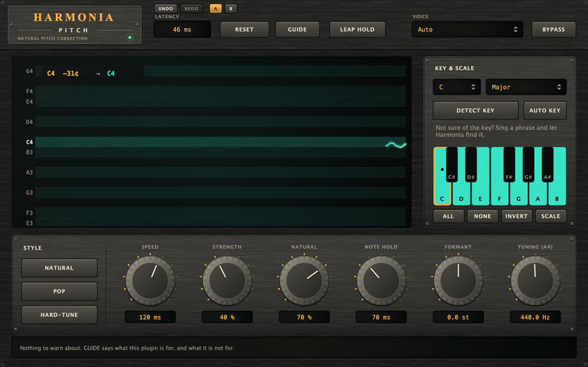
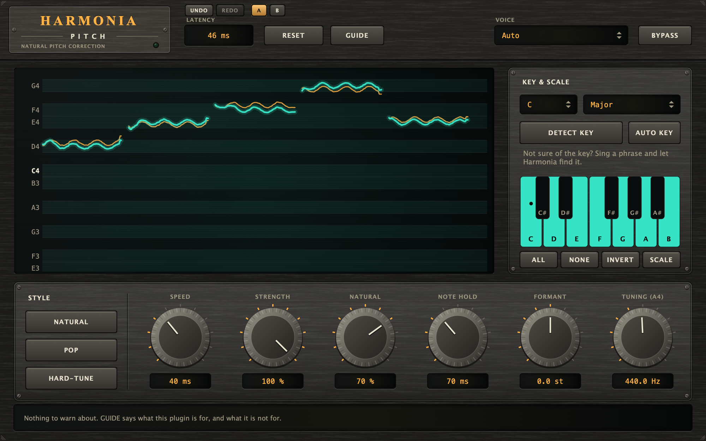

# Harmonia Pitch

Natural-sounding pitch correction for solo vocals that snaps a voice to a key while preserving vibrato, expression, consonants, and formants.

`VST3 + AU + Standalone`



*Sung pitch (amber) and corrected pitch (teal) scroll across allowed scale lanes while the piano keyboard highlights the active note.*

## Theme

### Name origin

*Harmonia* is the Greek goddess of harmony and concord, the one who keeps things in accord; *Pitch* is what it keeps in accord: the plugin does that for a sung line and the key it is meant to be in. (CMake targets, namespaces and plugin codes use the short name "Harmonia".)

### Core philosophy

- **Natural first.** *Speed* and *Strength* pull the voice onto a note while *Natural* decides how much vibrato and expression stays; settled notes hold instead of dragging to neighbours.
- **Your voice stays your voice.** PSOLA re-spaces grains rather than resampling, so formants stay put and unvoiced consonants and breaths pass untouched; *Formant* is `0` unless moved.
- **One voice at a time.** Built for a clean solo vocal and honest about it—not for chords, backing-vocal stacks, or full mixes.
- **A fixed, honest delay.** A `46 ms` look-ahead lets the pitch track be known before re-synthesis; latency is fixed, host-reported, and kept by **Bypass**.
- **Analog look, digital brain.** Studio-hardware interface drawn entirely from code by the shared kit ([shared/ui](../../shared/ui)); no image, font or sound files ship.
- **Free, public, source only.** The repository holds the code, not a download, under the AGPL-3.0-or-later (see [NOTICE](../../NOTICE.md)).

## See it

| View | What to look at |
|---|---|
|  | C major vibrato phrase: sung amber vs corrected teal, lit keys, `46 ms` latency. |

### UI colour legend

| Swatch | Hex | UI Element | Meaning |
|---|---|---|---|
| 🟡 | `#FFB347` | Sung pitch trace, live chip input, singing key outline, **LATENCY** readout | Raw detected vocal pitch (`pitchcolours::sung`) and digital read-outs / lit switches (`colours::amber`) |
| 🔵 | `#37E3C5` | Corrected pitch trace, allowed pitch lanes, lit piano keys | Corrected output pitch (`pitchcolours::corrected`), target lane highlight, and allowed scale notes (`colours::accent`) |
| 🟠 | `#F2A33A` | **BYPASS** active lamp, advice strip warning dots | Bypass engaged (original vocal delayed by 46 ms) or active configuration warnings (`colours::warn`) |
| ⚪ | `#EAE3D0` | C-octave & allowed note labels, active black-key text | Primary silkscreen labels (`colours::text`) |
| ⚫ | `#9F9680` | Advice strip info dots, blocked note labels, secondary captions | Informational notes and muted axis text (`colours::dim`) |
| ⬛ | `#090D0D` / `#1C2A29` | Recessed pitch glass & grid lines | Pitch roll background (`colours::glass`) and semitone/octave graticule (`colours::glassGrid`) |

## Try it

| Setting | What you see / hear / measure |
|---|---|
| **Natural** style (`Speed 20–60 ms`, `Natural 70 %`, `Note Hold 70 ms`) | Transparent vocal polish: steady notes pull onto target (`~0.05 c`) while vibrato and phrasing stay intact. |
| Click unused keys on **KEY & SCALE** (or hold **MIDI** notes) | Switches to *Custom* (or live MIDI mask) and cuts wrong-note snaps; **SCALE** restores last preset scale. |
| **Note Hold** `70 ms` + **Leap Hold** `On` | `≤ 1` semitone waits `76 ms` against flickers; `≥ 2`-semitone leaps adopt in `20 ms`. |
| **Hard-tune** style (`Speed < 1 ms` Instant, `Natural 0 %`) | Vibrato flattened (`≤ 15 %` depth kept) with instant robotic step transitions. |
| Click **Detect** (or enable **Auto Key**) while singing | **Detect** locks major/minor once; **Auto Key** commits in `~6 s` and follows modulations in `~4 s`. |

> [!TIP]
> **First in chain:** Place Harmonia before compression, reverb, or delay, set **Key/Scale** (block unused notes), and match **Voice** range to your singer.

> [!NOTE]
> **MIDI, Undo & A/B:** Held MIDI notes override scale keys (VST3 + Standalone; most AU hosts skip effect MIDI). **UNDO/REDO** (`Cmd+Z`), **A/B**, and `75%–200%` corner resize (`16:10`) keep workflow tight.

> [!IMPORTANT]
> **Fixed 46 ms look-ahead:** Latency is host-compensated during mixing and matched by **Bypass**—record dry and insert Harmonia afterwards.

> [!WARNING]
> **Settings pitfalls:** `Speed < 10 ms` sounds robotic; `Note Hold 0 ms` flickers (`Leap Hold` helps leaps without losing `1`-semitone guard); fewer than `5` notes forces odd snaps.

> [!CAUTION]
> **Solo vocals only:** Never use on chords, stacks, or mixes; it tracks one fundamental, never fixes timing, and leaves breaths/noise untouched.

## Reference

### Controls

| Control | Range / Choices | Default | Role |
|---|---|---|---|
| **Key** | `C` – `B` | `C` | Root note for preset scales |
| **Scale** | `Chromatic`, `Major`, `Minor`, `Harmonic Minor`, `Melodic Minor`, `Dorian`, `Phrygian`, `Lydian`, `Mixolydian`, `Major Pentatonic`, `Minor Pentatonic`, `Blues`, `Custom` | `Chromatic` | Allowed pitch classes; manual key edits switch to `Custom` |
| **Piano Keys & ALL/NONE/INVERT/SCALE** | 12 pitch classes (`C`–`B`) | All 12 on | Allow/block notes (one undo step each); **SCALE** restores last scale (`Major` initially) |
| **Detect / Auto Key** | One-shot listen / `Off`, `On` | `Off` | **Detect** finds key+major/minor once; **Auto Key** follows key changes |
| **Style** | `Natural`, `Pop`, `Hard-tune` | — | Quick-sets speed, strength, and natural character |
| **Retune Speed** | `0–400 ms` (`Instant` < 1 ms) | `35 ms` | Pull rate onto target note (`20–60 ms` transparent) |
| **Strength** | `0–100 %` | `100 %` | Correction depth (`100 %` = fully on note) |
| **Natural** | `0–100 %` | `70 %` | Preserves vibrato and pitch expression (`0 %` = flattened) |
| **Note Hold** | `0–200 ms` | `70 ms` | Minimum dwell before adopting a new note (`0` = immediate) |
| **Leap Hold** | `Off`, `On` | `Off` | Opt-in: `1.0×` hold for `≤ 1` semitone, `0.2×` for `≥ 2` semitones |
| **Formant** | `-6.0` to `+6.0 st` | `0.0 st` | Shifts vocal character without changing pitch (`0` = untouched voice) |
| **Tuning (A4)** | `415.0–466.0 Hz` | `440.0 Hz` | Reference pitch for non-440 Hz tracks |
| **Voice** | `Auto` (`75–1200 Hz`), `Low` (`75–440 Hz`), `Mid` (`100–780 Hz`), `High` (`180–1200 Hz`) | `Auto` | Narrows pitch search (tops sit a whole tone above `G4, F5, C6`, scaled with **Tuning**) |
| **Bypass / Reset / Guide / Undo / A-B** | Toggles & actions | `Off` / `A` | Latency-matched **Bypass**, history **Reset**, **GUIDE**, **UNDO/REDO**, **A/B** |

### Signal flow

```text
in ──► 46 ms look-ahead ──┬──► YIN detect (~24 kHz LP copy, full-rate refine, octave guard)
                          │         │
                          │         ▼
                          │    target note (vibrato centre + hysteresis + Note/Leap Hold)
                          │         │
                          ▼         ▼
                    PSOLA re-synthesis (unvoiced breaths/consonants pass untouched) ──► out
```

- **Pitch detection** ([PitchDetector.h](Source/dsp/PitchDetector.h)): YIN at ~`24 kHz` refined at full rate on a ~`4×` pitch low-passed copy; octave-away glitches pass untouched unless persistent.
- **Correction** ([PitchCorrector.h](Source/dsp/PitchCorrector.h)): Vibrato (`1.3–12 Hz`, up to `6` st peak-to-peak, recognised after `2` big or `3` ordinary swings) averages over one cycle; settled notes hold against `< ~70 cents/s` drift; **Leap Hold** scales by `clamp(1 - (jump - 100) / 100, 0.2, 1)` (`kLeapStartCents`, `kLeapCents`, `kLeapMinFraction`).
- **Re-synthesis** ([AutoTuneEngine.h](Source/dsp/AutoTuneEngine.h)): Sub-sample PSOLA re-spaces grains without resampling, keeping formants intact; unvoiced sound passes untouched.
- **Auto key** ([KeyTracker.h](Source/dsp/KeyTracker.h)): 12-bin histogram forgetting over ~`12 s` of singing against major/minor profiles; switches only after a clear lead for `4 s`.

### Measured

| Verified (`dsp_test` / `HarmoniaDevTool selftest`, synthetic voices, `22–192 kHz`) | Not yet verified |
|---|---|
| Steady notes land within **~0.05 cent** of target; wobble **< 1 cent** (`E2` to `C6`, two vowels) | Windows and Linux builds (`scripts/` are macOS-only) |
| Vibrato depth kept **≥ 100 %** at `Natural 100`, **≤ 15 %** at `Natural 0` | Voices other than a clean solo vocal |
| Formants unchanged on 3-semitone shift (centroid ratio **1.04** vs **1.19** naive resampling) | |
| CPU: **~0.8 %** of one core (stereo, `48 kHz`; **~1.4 %** at `96 kHz`); passes `auval` & `pluginval` strictness `10` | |
| Note Hold (`70 ms`) cut brief (`< 120 ms`) flickers on the Earth Angel stem from **134 to 36** | |
| **Leap Hold** (`dsp_test` 7d3, Linux g++ C++17): `2`-st step **20 ms** on vs **76 ms** off (bound `0.3 × 70 ms = 21 ms`); `3`-st **20 ms**; `1`-st **76 ms** both; `0.5`-st never switches; off bit-identical over `18,000` hops. `stress_corrector` (5 seeds): `12.5 %` wrong-note, `5.2` flips, `34.1 c` bias → **12.8 %**, **5.8**, **33.9 c** (`±150 c` vibrato moves `1.5 % → 1.8 %`) | |
| **NaN / Inf** treated as silence: finite output, identical `1 s` later (`dsp_test` section 9) | |
| Key detect race, idle withdrawal, held MIDI + host reset, `ALL/NONE/INVERT/SCALE`, `UNDO/REDO`, `A/B`, saved window size (`HarmoniaDevTool selftest`) | |

### Limits

- **One voice at a time:** Not for chords, backing-vocal stacks, or full mixes.
- **Fixed 46 ms latency:** Hosts compensate when mixing; monitoring while tracking adds `46 ms` delay (record dry).
- **Auto key** handles major/minor only (~`6 s` to commit, ~`4 s` to follow a key change).
- **Note Hold & Leap Hold:** Note Hold delays real changes by ~hold time (`0` switches immediately); **Leap Hold** is an opt-in non-standard choice shrinking whole-tone+ leaps to `1/5` (`100` to `200` cents).
- **Octave-away glitches** pass through untouched unless they persist.

## Build & develop

Source-only (**VST3 + AU + Standalone**, macOS universal `arm64 + x86_64`). Requires CMake and Xcode (`clang` + macOS SDK); JUCE is fetched via [cmake/Juce.cmake](../../cmake/Juce.cmake).

```sh
# From repository root:
scripts/build.sh harmonia             # build and run DSP + UI checks
scripts/showcase.sh harmonia          # regenerate docs/showcase.gif (requires ffmpeg)

# From plugins/harmonia/:
scripts/build.sh                      # configure, build VST3 + AU + Standalone, install, ad-hoc sign
scripts/build_tests.sh                # JUCE-free offline DSP tests (tune_wav, dsp_test, pitch_track, stress_corrector)
cmake --build build --target HarmoniaDevTool
build/HarmoniaDevTool_artefacts/Release/HarmoniaDevTool selftest
build/HarmoniaDevTool_artefacts/Release/HarmoniaDevTool snapshot docs/screenshot.png
```

Installs to `~/Library/Audio/Plug-Ins/VST3/Harmonia Pitch.vst3` and `~/Library/Audio/Plug-Ins/Components/Harmonia Pitch.component`. Extra tools: `build-tools/tune_wav`, `build-tools/pitch_track`, `build-tools/stress_corrector`, and `HarmoniaDevTool process`.

<details>
<summary>Repository layout & CI status</summary>

```text
Source/dsp/        JUCE-free engine: Scales, KeyTracker, PitchDetector, PitchCorrector, AutoTuneEngine, Kernels, Rings
Source/            PluginProcessor, PluginEditor, Advice.h
Source/ui/         PitchGraph, NoteKeyboard, HarmoniaUi.h (kit is shared/ui)
Tests/             dsp_test, tune_wav, pitch_track, stress_corrector, DevTool, TestSignals.h, WavIO.h
scripts/           build.sh, build_tests.sh, toolchain.sh
docs/              screenshot.png, showcase.gif
```

CI in [.github/workflows](../../.github/workflows) does not build or test Harmonia yet; run the checks above locally.

</details>

## Licence

AGPL-3.0-or-later, source only. See [LICENSE](../../LICENSE), [NOTICE.md](../../NOTICE.md) (third-party software, trademarks, distribution terms), [CONTRIBUTING.md](../../CONTRIBUTING.md), and [SECURITY.md](../../SECURITY.md). Provided "as is", without warranty; macOS quarantines unsigned copies (`xattr -cr "Harmonia Pitch.vst3"` clears it for personal use).
