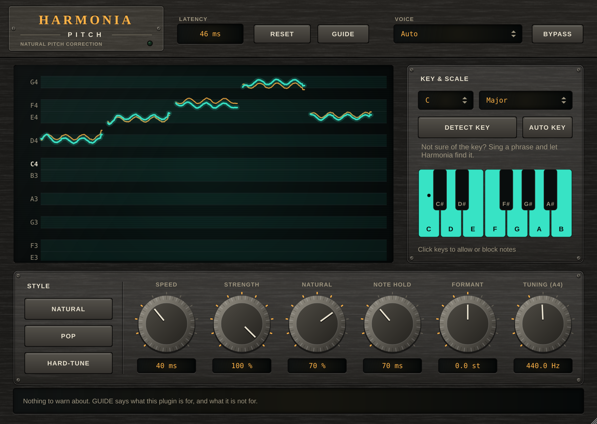

# Harmonia Pitch

**Natural-sounding pitch correction for solo vocals** (VST3 + AU + Standalone): it snaps the voice to the notes of a key
while keeping its vibrato, its expression and its colour.

## Name origin

*Harmonia* is the Greek goddess of harmony and concord, the one who keeps things in accord; *Pitch* is what it keeps in accord: the plugin does that for a sung
line and the key it is meant to be in. (CMake targets, namespaces and plugin codes use the short name "Harmonia".)



*Headless render of the editor (the hardware-style interface shared with the other plugins) after a phrase of five notes with vibrato in C major. The pitch graph shows the sung pitch (amber) and the corrected pitch (teal) against the allowed notes; the **KEY & SCALE** panel shows the allowed notes as lit piano keys (click one to allow or block it), and the **STYLE** buttons and the six knobs along the bottom (Speed 40 ms, Strength 100 %, Natural 70 %, Note Hold 70 ms, Formant 0, Tuning 440 Hz) set how the correction behaves. **LATENCY** (top) is the fixed 46 ms. Regenerate with the command under "Development".*

## Core philosophy

- **Natural first.** The voice is pulled onto a note by *Speed* and *Strength*, and *Natural* decides how much of the singer's
  own deviation (vibrato, expression) is kept. A vibrato stays a vibrato, and a note the voice has settled on is held rather
  than dragged to its neighbour.
- **Your voice stays your voice.** Grains are re-spaced, not resampled, so formants stay where they were; consonants and
  breaths (unvoiced) pass through untouched; *Formant* is zero unless you move it.
- **One voice at a time.** It is built for a clean solo vocal and says so: not for chords, backing-vocal stacks or full mixes.
- **A fixed, honest delay.** A 46 ms look-ahead means the pitch track is known before the audio is re-synthesised. The
  latency is fixed, reported to the host, and kept by Bypass so the original stays aligned.
- **Analog look, digital brain.** The interface is a piece of studio hardware drawn entirely from code by the kit shared
  with the other plugins ([shared/ui](../../shared/ui)): no image, font or sound files are shipped.
- **Free, public, source only.** The repository holds the code, not a download, under the AGPL-3.0-or-later (see
  [License and terms](#license-and-terms)).

## Features

| Area | What it does |
|---|---|
| **Key / Scale** | Notes the voice may land on. Click piano keys to allow or block individual notes (switches to *Custom*). Block notes your melody never uses: fewer wrong-note snaps. |
| **Detect key** | Listens to your vocal and sets key + major/minor for you, once. |
| **Auto key** | Keeps following the key of the vocal and changes it when the song modulates or a new section starts. Major/minor only; it needs about 6 s of singing before it commits, and takes about 4 s to follow a key change. Key and Scale are ignored while it is on (they still apply until the key is known). Automatable. |
| **Style** | *Natural* for transparent correction, *Pop* for a polished studio sound, *Hard-tune* for the robotic effect. |
| **Speed** | How fast the voice is pulled onto the note. *Instant* = robotic. 20–60 ms is transparent. |
| **Strength** | Amount of correction. 100 % = fully on the note; lower keeps more of your own pitch. |
| **Natural** | Keeps your own vibrato and expression. 100 % = all of it, 0 % = flattened onto the note. |
| **Note Hold** | How long the voice has to stay near a new note before Harmonia moves to it (default 70 ms). Stops the correction flickering to a wrong neighbouring note; a real note change is delayed by about that long. 0 = switch at once. Automatable. |
| **Formant** | Shifts vocal character without changing pitch. Leave at 0 to keep your own voice. |
| **Tuning (A4)** | Reference pitch, for songs not tuned to 440 Hz. |
| **Voice** | Bass/baritone, tenor/alto, soprano or Auto. Narrows the pitch search: faster, never jumps an octave. Each range reaches a whole tone past the usual top note of its voices (G4, F5, C6; Auto covers them all), and moves with **Tuning**. |
| **Bypass** | Original vocal, delayed by the latency so it stays aligned. |
| **Guide and notes** | **GUIDE** (header) says what Harmonia is for and what it is *not* for: one voice at a time, not chords, stacks or mixes; it moves a note to the nearest allowed one, it does not fix timing, and the delay is fixed (record dry). The strip under the controls warns, in amber, when BYPASS is on, when no note or fewer than five are allowed, and when TUNING is not 440 Hz; it notes an almost instant SPEED (the robotic effect), NOTE HOLD 0, AUTO KEY's limits, a moved FORMANT and a fixed VOICE range. The rules are in [Advice.h](Source/Advice.h), checked by `HarmoniaDevTool selftest`. |
| **Pitch graph** | Your pitch (amber) and the corrected pitch (teal) over the last few seconds against the allowed notes. |

### How it works

`detect (YIN) → pick target note + smooth the correction → PSOLA re-synthesis`

* **Pitch detection** ([PitchDetector.h](Source/dsp/PitchDetector.h)): YIN at ~24 kHz, refined at full rate; octave guard for
  strong harmonics; sub-cent precision. The pitch is measured on a low-passed copy of the voice (cutoff ~4x the pitch), so
  breath, sibilance and the non-harmonic residue left in AI-separated stems or by bleed cannot pull the detector onto a
  wrong period. A detection more than an octave away from where the voice just was is treated as a glitch (that stretch
  passes through untouched) unless it persists.
* **Correction** ([PitchCorrector.h](Source/dsp/PitchCorrector.h)): the target note comes from a "centre" of the sung note.
  Under vibrato (1.3-12 Hz, up to 6 semitones peak to peak, recognised after two big swings or three ordinary ones) the
  centre is the mean over one whole vibrato cycle, so even a +-1.5 semitone vibrato stays on one note. Without vibrato it
  follows the voice quickly, so real note changes are caught at once. A note the voice has settled on is *held*: slow drift
  (< ~70 cents/s) or a sag has to travel well past the halfway point before it counts as the next note. The correction
  is smoothed by *Speed*; *Natural* decides how much of the singer's own deviation is kept.
* **Re-synthesis** ([AutoTuneEngine.h](Source/dsp/AutoTuneEngine.h)): pitch-synchronous overlap-add (PSOLA) with sub-sample
  analysis marks. Grains are re-spaced, not resampled, so formants (the voice colour) stay where they were.
  Consonants and breaths (unvoiced) pass through untouched.
* **Note hold** (`dwellMs` in [PitchCorrector.h](Source/dsp/PitchCorrector.h)): a new target note has to persist for the hold time before it
  is adopted. While it is undecided the singer is left as sung, so a wobble or detector blip is not dragged to the neighbouring
  note. On the Earth Angel stem this cut brief (<120 ms) note flickers from 134 to 36.
* **Auto key** ([KeyTracker.h](Source/dsp/KeyTracker.h)): a pitch-class histogram of the sung notes that forgets over ~12 s of singing,
  matched against the major/minor key profiles. Glides and notes that sit between two semitones count for less. The followed key
  only changes when another key has beaten it by a clear margin for 4 s, so passing notes and drift do not move it.
* A fixed 46 ms look-ahead means the pitch track is known before the audio is re-synthesised.

## How to use

### Build and install (macOS)

Harmonia Pitch is source only: you build it yourself. Formats: **VST3 + AU + Standalone** (macOS, universal arm64 + x86_64).
Requires CMake and Xcode (clang + macOS SDK). JUCE is fetched automatically (the version is set in `cmake/Juce.cmake` at the
repository root).

```sh
scripts/build.sh            # configure, build VST3 + AU + Standalone, install, ad-hoc sign
```

This copies the plug-ins to `~/Library/Audio/Plug-Ins/VST3/Harmonia Pitch.vst3` and
`~/Library/Audio/Plug-Ins/Components/Harmonia Pitch.component`. Then rescan plugins in your host.

> `scripts/build.sh` drives Xcode's clang/SDK through Unix Makefiles on purpose: on this machine `xcodebuild`
> cannot start until `sudo xcodebuild -runFirstLaunch` is run, which also breaks CMake's Xcode generator.
> If you run that once, the stock `cmake -G Xcode` flow works too.

Builds are for your own use; if you hand one to somebody else, see [License and terms](#license-and-terms).

### Using it in FL Studio

1. In FL Studio: **Options → Manage plugins → Find installed plugins** (rescan), then add **Harmonia Pitch** (the VST3) to the
   mixer insert of your vocal.
2. **Put it first** in the insert chain, before reverb/delay/compression.
3. **Set the key and scale** (or click **Detect key from my vocal**, sing/play a phrase, click again), or turn on **Auto key**.
4. **Pick a style**: *Natural* for transparent correction, *Pop* for a polished studio sound, *Hard-tune* for the robotic effect.
5. **Record dry.** FL compensates the plug-in's fixed 46 ms latency automatically when mixing. If you monitor through
   Harmonia while recording, you will hear that delay: record dry and add Harmonia afterwards.

Tips for the most natural result:

* Use **Natural** style first; raise Speed only if notes still sound off.
* Choose the **correct key**. Wrong-key notes are the most audible sign of pitch correction.
* Block notes your melody never uses (click the piano keys): fewer wrong-note snaps.
* Pick your **Voice** type rather than Auto if the vocal is clean and solo.
* Works on one voice at a time. Not for chords, backing-vocal stacks or full mixes.

## Development

Built with [JUCE](https://juce.com). The engine in `Source/dsp` is JUCE-free and can be run offline on WAV files; the plugin
layer only holds the parameters, the host glue and the editor.

### Tests, screenshots and layout

```sh
scripts/build_tests.sh      # offline DSP accuracy tests (no JUCE) + builds build-tools/{tune_wav,pitch_track,stress_corrector}
cmake --build build --target HarmoniaDevTool
build/HarmoniaDevTool_artefacts/Release/HarmoniaDevTool selftest              # headless processor self-test
build/HarmoniaDevTool_artefacts/Release/HarmoniaDevTool snapshot docs/screenshot.png   # renders the editor to PNG
```

Extra tools:

```sh
# tune a WAV file offline (--dump writes a per-hop CSV: sung / corrected / target pitch)
build-tools/tune_wav in.wav out.wav --key A --scale minor --speed 40 --natural 0.7 --dump hops.csv

# independent pitch track (t, midi every 5 ms) of any WAV, e.g. to compare input and output
build-tools/pitch_track in.wav track.csv

# synthetic stress scenarios for the corrector: huge vibrato, drift, sagging notes (--csv dir writes the contours)
build-tools/stress_corrector

# follow the key of a WAV by itself (prints when it changes)
build-tools/tune_wav in.wav out.wav --autokey 1

# run a WAV through the real plug-in processor (bit-identical to tune_wav at equal settings)
build/HarmoniaDevTool_artefacts/Release/HarmoniaDevTool process in.wav out.wav 0 0
```

`docs/screenshot.png` is the output of the `snapshot` command, never edited by hand. It is regenerated after every change
that touches the UI or what it shows, and its caption above is kept true to the picture.

Layout (the one file map; update it when a source file is added, renamed or removed):

```
Source/dsp/        JUCE-free engine: Scales, KeyTracker, PitchDetector, PitchCorrector, AutoTuneEngine,
                   Kernels (SIMD-friendly sums), Rings (history buffers)
Source/            PluginProcessor (parameters, host glue), PluginEditor, Advice.h (the notes under the controls and the GUIDE text; plain C++)
Source/ui/         PitchGraph, NoteKeyboard, HarmoniaUi.h (the two pitch colours); the look itself is shared/ui
../../shared/ui/   the drawing kit of the interface, shared with the other plugins of the repository
Tests/             dsp_test, tune_wav, DevTool, synthetic voice generator
scripts/           build.sh, build_tests.sh, toolchain.sh (shared Xcode clang/SDK lookup)
docs/screenshot.png  editor render (generated by HarmoniaDevTool)
```

### Continuous integration

CI does not build or test Harmonia yet; the workflows in [.github/workflows](../../.github/workflows) cover Themis and Iris only (the
state of that is tracked in the repository's [CLAUDE.md](../../CLAUDE.md)). Run the commands above before you rely on a change.

### What has and hasn't been verified

| Verified (synthetic voices, 22–192 kHz) | Not yet verified |
|---|---|
| Steady notes land within ~0.05 cent of the target; wobble < 1 cent (E2 to C6, two vowels) | Windows and Linux builds: the build scripts are macOS-only |
| Vibrato depth kept ≥ 100 % at *Natural 100*, ≤ 15 % at *Natural 0* | Voices other than a clean solo vocal (see Limitations) |
| Formants unchanged when shifting 3 semitones (spectral centroid ratio 1.04; naive resampling gives 1.19) | |
| ~0.8 % of one core (stereo, 48 kHz; ~1.4 % at 96 kHz). Passes `auval` and `pluginval` at strictness 10 | |
| A NaN or an inf in the input is taken as silence: the output stays finite and a second later the voice is what it would have been without it (`dsp_test`, section 9) | |

## Limitations

- **One voice at a time.** Not for chords, backing-vocal stacks or full mixes.
- **Fixed 46 ms latency.** FL compensates it when mixing, but if you monitor through Harmonia while recording you will hear
  it: record dry and add Harmonia afterwards.
- **Auto key** handles major/minor only, needs about 6 s of singing before it commits and takes about 4 s to follow a key change.
- **Note Hold delays a real note change** by about the hold time; set it to 0 to switch at once.
- **A detection more than an octave away** from where the voice just was is treated as a glitch and passes through untouched
  unless it persists.

## License and terms

Harmonia is free software under the AGPL-3.0-or-later, and is source only. The licence, JUCE and the other third-party
components, the trademark note and what you owe somebody if you hand them a build are in [NOTICE.md](../../NOTICE.md); they are
the same for every plugin of the repository. Suggestions and bug reports are welcome as issues, code contributions are not
accepted ([CONTRIBUTING.md](../../CONTRIBUTING.md)).

- **No warranty.** Harmonia is provided "as is", without warranty of any kind. It is an audio effect: listen to the result and keep your original recording.
- **Passing it on.** macOS quarantines a copy that is not signed with a Developer ID certificate and notarised
  (`xattr -cr "Harmonia Pitch.vst3"` clears it for personal use).
