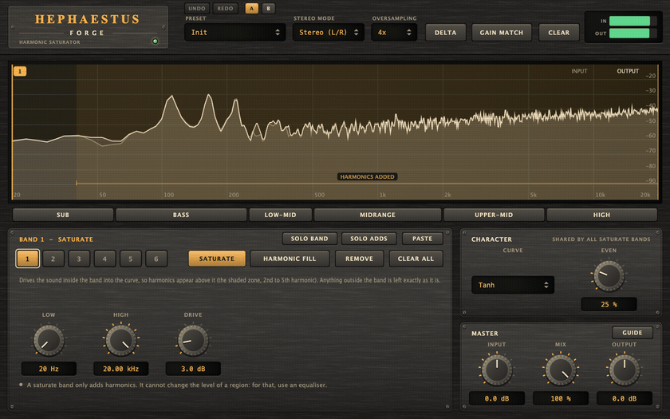
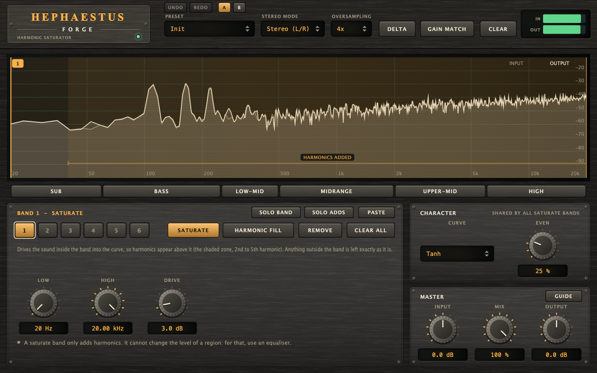

# Hephaestus Forge

Six-band mastering harmonic forge that either saturates inside a band or adaptively fills only the harmonics missing above it.

`VST3 + AU + Standalone`



*Live input and output spectra respond as Saturate (amber) and Harmonic Fill (teal) bands shape the harmonic balance.*

## Theme

### Name origin

*Hephaestus* is the Greek god of the forge, of metalworking and of the craftsmen's tools: the one who hammers a shape out of raw metal; *Forge* is what the plugin does to a master's spectrum, forging harmonics where the sound is thin. (CMake targets, namespaces and plugin codes use the short name "Hephaestus".)

### Core philosophy

- **A band adds only what you ask for.** Saturate shapes a band-passed copy and sums only the *difference* onto latency-matched input; nothing outside is filtered, so overlapping bands stay `0.000 dB` flat at small signal.
- **Fill what is missing, not what is already there.** Harmonic Fill measures the *input* above the band and adds only the shortfall against **Amount**—open-loop, with no feedback to destabilise.
- **Exact where it can be, honest where it cannot.** Unit-energy H2–H5 weights (`Warm` Chebyshev, `Clean` phase-locked sines, `Octave` STFT partials) and `double` ADAA inside oversampling; every claim is test-measured and heuristics live in Limits.
- **Made for judging, with mastering tools in reach.** **Delta**, **Gain Match**, **Mid/Side**, latency-compensated **Mix**, and live input-vs-output FFT prevent mistaking loudness for better.
- **Analog look, digital brain.** Studio-hardware interface drawn entirely from code by the shared kit ([shared/ui](../../shared/ui)); no image, font or sound files ship.
- **Free, public, source only.** The repository holds the code, not a download, under the AGPL-3.0-or-later (see [NOTICE](../../NOTICE.md)).

## See it

| View | What to look at |
|---|---|
|  | *808 Sub Fill* on `52 Hz` sub: teal band fills missing `104` and `156 Hz`. |

### UI colour legend

| Swatch | Hex | UI Element | Meaning |
|---|---|---|---|
| 🟡 | `#FFB347` | **Saturate** band frame, `HARMONICS ADDED` zone, mode button, active chip, off-screen `SOLO: BAND` alert | Band-passed waveshaper difference summed onto latency-matched dry (`colours::amber`) |
| 🔵 | `#37E3C5` | **Harmonic Fill** band frame, `HARMONICS ADDED` & `ADAPT LISTENS HERE` zones, mode button, active chip | Adaptive H2–H5 generator (`colours::accent`) |
| ⚪ | `#EAE3D0` | Output spectrum trace & fill, active main-band solo switch, primary labels | Processed output spectrum and active text (`colours::text`) |
| ⚫ | `#9F9680` | Input spectrum trace & fill, info notes under band knobs, secondary text | Pre-processing input trace and informational hints (`colours::dim`) |
| 🟢 | `#5FD68C` | **IN / OUT** level meters (`≤ -6 dBFS`) | Healthy headroom (`colours::good`) |
| 🟠 | `#F2A33A` | **IN / OUT** level meters (`-6` to `-0.5 dBFS`), advice warning dots | Approaching full scale or active configuration warning (`colours::warn`) |
| 🔴 | `#EF4A3D` | **IN / OUT** level meters (`> -0.5 dBFS`) | Peak near/at `0 dBFS` clipping (`colours::bad`) |
| ⬛ | `#090D0D` / `#1C2A29` | Spectrum & meter glass, FFT graticule | Recessed glass display (`colours::glass`) and grid (`colours::glassGrid`) |

## Try it

| Recipe / Preset | What you see / hear / measure |
|---|---|
| *808 Sub Fill* or *Clean Sub Fill* (`40–120 Hz` Fill) | Adds H2–H5 above sub (`104 / 156 Hz`); `ABOVE` shows existing energy, **Clean** locks single notes in `~100 ms` (`-57` to `-66 dB` non-harmonic). |
| *Missing Fundamental* / *Small-Speaker Bass* (**Rebuild** on) | Restores missing `60 Hz` from `120+180 Hz` (`0.299` vs `0.3` target) and backs off to `0.000` when the fundamental exists. |
| *Octave Air* (`Octave` Fill `600 Hz–2 kHz`) | Pure H2–H5 per resolved partial (`~43 ms` / `2047`-sample latency reported); `-47 dB` IM vs `+8 dB` **Warm**. |
| *Master Glue*, *Warm Tube*, *Tape Body*, *Air Exciter* | Band-limited **Saturate** (`4x` OS); check **Delta** and **Gain Match** (`~0.6 s`, `±12 dB`) to judge without level bias. |
| **Stereo Mode** `Mid/Side` + **SOLO ADDS** / **MusicBands** strip | Fill acts on **Mid only** (`-93 dB` side H2); six **MusicBands** solos sum flat to `0.000 dB`. |

> [!TIP]
> **Master/bus workflow:** Put Hephaestus **before the limiter**, double-click the spectrum to add a band (or load 1 of 10 factory presets), and audition with **Delta** + **Gain Match**.

> [!NOTE]
> **Analyzer, Solos & Paste:** 8192-point FFT (`+4.5 dB/oct`, `90 dB` range; right-click for Range/Speed/Tilt). Solos fade over `10 ms`, never save; **PASTE** imports Themis bass bands; user presets save in `~/Library/Application Support/Pantheon/Hephaestus Forge/Presets`.

> [!IMPORTANT]
> **Latency & Mid/Side:** Oversampling (`0 / 49 / 61 / 65` samples at `48 kHz`) and **Octave** (`+2047` samples, `~43 ms`) report latency to the host; set Octave before rendering. In **Mid/Side**, Saturate shapes M+S while Fill acts on **Mid only**.

> [!WARNING]
> **Character & Gain Match pitfalls:** **Octave** needs `≥ 94 Hz` separation (`4` bins @ `48 kHz`); **Clean** gates chords (`0.5–0.8`); **Warm** intermodulates chords; **Rebuild** is experimental on dense mixes; **Gain Match** pulls down bass boosts.

> [!CAUTION]
> **Only adds harmonics:** Not an EQ (use [Iris Prism](../iris/README.md)), compressor (use [Atlas Span](../atlas/README.md) / [Hera Bond](../hera/README.md)), or limiter—adaptive fill reads total energy in `1.25×–5.2× High`, so dense mids/highs make it back off.

## Reference

### Controls

| Control | Range / Choices | Default | Role |
|---|---|---|---|
| **Input / Output Gain** | `-12.0` to `+12.0 dB` | `0.0 dB` | Pre/post level trim (session-wide) |
| **Mix** | `0–100 %` | `100 %` | Latency-compensated dry/wet blend |
| **Stereo Mode** | `Stereo (L/R)`, `Mid/Side` | `Stereo (L/R)` | M/S saturates M+S; fill acts on Mid only |
| **Oversampling** | `Off`, `2x`, `4x`, `8x` | `4x` | Linear-phase oversampling (`0 / 49 / 61 / 65` samples at `48 kHz`) |
| **Delta / Gain Match** | `Off`, `On` | `Off` | **Delta**: `wet - dry`; **Gain Match**: slow (`~0.6 s`) `±12 dB` RMS match |
| **Curve / Even Harmonics** | `Tanh`, `Atan`, `Soft` / `0–100 %` | `Tanh` / `25 %` | Shared Saturate curve shape and asymmetry (adds even H2, H4…) |
| **Band On / Mode (1–6)** | `Off`, `On` / `Saturate`, `Harmonic Fill` | Band 1 On (`20–20k`), `Saturate`; 2–6 Off (`100–1k`) | Up to 6 bands (double-click, drag edges/body, Delete/Backspace, right-click Duplicate) |
| **Low / High** | `20 Hz–20 kHz` (min ratio `1.5`; Fill `≤ 2 kHz`) | `20 Hz–20 kHz` (B1) | Band boundaries |
| **Drive** *(Saturate)* | `0.0–24.0 dB` | `3.0 dB` (B1), `4.0 dB` (B2–6) | Waveshaper drive |
| **Character** *(Fill)* | `Warm`, `Clean`, `Octave` | `Warm` | Chebyshev waveshaper, 1-note sine tracker, or STFT partial synthesis |
| **Amount / Tone** *(Fill)* | `Off` (`-30 dB`) to `+6.0 dB` / `0–100 %` | `-9.0 dB` / `50 %` | Target harmonic energy above band & H2–H5 unit-energy tilt |
| **Adapt / Rebuild** *(Fill)* | `0–100 %` / `Off` (`-60 dB`) to `+6.0 dB` | `100 %` / `Off` | `100 %` fills missing shortfall only; **Rebuild** restores missing fundamental (`3f - 2f`) |
| **Solos / Paste / Undo / A-B** | Actions & monitors | Off / `A` | **SOLO BAND/ADDS**, 6 **MusicBands** solos, **PASTE**, **CLEAR ALL**, **UNDO/REDO**, **A/B**, **GUIDE** |

### Signal flow

```text
in ──► gain ─┬─ dry (delayed by latency) ───────────────────────────────────────────────────────────────┐
             └─ [M/S enc] ─┬─ fill band × N (base rate, adaptive) ──► sum ──► delay ─────────────┬─ + ─┴─ [M/S dec] ─► [gain match] ─► mix/delta ─► out
                           ├─ saturate band × N: BP ──► up ──► residual ADAA ──► down ──► sum ──┤
                           └─ clean copy (delayed by oversampling latency) ──────────────────────┘
```

- **Saturate residual ADAA:** Shapes `f(u)` minus its tangent at the bias point in `double` inside linear-phase oversampling (`DC` block on residual only); small signals stay flat (`0.000 dB`) with overlapping bands.
- **Adaptive Fill:** Open-loop `~100 ms` band `E_b` vs above-band `E_a` (`1.25×–5.2× High`): `s = 1 - min(1, E_a / (E_b × Amount))`, `g = (1 - Adapt) + Adapt × sqrt(s)` (`~50 ms` smooth); drops harmonics above `0.48 × fs`.
- **Warm / Clean / Octave / Rebuild:** **Warm** divides by slow `6 / lo` envelope (`1.26 dB` → `0.38 dB` error at `60 Hz`) + Chebyshev T2–T5; **Clean** ([PartialTracker.h](Source/DSP/PartialTracker.h)) uses `8` resonators/oct (`14–55` resonators) + quadrature integrators + `0.5–0.8` confidence gate; **Octave** ([OctaveGenerator.h](Source/DSP/OctaveGenerator.h)) runs quarter-frame Hann STFT (`N = 2048` ≤64 kHz, `4096` ≤128 kHz, `8192` >128 kHz) + `8 ms` echo guard; **Rebuild** uses narrow `GapDetector` resonators for `3f - 2f`.

<details>
<summary>Research notes</summary>

- **Virtual bass & NLD vs phase vocoder:** Combines Larsen & Aarts (*Audio Bandwidth Extension*, 2004), Bai & Lin (JAES 2006), Mu, Gan & Tan (ICASSP 2012), Hill & Hawksford (2010), and [Eloi et al., DAFx 2020](https://acris.aalto.fi/ws/portalfiles/portal/51973173/Eloi2020_Virtual_bass_DAFx2020.pdf) via envelope-normalised Chebyshev T2–T5.
- **Anti-aliasing & host API:** Residual ADAA after Parker et al. (DAFx 2016) / [Werner & Azelborn, DAFx 2023](https://www.dafx.de/paper-archive/2023/DAFx23_paper_61.pdf) in `double` inside linear-phase oversampling; latency updates via `AsyncUpdater` and versioned `ParameterID`s.

</details>

### Measured

| Check (`HephaestusTests`, `HephaestusUiCheck`, `HephaestusHostCheck`) | Result |
|---|---|
| Small-signal response (`40 Hz–20 kHz`, all OS, 6 overlapping bands @ `18 dB`) | Flat within **0.001 dB** |
| Dry & wet latency (`2x / 4x / 8x`) | Impulse lands **exactly** on **49 / 61 / 65** samples |
| Aliasing (`5.3 kHz` sine, `+18 dB` drive, re fundamental) | Naive tanh **-18 dB** → ADAA **-30 dB** → oversampled **-70 to -72 dB** |
| **Even** bias (`0` vs `0.5`) / Band isolation (`100 Hz` sine @ `+24 dB`) | H2 `< -160 dB` vs `-15 dB` / H3 **-11 dB** on tone vs **-120 dB** (`2–4 kHz` band) |
| Zone containment (noise, `6/12/24 dB`) / Band off | **0.00–0.02 %** above `5× High` (Saturate); **0.45 %** above / **81 %** inside (Fill); band off delayed input **max error 0** |
| Sample rates (`22.05–192 kHz`) / Random & NaN+Inf recovery | Small-signal error **3e-8** (`-60 dBFS`); `600` random blocks (`1–1500` samples) finite; NaN+Inf finite & within **8.3e-6** after `2 s` |
| **Warm** fill weights (`-6/-9/-15/-22`, `45/60/90 Hz`, `-6` & `-26 dBFS`), tails | Within **0.6 dB** (`0.3 dB` mid-range); `-48 dB` at `50 ms`, `-95 dB` at `100 ms` |
| **Clean** fill (`40–120 Hz`, `45/60/90 Hz`, `0.5` & `0.005`; decaying; glide) | Weights within **0.1 dB**; non-harmonic **-66 / -58 / -57 dB** (Warm `-28/-30/-34 dB`); decaying `60 Hz` H2 **-5.61 dB** at `0.3 s` & `2 s`; onset peak `0.594` vs `0.597`, **100 ms** to `90%`; `100→50 Hz` glide `-6.0 dB` (`-58 dB` non-harmonic, `-0.1 dB` glide); moving edge `-6.05 dB` (vs `-7.58 dB`); left-only right `-240 dB`; `44.1/96/192 kHz` `-6.0 dB` |
| **Clean** two-note & tremolo (`50+70 Hz`; `60 Hz` @ `3 Hz` `30–100%`) | `20 dB` quieter 2nd note: **-25 dB** IM (Warm `-9 dB`); equal notes: **-8.4 dB** (Warm `+2.6 dB`); tremolo H2 swing **9.3 dB** (Warm **69.0 dB**: `-2.3` to `-34 dB`) |
| **Octave** fill (`500–2000 Hz`, 5 partials; 3 & 6 partials; tremolo; edges; latency) | Weights within **0.15 dB**; non-harmonic **-46.9 / -47.6 dB** (Warm `+8.2 / +15.0 dB`); tremolo swing **0.28 dB** (Warm `11.4 dB`); out-of-band (`300/420 Hz`, `2.3/3.5 kHz`) **-240 dB**; note `-240 dB` before / **12 ms** to `90%` / `-240 dB` `40 ms` after; `60 Hz` apart **-64 dB** (Warm `-22 dB`); white noise `0.1 rms` adds `0.010 rms` (`0.05` peak); blocks `1–97` bit-identical to `480`; `44.1/96/192 kHz` frame `2048/4096/8192` (`46.4/42.7/42.7 ms`) H2 within **0.3 dB**; latency **2047** (`2108` at `4x`), error **-33.7 dB** re peak; `ADDS` solos sum to Delta (`6e-08`); `400` character/OS switches peak `0.49` |
| **Adaptive fill** (`60 Hz`, `Amount -6 dB`) & **Rebuild** (`120+180 Hz`) | Adapt `0%` `+0.6 dB` apart; Adapt `100%` hollow **-6.3 dB** (target `-6.0`), full **nothing**, quarter **0.76** (law `0.80`); Rebuild `0.299` (target `0.3`), `-6.0 dB` linear, `0.000` when fundamental exists (`0.230` when missing) |
| **MusicBands** solo strip / **Mid/Side** / **Mix & Delta** / **Gain Match** | Passband `1.68 dB` (`3.88 dB` Low-Mid), next band `≥ 14.0 dB` down, others `48.2 dB`, all `6` sum to `0.000 dB`; M/S side tone H2 **-93 dB** (L/R `-5.7 dB`); Mix `0` / `0.37` / off **sample-exact**; Gain Match `-4.9 dB` → **0.0 dB** |
| **Spectrum analyzer** / **CPU** | Bin-centred `-6.02 dBFS` → **-6.02 dB**, `4 kHz` @ `4.5 dB/oct` → **+2.98 dB**, off-bin `-7.44 dB`, left-only `-3 dB`; 6-band mix on Apple M4: **2 %** (no OS) → **15 %** (`8x`); 6 Octave bands on Linux: **9 %** |
| **`HephaestusUiCheck` & `HephaestusHostCheck`** | Advice/presets, mouse add/select/drag/limits, Duplicate, user presets, UNDO/REDO/Cmd+Z, A/B, CLEAR ALL, REMOVE/solo, paste, bypassed latency; VST3 across 5 rates × 5 block sizes, latency `0/49/61/65`, legacy migration, `auval` pass |

**Not yet verified:** Inside FL Studio itself (*pluginval* blocked by sandbox); manual mouse interaction in a DAW; Windows and Linux builds.

### Limits

- **Adaptive fill measures energy, not pitch:** Compares `1.25×–5.2× High` total energy, so dense upper material makes it back off; Chebyshev weights are approximate on noise.
- **Octave latency & resolution:** Adds ~`43 ms` (`2047` samples @ `48 kHz`) and `~94 Hz` (`4`-bin) resolution; echo guard starts harmonics `~12 ms` after note onset.
- **Clean requires one dominant note:** Locks in `~100 ms`, gates multi-note bands (`0.5–0.8` confidence), and leaves `-57` to `-66 dB` non-harmonic residue.
- **Rebuild is experimental:** Difference tones across all pairs can add inharmonic bass on dense mixes.
- **Saturate band edges:** 4th-order Butterworth edges rotate phase near crossovers.
- **Gain Match, Analyzer & signing:** **Gain Match** (`~0.6 s`, `±12 dB`) partly undoes bass boosts; **Analyzer** Hann scalloping reads up to `1.4 dB` low between bins; ad-hoc signed, not notarised.

## Build & develop

Source-only (**VST3 + AU + Standalone**, macOS universal `arm64 + x86_64`). Requires CMake and Xcode; JUCE is fetched via [cmake/Juce.cmake](../../cmake/Juce.cmake) (or `third_party/JUCE`).

```bash
# Recommended from repository root:
scripts/build.sh hephaestus           # configure, build & run HephaestusTests + HephaestusUiCheck
scripts/showcase.sh hephaestus        # regenerate docs/showcase.gif (requires ffmpeg)

# Manual CMake from plugins/hephaestus/:
export SDKROOT=$(xcrun --sdk macosx --show-sdk-path)
cmake -S . -B build -DCMAKE_BUILD_TYPE=Release
cmake --build build --target Hephaestus_VST3 Hephaestus_AU Hephaestus_Standalone   # installs to ~/Library/Audio/Plug-Ins/{VST3,Components}
auval -v aufx Hphs Hpha

cmake --build build --target HephaestusTests && ./build/HephaestusTests_artefacts/Release/HephaestusTests
cmake --build build --target HephaestusUiCheck && ./build/HephaestusUiCheck_artefacts/Release/HephaestusUiCheck
cmake --build build --target HephaestusHostCheck && ./build/HephaestusHostCheck_artefacts/Release/HephaestusHostCheck "$HOME/Library/Audio/Plug-Ins/VST3/Hephaestus Forge.vst3"
cmake --build build --target HephaestusSnapshot && ./build/HephaestusSnapshot_artefacts/Release/HephaestusSnapshot docs/screenshot.png "808 Sub Fill" sub 2
```

<details>
<summary>Repository layout & CI status</summary>

```text
Source/DSP/        Band, Waveshaper, Saturator, FundamentalEngine, PartialTracker, OctaveGenerator, Engine
Source/            Parameters, UserPresets, PluginProcessor.*, Advice.h
Source/UI/         SpectrumView, HephaestusUi.h (kit is shared/ui; shared/dsp provides Biquad, AnalyzerTap, SpectrumAnalyzer, MusicBands)
Tests/             HephaestusTests, HephaestusUiCheck, HephaestusHostCheck, HephaestusSnapshot
docs/              screenshot.png, showcase.gif
```

CI in [.github/workflows](../../.github/workflows) does not build or test Hephaestus yet; run the checks above locally.

</details>

## Licence

AGPL-3.0-or-later, source only. See [LICENSE](../../LICENSE), [NOTICE.md](../../NOTICE.md) (third-party software, trademarks, distribution terms), [CONTRIBUTING.md](../../CONTRIBUTING.md), and [SECURITY.md](../../SECURITY.md). Provided "as is", without warranty; macOS quarantines unsigned copies (`xattr -cr "Hephaestus Forge.vst3"` clears it for personal use).
