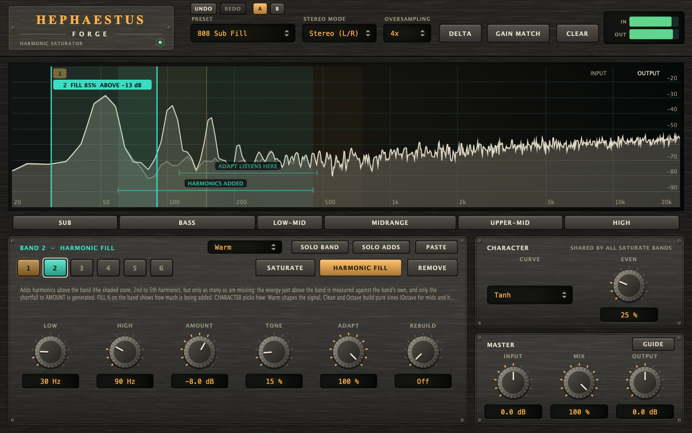

# Hephaestus Forge

A **harmonic forge for mastering** (VST3 + AU + Standalone) that fills in harmonics and missing fundamentals for tonal
balance: you draw bands over the spectrum, and each one either saturates what is inside it or adds only the harmonics that
are missing above it.

## Name origin

*Hephaestus* is the Greek god of the forge, of metalworking and of the craftsmen's tools: the one who hammers a shape out of
raw metal; *Forge* is what the plugin does to a master's spectrum, forging harmonics where the sound is thin. (CMake targets,
namespaces and plugin codes use the short name "Hephaestus".)



*Headless render of the editor (the hardware-style interface shared with the other plugins) on an 808-style sub note (52 Hz) with nothing above it, in the "808 Sub Fill" preset. Band 2 (teal) is a Harmonic Fill band: the dim input trace has no energy above the note, the cream output has grown harmonics at 104 and 156 Hz, and the band's tab reads FILL 85 % because that is how much of its Amount it is currently adding. The tinted zone under "HARMONICS ADDED" is where that band's harmonics land; "ADAPT LISTENS HERE" marks the region the adaptive fill measures. At the top, left of the controls: UNDO / REDO and the A / B compare pair (A lit, as on opening). Under the display, the band solo strip: the six main bands of music, each switch spanning its band on the axis. Under the band's knobs the panel would list its notes (none here: nothing in this setting needs a warning), and GUIDE, in the master panel, says what the plugin is for and not for. Regenerate with the command under "Development".*

## Core philosophy

- **A band adds only what you ask for.** A Saturate band shapes a band-passed copy of the signal and sums only the *difference*
  (what the shaper added) onto the untouched, latency-matched input. Nothing outside the bands is filtered, so bands can
  overlap or leave gaps, and the plugin is exactly transparent at small signal for any arrangement.
- **Fill what is missing, not what is already there.** Harmonic Fill measures the *input* and generates only the shortfall
  against the amount you set, so the balance holds from one moment to the next instead of piling harmonics onto passages
  that already have them. There is no feedback loop to destabilise.
- **Exact where it can be, honest where it cannot.** The harmonics are weighted exactly (Chebyshev polynomials of the band
  signal divided by its own envelope, or, in the **Clean** mode, sines locked to the band's strongest note), aliasing is
  controlled by ADAA inside linear-phase oversampling, and every claim in
  this README is a measurement from the test suite. Where something is a heuristic, the [Limitations](#limitations) say so.
- **Made for judging, with mastering tools in reach.** **Delta** (hear only what the plugin adds), **Gain Match**
  (loudness-matched A/B), **Mid/Side** mode, a latency-compensated **Mix** and a live input-vs-output spectrum, so more
  saturation is not mistaken for "better".
- **Analog look, digital brain.** The interface is a piece of studio hardware drawn entirely from code by the kit shared
  with the other plugins ([shared/ui](../../shared/ui)): no image, font or sound files are shipped.
- **Free, public, source only.** The repository holds the code, not a download, under the AGPL-3.0-or-later (see
  [License and terms](#license-and-terms)).

## Features

| Area | What it does |
|---|---|
| **Bands** | Up to six bands, any ranges, overlapping or not. Double-click the spectrum where you want one and choose *Saturate* or *Harmonic Fill*, or use the buttons in the band panel; drag a band's edges to resize it and its body to move it; right-click it to change its mode or remove it. Each band has its own **Low** / **High** edge (20 Hz – 20 kHz; a fill band stops at 2 kHz, and an edge can't come closer than a ratio of 1.5). Bands fade in and out over one block when they are added or removed, and a removed band costs no CPU. |
| **Saturate band** (amber) | Drives the sound inside the band into a waveshaper (ADAA + linear-phase oversampling), so harmonics appear above it. Per-band **Drive**; **Curve** and **Even** are shared. Anything outside the band is left exactly as it is. **Drive** is how hard the band is driven into the curve; small signals stay untouched whatever the drive. **Curve**: Tanh (smooth), Atan (open, tape-like) or Soft (algebraic, gritty, strongest upper odd harmonics). **Even**: 0 % = symmetric curve, odd harmonics only (3rd, 5th…); higher = asymmetric, adds 2nd, 4th… (tube-like). |
| **Harmonic Fill band** (teal) | Adds harmonics (H2–H5) of the band's content *above* the band, but only as many as are missing. The energy just above the band is measured against the band's own, and only the shortfall to **Amount** is generated (see [Why Harmonic Fill is adaptive](#why-harmonic-fill-is-adaptive)). **Amount**: harmonic energy above the band relative to the band's own, in dB; also what Adapt aims to keep there; off at the minimum. **Tone**: which harmonics carry that energy: dark = mostly the 2nd; middle = the usual virtual-bass roll-off (−3 / −9 / −16 dB for H3 / H4 / H5 re H2); bright = led by the 3rd. The four weights always carry unit energy, so Amount means the same at any tone. **Adapt**: 0 % = a fixed amount, 100 % = only what is missing. **Rebuild** also regenerates a fundamental that is physically missing while its harmonics are present (difference tone, 3f − 2f = f), and only where it is missing; off by default and experimental on dense material. |
| **Character** (fill band, selector at the top of the band panel) | How a fill band makes its harmonics. **Warm** (the default, and how every earlier session sounds) is a waveshaper: Chebyshev polynomials of the band signal over its own envelope. That is the usual way to make virtual bass and it behaves like one, so the harmonics follow what the band holds and how fast its level moves: two notes at once intermodulate, and when the level falls faster than the envelope follows (a tremolo, a gated or fast-decaying note) the harmonics fall away, by about 30 dB at the bottom of a 3 Hz tremolo. **Clean** follows the one strongest note in the band and builds each harmonic as a pure sine at *k* times its frequency, locked to its phase and at its amplitude, with the same Amount, Tone and Adapt weights. Nothing else in the band is bent into new frequencies, and the balance of the harmonics does not depend on the level or the envelope. It needs **one dominant note** (an 808, a sub, a bass line), takes about 100 ms to lock onto a new one, and while the band holds several notes of similar level it adds less, down to nothing, instead of intermodulating (see [Why Clean follows one note](#why-clean-follows-one-note)). **Octave** makes the same pure sines for **every resolved partial** in the band, in the spectrum, so a band of any density (mids, highs, a chord, a whole instrument) is filled without intermodulation. The price is **latency** (a frame of about 43 ms, reported to the host while a band uses it) and resolution: partials closer than about four bins (94 Hz at 48 kHz) are not told apart, so it is for the mids and highs and not for a single bass note (see [Why Octave works in the spectrum](#why-octave-works-in-the-spectrum)). **Rebuild** is a squarer and stays what it is in all three. |
| **Where the harmonics land** | Both kinds show where they add harmonics: the selected band gets a bracketed zone labelled **HARMONICS ADDED**, from the 2nd harmonic of its Low edge to the 5th of its High edge (stopping short of Nyquist, and for a fill band short of any harmonic that would alias); every other band shows it as a faint tint. A fill band with Amount off adds none and shows none. |
| **Spectrum analyzer** | Live input-vs-output spectrum that follows FabFilter Pro-Q's: an 8192-point FFT, **4.5 dB/oct tilt around 1 kHz** by default (so typical programme material looks flat), a 90 dB range, fast attack and a selectable release. Right-click empty space in it for Range (60 / 90 / 120 dB), Speed and Tilt (0 / 3 / 4.5 / 6 dB/oct); the choice is saved with the project. |
| **ABOVE read-out** | A fill band's tab shows, next to FILL %, **ABOVE**: the energy already in the region the adaptive fill listens to, relative to the band's own, in dB (the scale **Amount** is set on). ABOVE well under Amount means the harmonics are missing and the fill is adding them; ABOVE at or over Amount means they are already there. It is what the fill compares, so it includes the band's own tone leaking through the region's filter skirt (a lone 60 Hz tone in a 40–120 Hz band reads about −16 dB; test [5c]). |
| **Solo a band** | **SOLO BAND** and **SOLO ADDS** (band panel, left of PASTE) listen to the selected band alone; press again to release. **BAND** plays the signal through a filter over the band's range (what the band works on), **ADDS** plays only what the band adds, its distortion or its filled harmonics, so the soloed bands' ADDS sum to the Delta (test [12]). The solo replaces Mix and Delta, fades over 10 ms, is not saved with the session and ends when the editor closes; a solo on another band than the one shown is named in the panel. |
| **Solo a main band** | The strip under the display is six switches, the main frequency bands of music, each spanning its range on the display's axis: **Sub** (20–60 Hz), **Bass** (60–250 Hz), **Low-Mid** (250–500 Hz), **Midrange** (500 Hz–2 kHz), **Upper-Mid** (2–6 kHz, presence) and **High** (6–20 kHz, air); hover one for what lives there. Click to solo a band, click more to add others, Alt-click to hear one alone, click again to release. They are the same bands as Themis' AUDITION ranges and Iris' regions (defined once in [MusicBands.h](../../shared/dsp/include/pantheon/dsp/MusicBands.h)), so what Themis flags can be heard here over the same part of the spectrum. 4th-order Linkwitz-Riley crossovers with all-pass compensation: a band passes a tone in its middle within 1.68 dB (3.88 dB for the octave-wide Low-Mid), keeps the next band's tone at least 14.0 dB down and the others 48.2 dB; all six together are the plain output to 0.000 dB; releasing it returns the plain output bit for bit (test [12b]). It works on whatever you hear, so it combines with DELTA and a band solo; it fades over 10 ms, is not saved with the session and ends when the editor closes. |
| **Paste** | **PASTE** (top right of the band panel) adds the harmonic-fill bands another plugin of the suite copied (Themis: COPY on a bass item of its master plan), each in the next free slot over the range it measured. Equaliser bands are Iris' and are left out. |
| **Delta / Gain Match / Mix** | **Delta** plays only what the plugin adds (wet − dry). **Gain Match** is a slow (~0.6 s) RMS match, clamped to ±12 dB, for a loudness-matched A/B; it is off by default. **Mix** is latency-compensated: 0 is the input delayed by exactly the reported latency. |
| **Stereo mode** | **Mid/Side** saturates M and S; fill bands then work on Mid only so bass stays centred. |
| **Oversampling** | Off / 2× / 4× / 8×, linear-phase; 4× is the default. Latency is reported to the host and changes with this setting. |
| **Guide and notes** | **GUIDE** (master panel) says what the plugin is for and what it is *not* for: it only adds harmonics, so it is not an equaliser (it cannot lift or remove a region), a compressor or a limiter, and it does not clean up resonances or noise. Under the band's knobs the panel shows up to three **notes** for the band shown and the session, warnings in amber and information dim: DELTA or a solo is on (what you hear is not the mix), a fill band with AMOUNT off, Octave on bass (it cannot tell partials closer than about 94 Hz apart) or its 43 ms of latency, Clean on a band reaching past 400 Hz (it follows one note), Warm on chords in the mids, Rebuild on, ADAPT at 0 %, a heavy Drive (12 dB or more) and with no oversampling, Gain Match against a bass boost. Every note restates a limit under [Limitations](#limitations), and the rules are in [Advice.h](Source/Advice.h). Hovering the preset box says what the preset is for. |
| **Undo and A/B** | **UNDO / REDO** (Cmd+Z and Shift+Cmd+Z while the editor has the keyboard focus; Ctrl on other systems) take back and redo changes to the controls, a dragged band edge, a preset, an added, duplicated or removed band, each as one step; they are not kept with the session. **A / B** holds two complete settings: choosing B the first time copies A, after that each switch keeps what you have set in the one you leave and loads the other, so the plugin can be set up two ways and compared while listening; a switch is one undo step. The slots are not saved with the session (only which one is active). Both come from the shared kit (`Undo.h`, `AbCompare.h`). |
| **Duplicate band** | Right-click a band on the display, *Duplicate band*: every setting of it goes to the first free slot (greyed out when all six are used), switched on last, on top of the original for you to move. |
| **Presets** | Ten factory ones and your own. To make one choose *Save current settings as...* at the bottom of the preset box and give a name; the band settings (not the session-wide gain, mix, stereo mode, oversampling, delta and gain match) are saved as a small file in `~/Library/Application Support/Pantheon/Hephaestus Forge/Presets` (the user's data folder on other systems), so they are there in every session and project; they are listed under *User*, and *Delete* removes the chosen one. The host's program list shows the factory presets only. The ten factory ones include *808 Sub Fill*, *Clean Sub Fill* (the same fill, Clean, with no saturate band), *Octave Air* (an Octave fill band over 600 Hz - 2 kHz, 43 ms of latency), *Missing Fundamental*, *Small-Speaker Bass*, *Master Glue*, *Warm Tube*, *Tape Body* and *Air Exciter* (see [Using it](#using-it)). |

### Why Harmonic Fill is adaptive

A tonal-balance EQ fixes the *average* curve. It cannot fix a mix whose curve looks balanced but whose energy is not: a sub note with nothing above it, a bar where the low mids go empty, a section where they are full. Boosting those regions with an EQ lifts whatever happens to be there, and a fixed-amount harmonic generator adds the same harmonics whether or not they are already present. Harmonic Fill closes the loop instead:

```
band energy        E_b   (the band-passed input, ~100 ms)
energy above band  E_a   (input, from 1.25 x High up to 5.2 x High, same smoothing)
wanted             E_w = E_b x Amount          (Amount in dB, as an energy ratio)
shortfall          s   = 1 - min (1, E_a / E_w)
gain on harmonics  g   = (1 - Adapt) + Adapt x sqrt (s)       (smoothed over ~50 ms)
```

The measurement is made on the *input*, so there is no feedback to destabilise. **Adapt 0 %** is the old fixed-amount behaviour; **Adapt 100 %** adds only the shortfall. The harmonics are generated with exact weights (Chebyshev polynomials of the band signal divided by its own envelope, see below), so a hollow passage gets precisely `Amount` of harmonic energy and a full one gets none. This was measured (see [What has and hasn't been verified](#what-has-and-hasnt-been-verified)): at Amount −6 dB a hollow passage gets **−6.3 dB** of added energy relative to the band, a passage that already has plenty above the band gets **nothing**, and a quarter-filled one gets 0.76 of the full amount where the law predicts 0.80.

What it does *not* do: it judges "already there" by energy in a fixed region above the band, not by whether that energy is musically the right harmonics. Dense material above the band will make it back off. Raise Amount to ask for more energy above the band, lower Adapt to add regardless.

### Why Clean follows one note

A waveshaper makes harmonics of *everything* in its input at once, so with two notes in the band it also makes their sums and differences (the energy between the notes that makes a mix sound dirty), and the amount of each harmonic depends on how the level compares with the shaper's envelope. Measured on a 50 Hz note with 70 Hz beside it (test [5g]): with the second 20 dB quieter, the energy that is not on a multiple of either note is **-9 dB** re the harmonics in Warm and **-25 dB** in Clean; with the two equal, Warm adds **+2.6 dB** more than a lone note would, Clean **-8.4 dB** less. On a 60 Hz note under a 3 Hz tremolo (30 - 100 %) Warm's 2nd harmonic goes from **-2.3 dB** re the fundamental at the crest to **-34 dB** at the trough (69 dB of movement in 50 ms windows, because the envelope is still above the peaks when the level falls and the k-th Chebyshev harmonic scales as a^k); Clean's moves **9.3 dB**, all of it the integrators' lag of about 20 ms.

Clean cannot be made free of that for arbitrary material: a harmonic *of a partial* needs that partial separated from the rest, and a bass that is a chord has nothing to separate. So it follows one note and says when it cannot:

```
PITCH       a bank of resonators over the band (8 per octave) -> the strongest one, interpolated -> the note's frequency
PHASE       one second-order integrator per channel, tuned there -> the note as (v, q) in quadrature
HARMONIC k  amplitude x Re ((v + jq) / |v + jq|)^k       (exact sines, weights as Warm)
CONFIDENCE  the note's energy / the band's energy  ->  fades the fill out between 0.5 and 0.8
```

A frequency-locked loop on its own does not find a note (tried: on two notes it settled on neither), so the pitch is measured by the bank and the integrators only follow the phase from there. A note with its own 2nd harmonic in the band (the fundamental 6 dB above it) has a confidence of about 0.8 and still passes; a second note about as strong as that harmonic is not told from it, and is faded the same way. The integrators are narrow enough not to be carried off by a note 20 dB quieter a minor third away, and that is also why Clean takes about 100 ms to reach full level on a new note (**100 ms** to 90 % on a hit at full level, against 20 ms for Warm). Quicker settings of the pitch bank and the integrators were tried first and let the non-harmonic part rise (by 14 dB at the bottom of a 40-120 Hz band), which is the one thing Clean is for.

### Why Octave works in the spectrum

A fill band that is not a bass note holds many partials, and a waveshaper (Warm) multiplies all of them together. Clean cannot help there: it follows one note and fades out when there are several. What does not multiply them is treating each partial on its own, which a spectrum does for free:

```
every quarter of a frame   Hann-windowed FFT of the last N samples (N = 2048 up to 64 kHz, 4096 up to 128 kHz, 8192 above: about 43 ms)
each peak in the band      frequency to a fraction of a bin (log parabola), amplitude, phase (the window is centred on bin zero,
                           so a partial's bin phase is its phase in the middle of the frame)
harmonic k = 2 .. 5        a sine at k x frequency, k x phase, weight x amplitude, written into a synthesis spectrum as the window's own
                           transform at that exact frequency (not rounded to a bin)
inverse FFT, overlap-add   a continuous sine, phase-locked to its partial, N - 1 samples late
```

There is no state to drift: each frame stands on its own and the frames agree because each partial's phase is read afresh. Nothing is multiplied by anything, so what is left that is not on a harmonic of a partial is only the error of the frequency estimate and the truncated tails of the window's transform. Measured (test [5h]): three partials at 520 / 640 / 780 Hz: **-47 dB** re the harmonics (Warm **+8 dB**); six partials: **-48 dB** (Warm **+15 dB**); the harmonics themselves are within **0.15 dB** of their weights for partials between bins; under a 3 Hz tremolo the 2nd harmonic moves **0.3 dB** re the fundamental (Warm 11 dB at 1 kHz).

What it costs and what it guards against:

- **Latency.** The output is N - 1 samples behind the input (**2047** at 48 kHz). While a band is Octave (and only then) the plugin reports that latency, delays everything else by it (the dry signal, the saturate bands, the other fill bands: tested to be bit for bit what they were, shifted) and holds the Octave band back by the oversampling's share only. The latency depends on which bands are Octave, not on a fade or on Amount, so it does not move while a knob does. Changing it makes the host re-align the track once (and the plugin's delay lines start empty), so set it before you play or render.
- **Resolution.** A partial must be a peak that stands on its own: closer than about four bins (94 Hz at 48 kHz) two partials are one peak and their harmonics follow it (two partials 60 Hz apart: still **-64 dB** between the harmonics and the rest, Warm -22 dB). Peaks that are under 4 % of the strongest bin within six bins are the window's sidelobes, not partials. Noise has peaks too and is filled like any other: its harmonics are noise (white noise at 0.1 rms adds 0.010 rms).
- **The echo of a note.** A frame's sines last the whole frame, so before a note starts and after it stops there would be a short echo of it. What the band holds at that moment (its own signal, held back by the same latency) bounds what may be added: the harmonics, which carry at most the band's energy, are not let past twice its level, measured over 8 ms. In steady playing the bound is never reached. A note: **-240 dB** (nothing) before it starts, 90 % of its level **12 ms** after it does, and nothing 40 ms after it ends.
- **Adaptive fill** compares the energy above the band with the band's now, while what is added is the input of 43 ms ago; both move slowly (~50 - 100 ms), so they stay in step, but a very sudden change is answered a frame late.

### Research this is based on

- **Missing fundamental / virtual bass.** Larsen & Aarts' book *Audio Bandwidth Extension* (Wiley, 2004) frames the nonlinear-device (NLD) approach; Bai & Lin (JAES 2006) introduced phase-vocoder virtual bass; Mu, Gan & Tan (ICASSP 2012) and Hill & Hawksford (2010) built hybrids. The trade-off reported in that literature: **NLDs keep transients but give no control over individual harmonics; phase vocoders give precise harmonic weighting but smear transients.** Overview via [Eloi et al., DAFx 2020](https://acris.aalto.fi/ws/portalfiles/portal/51973173/Eloi2020_Virtual_bass_DAFx2020.pdf).
  → *Hephaestus' answer:* divide the bass band by its own envelope, apply Chebyshev polynomials T2–T5, multiply the envelope back. For a unit sine, T*k* gives exactly the *k*-th harmonic (the weights are exact and level-independent), yet the processing stays in the time domain (no smearing). See [Csound `chebyshevpoly`](https://csound.com/manual/opcodes/chebyshevpoly/) and the [UW lecture notes](https://courses.cs.washington.edu/courses/cse490s/11au/lectures/E-Non-linearSynthesis.pdf).
- **Typical harmonic weighting.** Hobbyist virtual-bass designs use roughly −6/−12/−18/−24 dB for H2–H5 ([DIYAudio thread](https://www.diyaudio.com/community/goto/post?id=3684217)); the defaults here are in that region. Vendor claims for how far below the speaker's limit MaxxBass works vary (1.5–2 octaves), and its algorithm is proprietary, so this is not a MaxxBass clone.
- **Aliasing.** First-order antiderivative anti-aliasing (Parker, Zavalishin & Le Bivic, DAFx 2016; extended in [Werner & Azelborn, DAFx 2023](https://www.dafx.de/paper-archive/2023/DAFx23_paper_61.pdf)) suppresses but does not eliminate aliasing, and misbehaves in single precision at extreme drive ([JUCE forum](https://forum.juce.com/t/anti-derivative-anti-aliasing-adaa-issues/46993)). → ADAA runs in `double`, with a midpoint fallback, *inside* linear-phase oversampling.
- **Host behaviour.** Latency changes must be reported from the message thread ([JUCE forum](https://forum.juce.com/t/bug-setlatencysamples-crashes-ableton-live-10-vst3-fixed/40216)), and the legacy parameter API breaks VST3 automation ([JUCE forum](https://forum.juce.com/t/vst3-automation-with-legacy-parameter-handling-broken/44854)). → latency goes through an `AsyncUpdater`; all parameters use the versioned `ParameterID` API.
- **Even vs odd harmonics.** Sources disagree on which sounds "warmer" ([iZotope](https://www.izotope.com/en/learn/what-is-audio-saturation) vs. a [CreativeLive/Ozone lesson](https://phoenix.creativelive.com/class/mastering-music-with-izotope-ozone-11-tomas-george/lessons/saturation-vintage-tape-module-and-exciter-module)), so Even is a continuous control rather than fixed "tube/tape" types. Trust your ears and Delta.

### Signal flow

```
in -> gain -+- dry (delayed by latency) ------------------------------------------------------+
            +- [M/S enc] -+- fill band x N (base rate, adaptive) -> sum -> delay -----+          |
                          +- saturate band x N: band-pass -> up -> ADAA -> down -> sum +- + -- [M/S dec] -- [gain match] -- mix/delta -- out
                          +- clean copy, delayed by the oversampling latency ----------+
```

Details that matter:

- **A saturate band adds only its distortion.** Each band shapes a band-passed copy of the signal and the *difference* (what the shaper added) is summed onto the untouched, latency-matched input. Nothing the user has not asked for is filtered, so bands can overlap or leave gaps and the plugin is exactly transparent at small signal for any arrangement (0.000 dB, six overlapping bands at 18 dB drive). It replaces a fixed three-band LR4 split, whose bands must sum flat and so cannot move freely.
- **ADAA is applied to the nonlinear residual only** (`f(u)` minus its tangent line at the bias point). Plain first-order ADAA is a `[1 1]/2` low-pass in the linear regime (about -5 dB at 15 kHz at 48 kHz); this form keeps small-signal gain exactly 1 while still anti-aliasing the distortion. The DC blocker acts on the residual only, so bass in the clean path is never phase-shifted.
- **The fundamental engine runs at the host rate**: a fill band's range stops at 2 kHz, so its harmonics stay well below Nyquist (a harmonic that would land above 0.48 x fs is dropped) and there is nothing to alias.
- **The Chebyshev envelope releases slowly (`6 / lo`).** The k-th harmonic scales as `a^k` where `a` is the normalised amplitude, so envelope droop between waveform peaks costs accuracy mostly in H4/H5. Doubling the release from `3/lo` cut the worst-case error from 1.26 dB to 0.38 dB at 60 Hz, with harmonics still 48 dB down 50 ms after a note ends.
- **Clean runs the same path as Warm**: the same band filters, the same band-limiting of what it generates, the same adaptive gain, the same latency alignment (it adds none), the same solo and delta. Only the generator inside the fundamental engine differs ([PartialTracker.h](Source/DSP/PartialTracker.h)). It costs one resonator per eighth of an octave of the band, on one channel (a fill band of 40-120 Hz: 14, a band of 20 Hz-2 kHz: 55) plus three integrators, all at the host rate.
- **Octave is a separate generator inside the same engine** ([OctaveGenerator.h](Source/DSP/OctaveGenerator.h)): the same Amount, Tone, Adapt, harmonic limit at Nyquist and Rebuild (held back by the generator's latency so the two sum in step). It costs two FFTs per quarter-frame per channel: six Octave bands on stereo noise are about **9 %** of one core at 48 kHz.
- **Rebuild's gap detector** compares input vs restored energy per frequency in a bank of narrow resonators. Comparing against the whole band mistakes a 2nd harmonic for an existing fundamental, and correlating with the restored signal fails because a difference tone is in phase quadrature with the true fundamental of saw-like waveforms. Both were tried first and failed the test suite.

## How to use

### Build and install (macOS)

Hephaestus Forge is source only: you build it yourself. Formats: **VST3 + AU + Standalone** (macOS, universal arm64 + x86_64).

```bash
# SDKROOT works around Command Line Tools shipping an SDK this Xcode's linker can't read.
export SDKROOT=$(xcrun --sdk macosx --show-sdk-path)
cmake -S . -B build -DCMAKE_BUILD_TYPE=Release    # fetches JUCE (version in cmake/Juce.cmake); an offline copy in third_party/JUCE at the repository root is used if present
cmake --build build --target Hephaestus_VST3 Hephaestus_AU Hephaestus_Standalone
```

Building the plugin targets **installs** them to `~/Library/Audio/Plug-Ins/{VST3,Components}` (the VST3 is
`~/Library/Audio/Plug-Ins/VST3/Hephaestus Forge.vst3`). Then rescan plugins in your host; in FL Studio that is *Options → Manage
plugins → Find plugins*. The binary is ad-hoc signed, which is enough for local use. Apple's validator checks the AU:

```bash
auval -v aufx Hphs Hpha
```

Builds are for your own use; if you hand one to somebody else, see [License and terms](#license-and-terms).

### Using it

1. **Check it is the right tool.** Hephaestus adds harmonics (warmth, glue, bass that carries on small speakers, air). To fix the tonal balance use an equaliser (Iris), for level and dynamics a compressor (Atlas) and a limiter; GUIDE in the plugin says the same, and the notes under the band's knobs warn when a setting does not suit its job.
2. **Put it on the master (or a bus) before the limiter.** Latency (shown by FL as PDC) is reported automatically; it changes
   with the Oversampling setting.
3. **Make bands.** Double-click the spectrum where you want one and choose *Saturate* or *Harmonic Fill*, or use the buttons
   in the band panel. Drag a band's edges to resize it, its body to move it; right-click it to change its mode or remove it.
   The band panel below shows the selected band's controls; the numbered chips pick a band.
4. **Or start from a preset:**
   - **Thin or small-speaker bass:** *Missing Fundamental* or *Small-Speaker Bass*. Put a Harmonic Fill band over the fundamentals you want to support. Watch the FILL % on its tab and confirm with **Delta**.
   - **808 / sub that disappears on laptops:** *808 Sub Fill*.
   - **Harmonics in the mids and highs without the tube-like distortion:** *Octave Air*, or set a fill band's **Character** to Octave and drag it over 500 Hz - 2 kHz. Mind the 43 ms of latency (it is reported to the host).
   - **The same bass fill, without the amp-like character:** *Clean Sub Fill*, or set a fill band's **Character** to Clean. Use it when the band holds one bass note at a time; if the harmonics fade in and out, the band holds more than one thing and Warm is the better tool.
   - **Glue and warmth:** *Master Glue* / *Warm Tube* / *Tape Body*. Use **Gain Match** so more saturation isn't mistaken for "better".
   - **Dull top end:** *Air Exciter* (a saturate band over the highs; harmonics land above it).
5. **Judge with Delta and with the analyzer.** The display is tilted +4.5 dB/oct by default so typical programme material looks
   flat.

## Development

Built with [JUCE](https://juce.com). All DSP lives in `Source/DSP`, which has no GUI dependencies and is covered by
`Tests/Tests.cpp`; the plugin layer only draws and wires it up. See [CLAUDE.md](CLAUDE.md) for the design invariants and the
single-source-of-truth map before changing anything.

### Tests, screenshots and layout

```bash
cmake --build build --target HephaestusTests && ./build/HephaestusTests_artefacts/Release/HephaestusTests
cmake --build build --target HephaestusUiCheck && ./build/HephaestusUiCheck_artefacts/Release/HephaestusUiCheck
cmake --build build --target HephaestusHostCheck && ./build/HephaestusHostCheck_artefacts/Release/HephaestusHostCheck "$HOME/Library/Audio/Plug-Ins/VST3/Hephaestus Forge.vst3"
cmake --build build --target HephaestusSnapshot && ./build/HephaestusSnapshot_artefacts/Release/HephaestusSnapshot docs/screenshot.png "808 Sub Fill" sub 2   # writes the README image
```

`docs/screenshot.png` is the output of that command, never edited by hand. It is regenerated after every change that touches
the UI or what it shows, and its caption above is kept true to the demo (the rules for contributors are in [CLAUDE.md](CLAUDE.md)).

Layout (the one file map; update it when a source file is added, renamed or removed):

```
Source/DSP/Band.h                band modes, range rules shared by engine and display
Source/DSP/Waveshaper.h          tanh / atan / algebraic curves + residual ADAA
Source/DSP/Saturator.h           user-placed saturate bands, per-band oversampling + shaping
Source/DSP/FundamentalEngine.h   Chebyshev harmonics + adaptive fill + difference-tone rebuild + gap detector
Source/DSP/Engine.h              latency alignment, band mixing, M/S, gain match, delta, meters
Source/Parameters.h              parameter layout, presets, band helpers, legacy-session migration
Source/UserPresets.h             the user's own presets: one XML file each in the user's data folder
Source/PluginProcessor.*         JUCE wrapper
Source/Advice.h                  the notes under the band's knobs and the GUIDE text (plain C++; UiCheck pins the rules)
Source/PluginEditor.*, UI/       band panel, spectrum view with draggable bands, HephaestusUi.h (band colours); the look itself is shared/ui
../../shared/ui/                 the drawing kit of the interface, shared with the other plugins of the repository
../../shared/dsp/                biquads, Butterworth cascades, the display's lock-free FIFOs and its EQ-style FFT analyzer (GUI-free, unit-tested here), shared with Iris; MusicBands.h (the six main bands and their splitter, the band solo strip), shared with Iris and Themis
Tests/                           DSP tests, UI check, VST3 host check, editor snapshot, shared helpers
docs/screenshot.png              editor render (generated by HephaestusSnapshot)
```

### Continuous integration

CI does not build or test Hephaestus yet; the workflows in [.github/workflows](../../.github/workflows) cover Themis and Iris only (the
state of that is tracked in the repository's [CLAUDE.md](../../CLAUDE.md)). Run the commands above before you rely on a change.

### What has and hasn't been verified

`HephaestusTests` (headless DSP, `Tests/Tests.cpp`) is measured, not assumed, and was run on the final binaries:

| Check | Result |
|---|---|
| Small-signal frequency response, 40 Hz-20 kHz, every oversampling mode | flat within **0.001 dB**; also with six overlapping bands at 18 dB drive |
| Dry path vs reported latency | dry impulse lands **exactly** on the reported latency (49 / 61 / 65 samples at 2x / 4x / 8x); the wet impulse lands on it too |
| Alias energy, 5.3 kHz sine, +18 dB drive (re fundamental) | naive tanh **-18 dB** -> ADAA only **-30 dB** -> with oversampling **-70 to -72 dB** |
| Even control | bias 0: H2 < -160 dB; bias 0.5: H2 -15 dB |
| A saturate band acts only on its range | 100 Hz sine, +24 dB drive: 3rd harmonic **-11 dB** with the band on the tone, **-120 dB** with the band at 2-4 kHz |
| Where the harmonics land (the shaded zone) | band-limited noise through a saturate band at 6 / 12 / 24 dB drive: **0.00 - 0.02 %** of what it adds lies above 5 x High; through a fill band: **0.45 %**, with 81 % of the added energy inside the zone (the rest sits just below it, from intermodulation of a noisy band) |
| Sample rates 22.05 - 192 kHz | small-signal error **3e-8** (-60 dBFS in, input delayed by the reported latency), loud mixed bands finite and bounded |
| Harmonic weights vs targets (-6/-9/-15/-22), 45 / 60 / 90 Hz, two input levels | within **0.6 dB** (0.3 dB mid-range), identical at -6 and -26 dBFS |
| **Clean fill**, 40-120 Hz band, 45 / 60 / 90 Hz, 0.5 and 0.005 amplitude | weights within **0.1 dB** of -6/-9/-15/-22 (Warm: 0.6 dB), identical at both levels; energy not on a multiple of the note **-66 / -58 / -57 dB** (Warm -28 / -30 / -34 dB) |
| Clean fill, a decaying 60 Hz note (30 dB lower at 2 s than at 0.3 s) | 2nd harmonic re fundamental **-5.61 dB** at 0.3 s and at 2 s |
| Clean fill, a note that starts at full level | peak of the first 200 ms **0.594** vs 0.597 settled (no overshoot); **100 ms** to 90 % of its level |
| Clean fill, two notes (50 + 70 Hz) | one 20 dB quieter: energy between the notes **-25 dB** re the harmonics (Warm -9 dB); equal: output **-8.4 dB** re a lone note (Warm +2.6 dB) |
| Clean fill, 60 Hz under a 3 Hz tremolo (30 - 100 %) | 2nd harmonic re the fundamental moves **9.3 dB** over the cycle (Warm **69.0 dB**: -2.3 dB at the crest, -34 dB at the trough) |
| Clean fill, 100 -> 50 Hz glide then held | 2nd harmonic **-6.0 dB** (target -6.0), not on a harmonic **-58 dB**, level during the glide -0.1 dB re held |
| Clean fill, left-only note; 44.1 / 96 / 192 kHz; switching Warm / Clean / Octave while playing | right channel silent (**-240 dB**); 2nd harmonic **-6.0 dB** at every rate; finite and bounded |
| **Octave fill**, 500-2000 Hz band, partials at 520 / 733.3 / 1000 / 1234.5 / 1777.7 Hz, 0.3 and 0.003 amplitude | H2-H5 within **0.15 dB** of -6/-9/-15/-22, identical at both levels |
| Octave fill, a 1 kHz partial (alone, and through the whole engine with Delta) | the harmonics are the ideal phase-locked ones (peaks lined up with the fundamental's, as Warm's and Clean's are), delayed by exactly **2047** samples (**2108** with 4x oversampling): max error **-33.7 dB** re their peak |
| Octave fill, three and six partials | energy that is not on a harmonic **-46.9 / -47.6 dB** re the harmonics (Warm +8.2 / +15.0 dB) |
| Octave fill, 1 kHz under a 3 Hz tremolo (30 - 100 %) | 2nd harmonic re the fundamental moves **0.28 dB** over the cycle (Warm 11.4 dB) |
| Octave fill, a note | before it starts **-240 dB** re its level; 90 % of it **12 ms** after it starts; **-240 dB** 40 ms after it ends |
| Octave fill, tones under (300 / 420 Hz) and over (2.3 / 3.5 kHz) the band | nothing added (**-240 dB**) |
| Octave fill, two partials 60 Hz apart (one peak) | **-64 dB** between their harmonics and the rest (Warm -22 dB) |
| Octave fill, silence / white noise 0.1 rms / blocks of 1 to 97 samples | silence in, silence out; noise adds 0.010 rms, peak 0.05; **bit-identical** to one block of 480 |
| Octave fill, left-only partial; 44.1 / 96 / 192 kHz | right channel silent (**-240 dB**); frame 2048 / 4096 / 8192 samples (46.4 / 42.7 / 42.7 ms), H2 within **0.3 dB** |
| Octave band's Rebuild | the plain Rebuild, 2047 samples later, **bit for bit** |
| Bypassed by the host (AU path) | a bypassed block comes out delayed by exactly the reported latency (impulse at sample 100 comes out at 100 + latency), and the tail is the latency; the delay is sized for the longest latency any setting can report (the slowest oversampling plus the Octave frame) |
| Clean fill, the band's top edge moving every block | the 2nd harmonic stays at **-6.05 dB** (expected -6.0): the tracker keeps its lock while the filters are redesigned (it read -7.58 dB when it was re-centred each time) |
| Latency with an Octave band | reported latency +2047 (61 -> 2108 at 4x), back to 61 when no band is Octave; saturate bands and a warm fill band are **bit for bit** what they were, 2047 samples later; the dry impulse comes out at exactly the reported latency; the saturate, octave and warm bands' ADDS solos sum to the delta (max error 6e-08) |
| 400 blocks changing every band's character and the oversampling as they go | always finite, peak 0.49 |
| CPU, 10 s stereo noise, six Octave bands at 48 kHz | **9 %** of one core (this Linux machine; the six-band mix in the row below is on an Apple M4) |
| Harmonic tails | 48 dB down 50 ms after note-off, 95 dB down at 100 ms |
| Tone | the four H2-H5 weights carry unit energy at every tone; dark is H2, bright is led by H3 |
| **Adaptive fill**, 60 Hz band, Amount -6 dB | Adapt 0 %: a hollow and a full passage get the same (+0.6 dB apart). Adapt 100 %: hollow passage **-6.3 dB** re band (target -6.0); plenty above the band: **nothing**; a quarter of the target above the band: **0.76** of the full amount (law: 0.80) |
| Rebuild, 120+180 Hz present, 60 Hz missing | restores 60 Hz at 0.299 (target 0.3); tracks level linearly (-6.0 dB for -6 dB); backs off to **0.000** when the real fundamental exists (0.230 when missing) |
| Mid/Side keeps bass centred | 2nd harmonic of a side-only tone: -5.7 dB in L/R mode, **-93 dB** in M/S mode |
| Mix / Delta | mix = 0 is the input delayed by exactly the latency; delta = wet - dry and mix = 0.37 is the linear blend, all **sample-exact** |
| Switching a band off | after the fade the output is the delayed input, **sample-exact** (max error 0) |
| Gain Match | a -4.9 dB level drop becomes **0.0 dB** |
| Spectrum analyzer | a bin-centred -6.02 dBFS sine reads **-6.02 dB**; 4 kHz with 4.5 dB/oct tilt reads +2.98 dB (expected +2.98); off-bin worst case -7.44 dB (Hann scalloping, < 1.5 dB); left-only signal reads -3 dB (L/R power is averaged) |
| 600 randomised blocks (all params incl. six random bands, block sizes 1-1500, mono/stereo, mode switches) | always finite |
| A NaN and two infs in the input (saturate, Warm, Clean and Octave bands, Gain Match; stereo and mid/side) | taken as silence: the output stays finite and, two seconds on, is within **8.3e-6** of what it would have been without them |
| CPU, 10 s stereo, six bands on (4 saturate, 2 adaptive fill with Rebuild) | 2 % (no OS) -> 15 % of one core (8x), Apple M4 |

| Verified | Not yet verified |
|---|---|
| **`HephaestusUiCheck`** checks the notes and presets (each warning fires for its setting and not otherwise, every note fits its line, every preset names its job, DELTA and a solo reach the editor's notes) and drives the real spectrum component with synthetic mouse events: a band added at 1 kHz takes the first free slot; clicking where bands overlap selects the narrowest; dragging an edge moves only that edge; dragging the body keeps the width ratio; an edge can't cross the minimum width; a fill band is pulled to at most 2 kHz; a full plugin refuses a seventh band and reuses a freed slot; Duplicate band copies every setting into the first free slot and refuses when none is free; a user preset is saved under the name typed, applied without touching the session-wide controls, kept with the session and deleted; UNDO, REDO and Cmd+Z take back a change and a preset (one step), and A / B switches, keeps each slot's settings and is one undo step; a bypassed block is delayed by the reported latency | **Inside FL Studio itself.** It was validated through JUCE's VST3 host and `auval`; *pluginval* was not run (the sandbox blocked executing the downloaded binary). Load it in FL and report anything odd |
| **`HephaestusHostCheck`** loads the installed **VST3** through JUCE's host wrapper: 5 sample rates (22.05-192 kHz) x 5 block sizes (1-4096) with every parameter randomised, latency reporting follows the oversampling choice (0 / 49 / 61 / 65 samples) and an impulse through the loaded plugin comes out exactly that many samples later, state and all 10 presets round-trip, and a session saved with the old fixed three-band layout loads as three saturate bands plus one fill band. Apple's `auval` passes for the **AU** | **The mouse interaction by hand in a DAW.** Dragging, the add/remove menus and the band panel are covered by `HephaestusUiCheck` and screenshots, but not by a person using them |
| | Windows and Linux builds. JUCE is cross-platform, but they were not built or tested |

## Limitations

- **The adaptive fill judges "already there" by energy, not by harmonic content.** It compares the energy from 1.25 x High to 5.2 x High with the band's own; anything in that region counts, whether or not it is related to the band. On dense material it will often back off completely: that is the intended behaviour (the energy exists), but raise Amount or lower Adapt if you want it to add regardless. The Chebyshev weights are exact for sine-like band content; noise-like band content gives somewhat different harmonic energy, so the target is approximate there.
- **Octave has latency, and a limit of resolution.** About 43 ms, reported only while a band uses it; switching a band to or from Octave changes it and re-aligns the track once. Partials under about four bins (94 Hz at 48 kHz) apart are one peak, so the lowest octaves (where partials sit closer than that) are for Warm or Clean. The echo guard is a bound on level, not a transient detector: a note's harmonics begin about 12 ms after it does.
- **Clean needs one dominant note.** It follows the strongest note in the band; a band that holds a chord, or a kick and a bass note of similar level, is faded out rather than filled (the confidence gate, 0.5 to 0.8 of the band's energy in the note), and the harmonics of a weaker second note are not made at all. It locks on in about 100 ms, so the first part of a short hit gets less than Warm gives. A note's own harmonics inside the band keep its confidence below 1 (fundamental 6 dB over its 2nd: about 0.8). The pitch bank is only coarse (the sines are locked to the note's phase, so the pitch only has to be close), and the part of the output that is not on a harmonic is -57 to -66 dB on a steady note (test [5g]), not zero.
- **Rebuild is experimental.** A squarer produces difference tones between *all* component pairs in its input band, so dense low-mid material can yield inharmonic bass content. It suits sparse bass material; leave it off for full mixes unless Delta says it helps.
- **A saturate band shapes a band-passed copy** (4th-order Butterworth edges), and what the shaper added is summed onto the clean signal. Near a band's edges, where that copy's phase has turned, the shaper's gain reduction on the fundamental is applied with that phase. This was not measured separately; overlap bands or check with Delta if a band edge sits on something important.
- **Gain Match** is a slow (~0.6 s) RMS match, clamped to ±12 dB. It will partly undo a deliberate bass boost, since low-end energy dominates RMS; that's why it's off by default.
- **The analyzer's absolute level** uses a Hann window, so a sine falling between FFT bins reads up to 1.4 dB low. Its tilt and range options mirror Pro-Q's, but it is not a Pro-Q clone: Pro-Q's smoothing and peak-hold details are not published.
- **Ad-hoc signed, not notarised.** Fine on this Mac. Distributing it needs a Developer ID signature and notarisation.

## License and terms

Hephaestus is free software under the AGPL-3.0-or-later, and is source only. The licence, JUCE and the other third-party
components, the trademark note and what you owe somebody if you hand them a build are in [NOTICE.md](../../NOTICE.md); they are
the same for every plugin of the repository. Suggestions and bug reports are welcome as issues, code contributions are not
accepted ([CONTRIBUTING.md](../../CONTRIBUTING.md)).

- **No warranty.** Hephaestus is provided "as is", without warranty of any kind. It is an audio effect: judge the result with Delta and your ears, and check levels before you export.
- **Passing it on.** macOS quarantines a copy that is not signed with a Developer ID certificate and notarised
  (`xattr -cr "Hephaestus Forge.vst3"` clears it for personal use).
