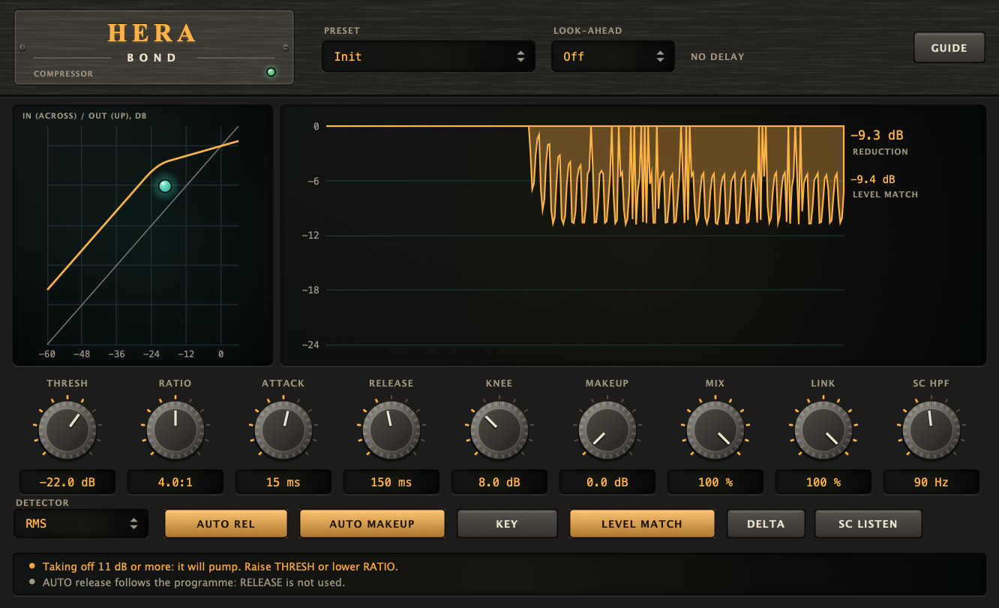

# Hera Bond

A **compressor** (VST3 + AU + Standalone) for a track or a bus: a peak or RMS detector, a soft knee, attack and release (or a release that follows the programme),
makeup (or one that makes up what the compression takes), a parallel **mix**, a **stereo link**, and a **sidechain** with a high-pass on what the detector hears
(or another track as the key).

## Name origin

*Hera* is the goddess of marriage and of what holds together: the compressor's work is to bring the loud and the quiet closer so that they hold together as one.
(CMake targets, namespaces and plugin codes use the short name "Hera".)



*Headless render of the editor (the hardware-style interface shared with the other plugins). A programme with a beat through an RMS detector, THRESH -22 dB, RATIO 4:1, ATTACK 15 ms, RELEASE 150 ms, an 8 dB knee, AUTO REL, AUTO MAKEUP and LEVEL MATCH on. On the left, the transfer curve (input across, output up) with the dot where the level is now; on the right, the reduction over the last seconds (-9.3 dB now), with **LEVEL MATCH** on and its gain read out under the reduction (-9.4 dB: the compression takes about that much level, and the match gives it back). The strip warns that taking off 11 dB or more will pump. Regenerate with the command under "Development".*

## What it does

| | |
|---|---|
| **Threshold** | -60 to 0 dB, -18 by default: the level (the peak of a sine) above which the sound is turned down. |
| **Ratio** | 1:1 to 20:1, 2:1 by default: how many dB it takes past the threshold for 1 dB more to come out. |
| **Attack / Release** | 0.1 to 200 ms (10) and 10 ms to 2 s (150): the time the gain takes to go 63% of the way down and of the way back. |
| **Knee** | 0 to 24 dB, 6 by default: how gradually it starts, around the threshold. |
| **Makeup** | 0 to +24 dB. **Auto makeup** adds what the compression takes from a signal at 0 dBFS, so a full-scale input is full scale out. |
| **Mix** | 0 to 100%, 100 by default: the compressed sound blended with the dry one (parallel compression). |
| **Link** | 0 to 100%, 100 by default: the share of the louder channel's level that both channels see, so the image does not move (0: each channel on its own). |
| **SC high-pass** | 20 to 500 Hz, off at 20: a high-pass on what the detector listens to (not on the sound). |
| **Detector** | Peak (quick, follows transients) or RMS (10 ms, closer to the ear; the default). Both read the peak of a sine, so THRESH means the same on both. |
| **Auto release** | Program-dependent: two followers, one of 50 ms and one of 600 ms that is 20 times slower to go down; the gain is the larger. A short peak lets go quickly, a long loud passage slowly. RELEASE is not used. |
| **Key** | Listen to the **sidechain** input (a second input, off until the host routes a track to it) instead of the sound. With nothing connected it listens to itself. |
| **Look-ahead** | Off (default), 1, 2, 5 or 10 ms: the detector sees the sound as it arrives and the sound is heard that long after, so the gain is already down when a peak gets to the output. It is a delay (the host compensates); MIX delays the dry sound the same, so nothing combs. |
| **Level match** | Takes the level the compressor and MAKEUP add or take away off again, slowly (about 0.6 s, within 12 dB), so an A/B is not decided by loudness. Off by default; while it is on, the gain it applies is read out beside the reduction. Kept by presets. |
| **Delta** | Plays only what the compressor changes (output minus the input, delayed like the output). Not saved, not automatable, off when the window closes. |
| **SC listen** | Plays what the detector hears: the key (this track, or the sidechain with KEY on) after SC HPF, instead of the track. Not saved, not automatable, off when the window closes. |
| **Presets** | Eight starting points (Init, Vocal Level, Drum Punch, Bus Glue, Bass Control, Parallel Smash, Peak Catcher, Sidechain Duck). A preset sets every control; what it does not list goes back to its default (LEVEL MATCH is kept). The thresholds are for a source around -18 dBFS: set THRESH where the reduction meter first moves. |

The display is the transfer curve (input level across, output up; the diagonal is "no compression", the dot is the level now) and the reduction of the last ten seconds.

## How it works

1. The key (the sound, or the sidechain) goes through the detector's high-pass (a 2nd-order Butterworth when it is on) and the detector: for each channel the **peak** is an envelope that
   takes any peak at once and lets it fall over 15 ms (so a low tone does not make the gain ripple), the **RMS** is the square root of a mean square of 10 ms, times the square root of 2.
2. LINK: each channel sees its own level plus LINK of the way to the louder one.
3. The gain computer turns the level in dB into a reduction in dB: `(1 - 1/ratio) x over` with a quadratic soft knee of `KNEE` dB around the threshold.
4. The reduction goes through the follower: one-pole attack when it grows, one-pole release when it shrinks. At rest (under 0.001 dB with nothing to reduce) it is let go to exactly 0, so the gain is exactly 1.
5. The gain (with makeup) is applied to the sound, and MIX blends it with the dry sound. MIX at 100% is the compressed sound itself, not a blend.

## Measured (`HeraTests`, 48 kHz)

- The law: a sine at -6 dBFS over a -24 dB threshold at 4:1 with no knee is turned down by 13.48 dB with the peak detector and 13.52 dB with the RMS one (13.5 by the law); 20:1: 17.13 dB (17.1).
  With a 12 dB knee, exactly at the threshold the reduction is 1.14 dB (1.125), and 8 dB under it none.
- Under the threshold the output is the input, bit for bit; three seconds after a loud passage the gain is back at exactly 1 and the quiet tone is the input, bit for bit.
- ATTACK 20 ms: after 20 ms the reduction has come 63% of the way to its value (20.9 dB; the law 21). RELEASE 200 ms: 200 ms after the tone stops 41% is left (a one-pole is 37%; the peak detector's 15 ms fall adds the rest), after 1.4 s 0.02 dB.
- AUTO release: the reduction halves 93 ms after a 30 ms burst but 1008 ms after a 1.5 s one.
- LINK 100%: a loud left and a right 26 dB under it get the same gain (-13.5 dB both); LINK 0%: the left is turned down by 13.5 dB and the right by 0.00.
- SIDECHAIN: a quiet tone is turned down by 13.4 dB by a loud key it never contained; with KEY off the sidechain is ignored (the tone is untouched). A 250 Hz detector high-pass: a 50 Hz tone that is turned down 13.4 dB without it is turned down 0.0 dB with it.
- MAKEUP +6 dB: -7.49 dB net (13.5 down, 6 up). AUTO makeup: a full-scale tone comes out at +0.01 dBFS. MIX 50%: -4.35 dB (-4.36 expected).
- A train of clicks: the peak detector turns it down by 15.7 dB, the RMS one by 0.0 dB.
- LOOK-AHEAD 5 ms: with nothing to compress the output is the input 240 samples later, bit for bit; at a step from -40 to 0 dBFS (20:1, ATTACK 5 ms) the first millisecond of the output is at -0.6 dBFS without it and -11.0 dBFS with it; a change of the setting while running moves the latency (96 samples for 2 ms).
- LEVEL MATCH: noise at 4:1 over -30 dB comes out 10.83 dB quieter; with it on it is -0.01 dB after 5 s (applying +10.83 dB); off, 0.00 dB; blocks of 1, 7, 333 and 4096 samples give the same output, bit for bit. DELTA of +6 dB makeup is -0.04 dB of the input (the wanted -0.04), and silence exactly with nothing to compress (with look-ahead too). SC LISTEN with the high-pass at 1 kHz: 5 kHz passes (-0.01 dB), 100 Hz is -40.0 dB; with KEY on it is the key. Bypassed by the host with 10 ms of look-ahead, an impulse comes out exactly the reported 480 samples late (`HeraUiCheck`).
- The same output for blocks of 1, 7, 64, 333, 512 and 4096 samples, bit for bit (with look-ahead too). NaN and infinity in the input are silence.

## Limits

- **It compresses; it does not limit.** It reads no true peak, and with LOOK-AHEAD off a fast peak gets through before ATTACK closes (with it on, the gain is already down, but it is still no ceiling). Put a limiter after it (Aegis).
- **LOOK-AHEAD delays the sound** by its time (the host compensates it); changing it while playing restarts the compressor (a short gap).
- **Taking off 10 dB or more pumps.** Raise THRESH or lower RATIO. A very fast ATTACK on the peak detector takes the transient away.
- **MIX under 100% blends the compressed path with the dry one**; the meter and the transfer curve show the compressed path, not the blend. The dry sound is delayed by the look-ahead like the compressed one, so the blend does not comb.
- **LEVEL MATCH is slow and is not a loudness meter.** It equals the RMS of the whole sound (about 0.6 s to settle, so it follows a section, not a note), stops at 12 dB, and does not weigh frequencies as an ear does; judge by ear, and with DELTA.
- **The RMS detector's 10 ms** means a very short peak (a click) is hardly seen: use the peak detector for them.
- **KEY with nothing connected listens to itself**, so a session saved with it still works without a sidechain.
- It builds on macOS (VST3 and AU, run by hand on 2026-11-13) and `auval -v` passes for the AU; it is not in a macOS CI job, and it has no `HostCheck` (see "Not yet in line" in the repository's [CLAUDE.md](../../CLAUDE.md)).

## Building

Requires CMake 3.22 or newer and a C++20 compiler. JUCE is fetched by CMake (see [cmake/Juce.cmake](../../cmake/Juce.cmake)).

```bash
cmake -S . -B build -DCMAKE_BUILD_TYPE=Release
cmake --build build --target Hera_VST3 Hera_AU Hera_Standalone -j 10
```

Building does **not** install the plugins; add `-DHERA_INSTALL_AFTER_BUILD=ON` for that (macOS).

## Development

```bash
cmake --build build --target HeraTests && ./build/HeraTests_artefacts/Release/HeraTests            # DSP: no plugin, no GUI
cmake --build build --target HeraUiCheck && ./build/HeraUiCheck_artefacts/Release/HeraUiCheck      # the editor on the real processor
cmake --build build --target HeraSnapshot && ./build/HeraSnapshot_artefacts/Release/HeraSnapshot docs/screenshot.png
```

`docs/screenshot.png` is the output of `HeraSnapshot` (arguments in the file's header), never edited by hand. See
[CLAUDE.md](CLAUDE.md) for the rules that keep the plugin correct.

## Licence

AGPL-3.0-or-later, source only. See [LICENSE](../../LICENSE), [NOTICE.md](../../NOTICE.md) (third-party software, trademarks,
the source-only policy), [CONTRIBUTING.md](../../CONTRIBUTING.md) and [SECURITY.md](../../SECURITY.md).
