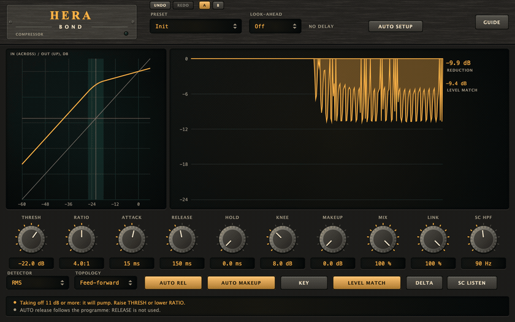

# Hera Bond

Track and bus compressor with peak or RMS detection, feed-forward or feedback topology, soft knee, hold, auto setup, and external sidechain.

`VST3 + AU + Standalone`



*The operating-point lamp rides the soft-knee transfer curve while the 10-second gain-reduction history scrolls beside it.*

## Theme

### Name origin

*Hera* is the goddess of marriage and of what holds together: the compressor's work is to bring the loud and the quiet closer so that they hold together as one. (CMake targets, namespaces, and plugin codes use the short name "Hera".)

### Core philosophy

- **Transparency at rest, exact law under load.** Below threshold or after release (`< 0.001 dB`), gain resets to exact `1.0` and `MIX 100 %` passes audio bit-for-bit; `15 ms` peak fall stops waveform ripple.
- **Two honest topologies.** **Feed-forward** follows `(1 - 1/ratio) × over`; **Feedback** reads post-gain output (`slope / (1 + slope)` overshoot, `0` latency) without faking compensation.
- **Loudness-fair and comb-free comparison.** **Look-ahead** (`1–10 ms`) delays the dry **Mix** path equally, **Level Match** balances RMS (`±12 dB`), and **Delta** / **SC Listen** isolate changes.
- **Not a brickwall limiter.** Reads no true peak and sets no hard ceiling—place [Aegis Ceiling](../aegis/README.md) after it, [Atlas Span](../atlas/README.md) for multiband, or [Iris Prism](../iris/README.md) for dynamic EQ.
- **Analog look, digital brain.** Studio-hardware interface drawn entirely from code by the shared kit ([shared/ui](../../shared/ui)); no image, font or sound files ship.
- **Free, public, source only.** The repository holds the code, not a download, under the AGPL-3.0-or-later (see [NOTICE](../../NOTICE.md)).

## See it

| View | What to look at |
|---|---|
|  | RMS beat: `-22 dB` thresh, `4:1`, `8 dB` knee, `-9.3 dB` GR, `-9.4 dB` match. |

### UI colour legend

| Swatch | Hex | UI Element | Meaning |
|---|---|---|---|
| 🟡 | `#FFB347` | Transfer curve, 10 s gain-reduction trace & fill, **REDUCTION** & **LEVEL MATCH** readouts, lit switches | Active compression curve (`IN`/`OUT`), live gain reduction (`0` to `-24 dB`), and digital readouts (`colours::amber`) |
| 🔵 | `#37E3C5` | Operating-point lamp, shaded soft-knee zone | Current input/output level dot and `THRESH ± 0.5 × KNEE` transition band (`colours::accent`) |
| 🟠 | `#F2A33A` | Advice strip warning dots | Active warnings (`≥ 10 dB` pumping, `RATIO 1:1`, `THRESH ≥ -1 dB`, unrouted `KEY`, `DELTA`/`SC LISTEN` on) (`colours::warn`) |
| ⚪ | `#EAE3D0` | Primary engraved labels | Panel and control titles (`colours::text`) |
| ⚫ | `#9F9680` | `THRESH` crosshairs, scale numbers, delay readout, advice info dots | Secondary references and informational notes (`colours::dim`) |
| ⬛ | `#090D0D` / `#1C2A29` | Recessed glass displays, grid lines & 1:1 diagonal | Glass background (`colours::glass`) and `12 dB` / `6 dB` graticule (`colours::glassGrid`) |

## Try it

| Setting | What you see / hear / measure |
|---|---|
| Play track → press **AUTO SETUP** | Listens `4 s`; maps crest (`2:1 / 10 / 300 ms` dense to `4:1 / 25 / 100 ms` dynamic) + **Thresh** for `~3.5 dB` avg GR in one undo step. |
| *Bus Glue* (`1–3 dB` GR, **RMS**, **Auto Rel**, **Level Match** on) | Fast `50 ms` peak release + `600 ms` sustained release (`93 ms` vs `1008 ms`); **Level Match** keeps loudness equal (`±12 dB`). |
| **Feed-forward** + **Peak** + **Look-ahead** `5 ms` | Delays audio `240` samples (`48 kHz`); cuts `-40 → 0 dBFS` step first ms from `-0.6` to `-11.0 dBFS` with zero **Mix** comb. |
| **Topology** `Feedback` + **Hold** `100–300 ms` | `0` latency, overshoot capped `≤ half` (`0.43 dB/dB` at `4:1`, `0.33` at `2:1`), `+20 dB` step overshoot drops `+2.70 → +0.34 dB`. |
| **SC HPF** `250 Hz` or **KEY** + **SC Listen** | `50 Hz` cut drops `13.4 dB → 0.0 dB` while bass passes cleanly; **SC Listen** auditions detector key. |

> [!TIP]
> **Quick start:** Aim for `1–3 dB` reduction on buses (or press **AUTO SETUP**), and keep **LEVEL MATCH** (`~0.6 s`, `±12 dB`) or **DELTA** handy so louder does not fool A/B.

> [!NOTE]
> **Hold, Undo & A/B:** **Hold** pauses release after signal drops (ignored in **Auto Rel**); **UNDO/REDO** & **A/B** preserve **LEVEL MATCH**; **DELTA** and **SC LISTEN** switch off on close.

> [!IMPORTANT]
> **Look-ahead & Feedback:** **Feedback** ignores **Look-ahead** (`0` latency, `≤ half` overshoot) and switching either while playing restarts the compressor; unrouted **KEY** listens to itself.

> [!WARNING]
> **Settings pitfalls:** `≥ 10 dB` GR pumps; **Peak** with `≤ 2 ms` Attack strips transients while `10 ms` **RMS** misses clicks; **MIX < 100 %** blends dry without changing the meter/curve.

> [!CAUTION]
> **Not a limiter:** Hera reads no true peak and sets no ceiling—put [Aegis Ceiling](../aegis/README.md) after it, [Atlas Span](../atlas/README.md) for multiband, or [Iris Prism](../iris/README.md) for dynamic EQ.

## Reference

### Controls

| Control | Range / Choices | Default | Role |
|---|---|---|---|
| **Threshold** | `-60.0` to `0.0 dB` | `-18.0 dB` | Sine-peak level above which compression begins |
| **Ratio** | `1.0:1` to `20.0:1` | `2.0:1` | Input dB per `1 dB` output above threshold |
| **Attack / Release** | `0.1–200.0 ms` / `10 ms–2.00 s` | `10.0 ms` / `150 ms` | Time to travel `63 %` down and back |
| **Hold** | `0.0–500 ms` | `0.0 ms` (Off) | Holds gain after signal drops before **Release** starts (unused in **Auto Rel**) |
| **Knee** | `0.0–24.0 dB` | `6.0 dB` | Quadratic soft-knee width centred on **Threshold** |
| **Makeup / Auto Makeup** | `0.0` to `+24.0 dB` / `Off`, `On` | `0.0 dB` / `Off` | **Auto Makeup** restores full-scale (`0 dBFS`) loss; **Makeup** adds on top |
| **Mix / Link** | `0–100 %` / `0–100 %` | `100 %` / `100 %` | Parallel dry/wet blend (`0` comb-free); stereo louder-channel link |
| **SC High-pass** | `Off` (`20 Hz`) to `500 Hz` | `Off` (`20 Hz`) | 2nd-order Butterworth high-pass on detector key only |
| **Detector / Topology** | `Peak`, `RMS` (`10 ms`) / `Feed-forward`, `Feedback` | `RMS` / `Feed-forward` | Peak (`15 ms` fall) vs RMS; input vs post-gain output detection |
| **Look-ahead** | `Off`, `1 ms`, `2 ms`, `5 ms`, `10 ms` | `Off` | Delays audio for pre-peak gain reduction (feed-forward only) |
| **Auto Rel / Key / Level Match** | `Off`, `On` | `Off` | Dual-follower release; external sidechain; slow (`~0.6 s`, `±12 dB`) RMS match |
| **Auto Setup / Delta / SC Listen** | Actions & monitors | Off | `4 s` crest+thresh auto setup; `output - input` delta; listen to detector key |
| **Presets / Undo / A-B / Guide** | 8 presets (`Init`, `Vocal Level`, `Drum Punch`, `Bus Glue`, `Bass Control`, `Parallel Smash`, `Peak Catcher`, `Sidechain Duck`), Undo/Redo, A/B | `Init` / `A` | Complete presets (keep **Level Match**), `Cmd+Z`, `A/B` compare, **GUIDE** |

### Signal flow

```text
in ──► [key: track or sidechain (or prev out in Feedback)] ──► SC HPF (2nd-order BW) ──► Peak (15 ms fall) / RMS (10 ms)
                                                                                                    │
in ──► [Look-ahead delay] ──┬───────────────────────────────────────────────────► gain + makeup ────┼──► MIX ──► [Level Match] ──► out
                            └───────────────────────────────────────────────────► dry blend ────────┘
```

- **Detection:** **Peak** tracks instantaneously with a `15 ms` fall; **RMS** computes `sqrt(mean_square_10ms) × sqrt(2)` so both read sine peaks identically. In **Feedback** (without external **Key**), the detector reads the previous post-gain sample (before **Makeup** and **Mix**).
- **Link & Gain Computer:** Each channel sees `own + Link × (louder - own)`, mapped via `(1 - 1/ratio) × over` with quadratic soft knee.
- **Follower & Rest:** One-pole attack/release (or max of `50 ms` fast and `600 ms` / `20×` attack slow followers in **Auto Rel**); below `0.001 dB` at rest, gain resets to exact `1.0`.

### Measured

| Check (`HeraTests` @ `48 kHz`, `HeraUiCheck`) | Result |
|---|---|
| Gain law (`-6 dBFS` sine over `-24 dB`, no knee; `12 dB` knee) | `4:1`: **13.48 dB** Peak, **13.52 dB** RMS (law `13.5`); `20:1`: **17.13 dB** (`17.1`); `12 dB` knee at thresh: **1.14 dB** (`1.125`), `8 dB` below: **none** |
| Transparency & release tail | Below thresh: **bit-identical**; `3 s` after loud passage: gain exact `1` (**bit-identical**) |
| **Attack** (`20 ms`) / **Release** (`200 ms`) / **Auto release** | `20 ms`: `63 %` (**20.9 dB** vs `21`); `200 ms`: `41 %` left (1-pole `37 %` + `15 ms` peak fall), `0.02 dB` at `1.4 s`; **Auto**: halves in **93 ms** (`30 ms` burst) vs **1008 ms** (`1.5 s` burst) |
| **Hold** (`300 ms`, `21 dB` reduction) | `200 ms` after stop: **21.0 dB** (`3.5 dB` without hold); `100 ms` post-hold: **7.6 dB**; `100 ms` gap inside `200 ms` hold keeps full reduction; `0 ms` identical to prior engine |
| **Link** / **Sidechain** / **Makeup** / **Mix** / **Clicks** | Link `100 %`: `-13.5 dB` both (`26 dB` offset); `0 %`: `-13.5 / 0.00 dB`; SC `250 Hz` HPF turns `50 Hz` cut from `13.4 dB` to **0.0 dB**; Makeup `+6 dB`: **-7.49 dB**; Auto makeup: **+0.01 dBFS**; Mix `50 %`: **-4.35 dB** (`-4.36`); Clicks: Peak **15.7 dB**, RMS **0.0 dB** |
| **Look-ahead** (`5 ms`) & **Host bypass** (`10 ms`) | Delay **240 samples** bit-exact (`96` @ `2 ms`); `-40 → 0 dBFS` step first ms: `-0.6 dBFS` off vs **-11.0 dBFS** on; Host bypass @ `10 ms`: **480 samples** (`HeraUiCheck`) |
| **Level Match**, **Delta**, **SC Listen** | `-10.83 dB` noise becomes **-0.01 dB** after `5 s` (`+10.83 dB`); Delta `+6 dB` makeup: **-0.04 dB** (`0` when idle); SC Listen `1 kHz` HPF: `5 kHz` `-0.01 dB`, `100 Hz` `-40.0 dB` |
| **Auto Thresh** & **Auto Setup** | Steady `-20 dB` → `-24.7 dB` thresh (**3.53 dB** avg GR, target `3.5`); `0 dB` bursts (`100 ms/s` over `-30 dB`) → `-18.4 dB` (**3.54 dB** avg GR); crest `3.01 dB` sine → `2:1 / 10 ms / 300 ms`; `12.97 dB` bursts → `2.8:1 / 16.2 ms / 217 ms` (**4.24 dB** avg GR; 2nd press `2.5 dB`); `20+ dB` crest (`-5..40 dB` monotonic) → `4:1 / 25 ms / 100 ms`; silent/`< -70 dB`/`1:1`/`-58 dB @ 2:1` unchanged; 1 press = 1 undo (`HeraUiCheck`) |
| **Feedback topology** (steady, `+20 dB` step, latency, Auto) | Steady `-6` over `-24`: `2:1` **5.99 / 6.01 dB** (`6.00`), `4:1` **7.70 / 7.73 dB** (`7.71`), `1000:1` **11.99 dB** (`< half` of `24 dB`); Processor: `-13.51 dB` FF vs **-7.72 dB** FB; `+20 dB` step (`-30 → -10 dBFS`, `THRESH -20`, `5 ms` Peak): steady **-14.27 dBFS** FB (`-14.29`) vs **-17.47 dBFS** FF (`-17.50`), 1st ms post-attack overshoot **+0.34 dB** FB vs **+2.70 dB** FF, 1st ms step `-10.20` FB / `-10.23` FF; Latency `0` in FB (`240` restored in FF); Auto Thresh `-28.6 dB` (**3.70 dB** GR); Auto Makeup **-0.01 dBFS** |
| Block invariance & NaN/Inf | Bit-identical across `1, 7, 64, 333, 512, 4096` samples (with look-ahead & feedback); NaN/Inf treated as silence |

### Limits

- **Not a limiter:** No true peak, no hard ceiling; put [Aegis Ceiling](../aegis/README.md) after it.
- **Look-ahead & Feedback:** Look-ahead adds latency and switching it or **Topology** while playing restarts the compressor; **Feedback** forces `0` latency, reduces at most half the overshoot (`0.43 dB/dB` at `4:1` vs `0.75`, `0.33` at `2:1` vs `0.50`), and Auto Thresh/Setup in feedback were tested on steady tones only.
- **Pumping, transients & Mix display:** `≥ 10 dB` GR pumps; fast Peak **Attack** strips transients; `10 ms` **RMS** misses brief clicks; **MIX < 100 %** does not alter meter/curve display.
- **Level Match:** Slow (`~0.6 s`, `±12 dB`) unweighted RMS, not perceptual loudness.
- **Unrouted KEY:** Listens to itself when no sidechain track is routed so saved sessions keep working.
- **AUTO THRESH / AUTO SETUP:** Measure once over `4 s` (`NO AUDIO` after `20 s` stopped); **Thresh** is approximate on bursts (`+0.7 dB` 1st press, `-1.0 dB` 2nd press, synthetic bursts only), and crest-to-ratio/attack/release is a reasoned starting point, not programme-matched.
- **Platform verification:** Builds on macOS (`VST3`, `AU`, `auval -v` pass, checked 2026-11-13); no macOS CI job and no `HostCheck`.

## Build & develop

Requires CMake 3.22+ and a C++20 compiler; JUCE is fetched via [cmake/Juce.cmake](../../cmake/Juce.cmake).

```bash
# Recommended from repository root:
scripts/build.sh hera                 # configure, build & run HeraTests + HeraUiCheck
scripts/showcase.sh hera              # regenerate docs/showcase.gif (requires ffmpeg)

# Manual CMake from plugins/hera/:
cmake -S . -B build -DCMAKE_BUILD_TYPE=Release
cmake --build build --target Hera_VST3 Hera_AU Hera_Standalone -j 10   # add -DHERA_INSTALL_AFTER_BUILD=ON to install (macOS)

cmake --build build --target HeraTests && ./build/HeraTests_artefacts/Release/HeraTests
cmake --build build --target HeraUiCheck && ./build/HeraUiCheck_artefacts/Release/HeraUiCheck
cmake --build build --target HeraSnapshot && ./build/HeraSnapshot_artefacts/Release/HeraSnapshot docs/screenshot.png
```

`docs/screenshot.png` and `docs/showcase.gif` are generated by `HeraSnapshot` / `scripts/showcase.sh` (never edited by hand); see [CLAUDE.md](CLAUDE.md) for invariants.

## Licence

AGPL-3.0-or-later, source only. See [LICENSE](../../LICENSE), [NOTICE.md](../../NOTICE.md) (third-party software, trademarks, source-only policy), [CONTRIBUTING.md](../../CONTRIBUTING.md), and [SECURITY.md](../../SECURITY.md).
