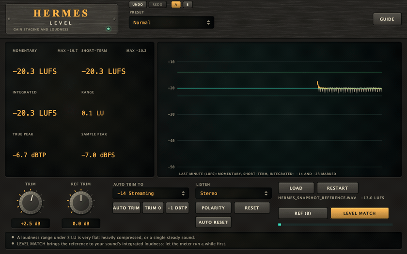
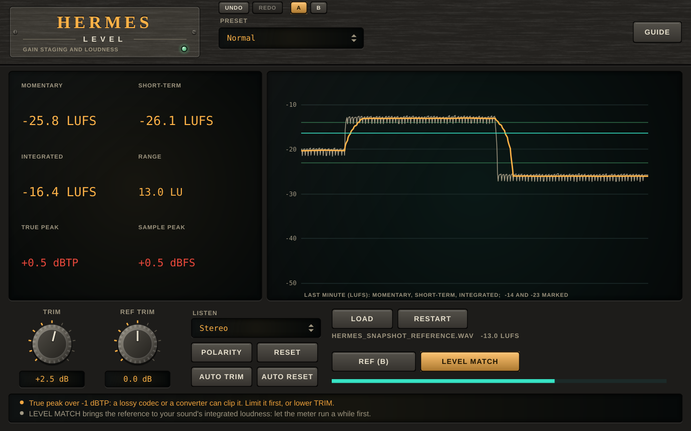

# Hermes Level

A gain-staging, ITU-R BS.1770-4 / EBU R128 loudness, true-peak, and level-matched reference tool that changes nothing except level and what you monitor.

**Formats:** VST3 + AU + Standalone



*Momentary (dim) and short-term (amber) loudness scrolling against the integrated line (teal), `-14 / -23 LUFS` targets, and the red true-peak alarm above `-1 dBTP`.*

## Theme

### Name origin

*Hermes* is the messenger god of measures, weights, and exchanges; *Level* is the gain staging, BS.1770 loudness, and `8×` true-peak readings he carries and weighs across the chain. (CMake targets, namespaces, and plugin codes use the short name "Hermes".)

### Core philosophy

- **Measures, never shapes.** Changes nothing except `TRIM`, `POLARITY`, and what you listen to; idle output is bit-for-bit identical to the input with zero latency.
- **Standards-faithful metering.** K-weighting comes from BS.1770 analog prototypes (within `0.006 dB` at any sample rate), fixed `0.1 LU` histograms (`-70` to `+10 LUFS`), and `8×` `64-tap` true peak shared with Aegis.
- **Meters hear your track, not your check.** Readings sit after `TRIM` and `POLARITY` and keep measuring your full stereo mix even while checking Mono/Side/Left/Right/Swap or `REF (B)`.
- **Honest reference matching.** `LEVEL MATCH` pairs your track's integrated loudness to a loaded reference (`±24 dB` cap) so you compare tone rather than loudness.

## See it

| View | Notes |
|---|---|
|  | `TRIM +2.5 dB`, loaded `-13.0 LUFS` reference matched, red true-peak alarm, `-14/-23` history graph. |

### UI colour legend

See [root UI colour legend](../../README.md#ui-colour-legend-hardwareh) for shared `Hardware.h` hex codes (`10 LU` graph graticule).

| Swatch | Hex | UI Element | Meaning |
|---|---|---|---|
| 🟡 | `#FFB347` | **Short-term** (`3 s`) graph trace, digital readouts, lit switches | `3 s` loudness trajectory and safe meter values (`colours::amber`) |
| 🔵 | `#37E3C5` | **Integrated** loudness line, **Reference** seek/progress bar | Gated integrated loudness level and reference playback position (`colours::accent`) |
| 🟢 | `#5FD68C` | `-14 LUFS` & `-23 LUFS` graph target lines | Streaming (`-14`) and EBU R128 broadcast (`-23`) reference marks (`colours::good`) |
| 🔴 | `#EF4A3D` | **TRUE PEAK** / **SAMPLE PEAK** alarm values | Over limit (`TRUE PEAK > -1.0 dBTP` or `SAMPLE PEAK ≥ 0.0 dBFS`) (`colours::bad`) |
| 🟠 | `#F2A33A` | Advice strip warning dots, missing-reference status | Active monitor (`LISTEN ≠ Stereo`, `REF` on/empty) or loudness/peak warning (`> -1 dBTP`, `> -9 LUFS`) (`colours::warn`) |
| ⚫ | `#9F9680` | **Momentary** (`400 ms`) trace | Fast `400 ms` loudness trace (`colours::dim`) |

## Try it

| Recipe / Setting | What you see, hear & measure |
|---|---|
| Play passage → pick `-14 Streaming` → **AUTO TRIM** (`-1 dBTP` off) | Adds `target - integrated` to `TRIM` in 1 undo step (`-26.7 LUFS` → `-14.00 LUFS`); hit **TRIM 0** first to start from unity. |
| `-20 LUFS` (`-6 dBTP`) + **AUTO TRIM** (`-14`, `-1 dBTP` on) | Stops at `+5 dB` (`-1.00 dBTP`) instead of `+6 dB`; strip shows `"AUTO TRIM stopped at the -1 dBTP ceiling"`. |
| **LOAD** reference (`≤ 10 min`) → **REF (B)** on + **LEVEL MATCH** on | `20 ms` clickless crossfade to looping reference (`5 ms` smoothed `sound - reference` match, `±24 dB` cap); meters still show your track. |
| **LISTEN** = `Mono` / `Side` / `Left` / `Right` / `Swap` | Auditions `(L+R)/2`, `(L-R)/2`, one channel, or swapped channels; **True Peak** & loudness meters stay on full stereo input. |
| **AUTO RESET** on (or **RESET** before section) | Clears integrated, range, `MAX` (`0.4 s` / `3 s` full windows), and peaks on host play; **UNDO / REDO** (`Cmd+Z`) & **A / B** compare setups. |

### Delivery targets (checked 2026)

| Target | Standard & source | Notes |
|---|---|---|
| `-14 LUFS` (`-1 dBTP` advised) | [Spotify](https://support.spotify.com/ca-en/artists/article/loudness-normalization/) | Streaming playback level; lower advised for very loud masters |
| `-16 LKFS ±1 dB` (`-1 dBFS` TP) | [Apple Podcasts](https://podcasters.apple.com/support/audio-requirements) | Stereo podcast requirement |
| `-19 LKFS` | [Auphonic](https://auphonic.com/blog/2020/06/09/loudness-normalization-mono-productions/) | Common mono podcast figure (third-party guidance) |
| `-23 LUFS ±0.5 LU` (`-1 dBTP`) | [EBU R128](https://tech-qual.ebu.ch/files/live/sites/tech/files/shared/r/r128v5_0.pdf) | Broadcast standard (`ATSC A/85` `-24 LKFS / -2 dBTP` is not offered) |

> [!TIP]
> Place Hermes at the **end** of your master chain (or at mix gain-staging points); presets (*Normal*, *Mono Check*, *Side Only*, *Left Only*, *Right Only*, *Swap Check*, *Reference A/B*, *Reference As Is*) switch monitoring while keeping `TRIM`, `POLARITY`, `REF TRIM`, `AUTO RESET`, and `AUTO TRIM` targets.

> [!IMPORTANT]
> **LISTEN** and **REF** are saved with the session—switch `LISTEN` back to `Stereo` (or preset *Normal*) and `REF` off before bouncing.

> [!WARNING]
> **Integrated** loudness and **LEVEL MATCH** need a few seconds of audio first; master notes (`< -24 LUFS` quiet, `< 3 LU` flat) are rules of thumb for finished masters, not stems.

> [!CAUTION]
> Meters flag `TRUE PEAK > -1 dBTP` and `> -9 LUFS`, but Hermes **never limits** or shapes tone—use **Aegis** to control true peaks.

## Reference

### Controls

| Control | Range / Choices | Default | Role |
|---|---|---|---|
| **Trim / Trim 0** | `-24.0` to `+24.0 dB` / Action | `0.0 dB` | Pre-meter gain (`TRIM 0` resets to unity in 1 undo step) |
| **Polarity** | `Off`, `On` | `Off` | Inverts both channels (identical alone, differs when summed) |
| **Auto Trim / Target / -1 dBTP** | Action / `-14`, `-16`, `-19`, `-23` / `Off`, `On` | `-14 Streaming` / `Off` | One-shot `TRIM` to integrated target (optionally capped at `-1 dBTP`) |
| **Listen** | `Stereo`, `Mono` `(L+R)/2`, `Left`, `Right`, `Side` `(L-R)/2`, `Swap` | `Stereo` | Monitoring check only (meters still read full stereo sound) |
| **Reset / Auto Reset** | Action / `Off`, `On` | `Off` | Clears integrated, range, maxima & peaks (`Auto Reset` on host play) |
| **Load / Restart / Seek bar** | File / Action / `0–100 %` | Empty | Loads reference (`WAV, AIFF, FLAC, OGG, MP3`, `≤ 10 min`), restarts loop, scrubs |
| **REF (B) / Level Match / Ref Trim** | `Off`, `On` / `Off`, `On` / `-12.0` to `+12.0 dB` | `Off` / `On` / `0.0 dB` | Crossfades (`20 ms`) to reference matched to sound's integrated LUFS |
| **Presets / Undo / A-B / Guide** | 8 presets, `Cmd+Z` / `Shift+Cmd+Z`, A/B | `Normal` / `A` | Monitoring presets, undo history (file loads excluded), `A/B` compare (slots unsaved), **GUIDE** |

### Signal flow

```text
in ──► TRIM ──► [POLARITY] ─┬─► BS.1770 K-weighting (+4 dB @ 1.68 kHz shelf, 38 Hz 2nd-order HPF)
                            │     └─► 100 ms blocks ─► 400 ms M (75% overlap) / 3 s S / 0.1 LU gated I (-70/-10) & LRA (-20, 10th-95th)
                            ├─► 8× 64-tap windowed-sinc TruePeak.h + Sample Peak
                            └─► [LISTEN matrix] ──► 20 ms A/B crossfade ◄── Reference (Lagrange resampled + 64-sample LEVEL MATCH + REF TRIM) ──► out
```

### Measured (`HermesTests`, 48 kHz)

- **BS.1770 / R128 loudness:** `1 kHz` stereo sine at `-23 dBFS` reads `-23.04 LUFS` integrated, momentary, and short-term (EBU Tech 3341: `-23.0 ± 0.1`); within `0.038 LU` at `44.1, 88.2, 96, 192 kHz`.
- **K-weighting:** follows analog prototypes within `0.006 dB` at `30, 100, 500 Hz, 1, 4 kHz` (`-1.18 dB` at `100 Hz`, `+3.92 dB` at `4 kHz`).
- **Gating:** `10 s` at `-23`, `5 s` at `-36`, `10 s` at `-23` reads `-23.10 LUFS`; `10 s` sound + `10 s` silence reads `-23.10 LUFS`.
- **Maxima & step response:** `-20 dBFS` (`5 s`) then `-30 dBFS` (`5 s`) holds `MAX` M & S at `-20.04 LUFS` while M reads `-30.04` (silent until `0.4 s` / `3 s` full); silence → `-20 dBFS` reads M `-20.04`, S `-24.8` at `0.5 s` and S `-20.04` at `3 s`.
- **Loudness range (EBU Tech 3342):** `20 s` at `-20` + `20 s` at `-30` reads `10.00 LU` (`10 ± 1`); steady tone `< 0.3 LU`.
- **True peak:** `-9.03 dBFS` sample / `-6.02 dBTP` tone reads `-5.93 dBTP`; band-limited noise `0.23` vs `0.33 dBTP` from a separate `128-tap` reader (within `0.1 dB`; BS.1770 asks `4×` / `0.2 dB`).
- **Gain, polarity & listen:** `TRIM +6 dB` = `+6.00 dB`; `POLARITY`, `MONO`, `LEFT`, `RIGHT`, `SIDE`, `SWAP` are bit-exact; idle output is bit-identical with zero delay.
- **Reference & crossfade:** `-14 dBFS` sine reads `-14.04 LUFS`; `LEVEL MATCH` pairs it with a `-26.7 LUFS` sound (`-12.7 dB` gain); `REF TRIM +3 dB` = `+3.00 dB`; `4×` A/B switches in a tone show no step (`0.0131` vs `0.0131`); `50 %` seek = `0.500`; shorter swapped reference clamps cleanly.
- **Auto Trim:** `-26.7 LUFS` → `-14.00 LUFS`; `-20 LUFS / -6 dBTP` with `-1 dBTP` cap → `+5 dB` (not `+6`); `20 s` clicks (`-6 dBFS` / `100 ms`, `-36.73 LUFS`) with cap → `+5.0 dB` → `-1.00 dBTP`; `-19` = `+1 dB` from `-20`, `-23` = `-3 dB`.
- **Stability:** bit-identical across `1, 7, 64, 333, 512, 4096` samples with reference active; `NaN` and infinity inputs become silence.

### Limits

- **AUTO TRIM with `-1 dBTP` ceiling** stops short on peak-heavy material and reports `"AUTO TRIM stopped at the -1 dBTP ceiling"`; use **Aegis** to reach loudness and true-peak ceiling together.
- **Meters are not a limiter:** they warn on `> -1 dBTP` and `> -9 LUFS` but do not attenuate peaks (use **Aegis**).
- **Integrated loudness & LEVEL MATCH need time:** until a few seconds of audio play, there is nothing to match to (reference plays as is); press **RESET** on a new passage.
- **True peak reads at 8×** (`0.1 dB` vs separate reader; BS.1770 specifies `4×` / `0.2 dB`) after `TRIM`, not after `LISTEN`.
- **LISTEN and REF are saved parameters:** reset to `Stereo` and `REF Off` before bouncing (`REF` with no file loaded plays your own track and prompts **LOAD**).
- **Polarity** inverts both channels: sounds identical alone, sums differently with other tracks.
- **Quiet (`< -24 LUFS`) & flat (`< 3 LU`) notes** are rules of thumb for finished masters, not stems or works in progress.
- **Reference RAM & resampling:** holds up to `10 min` whole in memory (`~230 MB` at `48 kHz`), resamples to the session rate on load, and rebuilds from file if the session rate changes.
- **Reference path persistence:** reloads from its file path on session reopen; if moved or saved without one, the slot opens empty.
- **Platform verification:** See [CI & platform status](../../CLAUDE.md#not-yet-in-line).

## Build & develop

See [root Build & develop](../../README.md#build--develop) for shared prerequisites and image-generation rules, and [CLAUDE.md](CLAUDE.md) for invariants.

```bash
# Recommended from repository root:
scripts/build.sh hermes               # configure, build & run HermesTests + HermesUiCheck
scripts/showcase.sh hermes            # regenerate docs/showcase.gif

# Manual CMake from plugins/hermes/:
cmake -S . -B build -DCMAKE_BUILD_TYPE=Release
cmake --build build --target Hermes_VST3 Hermes_AU Hermes_Standalone -j 10   # add -DHERMES_INSTALL_AFTER_BUILD=ON to install (macOS)

cmake --build build --target HermesTests && ./build/HermesTests_artefacts/Release/HermesTests
cmake --build build --target HermesUiCheck && ./build/HermesUiCheck_artefacts/Release/HermesUiCheck
cmake --build build --target HermesSnapshot && ./build/HermesSnapshot_artefacts/Release/HermesSnapshot docs/screenshot.png
```

## Licence

AGPL-3.0-or-later, source only — see [root Licence](../../README.md#licence) and [NOTICE](../../NOTICE.md).
