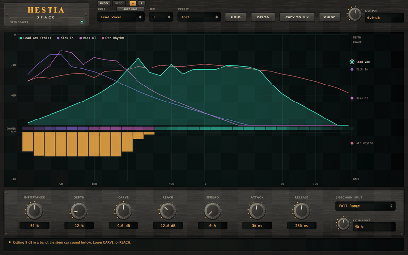
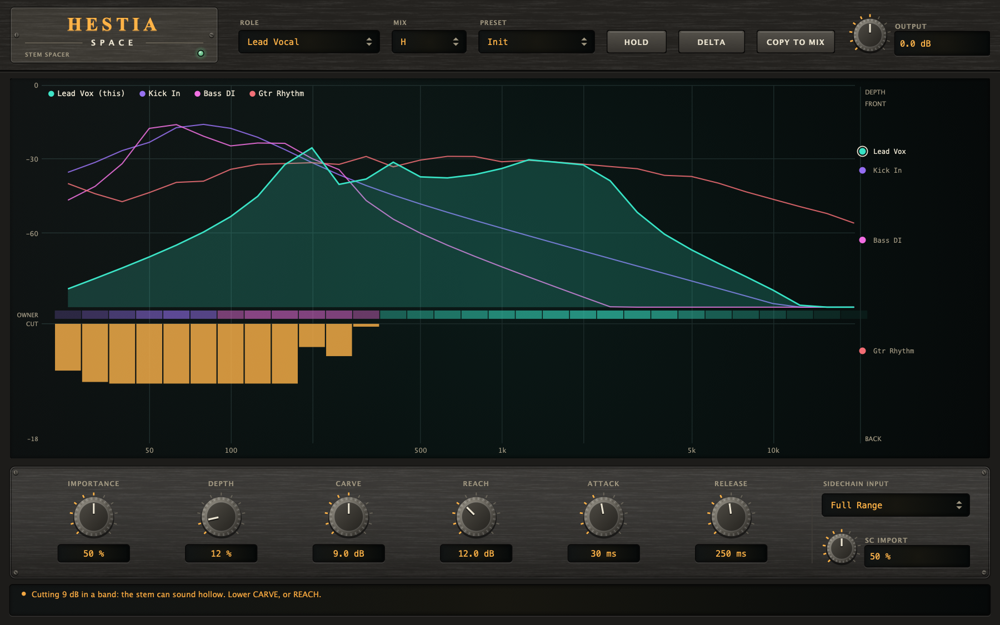

# Hestia Space

A zero-latency stem spacer for mixing that dynamically carves room across thirty third-octave bands and places stems in depth without reverb tails.

**Formats:** VST3 + AU + Standalone



*Coordinating a vocal against kick, bass, and guitar stems: live spectra, the `OWNER` band strip, amber `CUT` bars, and the `DEPTH` map.*

## Theme

### Name origin

*Hestia* is the goddess of the hearth who keeps a home orderly and welcoming; *Space* is the spectral room she carves in lower-priority stems so every instrument has a place without masking. (CMake targets, namespaces, and plugin codes use the short name "Hestia".)

### Core philosophy

- **Only cuts, never lifts.** Each instance attenuates only its own stem where a higher-claim stem plays; a band's owner is never touched, and idle bells bypass bit-for-bit.
- **Decentralised, zero-delay coordination.** Instances publish pre-cut `50 ms` time-domain band levels to a shared `32`-slot table in one host process and format—no FFT, no look-ahead, no master node.
- **Depth is cues, not a reverb.** `DEPTH` combines high air (`-9 dB` @ `5 kHz`), level (`-4 dB`), side narrowing (`-30 %`), and eight single-tap early reflections (`6–37 ms`, no tail, no feedback) while yielding up to `35 %` claim.
- **Rules of thumb, not magic.** Role curves encode mixing practice, third-octave bands cannot notch narrow resonances, and non-lockstep host threads make offline bounces vary slightly.

## See it

| View | Notes |
|---|---|
|  | `Lead Vox` in Mix `H` giving way below `350 Hz`, `CARVE 9 dB`, `DEPTH 12 %`. |

### UI colour legend

See [root UI colour legend](../../README.md#ui-colour-legend-hardwareh) for shared `Hardware.h` hex codes (`hestia::gui::stemColour` assigns per-slot stem hues).

| Swatch | Hex / Formula | UI Element | Meaning |
|---|---|---|---|
| 🔵 | `#37E3C5` | **This stem** spectrum & fill, owned bands in `OWNER` strip, legend & ringed **DEPTH** dot | Active instance's energy, band ownership, and front-to-back position (`colours::accent`) |
| 🟡 | `#FFB347` | **CUT** bars (`0` to `-18 dB`), lit **Sidechain input** label | Dynamic attenuation currently carved by this stem, or active external sidechain (`colours::amber`) |
| 🎨 | `HSV(fmod(0.58 + 0.137×slot, 1), 0.55, 0.95)` | **Other stems** on the mix bus (traces, `OWNER` strip, legend, **DEPTH** dots) | Stable per-slot colour for up to `32` stems (`hestia::gui::stemColour`) |
| ⚪ | `#EAE3D0` | **Sidechain** spectrum & `OWNER` strip, ring on this stem's **DEPTH** dot | External sidechain stem (`colours::text`) |
| 🟠 | `#F2A33A` | Advice strip warning dots | Active alerts (`DELTA` on, `MIX Off`/alone, `CARVE ≥ 9 dB` hollow cut, `CARVE 0 & DEPTH 0`) (`colours::warn`) |

## Try it

| Recipe / Setting | What you see, hear & measure |
|---|---|
| Put Hestia on stems (Mix `A`) + **AUTO ROLE** (`"Bass DI"`, `"Lead Vox"`) | Fresh `Full Range` instances auto-set clear host names once in 1 undo step; `OWNER` strip shows who holds each of the `30` bands. |
| Vocal + Bass on `79 Hz` vs `2 kHz` (`CARVE 6 dB`) | At `79 Hz` vocal cuts `-5.9 dB` (bass `0.0 dB`); at `2 kHz` bass cuts `-5.9 dB` (vocal `0.0 dB`); equal role & `IMPORTANCE` leave each other untouched. |
| **SPREAD** `0 %` → `100 %` on `1.25 kHz` (`-50 dB` vocal → bass) | Masks `±6` bands (`25 dB/Bark` down, `10 dB/Bark` up): 1 band up cuts `4.79 → 5.55 dB` (`+0.77 dB`), 1 band down `4.79 → 4.81 dB` (`+0.01 dB`). |
| **DEPTH** `0 %` → `80–100 %` on background guitars | Pushes dot back on `DEPTH` map; `-9 dB` `5 kHz` shelf, `-4 dB` level, `-30 %` sides, `6.3–31.9 ms` reflections, and up to `-35 %` claim. |
| Route non-Hestia track to **Sidechain** (`SC ROLE` = `Bass`) | Acts as an extra mix stem (`-5.9 dB` vocal cut on `79 Hz`, never heard); **COPY TO MIX** pushes `CARVE/REACH/ATTACK/RELEASE` to playing peers. |

> [!TIP]
> Start from the `10` stem presets (*Init*, *Kick*, *Bass*, *Drum Bus*, *Lead Vocal*, *Backing Vocals*, *Guitars*, *Lead Synth*, *Pads and Strings*, *FX and Ambience*); **COPY TO MIX** syncs `CARVE`, `REACH`, `ATTACK`, and `RELEASE` to all playing peers in one click.

> [!IMPORTANT]
> Instances link only within **one host process and one plugin format** (`VST3` and `AU` have separate `32`-slot tables); use **Sidechain** across sandboxed tracks or third-party chains.

> [!WARNING]
> **CARVE ≥ 9 dB** (`~8.5 dB+` active cut) can sound hollow, **RELEASE < 60 ms** flutters on notes (try `≥ 200 ms`), **IMPORTANCE 0 %** halves claim, and **DEPTH ≥ 80 %** is not for leads.

> [!CAUTION]
> Hestia **never boosts** and **cannot notch narrow resonances** (use **Iris**); **DEPTH is not a reverb** (eight early reflections `≤ 37 ms`, zero tail).

## Reference

### Controls

| Control | Range / Choices | Default | Role |
|---|---|---|---|
| **Role / Auto Role** | `Kick`, `Bass`, `Drums`, `Hats / Cymbals`, `Lead Vocal`, `Backing Vocal`, `Guitar`, `Keys`, `Pad`, `Lead Synth`, `Strings`, `FX`, `Full Range` | `Full Range` | `30`-band mixing claim curve; **AUTO ROLE** reads track name ([RoleGuess.h](Source/RoleGuess.h)) |
| **Mix** | `Off`, `A` – `H` | `A` | Shared bus letter (`Off` = isolated, no cut) |
| **Importance** | `0–100 %` | `50 %` | Scales role claim from `0.5×` to `1.5×` |
| **Carve** | `0.0–18.0 dB` | `6.0 dB` | Maximum attenuation when an equally loud higher-claim stem plays |
| **Reach** | `0.0–36.0 dB` | `12.0 dB` | How much quieter another stem may be and still trigger carving |
| **Spread** | `0–100 %` | `0 %` (Off) | Upward/downward Bark masking spread across `±6` bands (reset to `0 %` by presets) |
| **Attack / Release** | `1–500 ms` / `20 ms–3.00 s` | `30 ms` / `250 ms` | Cut onset and recovery speed |
| **Depth** | `0–100 %` | `0 %` (Front) | Distance cues: `-9 dB` `5 kHz` shelf, `-4 dB` level, `-30 %` sides, `4` reflections/ch (`6–37 ms` @ `0.45`), `-35 %` claim |
| **Output** | `-24.0` to `+24.0 dB` | `0.0 dB` | Post-carve gain |
| **SC Role / SC Importance** | Same `13` roles / `0–100 %` | `Full Range` / `50 %` | Identity and weight of external sidechain input |
| **Hold / Copy to Mix / Delta** | `Off`, `On` / Action / Monitor | `Off` | Freeze cut (while still publishing); copy `CARVE/REACH/ATTACK/RELEASE` to mix; monitor `out - in` (unsaved) |
| **Presets / Undo / A-B / Guide** | `10` presets, `Cmd+Z` / `Shift+Cmd+Z`, A/B | `Init` / `A` | Keep `Mix`, `Output`, `Hold`, `SC Role/Importance` (A/B slots unsaved), **GUIDE** |

### Signal flow

```text
in ─► 30× 4th-order BP (25 Hz–20 kHz, 50 ms MS) ──► publish to 32-slot bus (500 ms TTL, ≤24-char track name)
  │                                                         │
  │                                                         ▼
  │                         gather live mix + sidechain ─► [Spread ±6 bands, 25/10 dB/Bark] ─► Dominance × Presence × Reach × Carve
  │                                                                                                  │
  └──► 30× minimum-phase peaking bells (overlap-inverted, Attack/Release, [Hold]) ───────────────────┴─► Depth (shelf + M/S + 8-tap ER + gain) ─► Output ─► out
```

- **Rule constants ([Engine.h](Source/DSP/Engine.h)):** `kDominanceSpan = 0.5`, presence `-80` to `-60 dB`, `64`-sample ticks; `Spread` uses Traunmüller's Bark scale with fixed slopes (`kSpreadDownDbPerBark = 25`, `kSpreadUpDbPerBark = 10` after Lynch et al., Eurospeech 1997).

### Measured (`HestiaTests` @ `48 kHz`, `HestiaUiCheck`)

- **30-band cut accuracy:** flat `-6 dB` within `0.4 dB` at every band centre; single-band `9 dB` cut within `0.4 dB` (untouched `≥ 3` bands away within `0.4 dB`); idle bells bypassed bit-for-bit (including FMA builds).
- **Level bank selectivity:** centre sine within `0.8 dB`; `3` bands away `-20 dB`, `≥ 6` bands `-40 dB`.
- **Stem priority (`79 Hz` & `2 kHz`, bass vs lead vocal):** `79 Hz` cuts vocal `5.9 dB` (`DEPTH 6` / `CARVE 6`), bass `0.0 dB`; `2 kHz` reverses; different tones leave both untouched.
- **Auto Role (`HestiaUiCheck`, `HestiaTests` [16]):** fresh `"Bass DI"` → `Bass` (`"Role set to Bass from the track name 'Bass DI'; change it any time."`) + `1`-step `UNDO`; saved `Kick` stays `Kick`; `"Track 1"` and `"Synth"` change nothing.
- **Track names, Hold, Copy to Mix, Reach & TTL:** names capped at `24` chars; **Hold** keeps `6.00 dB` vocal cut `3 s` after bass stops (`5.9 dB` down vs `0.00 dB` unheld; held before cut = bit-exact); **Copy to Mix** sends `CARVE 11, REACH 20, ATTACK 5, RELEASE 400` to active peers; **Reach** `6` vs `24 dB` on `12 dB` quieter stem = `0` vs `-3 dB` of `6`; stopped stem forgotten in `0.5 s` (`500 ms`).
- **Depth (`100 %` & `80 %`) & Sidechain:** `100 %` impulse direct L `0.2400`, R `0.0424` (exact to 4 places); left reflections at `6.3, 13.1, 21.7, 31.9 ms` at `0.45 × (0.5, 0.4, 0.3, 0.2)` (`< 1 %`), R silent on L-only impulse, clear at `45 ms`, `0 %` bit-exact; `80 %` depth guitar cuts `2.6 dB` more (`2.7` expected from `28 %` smaller claim); Sidechain matches bus (`5.9 dB`); disconnected/silent/`Off` = bit-exact.
- **Spread (`-50 dB` & `-12 dB` band 17 `1.25 kHz`, vocal → bass after `2.5 s`):** `100 %` pushes 1 band up `4.79 → 5.55 dB` (`+0.77 dB`), 1 band down `4.79 → 4.81 dB` (`+0.01 dB`), own band `6.00 dB`, `> 6` bands unchanged (`1e-9` at `-50 dB`; up to `0.42 dB` on bands `7–10` at `-12 dB` from filter leakage); `0 %` bit-identical to never set; `100 %` changes noise output by up to `0.0002`; weights `0.0316` (`-15.0 dB`, `1.50 Bark`) up and `0.000272` (`-35.7 dB`, `1.43 Bark`) down; `HestiaUiCheck` confirms `4.79 → 5.55 dB` through the processor.
- **Spread CPU (`-O2`, `48 kHz`, `20 s` audio) & Bus capacity:** `4` stems: `0.78 s → 1.00 s` (`0.97 % → 1.25 %` core/stem); `32` stems (bus max): `21.0 s → 32.2 s` (`+0.56` core total); `1` stem alone: `0.17 s`; `33rd` stem works alone.
- **Block invariance & bypass:** bit-identical across `1, 7, 64, 100, 512, 4096` samples (bus + `60 %` depth, sidechain + `50 %` depth, and `100 %` Spread); alone / `Off` / `CARVE 0 & DEPTH 0` = bit-exact.

### Limits

- **COPY TO MIX copies settings once:** not linked; reaches only playing instances in the same process and mix (stopped ones pick up on next play).
- **HOLD keeps a cut, not a decision:** if other stems change while held, switch it off to follow again.
- **One process & one plugin format:** VST3 and AU have separate tables, and sandboxed/bridged hosts isolate instances (use **Sidechain** where needed).
- **Hollow cut & flutter:** `CARVE ≥ 9 dB` (`~8.5 dB+` cut) can sound hollow; `RELEASE < 60 ms` flutters on notes (try `≥ 200 ms`); `IMPORTANCE 0 %` halves claim.
- **DELTA is an unsaved monitor:** hear `out - in`, ends when the window closes.
- **Only cuts, never lifts:** never touches a band's owner (use **Iris** for static/boost EQ).
- **Depth is not a reverb:** fixed distance cues (`-9 dB` air, `-4 dB` level, `-30 %` sides, `0.45` reflections `≤ 37 ms`, no tail, no feedback, no pre-delay or room size control).
- **Sidechain is only as good as its SC Role / SC Importance:** Hestia cannot infer the sidechain's identity; requires a host that routes a second input.
- **Role curves are rules of thumb:** equal role and importance never cut each other; use `IMPORTANCE` to break ties.
- **No look-ahead (`50 ms` level smoothing):** the first tens of milliseconds of a hard note are uncarved.
- **Non-lockstep host threads:** offline bounces can differ subtly across runs because stems process asynchronously.
- **Third-octave resolution:** smooth over `~1/3` octave; cannot notch a single narrow resonance.
- **SPREAD approximations & scope:** fixed `25` / `10 dB/Bark` slopes (ignoring level dependence), reads `±6` bands (plus filter leakage up to `~10` bands at `-12 dB`, `0.42 dB` max; small effect on a single tone: `0.77` up / `0.01 dB` down), per stem (not copied by `COPY TO MIX`, reset to `0 %` on presets).
- **Stereo & mono:** identical cut applied to both channels (no per-channel or M/S carving).

## Build & develop

See [root Build & develop](../../README.md#build--develop) for shared prerequisites and image-generation rules, and [CLAUDE.md](CLAUDE.md) for invariants.

```bash
# Recommended from repository root:
scripts/build.sh hestia               # configure, build & run HestiaTests + HestiaUiCheck
scripts/showcase.sh hestia            # regenerate docs/showcase.gif

# Manual CMake from plugins/hestia/:
cmake -S . -B build -DCMAKE_BUILD_TYPE=Release
cmake --build build --target Hestia_VST3 Hestia_AU Hestia_Standalone -j 10   # add -DHESTIA_INSTALL_AFTER_BUILD=ON to install (macOS)

cmake --build build --target HestiaTests && ./build/HestiaTests_artefacts/Release/HestiaTests
cmake --build build --target HestiaUiCheck && ./build/HestiaUiCheck_artefacts/Release/HestiaUiCheck
cmake --build build --target HestiaSnapshot && ./build/HestiaSnapshot_artefacts/Release/HestiaSnapshot docs/screenshot.png
```

## Licence

AGPL-3.0-or-later, source only — see [root Licence](../../README.md#licence) and [NOTICE](../../NOTICE.md).
