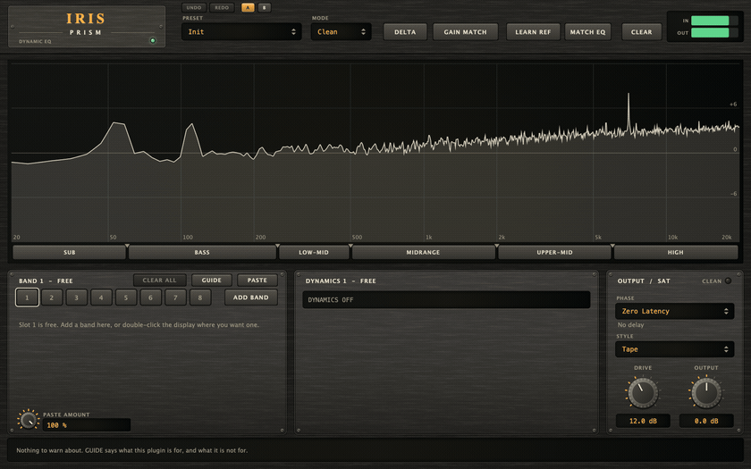
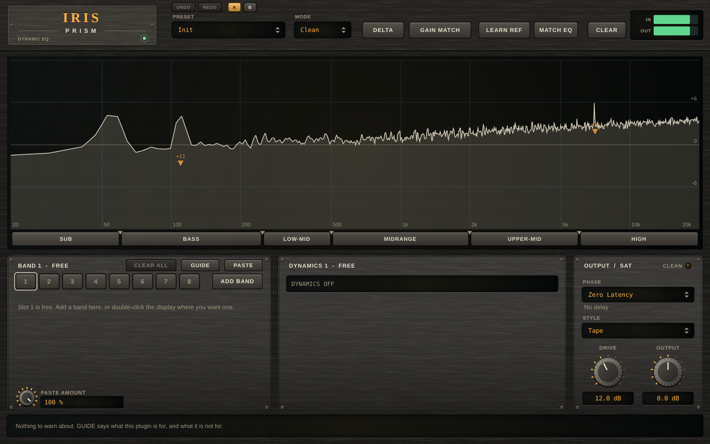
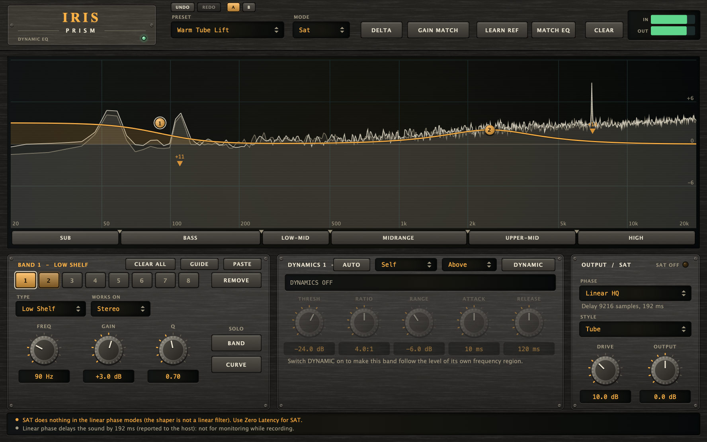
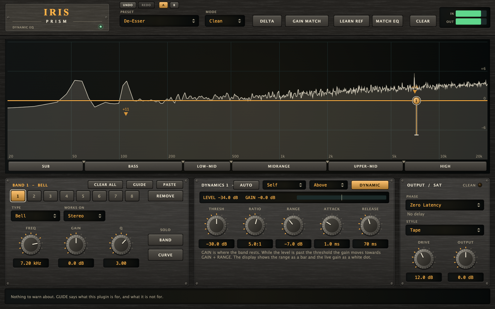
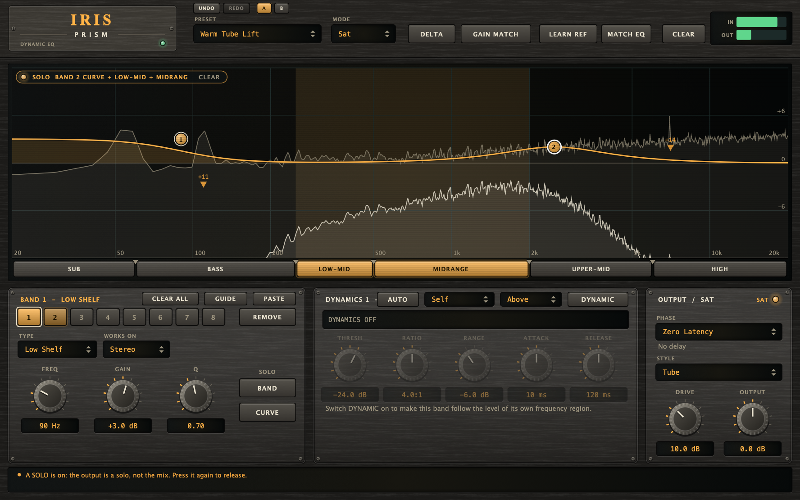
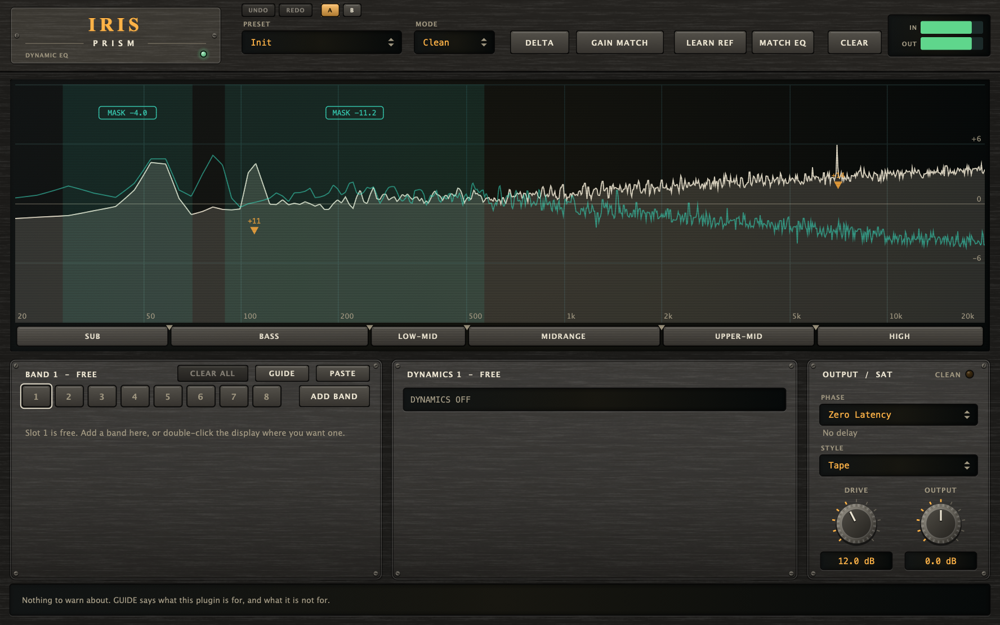
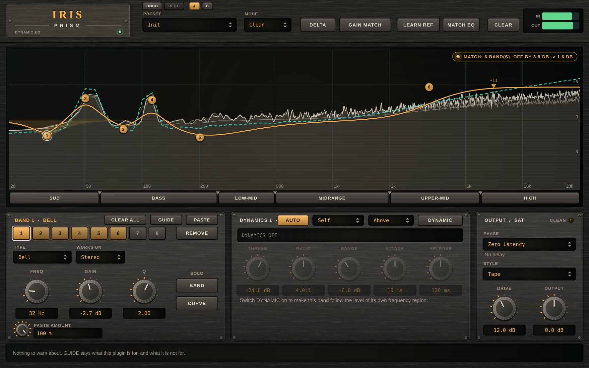

# Iris Prism

An 8-band dynamic equaliser with per-band Stereo/L/R/M/S placement, self/sidechain dynamics, boost saturation, linear-phase modes, masking overlays, and reference matching.

**Formats:** VST3 + AU + Standalone



*Dynamic bands tracking input energy, pre/post FFT spectra, placement-coded curves, and interactive solo, resonance, and masking overlays.*

## Theme

### Name origin

*Iris* is the Greek goddess of the rainbow, the messenger who carries light across the sky; a *Prism* is what splits light into its bands, which is what this plugin lets you do to a sound (and listen to one band at a time). (CMake targets, namespaces, and plugin codes use the short name "Iris".)

### Core philosophy

- **A band touches only what you give it.** Left, Right, Mid, or Side bands extract that component, filter it, and add back only the difference; untouched components pass bit-exact (`0` latency in Zero Latency, exact reported delay in Linear).
- **Only modes with a reason.** Zero Latency handles tracking and mixing with minimum-phase delay-free bands; Linear and Linear HQ preserve timing for mastering and parallel stems—de-cramping belongs in every filter, not a separate "natural phase" mode.
- **Clean means clean.** Clean mode adds no harmonics at any level (`< -160 dB` in tests); **Sat** is a separate, deliberate mode that warms only loud boosts.
- **Listen to the thing you are changing.** One click auditions a band's filter region (`BAND`), its own contribution (`CURVE`), six spectrum regions, or `DELTA`, with `GAIN MATCH` so louder never passes for better.
- **Monitoring is not a setting.** `DELTA`, `BAND` / `CURVE` solo, and the six region solos are never parameters, never saved or automated, and always start off.
- **Analog look, digital brain.** Studio-hardware interface drawn entirely from code by the shared kit ([shared/ui](../../shared/ui)); no image, font or sound files ship.
- **Free, public, source only.** The repository holds the code, not a download, under the AGPL-3.0-or-later (see [NOTICE](../../NOTICE.md)).

## See it

| View | Preview | Notes |
|---|---|---|
| **M/S & Placement** |  | *Mono Bass, Wide Air*: Side low cut & shelf, Mid bell, 6-region solo strip. |
| **Linear Phase** |  | *Warm Tube Lift* in **Linear HQ**: zero phase shift, `9216`-sample delay, `SAT OFF` lamp. |
| **Dynamic Band** |  | *De-Esser* (`7.2 kHz` bell): `−7 dB` range bar, live gain dot, `Self`/`Sidechain` key. |
| **Solo Modes** |  | Low-mid and midrange soloed (shaded), Band 2 in **CURVE** solo; top-left pill clears. |
| **Masking & Resonances** |  | Teal peer/sidechain spectrum, `6 dB` clash zones, and orange standing resonance markers. |
| **Reference & Match** |  | **LEARN REF** + **MATCH EQ**: dashed reference, six matched bands (`3.8 → 1.5 dB` RMS). |

### UI colour legend

| Swatch | Hex | UI Element | Meaning |
|---|---|---|---|
| 🟡 | `#ffb347` | Stereo nodes & curve, SAT lamp, active pills (`SOLO`, `LEARNING`), `GAIN MATCH` readout | Default **Stereo** band placement (`colours::amber`), active status pills, and positive dynamic boost readout |
| 🔵 | `#7fb2ff` | **Left** nodes & curve (`L`) | Band acting on Left channel only ([IrisUi.h](Source/UI/IrisUi.h)) |
| 🌸 | `#ff8fa3` | **Right** nodes & curve (`R`) | Band acting on Right channel only ([IrisUi.h](Source/UI/IrisUi.h)) |
| 🩵 | `#37e3c5` | **Mid** nodes & curve (`M`), sidechain trace, masking clash zones, dashed reference curve | **Mid** (`(L+R)/2`) placement (`colours::accent`), other track's spectrum, clash zones, reference target, and negative dynamic gain reduction readout |
| 🟣 | `#b48cff` | **Side** nodes & curve (`S`) | **Side** (`(L−R)/2`) placement ([IrisUi.h](Source/UI/IrisUi.h)) |
| 🟠 | `#f2a33a` | Resonance markers, warning strip notes, output meter `> −6 dBFS` | Standing narrow resonances (`colours::warn`), warning notes, and upper meter headroom |
| 🟢 | `#5fd68c` | Output meter `≤ −6 dBFS` | Safe peak level on IN / OUT meters |
| 🔴 | `#ef4a3d` | Output meter `> −0.5 dBFS` | Near-clipping peak warning on IN / OUT meters |
| ⚪ | `#eae3d0` / `#9f9680` | Output trace (`#eae3d0`), input trace & average (`#9f9680`), white dynamic dot | Post-EQ spectrum (cream), pre-EQ spectrum (dim), and live dynamic gain dot |
| ⬛ | `#090d0d` / `#1c2a29` | Recessed glass & graticule lines | Display background and dB/frequency gridlines |

## Try it

| Recipe / Gesture | What you see, hear & measure |
|---|---|
| Double-click display / drag (`Shift` fine) / wheel (`Q`/slope) / double-click node / `Del` | Inserts bell at clicked gain, adjusts freq/gain/Q, resets node to `0 dB` & `Q 1.0`, or removes band (`CLEAR ALL` clears all in 1 undo step). |
| **DYNAMIC** on + `Above` + **Sidechain** (`Range -4 dB` at kick fundamental) | External key ducks bass only while kick hits (`-12.00 dB` when SC loud, `+0.000 dB` when silent); click `N OTHER IRIS FOUND` pill for zero-routing peer masking. |
| Double-click orange resonance marker or teal `MASK` label | Inserts narrow dynamic bell on standing peak (`≥ 6 dB` above `1/12–1/3` oct mean) or static bell for `6 dB` clash clearance (`≤ 12 dB`). |
| **LEARN REF** (`≥ 3 s` playback) → **LEARN REF** → **MATCH EQ** (or **PASTE** from Themis) | Fits up to `6` stereo bands (`≤ 12 dB`, `Q 0.4–2.0`) over `~2/3` octave; **PASTE AMOUNT** (`0–100%`) scales pasted gains. |
| **BAND** / **CURVE** / **DELTA** / **GAIN MATCH** / **6 Region Solos** (`Alt`-click solos 1) | Audits band filter, band diff, `wet − dry`, `0.6 s` RMS match (`±12 dB` cap), or LR4 crossovers (`min ratio 1.2`). |

> [!TIP]
> Use **BAND** to isolate a problem frequency while sweeping, **CURVE** to hear only what that band removes, and **GAIN MATCH** (`±12 dB`) before judging any boost.

> [!NOTE]
> **Linear** (`2304` samples / `48 ms` @ `48 kHz`) and **Linear HQ** (`9216` samples / `192 ms`) eliminate phase shift with look-ahead dynamics; use **Linear HQ** under `100 Hz` or for steep low cuts.

> [!IMPORTANT]
> Global settings (`Phase`, `Output Gain`, `Gain Match`, `Paste Amount`, and the `5` crossovers) persist across the `9` presets; solos and `DELTA` never save.

> [!WARNING]
> **SAT** runs in **Zero Latency** only (`SAT OFF` in Linear modes); boosting **Side** below `150 Hz` weakens mono bass, and boosts `≥ 9 dB` warn when `GAIN MATCH` is off.

> [!CAUTION]
> Iris is **not a broadband compressor/limiter** (dynamic bands track only their own band) and **not a harmonic generator** (`SAT` shapes only loud boosts; use **Hephaestus** for missing harmonics).

## Reference

### Controls

| Group | Control | Range / Options | Default | Purpose |
|---|---|---|---|---|
| **Header** | **Undo / Redo** | `Cmd+Z` / `Shift+Cmd+Z` | — | Parameter, node, crossover, match, paste, and preset history |
| **Header** | **A / B** | Two complete slots | `A` | Instant comparison (slots unsaved; active slot saved) |
| **Header** | **Presets** | 9 presets (`Init`, `Master Air`, `Mono Bass, Wide Air`, `Mud Duck`, `De-Esser`, `Open the Top`, `Tilt`, `Warm Tube Lift`, `Console Presence`) | `Init` | Starting points (leaves global settings intact) |
| **Header** | **LEARN REF / MATCH EQ** | Toggle / Action | — | Learn `≥ 3 s` reference profile; place up to `6` stereo matching bands |
| **Header** | **DELTA / GAIN MATCH** | Toggles | `Off` | Hear `output − input` (unsaved); slow `~0.6 s` RMS loudness match (`±12 dB` cap) |
| **Band** | **Type** | `Bell`, `Low Shelf`, `High Shelf`, `Low Cut`, `High Cut`, `Notch` | `Bell` | Filter shape (`12/24/36/48 dB/oct` Butterworth cuts) |
| **Band** | **Works on** | `Stereo`, `Left`, `Right`, `Mid`, `Side` | `Stereo` | Channel / M-S target (`All bands to` in display menu) |
| **Band** | **Freq / Gain / Q** | `20 Hz – 20 kHz` · `±24.0 dB` · `0.10 – 18.00` | Spread · `0.0 dB` · `1.00` | Centre/corner frequency, gain, bandwidth |
| **Band** | **BAND / CURVE / PASTE / AMOUNT** | Toggles / Action / `0 – 100%` | `Off` / `100%` | Solo region, solo difference, paste `pdsp::link` bands & curves, scale pasted gain |
| **Dynamics** | **DYNAMIC / Mode / Listen** | Toggle · `Above` / `Below` · `Self` / `Sidechain` | `Off` · `Above` · `Self` | Per-band dynamic EQ keyed to self or sidechain (`8 s` usage watcher) |
| **Dynamics** | **Thresh / Ratio / Range** | `-60 – 0 dB` · `1.0:1 – 20.0:1` · `±24.0 dB` | `-24 dB` · `4.0:1` · `-6.0 dB` | Detector threshold (sine peak), slope (`6 dB` soft knee), max excursion |
| **Dynamics** | **Attack / Release / AUTO** | `0.1 – 200 ms` · `5 – 2000 ms` · Toggle | `10 ms` · `120 ms` · `Off` (`On` on new bands) | Gain ballistics (`AUTO`: `4` cycles `3–80 ms` atk, `40` cycles `60–600 ms` + slow rel) |
| **Global** | **Mode / Drive / Style** | `Clean`, `Sat` · `0.0 – 30.0 dB` · `Tape`, `Tube`, `Console` | `Clean` · `12.0 dB` · `Tape` | Boost-only anti-aliased saturator (Zero Latency only) |
| **Global** | **Phase / Output Gain** | `Zero Latency`, `Linear`, `Linear HQ` · `±24.0 dB` | `Zero Latency` · `0.0 dB` | Minimum-phase vs linear-phase FIR; master trim |
| **Display** | **6 Region Solos & Crossovers** | `Sub` `20–60`, `Bass` `60–250`, `Low-Mid` `250–500`, `Midrange` `500–2k`, `Upper-Mid` `2k–6k`, `High` `6k–20k` | All off | LR4 all-pass-compensated band solo ([MusicBands.h](../../shared/dsp/include/pantheon/dsp/MusicBands.h); min ratio `1.2`) |

### Signal flow & phase modes

```text
in ─┬─► [band 1] ─► [band 2] ─► ... ─► [band 8] ─┬─► gain match ─┬─► output gain ─► [region solo] ─► out
    │    (extract Stereo/L/R/M/S, filter, add     │               │
    │     difference; SAT shapes boost diff;     │               └─► DELTA = (matched wet) − dry
    │     dynamics modulate band gain)            └─► BAND SOLO (band region) / CURVE SOLO (band diff)
    └─► dry ──────────────────────────────────────┘
```

| Mode | Topology (at `44.1 / 48 kHz`; `×2` > `50 kHz`, `×4` > `100 kHz`) | Delay (`48 kHz`) | Notes |
|---|---|---|---|
| **Zero Latency** | Minimum-phase RBJ biquads + Butterworth cuts in series | `0` samples | Supports `SAT`; `−160 dB` noise floor |
| **Linear** | Single symmetric FIR (`4097` taps, Kaiser window, `256`-sample FFT overlap-save) | `2304` samples (`48 ms`) | `~60 Hz` resolution; best for broad curves |
| **Linear HQ** | Single symmetric FIR (`16385` taps, Kaiser window, `1024`-sample FFT overlap-save) | `9216` samples (`192 ms`) | `~16 Hz` resolution; use below `100 Hz` & steep cuts |

- **2×2 L/R/M/S matrix & look-ahead:** Linear modes evaluate the exact Zero Latency magnitudes as a `2×2` zero-phase matrix (commuting without doubling latency; empty/`0 dB` bands copy exact delayed input), while detectors read the undelayed input ahead of the FIR.
- **SAT (`f(drive·d)/drive − d`):** ADAA first-order anti-aliased residual on boost differences `d = H(x) − x` (`Tape` `tanh` odd, `Tube` asymmetric even + DC block, `Console` `arctan`); cuts stay clean.
- **Display analyzers ([ResonanceFinder.h](Source/DSP/ResonanceFinder.h), [Masking.h](Source/DSP/Masking.h), [Peers.h](Source/DSP/Peers.h), [ReferenceMatch.h](Source/DSP/ReferenceMatch.h)):** `8192`-point FFT (`4.5 dB/oct` default tilt); resonances = peak within `±1/12` oct `≥ 6 dB` above `1/12–1/3` oct mean over `~3 s` (`1/24`-oct grid); masking = both tracks within `24 dB` of own peak and `6 dB` of each other (`≥ 2 s`); reference = `1/6`-oct `30 s` average levelled at `200 Hz – 5 kHz`.

### Measured (`IrisTests`, `IrisUiCheck`, `IrisHostCheck`, `48 kHz` unless noted)

- **Transparent & host bypass:** Off / `0 dB` / default hosted VST3 is bit-exact (`0` delay in Zero Latency; exact `2304` or `9216` samples in Linear; `0.000001 dB` float-snapped gain treated as `0`); host bypass delays by exact `2304` / `9216` samples.
- **Filter accuracy:** `+6 dB` bell reads `+6.000 dB`; `bandResponseDb` agrees to `0.000 dB` at six additional frequencies; Butterworth cuts read `−12.3`, `−24.1`, `−36.1`, `−48.2 dB` (`−12.30`, `−24.08`, `−36.12`, `−48.16`) at half corner (`−3.01 dB` at corner; warped `−38.2 dB` at `16 kHz` for `8 kHz` high cut).
- **Placement:** Mid band on pure side, Side band on mono, and untouched L/R channel pass bit-for-bit; Mid/Side boosts read `+6.00 dB`.
- **Dynamics & Sidechain:** Under threshold `+0.000 dB`; `4 dB` over at `4:1` = `−3.02 dB` (law `−3.00`); full range `−12.00 dB`; Below mode `+6.00 dB` quiet / `+0.006 dB` loud; `100 ms` attack reaches `2.0 dB` at `15 ms` (`1.7` single-pole); `400 ms` release at `−1.25 dB` after `900 ms` (`−1.26`). AUTO on `1 kHz` (`12 dB` range): `30 ms` hit returns to `−0.92 dB` after `200 ms`; `1.5 s` held stays at `−6.9 dB` after `200 ms` (`3/60 ms` @ `4 kHz`, `20/200 ms` @ `200 Hz`, `80/600 ms` @ `40 Hz`). Sidechain `[16]`: `−12.00 dB` when SC loud, `+0.000 dB` when SC silent; identical across blocks `512` and `37`; Linear sidechain reads `−11.99 dB`.
- **Linear phase:** Curves agree within `0.05 dB` (`220 Hz–17 kHz`; Linear HQ `0.06 dB` @ `150 Hz`, Linear `0.79 dB`); `+12 dB` `60 Hz` Q `2` bell = `+12.00 dB` (ZL), `+9.29 dB` (Linear), `+11.60 dB` (Linear HQ); Side on mono residue `2e-7`, `+12.01 dB` on side; look-ahead `1 kHz` burst peaks `0.137` (Linear) vs `0.300` (ZL), steady-state `−11.98 dB`; CURVE solo matches Delta to `1.7e-7` (flat fade `0.30` vs `0.29` start, `0.71` vs `0.71` end over `280–400` samples); `96 kHz` reports `4608` samples (`48.0 ms`) and `+6.0 dB` bell.
- **Clean / Sat:** Clean harmonics: 2nd `−240 dB`, 3rd `−163 dB`. Sat (`0.3` amp, `+12 dB` bell, `12 dB` Drive): Tape 3rd `−17.8 dB`, 5th `−26.0 dB`, 2nd `−221 dB`; Tube 2nd `−26.4 dB`; Console 3rd `−19.5 dB`. At `−50 dBFS` Clean vs Sat differ by `0.002 dB`. `0.2` sine `+6 dB` boost 3rd harmonic: `−55.9 dB` (`0 dB` Drive), `−44.3 dB` (`6 dB`), `−33.6 dB` (`12 dB`). ADAA cuts `9.7 kHz` 3rd-harmonic foldback at `18.9 kHz` from `−26.5 dB` to `−36.2 dB`.
- **Delta, Gain Match & Solo:** Delta error `3e-8`; `+9 dB` low shelf on noise drops from `+2.4 dB` to `0.03 dB` with Gain Match (`≤ 12 dB`). Region solos pass centre within `1.7 dB` (`3.9 dB` in 1-octave Low-Mid), reject adjacent bands by `≥ 20.0 dB` (`14.0 dB` beside Low-Mid) and further bands by `≥ 48.2 dB`; all `6` sum flat to `0.000 dB`. BAND solo (`1 kHz` bell): `+0.00 dB` @ `1 kHz`, `−64 dB` @ `100 Hz`, `−67 dB` @ `10 kHz`; CURVE solo `+6 dB` bell passes `0.995` (`−0.04 dB`).
- **Paste & Reference:** `−2.0 dB` bell pastes at `−2.00 dB` (`100%`), `−1.00 dB` (`50%`), `0 dB` (`0%`); `amount=0.5` at `50%` = `−0.50 dB`. Profile normalises level to `0.0000 dB` (`200 Hz – 5 kHz` mean `0 dB`), `−3 dB/oct` reads `−6.00 dB` over `2` octaves (`0.1 dB` session precision); matching finds `+6 dB` `3 kHz` Q `1.4` as `2874 Hz`, `+5.3 dB`, Q `1.20` (`1.72 → 0.20 dB`), and `−5 dB` `120 Hz` shelf + `−3 dB` `800 Hz` dip (`0.31 dB` left).
- **Robustness, CPU & Host:** Identical across `4096 / 37 / 1` sample blocks; finite at `22.05–192 kHz`; `NaN`/`Inf` safe; max step on `12 dB`/on-off/freq jumps `0.0104` (`< 0.05`). CPU (Linux): `8` dynamic Sat bands across all placements `~1.1%` of `1` core (`10 s` in `0.11 s`); `8` moving dynamic bands in Linear `24%`, Linear HQ `27%`, Zero Latency `0.6%`. `IrisHostCheck` (`5` rates × `5` block sizes, mono/stereo), `IrisUiCheck`, and `auval` pass (`pluginval` and DAW testing not run).

### Limits

- **Reference, Resonances, Masking & Dynamics check need editor open** and real-time playback (`30 s` analyzer timer; loud passages weigh more; sustained notes count as resonances; peer discovery works only within one host process—sandboxed hosts fall back to sidechain; tested on synthetic spectra like Q `8` peaks, not a mix library).
- **MATCH EQ is a starting point:** matches broad `~2/3`-octave shape only (ignores L/R/M/S and dynamic bands; cannot fix dynamics or arrangement).
- **Self/Sidechain detector path:** Self listens to the signal entering the band (after prior bands); Sidechain filters the whole key through the band's filter with no separate key EQ/level/audition.
- **Linear single-precision floor:** `~−130 dB` (vs `−160 dB` in Zero Latency); `SAT` is disabled in Linear modes; switching phase modes clears filter memory (brief gap); sharp high-gain bands pre-ring.
- **SAT is not oversampled:** first-order ADAA reduces aliasing (`~10 dB`) rather than removing it under heavy drive on bright audio; only boosts saturate.
- **Region solo & BAND solo:** region solo introduces crossover phase while active; BAND solo of L/R/Mid plays in both ears (Side plays as side).
- **8 bands max**, minimum crossover spacing ratio `1.2`; solos and `DELTA` are intentionally never saved (reference is saved; running averages are not).

## Build & develop

Requires CMake 3.22+, a C++20 compiler, and `ffmpeg` (for `showcase.sh`); JUCE is fetched from [cmake/Juce.cmake](../../cmake/Juce.cmake). Linux CI runs `IrisTests`, `IrisUiCheck`, VST3, and `IrisHostCheck` via [.github/workflows/iris.yml](../../.github/workflows/iris.yml).

```bash
# Recommended from repository root:
scripts/build.sh iris                 # configure, build & run IrisTests + IrisUiCheck
scripts/build.sh iris all             # also builds vst3 | au | app | host | snap
scripts/showcase.sh iris              # regenerate docs/showcase.gif (requires ffmpeg)

# Manual CMake from plugins/iris/:
export SDKROOT=$(xcrun --sdk macosx --show-sdk-path)   # if CLT SDK differs from Xcode
cmake -S . -B build -DCMAKE_BUILD_TYPE=Release
cmake --build build --target Iris_VST3 Iris_AU Iris_Standalone -j 10   # add -DIRIS_INSTALL_AFTER_BUILD=ON to install (macOS)

cmake --build build --target IrisTests && ./build/IrisTests_artefacts/Release/IrisTests
cmake --build build --target IrisUiCheck && ./build/IrisUiCheck_artefacts/Release/IrisUiCheck
cmake --build build --target IrisHostCheck && ./build/IrisHostCheck_artefacts/Release/IrisHostCheck "build/Iris_artefacts/Release/VST3/Iris Prism.vst3"
cmake --build build --target IrisSnapshot && ./build/IrisSnapshot_artefacts/Release/IrisSnapshot docs/screenshot.png "Mono Bass, Wide Air" band=2
auval -v aufx Irsp Irsa
```

`docs/screenshot.png`, `dynamics.png`, `solo.png`, `masking.png`, `reference.png`, and `linear.png` are generated by `IrisSnapshot` (never edited by hand); see [CLAUDE.md](CLAUDE.md) for invariants.

## Licence

AGPL-3.0-or-later, source only. Copyright (C) 2026 The Pantheon authors. See [LICENSE](../../LICENSE), [NOTICE.md](../../NOTICE.md) (third-party software, trademarks, source-only policy), [CONTRIBUTING.md](../../CONTRIBUTING.md), and [SECURITY.md](../../SECURITY.md).
