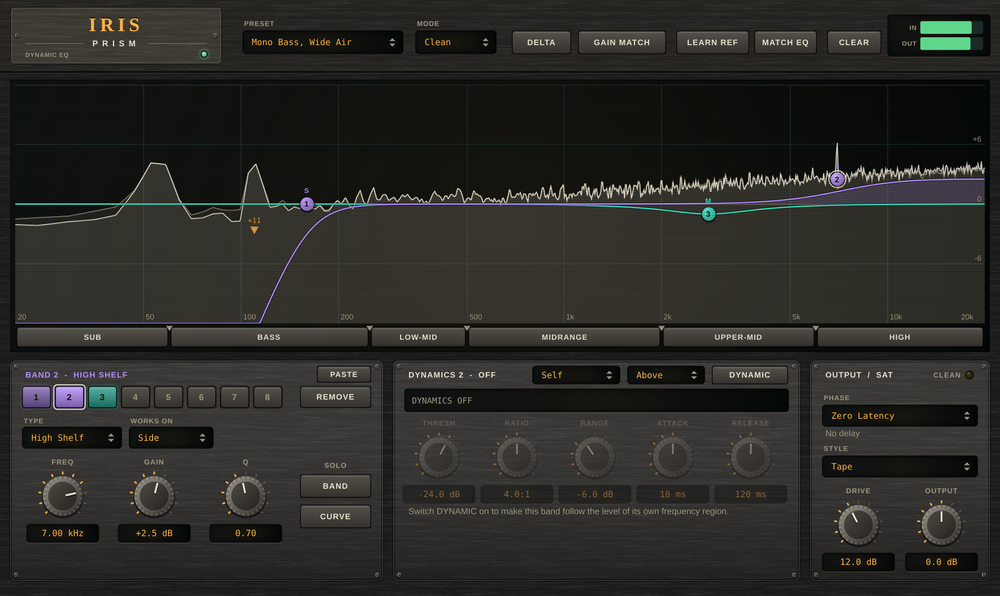
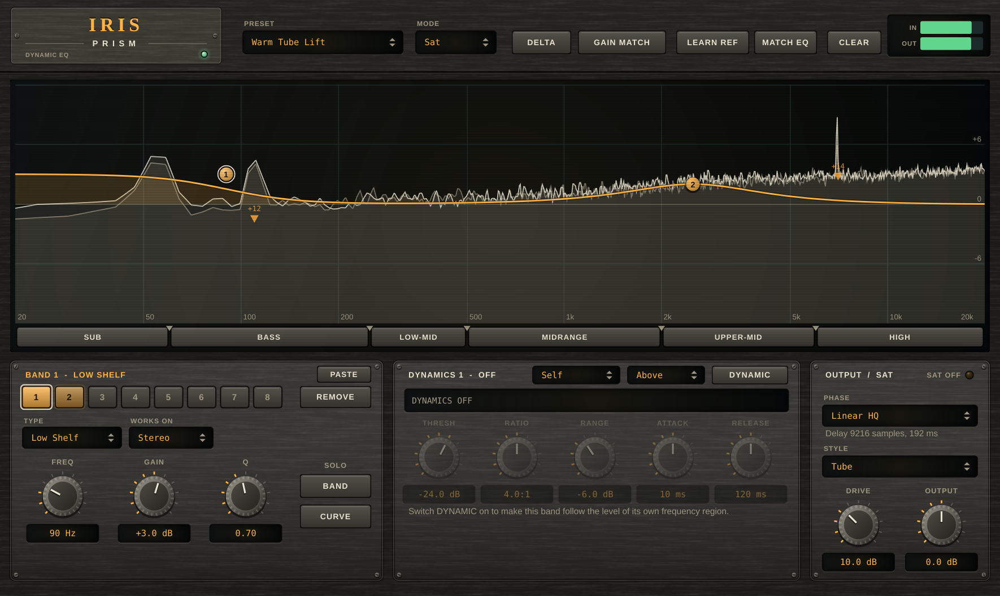
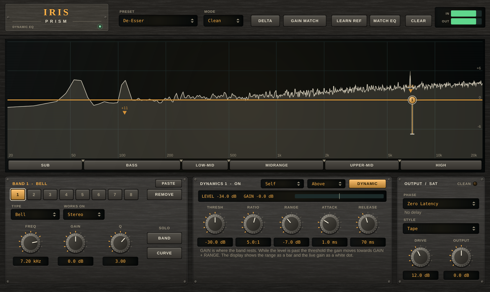
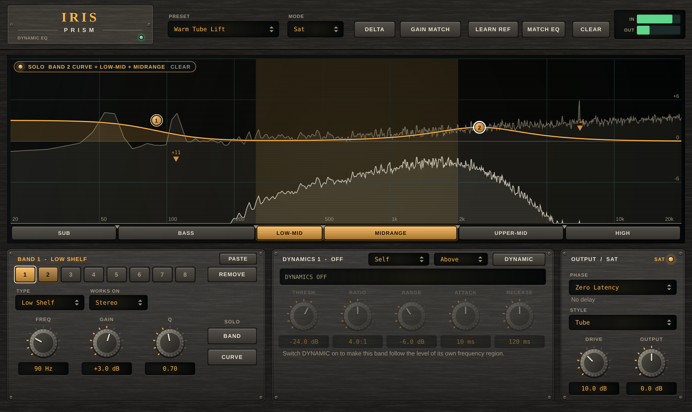
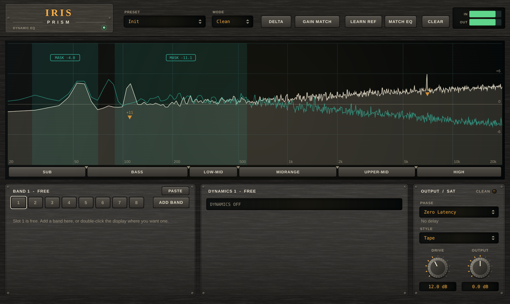
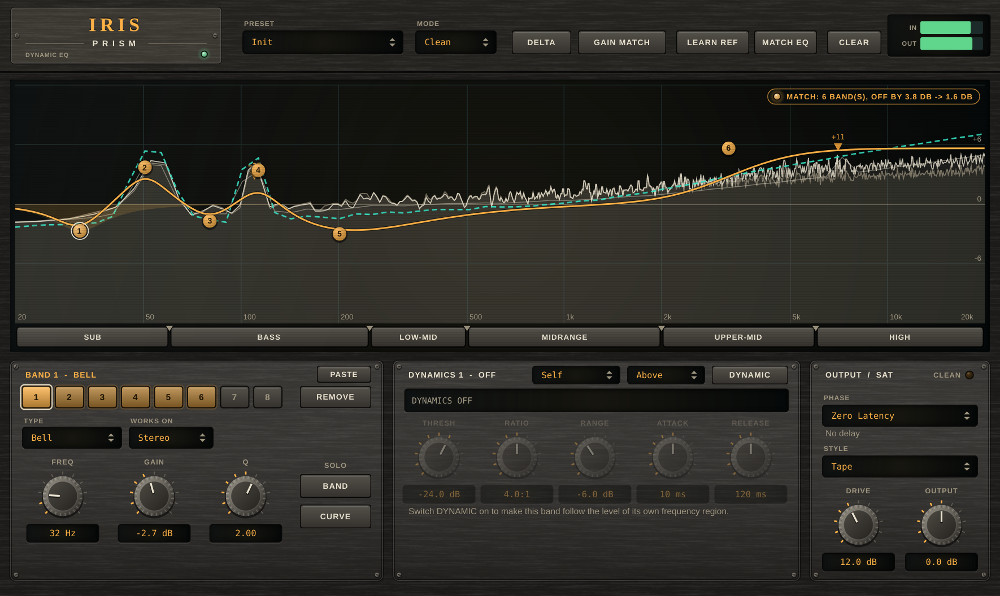

# Iris Prism

A **dynamic equaliser** (VST3 + AU + Standalone) for mixing and mastering: eight bands that each work on both channels, on
left or right alone, or on the mid or the side of the stereo image; any band can follow the level of its own frequency
region; a **Clean** mode that is a plain equaliser and a **Sat** mode that warms up the boosts; a **Phase** choice between **Zero Latency**
(minimum-phase bands, no delay) and two **Linear** modes (no phase shift at all, delayed); **Delta** and **Gain Match**
to judge what you did; **solo** for a band, for what a band adds, and for the sub, bass, low-mid, midrange, upper-mid and high parts
of the spectrum; and a **reference**: learn the long-term shape of another track (or take Themis' target curve), see it behind the
spectrum, and let **MATCH EQ** add the bands that bring yours to it.

## Name origin

*Iris* is the Greek goddess of the rainbow, the messenger who carries light across the sky; a *Prism* is what splits light
into its bands, which is what this plugin lets you do to a sound (and listen to one band at a time). (CMake targets,
namespaces and plugin codes use the short name "Iris".)



*Headless render of the editor (the hardware-style interface shared with the other plugins) in the "Mono Bass, Wide Air" preset
over a stereo programme whose top is on the sides. Band 1 (violet) is a low cut on the **Side** only, so the bass stays in the
centre; band 2 (violet, selected) is a high shelf on the Side; band 3 (teal) is a bell on the **Mid**. The display draws one curve for each
channel that has a band of its own, in the band's colour (Mid teal, Side violet; Left blue and Right rose when a band is placed on one
channel); the dim trace is the spectrum going in, the cream one coming out. Along the bottom, the six frequency regions are the solo
switches, and the triangles between them move the crossovers. Regenerate with the command under "Development".*



*The "Warm Tube Lift" preset with **Phase** on Linear HQ. The curves are the same as in Zero Latency; what changed is the sound's phase (none is added) and its
delay: the panel reads 9216 samples (192 ms), which the host is told so that it lines the track up. The lamp says SAT OFF: SAT only runs in Zero Latency.
Regenerate with the command under "Development" (`phase=2`).*



*The "De-Esser" preset on the same programme: a bell at 7.2 kHz whose gain moves with the level of its own region. The bar
hanging from the node is the range the dynamics can move it through (down to -7 dB); the white dot is where it is now (at rest,
between two sibilant bursts), and the DYNAMICS panel reads the level the band hears and the gain it applies; the selector beside Above is what the
band listens to (Self, or the sidechain input).*



*A solo in progress: the low-mid and midrange regions are lit (and shaded in the display, the rest dimmed), and band 2 is on
**CURVE** solo, so what plays is only what that band adds. The pill at the top left says what is soloed; clicking it clears
every solo.*



*The same programme with another track (a bass line over low-passed noise, teal trace) on the **sidechain** input. The two shaded
zones are where they mask each other, each labelled with the cut that would leave the other track 6 dB clear (double-click a label
for that band). The orange markers are **resonances** in this track: the steady tone at about 110 Hz and the 7 kHz burst stand out
of their neighbourhood (double-click one for a narrow dynamic bell).*



*The "Init" preset with a **reference**: a brighter track with more bass was learned first (LEARN REF, then again to keep it), then the programme
played and MATCH EQ was pressed. The dashed teal line is the reference, levelled to this track's average; the thin cream line is that average (the
dim and cream traces are the spectrum going in and out). The six bands are what MATCH EQ made: a lift in the highs and the two bass notes brought
up to the reference's. The pill at the top right says what the last action did (six bands, the shape was 3.8 dB off the reference on average and
1.5 dB after). Regenerate with the command under "Development".*

## Core philosophy

- **A band touches only what you give it.** A band on Left, Right, Mid or Side takes that signal out of the stereo pair, filters it
  and puts back only the *difference*. Everything it does not touch is bit for bit what went in (this is tested), so a Side band
  cannot change the mid, and a plugin with nothing switched on is exactly transparent (in Zero Latency, with no latency; in a Linear mode, the input delayed by
  exactly the reported latency).
- **Only modes with a reason.** Two things decide how an equaliser treats phase, and each has one right answer for a kind of work: Zero Latency for
  tracking, live use and mixing, where delay is unacceptable and the phase shift of a gentle band is how every analogue equaliser behaves; Linear for mastering, stems
  and parallel processing, where a filter must not move the waveform's timing. There is no "natural phase" mode: that is a better biquad design (it removes the
  cramping towards Nyquist), which would belong in the filters of every mode, not in a mode of its own. See [Phase modes](#phase-modes).
- **Clean means clean.** In Clean mode the equaliser adds no harmonics at any level (below -160 dB in the tests). Sat is a
  deliberate, separate mode with its own controls.
- **Listen to the thing you are changing.** A band, the curve a band draws, one part of the spectrum, or only what the whole
  equaliser changes (Delta), each one switch away; and a Gain Match so that louder does not pass for better.
- **Monitoring is not a setting.** Solos and Delta are not parameters: they are never saved, never recorded as automation, and
  always start off, so no session ever opens with only the lows playing.
- **Analog look, digital brain.** The interface is a piece of studio hardware drawn entirely from code by the kit shared with the
  other plugins ([shared/ui](../../shared/ui)); no image, font or sound files are shipped.
- **Free, public, source only.** The repository holds the code, not a download, under the AGPL-3.0-or-later (see
  [License and terms](#license-and-terms)).

## Features

| Area | What it does |
|---|---|
| **Bands** | Up to eight. Double-click the display where you want one (a bell, at the gain you clicked), drag its node (frequency across, gain up and down; Shift for fine), turn the wheel over the node for Q (for a cut, the wheel steps the slope), right-click it for its menu. **Types**: Bell, Low Shelf, High Shelf, Low Cut, High Cut (12 / 24 / 36 / 48 dB per octave, Butterworth) and Notch. Frequency 20 Hz – 20 kHz, gain ±24 dB, Q 0.1 – 18. All filters are double-precision biquads; a band glides to new settings and fades in and out, so nothing zippers or clicks. |
| **Left / Right / Mid / Side** | Each band has its own **Works on**: Stereo (both channels), Left, Right, Mid or Side. A mid band and a side band are two independent equalisers. Mid is (L+R)/2 and Side is (L-R)/2, and the round trip is exact. A one-channel track is treated as mid. |
| **Curves** | The display sums the bands into one curve per channel that has a band of its own: Left (blue), Right (rose), Mid (teal), Side (violet), and a single amber curve when every band is on Stereo. The selected band's own curve is filled. The dynamic bands' curves move live. |
| **Dynamic** | Any bell or shelf can be dynamic. The band listens to its own frequency region (a band-pass for a bell, a low-pass below a low shelf, a high-pass above a high shelf) on what goes *into* the band, so its own boost cannot feed back; or, with the selector next to the DYNAMIC switch on **Sidechain**, to the same region of the *other track* on the sidechain input (see [Listening to the sidechain](#listening-to-the-sidechain)). **Threshold** (dB, as the peak of a sine), **Ratio**, **Range** (the most the gain moves; negative cuts further, positive boosts), **Attack**, **Release**, and **Above** or **Below** (engage while the level is over, or under, the threshold). The band rests at its **Gain** and moves towards Gain + Range; a 6 dB soft knee smooths the start. On a Stereo band the two channels are linked. See [How the dynamics work](#how-the-dynamics-work). |
| **Clean / Sat** | **Clean** is a plain equaliser. **Sat** passes what a *boosting* band adds through a soft curve, so a boost that gets loud warms up and rounds off instead of staying perfectly linear: small signals stay linear, cuts and cut filters stay clean. **Drive** (0 – 30 dB) is how far below full scale the knee sits; **Style** is the curve: **Tape** (tanh, odd harmonics), **Tube** (asymmetric, adds the even ones, DC-blocked) or **Console** (arctan, open and gentle). No latency and no oversampling: the shaper is anti-aliased (see [How Sat works](#how-sat-works)). |
| **Phase** | **Zero Latency** (default): the bands are minimum-phase filters, no delay. **Linear**: no phase shift, delayed by 2304 samples (48 ms at 48 kHz). **Linear HQ**: the same at four times the frequency resolution, delayed by 9216 samples (192 ms). The latency is reported to the host, which compensates it. SAT works in Zero Latency only. A session-wide setting: presets leave it alone. See [Phase modes](#phase-modes). |
| **Delta** | Plays only what the equaliser changes (output minus input). Not saved; a band solo takes over from it. |
| **Gain Match** | A slow (about 0.6 s) RMS match of the output to the input, never more than 12 dB either way, so a boost that is merely louder is not mistaken for better. Off by default; while it is on, the gain it is applying is read out above its button. |
| **Solo a band** | Two ways, both on the band panel (and in the node's menu). **BAND** plays the output through a filter that matches the band, at its frequency and width (below a low shelf or low cut, above a high one): what the band is working on. **CURVE** plays only what the band adds or takes away: its own curve, nothing else. Press the same button again to release. |
| **Solo a frequency region** | The strip along the bottom of the display is six switches, the six main frequency bands of music: **Sub** (20–60 Hz), **Bass** (60–250 Hz), **Low-Mid** (250–500 Hz), **Midrange** (500 Hz–2 kHz), **Upper-Mid** (2–6 kHz, presence) and **High** (6–20 kHz, air), cut at five crossovers (60 Hz, 250 Hz, 500 Hz, 2 kHz, 6 kHz by default: the same bands Themis' AUDITION and Hephaestus' band solo strip use, defined once in [MusicBands.h](../../shared/dsp/include/pantheon/dsp/MusicBands.h), so a band soloed there is the same part of the spectrum here; a session saved before keeps its own crossovers). Click to solo a region, click more to add others, Alt-click to solo one alone. Drag a triangle between two regions to move the crossover (it cannot be dragged into the next one), double-click it to put it back. Linkwitz-Riley 4th order, and every region goes through the all-pass of the crossovers above it, so any combination of regions adds up exactly: soloing all six sounds like soloing none. The region solo works on whatever you hear, so it combines with Delta and with a band solo. |
| **Resonances** | Orange markers on the input trace where a narrow peak stands out of its neighbourhood for seconds (a ringing room mode, a boxy drum, a harsh formant), labelled with how far it stands out. **Double-click a marker** for a narrow *dynamic* bell at its frequency and width: it rests at 0 dB and cuts by as much as the peak stands out while the level there is at or above what was measured (threshold 3 dB under it), so it only works while the ring is there. A peak counts when it is the highest point within ±1/12 octave and at least 6 dB above the mean from 1/12 to 1/3 octave either side, averaged over about 3 s on a 1/24-octave grid (rules of thumb, in [ResonanceFinder.h](Source/DSP/ResonanceFinder.h)). Right-click the display to turn the markers off. |
| **Masking (sidechain)** | Route another track to Iris' **sidechain** input (it is never heard, only measured) and the display adds its spectrum (teal) and shades every zone where the two **mask each other**: in a third-octave band both are within 24 dB of their own loudest band and within 6 dB of each other. Each zone is labelled with the cut that would put the other track 6 dB clear of this one there (at most 12 dB); **double-click the label** for a bell across the zone. Or cut the other track instead: the zones are the same from either side. Rules of thumb, in [Masking.h](Source/DSP/Masking.h). |
| **Is the dynamics working?** | The DYNAMICS panel watches each dynamic band for about 8 s of playback and says so when it **never moves** (the level never reached the threshold) or is **always at its full range** (it acts like a static band), with the level it heard and a threshold to try (3 dB under the loudest moment, or above the quietest for a band that works below). |
| **Reference and match** | **LEARN REF** (header): press it, play the track you want this one to sound like through Iris (three seconds at least, the longer the better), press it again. Its long-term shape (a 1/6-octave average, with the level taken out) is kept as the **reference**, saved with the project, and drawn as a dashed line behind the spectrum, levelled to this track's own average (the thin line). **MATCH EQ** adds up to six bands in free slots that bring this track's average to the reference: the difference is smoothed over about two thirds of an octave and taken apart one band at a time, largest first, each band as wide as the difference stays above half its peak (a bell, or a shelf when the difference runs to the end of the range and is wider than an octave), with each one's own response taken off before the next is found, and none asking for more than 12 dB. Stereo bands that are already on are counted, so pressing it again asks only for what is still missing. The pill says how far off the shape was before and after (RMS, 30 Hz to 18 kHz). The reference can also come from Themis: its **Copy EQ** puts its target curve on the clipboard with the bands, and **PASTE** here takes the curve as the reference. Right-click the display for *Clear the reference*, *Restart this track's average* and *Reference curve: Hidden / Shown*. It matches the broad shape, not individual notes, and a difference from another track is taste: judge the bands with Delta and your ears. See [ReferenceMatch.h](Source/DSP/ReferenceMatch.h). |
| **Paste** | **PASTE** (top right of the band panel) adds the bands another plugin of the suite copied: Themis' COPY on a master-plan item or its *Copy EQ* for the tonal curve, each in the next free slot with its type, frequency, gain, width and placement; if the text also carries a curve (Copy EQ does), the curve becomes the reference. A harmonic-fill band is Hephaestus' and is left out. |
| **Meters and output** | IN and OUT peak meters (a NaN or inf sample cannot pin them), output gain ±24 dB. |
| **Presets** | Nine: *Init*, *Master Air*, *Mono Bass, Wide Air*, *Mud Duck*, *De-Esser*, *Open the Top*, *Tilt*, *Warm Tube Lift*, *Console Presence*. Output gain, Gain Match and the crossovers are kept when a preset loads. |
| **Display** | The spectrum before (dim) and after (cream), calibrated in dBFS, 8192-point FFT, a 4.5 dB/oct tilt by default. Right-click empty space for Gain scale (±6 / 12 / 18 / 24 dB), Analyzer range, Speed and Tilt; the choice is saved with the project. |

### Phase modes

```
Zero Latency   each band is a minimum-phase filter (an RBJ biquad, a Butterworth cascade for the cuts), run in series      delay 0
Linear         one symmetric FIR for the whole curve, 4097 taps, Kaiser window, FFT overlap-save of 256 samples          delay 2304
Linear HQ      the same with 16385 taps and blocks of 1024 samples                                                       delay 9216
```

A minimum-phase filter has the least delay a given magnitude can have, which is none, and pays for it in phase: a boost or a cut turns the phase around
its frequency. That is inaudible in most mixing and is why equalisers sound the way they do, but it moves the low end of a kick against its click, and
it makes two copies of a signal (an equalised stem and the original, or a band and its sibling) comb against each other. A linear-phase filter has the
same magnitude and a phase that is a pure delay, so none of that happens; in exchange the whole sound is late (the plugin reports the delay) and a sharp boost
rings on both sides of a transient, **before** it as well as after (pre-ringing). For a gentle curve it cannot be heard; for a narrow, high-gain band it can.

How the linear modes work, and what follows from it:

- **The same curves.** Every band is evaluated as its Zero Latency filter's magnitude, on the FFT's frequency grid, and the product over the bands is turned into a kernel
  (inverse transform, Kaiser window, delay by half its length). So the display, the bands, the dynamics and the Mid/Side placements are the same in every mode. With a bell,
  a high shelf, a 48 dB/oct low cut and a notch on at once the two modes agree to within 0.05 dB from 220 Hz to 17 kHz (Linear HQ: to 0.06 dB at 150 Hz, under the cut's edge; Linear: 0.79 dB there).
- **Resolution is the kernel's length.** A kernel of 4097 taps cannot draw a feature narrower than about 60 Hz (the window's main lobe, at 48 kHz); 16385 taps, about 16 Hz.
  A +12 dB bell at 60 Hz with a Q of 2 reads +12.00 dB in Zero Latency, +9.29 dB in Linear and +11.60 dB in Linear HQ. Use Linear HQ for narrow bass bands, steep low cuts and anything
  under 100 Hz; Linear is for broad curves, and the shorter delay.
- **Left, right, mid, side.** The bands work as they do in series: left and right first, then the mid and the side of that. Written out that is a 2 x 2 matrix of
  zero-phase responses, and each of its four entries is one kernel (a cascade of two kernels would need twice the delay). A Side band leaves a mono signal's mid alone
  (residue 2e-7, float rounding) and gives +12.01 dB where it should. The order of the bands does not matter in the linear modes, because linear filters commute.
- **Dynamics look ahead.** The detectors listen to the input, which is ahead of the sound by the delay, so a dynamic band has begun to move when the loud part reaches the
  output (a 1 kHz burst after silence peaks at 0.137 in Linear, 0.300 in Zero Latency). The Attack time is measured from the input, not from the output. The levels and the
  steady-state gains are the same: a -12 dB range reads -11.98 dB in Linear, -12.00 dB in Zero Latency. A detector hears the input rather than the output of the bands before it.
- **Delta, Gain Match and the solos follow the delay.** Delta is the output minus the input *delayed*, so it is still exactly what the equaliser changes; the CURVE solo of a lone
  band is the same signal as the Delta (1.7e-7). The BAND solo and the regions listen to the output, as before.
- **SAT is off.** The saturator is not a linear filter; making a linear-phase "saturating" kernel is a contradiction. In the linear modes the SAT switch has no effect (the lamp says SAT OFF).
- **Single precision.** The transform is JUCE's, in single precision, so the floor of these modes is about -130 dB, not the -160 dB of Zero Latency. With no band on, the output is the
  input delayed bit for bit (the filter is skipped, the delay line is exact), and so it is with bands on at 0 dB.
- **Cost.** A kernel is rebuilt every block while something in the curve moves (a dynamic band, a glide, a fade) and not otherwise. Eight dynamic bands, all moving, on this machine
  (Linux, JUCE's own FFT): Zero Latency 0.6 % of a core, Linear 24 %, Linear HQ 27 %; with nothing moving it is a fraction of that.
- **Switching** the mode while playing starts the bands from clean memory (the delay in front of them is a different length) and the host is told the new latency; expect a short gap.

### How the dynamics work

```
level        L   = what the band hears: the input through the band's filter, mean-square over about two cycles of its
                   own frequency, read as the peak of a sine of the same power (dB)
over         x   = L - Threshold           (Above)      or      Threshold - L           (Below)
moved        m   = x x (1 - 1 / Ratio), through a 6 dB soft knee, never more than |Range|
wanted gain  g   = Gain + sign (Range) x m
applied gain      = g, reached with Attack while it moves further from Gain and with Release while it comes back
```

Attack and release act on the gain, in dB, so the times you set are the times you get: with a 100 ms attack the gain is 2.0 dB of
the way after 15 ms (a single-pole curve gives 1.7), and with a 400 ms release it is at -1.25 dB 900 ms after the signal stops
(the curve gives -1.26). The level reading does not depend on the times: a sine at -26 dB reads -26 dB. The detector cannot be
faster than about two cycles of the band's own frequency, which is a limit of measuring a level, not of this one. The gain and
the coefficients are updated every 32 samples (0.67 ms at 48 kHz).

### Listening to the sidechain

A dynamic band normally listens to itself (**Self**). Set to **Sidechain**, its detector hears the track the host routes to Iris' sidechain input
instead, through the same band-matched filter, and everything else (Threshold, Ratio, Range, Attack, Release, Above / Below) works as before. That
is how one track makes room for another only while the other plays and only where they collide: a bell on the bass at the kick's fundamental, Above,
Range -4 dB, listening to the kick; or a shelf on the pads that dips while the vocal is present. The masking view on the same input shows where.

- The sidechain is **never heard**, only measured, and a band that is not dynamic ignores it.
- The band's **Works on** says which part of *this* track moves; of the sidechain both channels are measured and the louder one counts, so a
  sidechain on one side moves a Mid, a Side or a one-channel band alike.
- **Without a sidechain connected** the band listens to itself, exactly as on Self, and the DYNAMICS panel says NO SIDECHAIN.
- In a Linear mode the band hears the sidechain as it arrives while the sound it acts on is the reported latency late, as with its own signal.

Measured (test [16]): a track 10 dB under the threshold is cut by the full range (-12.00 dB) while the sidechain is loud in the band, and passes at
+0.000 dB when the sidechain is silent, however loud the track itself is, or loud somewhere else in the spectrum.

### How Sat works

The shaper works on the band's *difference* `d = H(x) - x` (what the band adds), not on the signal: `out = x + d + residual(d)`,
where `residual` is the curve minus its straight line, `f(drive x d) / drive - d`. Three things follow, all measured:

- **Small signals are exactly linear.** The residual is cubic, so at -50 dBFS Clean and Sat differ by 0.002 dB.
- **Only boosts saturate.** A cut would be shallower the louder it got, which is not what an equaliser should do; cuts, cut
  filters and notches give the same output bit for bit in both modes.
- **Drive is where the knee is.** With a +6 dB boost on a 0.2 amplitude sine, the 3rd harmonic is at -55.9 dB with the Drive at 0 dB,
  -44.3 dB at 6 dB and -33.6 dB at 12 dB. Push the knee far below the level of the boost itself and the boost gets limited
  (that is what a ceiling does); the display and the ears will tell you where that is.

The residual is anti-aliased with first-order antiderivatives (ADAA) and added to the untouched band output, which is why no oversampling
(and so no latency) is needed: the 3rd harmonic of a 9.7 kHz tone folds to 18.9 kHz, and it is -36.2 dB with the anti-aliasing against -26.5 dB
without. It reduces aliasing, it does not remove it; see [Limitations](#limitations).

### Signal flow

```
in -+-> [band 1] -> [band 2] -> ... -> [band 8] -+-> gain match -+-> output gain -> [region solo] -> out
    |    each band: take Stereo / L / R / Mid / Side out of the pair, filter it, add back only the difference
    |    (the difference of a boosting band goes through the SAT shaper first; a dynamic band moves its gain)
    +-> dry ---------------------------------------+-> DELTA = (matched wet) - dry replaces the wet
                                                   +-> BAND SOLO replaces it with the band's region, or its difference
```

## Using it

1. **Add a band**: double-click the display where you want it. Drag the node; wheel for Q. Choose its **Type** and what it
   **Works on** in the BAND panel.
2. **Find a problem**: put a narrow bell on it and press **BAND** (solo) to hear the region it covers; sweep until it jumps out. Press
   **CURVE** to hear exactly what the band is removing.
3. **Make it follow the sound**: switch **DYNAMIC** on, set the Threshold to where the problem starts (the readout shows the level
   the band hears), set the Range to how much to take off, and watch the white dot move.
4. **Keep the centre solid**: put a low cut on **Side** only; widen the top with a high shelf on **Side**.
5. **Judge it**: **DELTA** to hear what you changed, **GAIN MATCH** to compare at equal loudness, a region solo to check one part of the
   spectrum at a time. Close the plugin (or click CLEAR in the pill) and every solo and Delta end.
6. **Follow a reference**: play the track you want to sound like through Iris and press **LEARN REF** at the start and again after a while, then play your own track and press **MATCH EQ**. Check what it added with **DELTA** and **GAIN MATCH**; remove what you do not want.
7. **Warm the boosts**: switch the mode to **Sat**, pick a Style, and raise Drive until the loud boosts start to round off.

## Build

Iris Prism is source only: you build it yourself. Formats: **VST3 + AU + Standalone** (macOS, universal arm64 + x86_64).
Needs CMake 3.22+ and a C++20 compiler; JUCE is fetched by CMake (the version is in [cmake/Juce.cmake](../../cmake/Juce.cmake)),
or taken from `third_party/JUCE` at the repository root for an offline build.

```bash
# On a machine whose Command Line Tools ship an SDK that Xcode's linker cannot read:
export SDKROOT=$(xcrun --sdk macosx --show-sdk-path)

cd plugins/iris
cmake -S . -B build -DCMAKE_BUILD_TYPE=Release
cmake --build build --target Iris_VST3 Iris_AU Iris_Standalone -j 10
```

The plugins are in `build/Iris_artefacts/Release/{VST3,AU,Standalone}/`. Building does **not** install them; add
`-DIRIS_INSTALL_AFTER_BUILD=ON` to copy them to `~/Library/Audio/Plug-Ins/{VST3,Components}`, or copy them yourself. On Apple
Silicon an unsigned bundle needs an ad-hoc signature before a host loads it
(`codesign --force --deep --sign - "Iris Prism.vst3"`; `xattr -cr` clears a quarantine flag for personal use). Then rescan plugins in your host.

## Development

```bash
cmake --build build --target IrisTests && ./build/IrisTests_artefacts/Release/IrisTests            # DSP: no plugin, no GUI
cmake --build build --target IrisUiCheck && ./build/IrisUiCheck_artefacts/Release/IrisUiCheck      # mouse drags, wheel, regions, editor panels
cmake --build build --target IrisHostCheck && ./build/IrisHostCheck_artefacts/Release/IrisHostCheck "build/Iris_artefacts/Release/VST3/Iris Prism.vst3"
cmake --build build --target IrisSnapshot && ./build/IrisSnapshot_artefacts/Release/IrisSnapshot docs/screenshot.png "Mono Bass, Wide Air" band=2
auval -v aufx Irsp Irsa                                                                            # Apple's AU validator (the AU must be installed)
```

`docs/screenshot.png`, `dynamics.png`, `solo.png`, `masking.png`, `reference.png` and `linear.png` are the output of `IrisSnapshot` (arguments in the file's header), never
edited by hand: `"Mono Bass, Wide Air" band=2`, `"De-Esser" band=1`, `"Warm Tube Lift" band=1 region=12 solo=2:curve`, `"Init" sidechain`, `"Init" reference`, `"Warm Tube Lift" band=1 phase=2`. They are
regenerated after any change that touches the UI or what it shows. The rules for working on the code are in
[CLAUDE.md](CLAUDE.md); the rules for the repository are in [the root CLAUDE.md](../../CLAUDE.md).

```
Source/DSP/Band.h            band types, placements, BandParams, BandFilter (one band's filter), bandResponseDb (the drawn curve)
Source/DSP/Dynamics.h        the detector and the gain computer, and DynamicsUsage (does a dynamic band move?)
Source/DSP/ResonanceFinder.h narrow peaks that stand out of the input spectrum (the display's markers)
Source/DSP/Masking.h         where this track and the sidechain mask each other (the display's clash zones)
Source/DSP/ReferenceMatch.h  the long-term shape of a spectrum, a reference taken from text or a pasted curve, and the bands that make one shape follow another
Source/DSP/LinearPhase.h     the linear-phase modes: kernels from the bands' magnitudes, FFT overlap-save, the delay
Source/DSP/Saturator.h       the SAT shaper: three curves, residual ADAA, DC block
Source/DSP/Crossover.h       the six regions: the shared band splitter (shared/dsp MusicBands.h) and their names
Source/DSP/Engine.h          bands in series, placements, dynamics, SAT, gain match, delta, solo, meters, analyzer taps
Source/Parameters.h          parameter layout, presets, readParams(), band helpers  <- the single source of truth for parameters
Source/Plugin*.{h,cpp}       JUCE wrapper and editor
Source/UI/EqView.h           the display: spectrum, curves, nodes, region strip; IrisUi.h: the two words and the placement colours
../../shared/dsp/            biquads (with the EQ designs), the analyzer taps and the FFT analyzer, shared with Hephaestus
../../shared/ui/             the drawing kit of the interface, shared with the other plugins of the repository
Tests/                       DSP tests, UI check, VST3 host check, editor snapshot, shared helpers
docs/                        the six screenshots (generated by IrisSnapshot)
```

### Continuous integration

[.github/workflows/iris.yml](../../.github/workflows/iris.yml) builds `IrisTests`, `IrisUiCheck`, the VST3 and `IrisHostCheck` on Linux and runs the three checks on every push and pull request that touches Iris, `shared/` or `cmake/`. It publishes nothing. A macOS build (universal binary, AU, `auval`) is not in CI yet.

### What has and hasn't been verified

Everything in this README that is a number comes from `IrisTests` (headless, 48 kHz unless stated); all of it passes.

- **Transparent.** With no band on, with bands on at 0 dB, and at the default settings in a hosted VST3, the output is the input bit for bit; the
  latency is 0 (in a Linear mode, the input delayed by the reported 2304 or 9216 samples, bit for bit, and a hosted impulse arrives exactly that late). An output gain of 0.000001 dB (what a host's 0.0 looks like after JUCE snaps it) is treated as exactly 0.
- **The curves are the designed ones.** A +6 dB bell reads +6.000 dB at its centre; shelves and the notch match the design; the
  display's curve (`bandResponseDb`) agrees with the measured response to 0.000 dB at six more frequencies. The cuts are -12.3, -24.1,
  -36.1 and -48.2 dB at half the corner frequency (Butterworth: -12.30, -24.08, -36.12, -48.16) and -3.01 dB at the corner. (A digital
  filter is the analogue one with its frequency axis warped, so a high cut at 8 kHz is -38.2 dB at 16 kHz, as the warped Butterworth gives.)
- **Placement is exact.** A Mid band on a pure-side signal, a Side band on a mono signal, the other channel of a Left or Right band:
  untouched, bit for bit. Mid and Side bands give +6.00 dB where they should.
- **Dynamics.** Under the threshold +0.000 dB; 4 dB over at 4:1 is -3.02 dB (the law gives -3.00); far over it stops at the range (-12.00 dB);
  Below mode gives +6.00 dB on quiet material and +0.006 dB on loud; a loud tone far from the band does not move it. Attack and
  release as quoted above. **Sidechain** (test [16]): the numbers under [Listening to the sidechain](#listening-to-the-sidechain); a Mid and a
  Right band follow a sidechain that is on the right channel only; with none connected the output is bit for bit that of a band on Self; with no
  band listening a loud sidechain leaves the output bit for bit the input; a NaN or an inf on it is taken as silence; the output is the same for
  host blocks of 512 and 37 samples; Linear gives -11.99 dB.
- **Clean / Sat.** Clean: 2nd harmonic -240 dB, 3rd -163 dB. Sat, 0.3 amplitude through a +12 dB bell, Drive 12 dB: Tape has the 3rd at
  -17.8 dB, 5th at -26.0 dB and the 2nd at -221 dB (none); Tube has the 2nd at -26.4 dB; Console's 3rd is -19.5 dB (gentler than Tape).
- **Delta** is the processed signal minus the input to 3e-8. **Gain Match**: a +9 dB low shelf on noise is 2.4 dB louder and 0.03 dB
  with the match on; it never takes off more than 12 dB.
- **Solo.** A region passes a tone in the middle of its range within 1.7 dB (the crossovers are 4th order: a tone is -6 dB at its
  crossover; the low-mid is only one octave wide, so its middle is 3.9 dB down) and keeps the next range's tone at least 20.0 dB down
  (14.0 dB beside the low-mid) and the others at least 48.2 dB; all six together are flat to
  0.000 dB over eleven tones including the crossover frequencies; releasing a solo restores the output bit for bit. BAND solo of a 1 kHz
  bell: +0.00 dB at 1 kHz, -64 dB at 100 Hz, -67 dB at 10 kHz. CURVE solo: a +6 dB bell adds 0.995 of the input at its centre (-0.04 dB).
- **Reference.** A profile averages the display's spectrum with the level taken out: the same shape at two levels agrees to 0.0000 dB, the mean over 200 Hz - 5 kHz is 0 dB, a -3 dB/octave tilt reads -6.00 dB over two octaves, silence and under three seconds are not a profile. The reference survives its session text to the 0.1 dB it keeps, and a curve from Themis (another grid) is resampled and levelled the same way. Matching: a +6 dB bell at 3 kHz Q 1.4 is found as a bell at 2874 Hz, +5.3 dB, Q 1.20, taking the difference from 1.72 dB to 0.20 dB; a -5 dB low shelf at 120 Hz with a -3 dB dip at 800 Hz are both found (0.31 dB left); the same shape needs no bands; a ragged reference gives no more than the bands asked for, each inside 12 dB and Q 0.4 - 2. `IrisUiCheck` runs the whole flow in about real time on noise: learn, keep, match (a lift in the highs among the bands, all on Stereo), match again (fewer bands, because the first ones are counted), the reference coming back with the project and going when cleared, a pasted curve, and text without one changing nothing.
- **Robust.** The output is identical whether the host sends blocks of 4096, 37 or 1 samples; every band at its extreme with Sat,
  dynamics and a region solo stays finite at 22.05, 44.1, 48, 96 and 192 kHz; a NaN and an inf in the input do not leave the output broken;
  a 12 dB jump, an off/on and a frequency jump never step the output by more than 0.0104 (a click would be over 0.05). Eight dynamic
  bands in Sat mode on every placement cost about 1.1 % of one core (10 s of stereo audio in 0.11 s).
- **Changes while playing.** A cut's slope, a band's DYNAMIC switch, the placement, the saturation style and the sample rate can all be
  changed on a running engine and it ends up where a fresh start would (a change that reaches it mid-tick waits for the next tick);
  a dynamic band reads a -20 dB sine as -20.0 dB on every placement; Gain Match makes up at most 12 dB.
- **As a plugin.** `IrisHostCheck` loads the built VST3 and fuzzes it at 5 sample rates x 5 block sizes (1 to 4096), mono and stereo
  layouts, state and preset round trips and the editor; `IrisUiCheck` drives the display with mouse events; Apple's `auval` passes the AU.
  pluginval was not run, and it has not been tried in a DAW.

### Limitations

- **The reference** is the long-term average of what the display's analyzer sees (a 30 s running average, fast attack and slow release as the display, on the editor's timer), so it needs the editor open, the track has to play in real time (it is not an offline analysis), and loud passages count for more. A short or a looped excerpt gives that excerpt's shape. Two masters differ in more than their EQ (dynamics, stereo image, what is in the mix), so MATCH EQ is a starting point, not a fix; it matches the broad shape (about two thirds of an octave) and leaves single notes alone. Bands on one channel, mid or side, and the dynamics of a band, are not counted as what is already done.
- **A band's own detector listens to the signal entering it**, after the bands before it. One set to Sidechain listens to the whole
  sidechain input through the band's filter: there is no separate filter or level for the key, and no way to listen to it.
- **Resonances, masking and the dynamics check are rules of thumb on the display's analyzer** (an 8192-point FFT averaged over a few
  seconds): tested on synthetic spectra (a Q 8 peak is found within 1/24 octave; a broad bump, a smooth spectrum and silence are not;
  two tracks loud in the same range clash, in different ranges do not), not on a library of mixes. A note held for seconds is a
  resonance to them; whether to cut it is your call. They need the editor open.
- **Sat is not oversampled.** The anti-aliasing is first-order, and aliasing is reduced (about 10 dB on the tone tested), not
  removed. Drive the shaper hard on bright material and it will show.
- **Sat only saturates boosts.** By design; a cut band is always clean.
- **Region solo adds phase while it is on.** The magnitudes add up flat, but each region has the phase of its crossovers; with
  one region soloed you are hearing a band-pass, which is the point.
- **BAND solo of a Left, Right or Mid band plays in both ears** (a Side band plays as a side signal, opposite in the two), so you can hear it.
- **Eight bands**, and a minimum spacing of a ratio of 1.2 between crossovers.
- **Not saved on purpose:** solos and Delta. (The reference is saved; the averages are not.)

## License and terms

Copyright (C) 2026 The Pantheon authors. Free software under the **GNU Affero General Public License, version 3 or (at your
option) any later version**, with **no warranty**. This repository holds source only: no compiled plugin is published
from it, and releases are source tags. See [LICENSE](../../LICENSE), [NOTICE.md](../../NOTICE.md) (third-party software, trademarks, the source-only policy),
[CONTRIBUTING.md](../../CONTRIBUTING.md) and [SECURITY.md](../../SECURITY.md).
