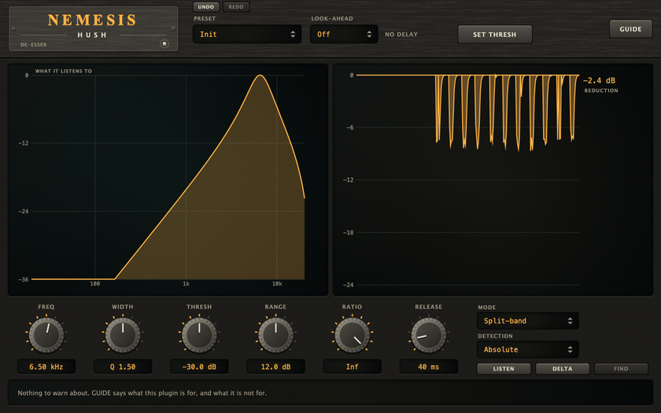
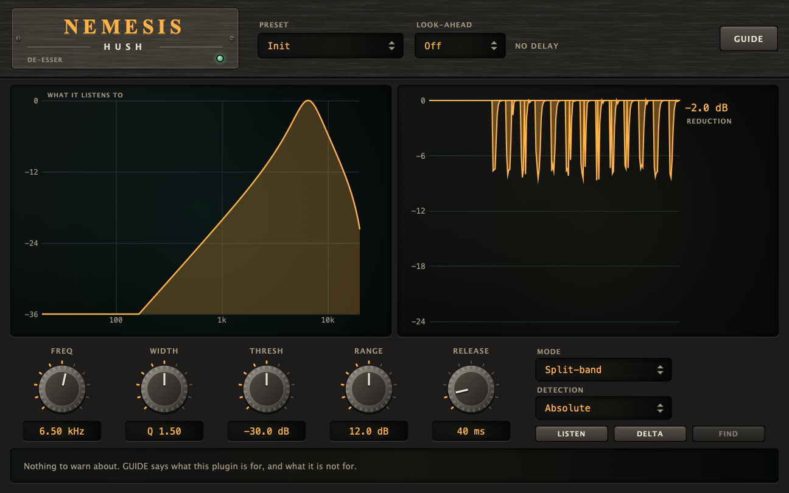

# Nemesis Hush

A transparent de-esser for vocals and bright instruments with split-band/wideband modes, absolute/relative detection, look-ahead, and one-click calibration.

**Formats:** VST3 + AU + Standalone



*Left glass plotting the detector's band-pass response (amber at rest, teal when `LISTEN` is active) while the right glass scrolls 8 seconds of gain reduction.*

## Theme

### Name origin

*Nemesis* is the goddess of proportion who brings whatever is out of measure back into line; *Hush* is the quiet she restores by taming harsh sibilance without dulling the voice. (CMake targets, namespaces, and plugin codes use the short name `Nemesis`.)

### Core philosophy

- **Only subtracts what crosses the line.** Split-band computes `in − (1 − gain) × band` instead of a dynamic filter, so vowels and below-threshold audio (`gain = 1`) pass bit-for-bit identical.
- **One gain across both channels.** The louder channel's `2 ms` peak envelope drives both channels equally so stereo sibilants never drift.
- **Band energy, not phoneme recognition.** `FIND` (`4–10 kHz`, `17` Q-`10` bins) and `SET THRESH` (loudest `6%` over `-100 dBFS`) measure raw band energy, so cymbals or bright buses trigger reduction too.
- **Single-band focus.** Tracks one sibilant region cleanly; widen `WIDTH` (`Q`) or stack two instances (or use **Iris Prism**) if sibilance jumps in frequency.

## See it

| View | Preview | Notes |
|---|---|---|
| **Default editor** |  | Split-band Absolute (`6.5 kHz`, `Q 1.5`, `-30 dB`, `Inf`) cutting hiss `-2.0 dB`. |

### UI colour legend

See [root UI colour legend](../../README.md#ui-colour-legend-hardwareh) for shared `Hardware.h` hex codes (`−36 dB` band floor, `−24 dB` reduction depth).

| Swatch | Hex | UI Element | Meaning |
|---|---|---|---|
| 🟡 | `#ffb347` | Detector curve (`LISTEN` off), reduction trace & fill, lit switches (`DELTA`, `UNDO`) | Active de-essing band, live gain reduction history (`0` to `−24 dB`), and active switches |
| 🩵 | `#37e3c5` | Detector curve (`LISTEN` on) & left glass frame | Auditioning only the band-pass detector signal (`WHAT IT LISTENS TO`) |
| 🟠 | `#f2a33a` | Note strip warnings | Alerts when `LISTEN`/`DELTA` are active, `RANGE` is `0 dB`, `THRESH ≥ -3 dB`, or reduction reaches `≥ 10 dB` (lisp risk) |

## Try it

| Recipe / Setting | What you see, hear & measure |
|---|---|
| **Male vocal** (`4–7 kHz`) / **Female vocal** (`6–10 kHz`), `WIDTH Q 1.5` | Enable **LISTEN** → press **FIND** (`1.5 s` scan across `4–10 kHz`) → switch **LISTEN** off → press **SET THRESH** (`1.5 s` scan, 1 undo step). |
| **Relative** detection + `RANGE 8 dB` + `RATIO 2:1–4:1` | Compares band against `30 ms` broadband RMS so quiet verses and loud choruses get identical reduction (`5.09 dB` across `30 dB` level drop). |
| **Split-band** vs **Wideband** (`RANGE 12`, vowel `300 Hz` + s `6.5 kHz`) | Split-band drops `6.5 kHz` by `-12.0 dB` while leaving `300 Hz` at `-0.00 dB`; Wideband ducks both `-12.0 dB`. |
| **DELTA** on during sibilant phrases | Auditions `in − out` (overrides **LISTEN**); if vocal tone leaks in, raise `THRESH` or lower `RANGE`. |
| **LOOK-AHEAD** `1–5 ms` on sharp `s` bursts | Delays audio (`48–240 samples` @ `48 kHz`, host-compensated) so the first `0.3 ms` peak drops from `-11.0 dBFS` to `-21.7 dBFS`. |

> [!TIP]
> Set `FREQ` (manually or with **FIND**) **before** running **SET THRESH**, because **SET THRESH** measures only at the current `FREQ` and `Detection` mode.

> [!NOTE]
> `Inf` holds the band at `THRESH`, while finite `RATIO` (`1 − 1/ratio`, `6 dB` soft knee, Giannoulis, Massberg & Reiss, JAES 2012) softens loud sibilants.

> [!IMPORTANT]
> **LISTEN** and **DELTA** are monitoring modes (never saved as sound); switch both **off** before bouncing or exporting.

> [!WARNING]
> Taking off `10 dB` or more risks a noticeable lisp (flagged in the bottom strip); switching **LOOK-AHEAD** while playing clears the delay ring (brief gap).

> [!CAUTION]
> Nemesis is **not a multi-band dynamic EQ** (use **Iris Prism**); use on isolated vocal/instrument tracks, since cymbals on a full bus trigger reduction too.

## Reference

### Controls

| Control | Range / Options | Default | Purpose |
|---|---|---|---|
| **Freq** | `2.0 – 12.0 kHz` | `6.5 kHz` | Centre frequency of the detector (and cut band in Split-band) |
| **Width** | `Q 0.50 – 5.00` | `Q 1.50` | Bandwidth of the band-pass filter (higher Q = narrower) |
| **Thresh** | `-60.0 – 0.0 dB` | `-30.0 dB` | Absolute dBFS level, or Relative dB below broadband `30 ms` RMS |
| **Range** | `0.0 – 24.0 dB` | `8.0 dB` | Maximum attenuation applied |
| **Ratio** | `1.0:1 – Inf` | `Inf` | Slope above `THRESH` (`1 − 1/ratio`, `6 dB` soft knee); `Inf` holds at `THRESH` |
| **Release** | `5 – 300 ms` | `40 ms` | Gain recovery time (`0.3 ms` fixed attack) |
| **Mode** | `Split-band`, `Wideband` | `Split-band` | Duck only the sibilant band or the whole signal |
| **Detection** | `Absolute`, `Relative` | `Absolute` | Level reference for `THRESH` |
| **Look-ahead** | `Off`, `0.5 ms`, `1 ms`, `2 ms`, `5 ms` | `Off` | Audio delay so the detector reacts ahead of transients |
| **Listen / Delta** | Toggles | `Off` | Audition detector band, or `in − out` (`DELTA` overrides `LISTEN`; presets turn `DELTA` off) |
| **Find / Set Thresh** | Actions (`1.5 s` scans) | — | **FIND** (`LISTEN` on): peaks `4–10 kHz` (`17` Q-`10` bins); **SET THRESH** (header): loudest `6%` (1 undo step) |
| **Undo / Redo / Presets** | `Cmd+Z` / `Shift+Cmd+Z` · `7` presets | `Init` | History (not saved with session); presets (*Init*, *Male Vocal*, *Female Vocal*, *Gentle Touch*, *Hard Sibilance*, *Broadcast Voice*, *Find the S*) |

### Signal flow

```text
in ─┬─► [Look-ahead delay (0–5 ms)] ─────────────────────────────────────┬─► Mode:
    │                                                                    │    Split-band: in - (1 - gain) × band
    └─► [0 dB Band-pass (FREQ, WIDTH)] ─► [2 ms peak env] ─► [6 dB knee, │    Wideband:   in × gain
                                       RATIO, RANGE, 0.3 ms atk / REL] ──┴─► [DELTA / LISTEN monitor] ─► out
         (Relative subtracts 30 ms broadband MS; snaps to gain=1 < 0.001 dB)
```

### Measured (`NemesisTests`, `48 kHz`)

- **Threshold & Range:** `6.5 kHz` tone at `−20 dBFS` over `−30 dB` `THRESH` reduces by `9.95 dB` (law: `10`); `RANGE 6 dB` caps reduction at `6.00 dB`.
- **Ratio:** `reductionDb` of `10 dB` overshoot at `2:1` (slope `0.5`) computes `5.00 dB` and settles at `4.98 dB`; `Inf` computes `10.00 dB` and matches the default output bit-for-bit in split-band (`−12.0 dB` sibilant) and wideband (`−11.9 dB`).
- **Split-band vs Wideband:** Vowel (`300 Hz`, `−12 dBFS`) + sibilant (`6.5 kHz`, `−16 dBFS`) at `RANGE 12`: Split-band changes vowel by `-0.00 dB` and sibilant by `-12.0 dB`; Wideband changes both by `-12.0 dB`. A `1.5 kHz` tone as loud as the sibilant changes by `-0.000 dB`.
- **Delta & Listen:** `output + DELTA == input` within `1e-8` (delta peaks `0.19` split-band, `0.26` wideband on a `−12 dBFS` sibilant; exact silence when idle). `LISTEN` passes `6.5 kHz` at `-0.00 dB` and attenuates `300 Hz` by `31 dB`.
- **Find:** Tones at `4.5, 6.2, 7.8, 9.5 kHz` detected at `4484, 6206, 7813, 9497 Hz`; `7 kHz` at `−26 dBFS` under `0 dBFS` `300 Hz` detected at `7011 Hz`; noise hump at `5.6 kHz` at `5574 Hz`; `−130 dBFS` returns no answer (`−100 dBFS` gate).
- **Set Thresh:** Speech test (`300 Hz` vowel at `−12 dBFS` + `120 ms` `6.5 kHz` bursts every `0.3 s` at `−12, −20, −24 dBFS`) lands at `THRESH -13.0 dBFS` (`1.40 dB` off loud s, `0.00 dB` off quieter s and vowel). Relative gives `-3.0 dB` under signal at both levels (`30 dB` drop); Absolute shifts `-43.0` vs `-13.0`. Vowel alone or silence leaves `THRESH` untouched; reset mid-pass answers `"stopped"`.
- **Relative vs Absolute:** Same signal `30 dB` quieter gives `5.09 dB` reduction both times in Relative; `18.10 dB` vs `+0.000 dB` in Absolute.
- **Release & Look-ahead:** `RELEASE 50 ms` decays `14.8 dB` (`1 s` sibilant) to `38%` (`5.6 dB`) after `50 ms` and `0` after `1 s`. `LOOK-AHEAD 1 ms` delays idle audio by exact `48` samples bit-for-bit (`96` samples on bypass at `2 ms` impulse `7 → 103`, `240` samples latency at `5 ms`), cutting the first `0.3 ms` peak of a `−10 dBFS` wideband burst from `-11.0 dBFS` to `-21.7 dBFS`.
- **Transparency & Stability:** Below threshold (and `0.5 s` after loud sibilance), output is bit-for-bit identical to input. Linked across L/R, bit-identical across block sizes `1, 7, 64, 333, 512, 4096`; `NaN`/`Inf` inputs become silence.

### Limits

- **FIND reads what plays:** scans `1.5 s` for the strongest energy in `4–10 kHz` (loud upper harmonics on vowels can beat a quiet s, and strong `< 4 kHz` energy leaks slightly into the lowest bin—verify with **LISTEN**).
- **SET THRESH needs several sibilants:** picks the loudest `6%` of active sound (`> -100 dBFS`, `≥ 10 dB` contrast, `≥ 100 ms` active) at the current `FREQ` (set `FREQ` first); the `6 dB` knee starts `3 dB` under `THRESH` for a gentle entry (`1.4 dB` in test). One undo step.
- **DELTA and LISTEN are monitoring:** switch both off before bouncing.
- **Look-ahead & band-pass settling:** with Look-ahead `Off`, the first `0.3 ms` of a loud `s` escapes before the attack closes; with Look-ahead `On`, split-band's band-pass still takes `~70 µs` to settle on the first cycle; changing Look-ahead mid-play clears the ring (short gap).
- **10 dB+ reduction & Wideband:** cutting `≥ 10 dB` creates a lisp; Wideband ducks the entire vocal alongside the `s`.
- **Single band & non-phoneme detection:** cannot track sibilance that shifts widely in frequency (widen `Q` or stack two instances, or use **Iris Prism**); cymbals/hi-hats in the band trigger reduction on buses.
- **Platform verification:** See [CI & platform status](../../CLAUDE.md#not-yet-in-line).

## Build & develop

See [root Build & develop](../../README.md#build--develop) for shared prerequisites and image-generation rules, and [CLAUDE.md](CLAUDE.md) for invariants.

```bash
# Recommended from repository root:
scripts/build.sh nemesis              # configure, build & run NemesisTests + NemesisUiCheck
scripts/showcase.sh nemesis           # regenerate docs/showcase.gif

# Manual CMake from plugins/nemesis/:
cmake -S . -B build -DCMAKE_BUILD_TYPE=Release
cmake --build build --target Nemesis_VST3 Nemesis_AU Nemesis_Standalone -j 10   # add -DNEMESIS_INSTALL_AFTER_BUILD=ON to install (macOS)

cmake --build build --target NemesisTests && ./build/NemesisTests_artefacts/Release/NemesisTests
cmake --build build --target NemesisUiCheck && ./build/NemesisUiCheck_artefacts/Release/NemesisUiCheck
cmake --build build --target NemesisSnapshot && ./build/NemesisSnapshot_artefacts/Release/NemesisSnapshot docs/screenshot.png
```

## Licence

AGPL-3.0-or-later, source only — see [root Licence](../../README.md#licence) and [NOTICE](../../NOTICE.md).
