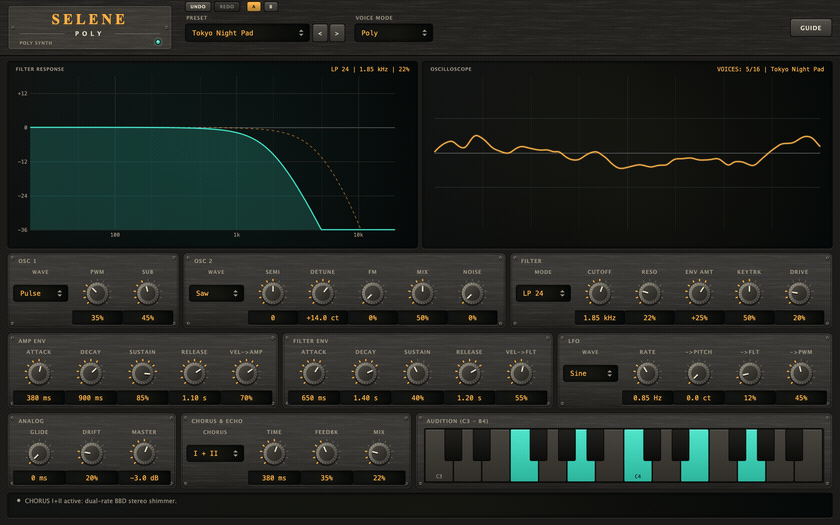
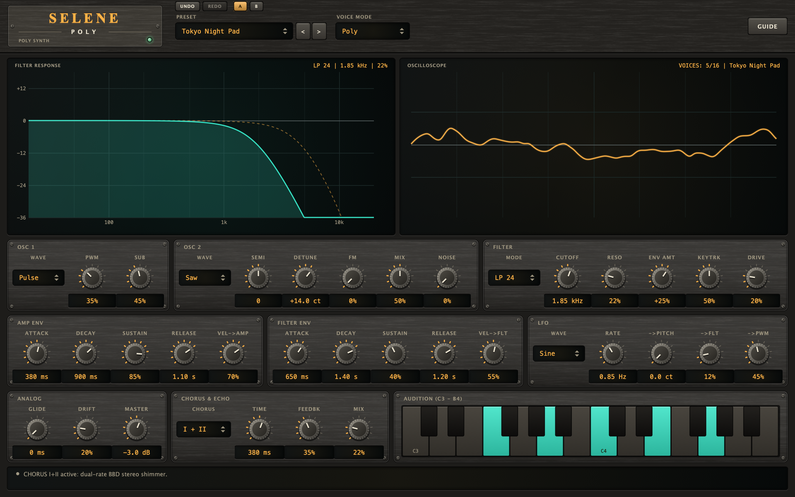

# Selene Poly

A 16-voice polyphonic analog-style synthesizer voiced for 80s City Pop: BBD chorus pads, FM electric pianos, slap bass, and tape-echo leads.

**Format:** VST3 · AU · Standalone (`0 in / 2 out`)



*Live animation of `SeleneSnapshot`: filter curve and envelope sweep on the left, triggered oscilloscope on the right, and clickable `C3–B4` audition keyboard.*

## Theme

**Name origin:** *Selene* is the Greek goddess of the moon — fitting for late-night City Pop chords and shimmering twilight pads. (CMake targets, namespaces, and plugin codes use the short name `Selene`.)

### Core philosophy

- **Voiced for 80s City Pop, real-time safe.** Pure subtractive + 2-operator linear FM engine (`Engine.h`, plain C++20, zero JUCE, zero audio-thread allocations or locks).
- **Classic dual-oscillator warmth.** PolyBLEP/PolyBLAMP oscillators, `-1 oct` sub, ZDF resonant filter, dual ADSRs, global LFO, BBD stereo chorus, and stereo tape echo.
- **Built-in instrument only, never an audio effect.** Stereo synth (`0 in / 2 out`) with no external audio input or sidechain; not wavetable, granular, or sample-based.
- **Honest about digital headroom and limits.** Unoversampled FM/filter drive can mildly alias near `98%` resonance, and stacked chords need `Master Gain` headroom.
- **Analog look, digital brain.** Studio-hardware interface drawn entirely from code by the shared kit ([shared/ui](../../shared/ui)); no image, font or sound files ship.
- **Free, public, source only.** The repository holds the code, not a download, under the AGPL-3.0-or-later (see [NOTICE](../../NOTICE.md)).

## See it

| View | Preview | What to look at |
|---|---|---|
| **Default editor** |  | Fmaj9 chord on *Tokyo Night Pad*: static filter curve, dashed envelope sweep, triggered scope. |

### UI colour legend

| Swatch | Hex | UI Element | Meaning |
|---|---|---|---|
| 🩵 | `#37e3c5` | `kFilterCurve` (`FILTER RESPONSE` trace & fill), active white audition keys, lit switches | Static ZDF filter frequency response (`20 Hz – 20 kHz`, `−36` to `+18 dB`) and held white keys |
| 🟡 | `#ffb347` | `kScopeTrace` (`OSCILLOSCOPE` trace & fill), dashed filter env peak curve, LCD readouts, active black keys | Triggered output waveform, maximum envelope sweep (`ENV AMT`), active voice/preset readouts, and held black keys |
| 🟣 | `#b388ff` | `kChorusGlow` (`SeleneUi.h`) | Twilight City Pop accent colour defined for chorus/shimmer styling |
| 🟠 | `#f2a33a` | Bottom note strip warnings | Alerts for output peak `≥ 0.99` / `Master Gain ≥ +6 dB`, `Resonance ≥ 90%`, or `Cutoff < 120 Hz` with low env/keytrack |
| ⚪ | `#eae3d0` / `#9f9680` | Module captions, knob scales, grid ticks, info notes | Hardware faceplate silkscreen (`OSC 1/2`, `FILTER`, `AMP/FILTER ENV`, `LFO`, `ANALOG`, `CHORUS & ECHO`), plus Mono/Unison/Chorus `I+II` info notes |
| ⬛ | `#090d0d` / `#1c2a29` | Recessed glass & graticule lines | Filter/scope display background and `0 dB` / octave grid divisions |

## Try it

| Recipe | Setting | What you see / hear / measure |
|---|---|---|
| **Twilight Pads** | Load *Tokyo Night Pad* or `Osc 1` Pulse (`35%` PWM), `Osc 2` Saw (`+14 ct`), `Chorus I+II`, `LFO → PWM` | Wide stereo BBD chorus shimmer with animated PWM and gentle `Analog Drift`. |
| **Glassy FM EPs & Bells** | `Osc 1 & 2` `Sine`, `Osc 2 Semi +12` or `+19`, `Osc 2 FM 40–72%`, `Chorus Mode I` | Bell-like partials (`> 30 dB` 3rd harmonic lift at full linear FM) with stereo motion. |
| **Slap / Boogie Bass** | `Voice Mode = Mono`, `Sub 65–85%`, `Chorus Off`, `Echo Mix 0%`, `Filter Env +65–78%`, `Decay 140–170 ms` | Tight `-1 oct` sub punch, legato `Glide` (`0–500 ms`), and fast percussive filter sweep. |
| **Headroom for stacked chords** | Lower `Master Gain` (e.g. *Velvet Strings* / *Breezy Ensemble* default to `−5.0` / `−5.5 dB`) | Prevents bottom-strip `peak ≥ 0.99` warnings in 16-voice `Poly` or 4-note `Unison`. |

> [!TIP]
> **Workflow & MIDI:** Step 24 presets with `<` / `>`, use **A/B**, **Undo/Redo** (`Cmd+Z`), and click the `C3–B4` keyboard alongside Pitch Bend, `CC64` sustain, and `CC1` mod wheel.

> [!NOTE]
> **Voices & display:** `Poly` runs 16 voices, `Mono` uses last-note legato glide, `Unison` stacks 4 stereo voices (`4` notes max); the oscilloscope triggers on the first rising zero-crossing.

> [!WARNING]
> **Resonance & low cutoff:** `Reso ≥ 90%` nears self-oscillation, `Master Gain ≥ +6 dB` warns on the strip, and `Cutoff < 120 Hz` with `Env Amt < +10%` and `Keytrk < 20%` can mute high notes.

> [!CAUTION]
> **Instrument only:** Accepts MIDI in and stereo out (`0 in / 2 out`); cannot filter external audio or load wavetable/granular samples.

## Reference

### Controls (38 parameters)

| Group / Module | Control | Range / Options | Default | Purpose |
|---|---|---|---|---|
| **Header / Analog** | **Preset** | 24 City Pop presets (`<` / `>` wrap) | `Init` | Loads all 38 parameters (unspecified return to defaults) |
| **Header / Analog** | **Voice Mode** / **Glide** | `Poly, Mono, Unison` · `0 – 500 ms` | `Poly` · `0 ms` | 16-voice poly, mono legato, or 4-voice stereo unison (`4` notes max); glide time |
| **Header / Analog** | **Analog Drift** / **Master Gain** | `0 – 100%` · `-24.0 – +12.0 dB` | `20%` · `-3.0 dB` | Per-voice slow pitch/filter drift; master stereo output level |
| **OSC 1** | **Wave** / **PWM** / **Sub** | `Saw, Pulse, Triangle, Sine` · `5 – 95%` · `0 – 100%` | `Saw` · `50%` · `35%` | PolyBLEP/PolyBLAMP Osc 1 + pulse width + `-1 oct` sub |
| **OSC 2** | **Wave** / **Semi** / **Detune** | `Saw, Pulse, Triangle, Sine` · `-24 – +24` · `-50 – +50 ct` | `Saw` · `0` · `+8.0 ct` | Osc 2 waveform, coarse semitones, fine detune |
| **OSC 2** | **FM** / **Mix** / **Noise** | `0 – 100%` · `0 – 100%` · `0 – 100%` | `0%` · `45%` · `0%` | Linear FM (`Osc 2 → Osc 1`), `Osc 1↔2` mix, white noise |
| **FILTER** | **Mode** / **Cutoff** / **Reso** | `LP 24, LP 12, BP 12, HP 12` · `20 Hz – 20 kHz` · `0 – 98%` | `LP 24` · `3.60 kHz` · `18%` | ZDF state-variable filter frequency & resonance |
| **FILTER** | **Env Amt** / **Keytrk** / **Drive** | `-100 – +100%` · `0 – 100%` · `0 – 100%` | `+35%` · `50%` · `15%` | Bipolar filter env depth, C4 keytrack, pre/stage saturation |
| **AMP ENV** | **A / D / S / R** / **Vel→Amp** | `1 – 5000 ms` (A/D/R) · `0 – 100%` (S/Vel) | `8 ms / 280 ms / 75% / 220 ms` · `70%` | Voice amplitude ADSR and velocity sensitivity |
| **FILTER ENV** | **A / D / S / R** / **Vel→Flt** | `1 – 5000 ms` (A/D/R) · `0 – 100%` (S/Vel) | `12 ms / 380 ms / 35% / 250 ms` · `55%` | Filter cutoff ADSR and velocity sensitivity |
| **LFO** | **Wave** / **Rate** | `Sine, Triangle, Square, S&H` · `0.05 – 20.00 Hz` | `Sine` · `4.20 Hz` | Global modulation source |
| **LFO** | **→Pitch / →Flt / →PWM** | `0 – 100 ct` · `0 – 100%` · `0 – 100%` | `0.0 ct` · `0%` · `0%` | Pitch vibrato, filter sweep, and Osc 1 PWM depth |
| **CHORUS & ECHO** | **Chorus** | `Off`, `Mode I`, `Mode II`, `I + II` | `Mode I` | Classic 80s BBD stereo chorus |
| **CHORUS & ECHO** | **Time / Feedbk / Mix** | `40 – 1000 ms` · `0 – 85%` · `0 – 100%` | `320 ms` · `28%` · `12%` | Cross-fed stereo tape echo with feedback filtering & saturation |

### Signal flow

```
MIDI (Note, Vel, PB, CC1/CC64, C3–B4 Audition)
  └─► [Voice Allocator: 16 Poly / Mono Glide / 4-Voice Unison]
        └─► [Osc 1 (PWM) + Sub (-1 oct) + Osc 2 (Semi/Detune/FM) + Noise]
              └─► [ZDF SVF (Drive, Keytrack, Bipolar Filter Env, LFO)]
                    └─► [Amp Env] ─► [BBD Stereo Chorus] ─► [Stereo Tape Echo] ─► [Master Gain] ─► out
```

### Measured

- **`SeleneTests` (`15` checks at `48 kHz` + `44.1 / 96 kHz`):**
  - `[1–3]` NoteOn/Off decays to `< 1e-6` with `0` active voices; `16`-voice polyphony & stealing; Mono glide (`523.25 Hz` within `3 Hz`); `4`-voice stereo Unison spread.
  - `[4–6]` LP24 rolls off `> 12 dB` steeper than LP12; HP12 vs LP12 separation; bipolar filter env (`±`); Osc 2 linear FM (`> 30 dB` 3rd harmonic lift), `-1 oct` Sub (`> 30 dB` lift), white Noise (`> 25 dB` floor).
  - `[7–10]` Chorus `Off` transparent (`< 1e-6` stereo diff) vs `Mode I` / `I+II` stereo motion (`diff > 20`); Stereo Tape Echo taps; `CC64` Sustain hold/release; Pitch Bend (`440 → 493.88 Hz` within `2.5 Hz`).
  - `[11–15]` Sample-rate independence across `44.1 / 48 / 96 kHz` (`440 Hz` within `2 Hz`); extreme settings finite and `reset()` leaves `0.0` (`< 1e-7` over `20,000` echo samples); Mono→Poly leaves `0` phantom voices; Unison whole-group voice stealing.
- **`SeleneUiCheck`:** Verifies `"Selene Poly"`, `38` parameters, `1280×800` (16:10) non-overlapping layout, `24` presets & `<`/`>` wrap, A/B compare, Undo/Redo, audition keyboard trigger, advice notes (`≤ 108` chars), and state round-trip.

### Limits

- **16 voices max:** Unison uses 4 voices per note, capping simultaneous unison notes at 4 before voice stealing engages.
- **Stereo synth only:** MIDI in, stereo out (`0 in / 2 out`); no external audio sidechain or audio-in filtering.
- **No oversampling on filter/FM drive:** High FM depths and resonance near `98%` at very high pitches can exhibit mild aliasing.

## Build & develop

Requires CMake 3.22+, a C++20 compiler, and `ffmpeg` (for `showcase.sh`); JUCE is fetched via [cmake/Juce.cmake](../../cmake/Juce.cmake). See [CLAUDE.md](CLAUDE.md) for invariants.

```bash
scripts/build.sh selene             # builds & runs SeleneTests + SeleneUiCheck
scripts/build.sh selene all         # tests | ui | snap | vst3 | au | app | all
scripts/showcase.sh selene          # regenerate docs/showcase.gif
```

Plain CMake (from `plugins/selene`):

```bash
cmake -S . -B build -DCMAKE_BUILD_TYPE=Release
cmake --build build --target Selene_VST3 Selene_AU Selene_Standalone -j 10   # add -DSELENE_INSTALL_AFTER_BUILD=ON to install (macOS)
cmake --build build --target SeleneTests && ./build/SeleneTests_artefacts/Release/SeleneTests
cmake --build build --target SeleneUiCheck && ./build/SeleneUiCheck_artefacts/Release/SeleneUiCheck
cmake --build build --target SeleneSnapshot && ./build/SeleneSnapshot_artefacts/Release/SeleneSnapshot docs/screenshot.png
```

## Licence

AGPL-3.0-or-later, source only. See [LICENSE](../../LICENSE), [NOTICE.md](../../NOTICE.md), [CONTRIBUTING.md](../../CONTRIBUTING.md), and [SECURITY.md](../../SECURITY.md).
