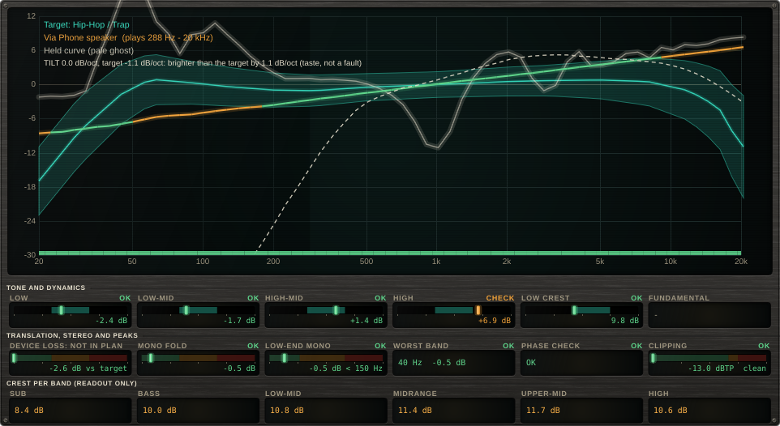

# Themis Verdict

A **mastering check suite in one plugin** (VST3 + AU) for judging a master: tonal balance, device translation, mono fold and
phase cancellation, clipping and true peak, loudness, low-end dynamics, bass fundamental and energy over time, summed up in a
short list of what to do next.

## Name origin

*Themis* is the Greek titaness of divine law and fair judgment, usually shown holding a pair of scales; *Verdict* is what
the checks add up to: a plugin that weighs a master and gives its judgment. (CMake targets, namespaces and plugin codes use
the short name "Themis".)


*Headless render of the editor (the hardware-style interface: brushed-metal modules, glass displays, lamps, knobs) measuring a synthetic programme: a four-note bass line over pink noise whose right channel is 0.5 ms late and 1 dB quieter, with a loud "chorus" driven into a hard clipper at -1 dBFS. The **MASTER PLAN** (top right) ranks what to do: stop the clipping, remove the 0.50 ms channel offset (PHASE CHECK reports it and outlines the comb-filter region, about 500 Hz–1.5 kHz, on the mono-fold strip), bring the loudness down to the streaming target, and so on down the list (scroll it: the programme's top is widened and swells in short bursts, so one item narrows HIGH, whose side signal a mono sum loses 7.8 dB of; further down, the 4.1 kHz ring is the channel offset's comb peak and the bursts raise a sibilance suggestion) (the wild tonal curve and the DEVICE LOSS readout are not in the plan: a difference from the reference is not a fault); its HEAR chip on the second item has put SIDE on solo in the **AUDITION** strip (red outline: the output is altered). The clipping and loudness items carry COPY chips for Aegis' PASTE, the COPY ALL chip beside the title copies the whole plan as one text for the plugins, and the TEXT chip under SNAP copies the check report as text. Each readout cell with a verdict and each MASTER PLAN item carries its level word (OK, CHECK or FIX; see the features table), and the twelve readouts sit in two captioned groups, TONE AND DYNAMICS and TRANSLATION, STEREO AND PEAKS, with the six CREST PER BAND figures under a third caption (readouts only); DEVICE LOSS has no word while a device is chosen, because its long title leaves no room for one. The header is three captioned groups: **TARGET** (the target box and the curve buttons, **HOLD CURVE** after Copy EQ), **JUDGE** (Averaging, Tolerance, the **TRUE-PEAK CEILING** knob at -1 dBTP, its default, and the two delivery menus) and **SESSION** (**RESET** and **AUTO RESET**, at the end of the second row). The verdict plate at the top left reads **FAULTS** with the count, three to fix and five to check. CLIPPING is red with the clip count, the FUNDAMENTAL readout and graph follow the bass, and the LEVEL graph shows the notes and the louder chorus. The tonal curve looks wild because the demo is not music; the TILT line over it is the curve's slope against the target's, a matter of taste. Regenerate with the command under "Development".*


*The same programme in every tab of the two graphs: LEVEL (BANDS, MID / SIDE on the LOW range, LEFT / RIGHT, PEAKS with the clipped frames in red, CREST with its squashed / typical / dynamic zones (the demo is bass-led, so its median reads squashed while the whole track reads 10 dB or more), LOUDNESS, where the short-term trace sits just under the shaded band around the -14 LUFS streaming target for most of the minute (the verdict: about 38 % of the time within 1 LU of the target, 19 % above, 42 % below), rises above it on the louder chorus near the end, and the dashed target line runs across it, and the SPECTROGRAM, where the four bass notes are the bright lines low down, the louder chorus lights the whole top, and the widened top stays lit between them with a short swell in every second) and FUNDAMENTAL (BALANCE, LEVELS, PITCH). Each tab but the spectrogram ends in a traffic-light verdict line; the spectrogram's names the sharpest burst.*



*The tonal view after **HOLD CURVE**: the pale ghost is the demo programme's curve, kept at the moment HOLD was pressed (the wild line with the notch around 1 kHz that its channel offset makes), and the coloured trace is what was measured after pressing Reset and playing something else (here pink noise with partly mono channels), judged against the target band as always. The ghost keeps its place while the live curve moves, so a change shows as the distance between the two; the TILT line is the live curve's slope against the target's (taste, not a fault), and the dashed line is the device preview (Phone speaker: **Translate to** is Off by default, and the screenshots choose it). Regenerate with the command under "Development".*

## Core philosophy

- **Clean and transparent: for monitoring and decisions only.** Themis has no EQ, dynamics, limiter, gain or dither stage; the
  audio passes through bit-for-bit unchanged with zero latency, so it is safe to leave on the master bus. A feature belongs
  here if it helps you *judge* a master (a measurement, a verdict, a graph, advice); it does not belong if it *processes* the
  signal.
- **One exception, for listening only.** The **Solo / Mute audition** lets you hear what a check flags, and **COMPARE** lets you
  hear the master as a streaming service would play it, or a reference track at the same loudness. They change the output
  only while a button is pressed, are bit-exact when idle, are never saved with the session, are ignored when the host renders
  offline, and run after every measurement so the analysis always sees the input.
- **The plugin tells you what to do, from measurements only.** The **master plan** turns the readouts into a short list of
  changes, worst first, each with an amount and a place computed from a measurement and a *why* behind it. It never invents a
  number, and it says plainly where a limit is a rule of thumb rather than measured data.
- **Everything a mastering check needs, in one place.** All checks read the same analysis (one FFT, one band grid) and show up
  as a readout, a graph or an overlay in a single editor, each with a tooltip that explains the numbers.
- **Analog look, digital brain.** The interface is a piece of studio hardware: brushed-metal modules, glass displays with
  phosphor traces, lamps for every verdict, push switches that light up, rotary knobs with lit scales and a swing-needle
  correlation meter. It is drawn entirely from code: no image, font or sound files are shipped.
- **Free, public, source only.** The repository holds the code, not a download, under the AGPL-3.0-or-later (see
  [License and terms](#license-and-terms)).

## Features

| Area | What it does |
|---|---|
| **Master plan** | **MASTER PLAN** (top right) reads the faults the monitors below find and lists what to do about them, **worst first**, with the amount and the place: *"Stop the clipping: ease the clipper or limiter drive and lower the ceiling 0.6 dB, to -1.0 dBTP"*, *"Remove the 0.50 ms offset between the channels"*, *"Take about 3 dB off the limiter's gain: -11.2 LUFS against a -14 LUFS Streaming target"*, *"Lower the limiter ceiling by 0.6 dB, to -1.0 dBTP"*, *"Make the low end mono: high-pass the side channel around 150 Hz"*, *"Open up the low end: ease the compression or clipping on the bass by about 2 dB"*. Each item carries its level word, **FIX** or **CHECK**, at the right end of its headline's first line, beside the red or amber lamp (a colour is never the only coding). The headline says what to change and by how much, **hover for why** (the numbers behind it, and which limit was crossed); the verdict plate at the top left says the same in one word, `FAULTS`, `CHECK` or `CLEAR` (`MEASURING` and `NO SIGNAL` before enough audio), and the title counts what is left to fix. **COPY ALL** (beside the title) puts the whole plan on the clipboard as one text, to **PASTE** in each plugin once: the bands for Iris or Apollo (Hephaestus takes the fill band), the limiter line for Aegis and the width line for Castor. A width line is left out when a band on the side makes the same cut, its status line counts what is in the text, and the chip is greyed, with the reason, when the plan has nothing a plugin can take. The **TEXT** chip (under SNAP) puts the **check report** on the clipboard as plain text, for a note, a message to the client or a session log: the plan (the delivery target and the true-peak ceiling, and every item worst first with its why), then the readings that have data (integrated and short-term maximum loudness against the chosen target, LRA, the true peak of each channel against the ceiling, PLR, the clip counts, crest factors, the mono sum against the stereo loudness, block dynamics, silence, and the worst band of the phase check and of the mono fold), then the **event log**: the first clip or sample at 0 dBFS, each new true-peak maximum above the ceiling (logged when it has risen 0.5 dB), and each loudness excursion (short-term loudness 2 LU above the target for 3 s; logged at its start). Positions are seconds of audio since the Reset, read from the meters about every 15 ms; the log keeps 64 entries and counts the rest (*and N more*), and it is cleared by Reset (also auto reset), even with the editor closed. **Shift-TEXT** copies the plan alone. It lists **objective faults**, and two **suggestions**, marked as such in their why: a narrow ring in the long-term curve, and a region whose level keeps jumping (possible sibilance). How the spectrum differs from the target curve, and how it would translate to a device (also measured against that curve), is a matter of genre and taste, so those stay on the tonal view and are never turned into a to-do. Checks: clipping and peak ceiling, **DC offset** (the average of the samples away from zero by -60 dBFS or more, judged once 20 s have played: the headline names the channel and how far it sits from zero, as a share of full scale), loudness against the **Deliver for** target, **squashed peaks** (the peak-to-loudness ratio, PLR: under 6 dB a warning, under 4 dB bad, a rule of thumb: the headline says how far the peaks stand above the average), phase cancellation, low-end mono, mono fold, **stereo width per range** (LOW-MID, HIGH-MID and HIGH each judged by what a mono sum loses of it, the same measure and limits as the MID / SIDE graph; the headline says how far to bring that range's side signal down for the loss to reach the warning limit, *"Narrow HIGH-MID (1.0 kHz - 6.0 kHz): take about 3.0 dB off its side signal"*, with a HEAR chip for that range's side; its COPY also carries a width line for **Castor**, so paste it in Iris or Apollo or in Castor, one of them, not both), low-end crest, left/right balance, bass (under 40 Hz, sub-heavy / thin) and the low end's steadiness between sections. The two suggestions: **narrow rings** (a band of the long-term curve from 250 Hz up that stands 4 dB or more above both of its sides, the worst three; the headline names its frequency and a narrow cut, *"Check the narrow ring at 3.2 kHz: a narrow cut of about 4.0 dB may tame it"*, with a COPY chip that hands a narrow bell at its centre to **PASTE** in Iris or Apollo) and **harshness** (the 4 - 10 kHz region's level reaches 6 dB or more above its own average on its loud tenth of frames, *"The 4.0 kHz - 10 kHz range keeps jumping 6.2 dB above its average: possible harsh sibilance (use a de-esser or dynamic EQ in your DAW)"*, no COPY). Both are judged on the measurement itself, never against the target, and both say in their why that they are a suggestion to check by ear. Items that can be listened to have a **HEAR** chip: it sets the Solo / Mute audition (e.g. SIDE + SUB + BASS for low-end mono, SUB + BASS for the bass); click again (STOP) to release. The ceiling and loudness items also have a **COPY** chip for **Aegis**, the limiter of this repository: the ceiling to set (your true-peak ceiling, -1 dBTP unless you set another, when the peak is over it) and how far to move its GAIN (the distance to the **Deliver for** target, down or up), for its **PASTE**. Items an equaliser or a harmonic generator can fix have a **COPY** chip: it puts the band on the clipboard for **PASTE** in Iris (low-end mono: a side low cut at 150 Hz; a wide range: a side bell across the range, or a side high shelf for HIGH, cutting by the amount in the headline and at most 6 dB; a thin fundamental: a mid bell at the bass note, lifted by how far its median sits under the balanced zone, at most 6 dB, and no bell when the median is not under it) or Hephaestus (bass under 40 Hz or sub-heavy: a harmonic-fill band half an octave either side of the median bass note; Copy EQ below can hand one over too). **SNAP** (next to the loudness readout) keeps the plan as it is; after you change the master and play the same part again, the readout says how many items were fixed, got better, got worse or are new, and how far the loudness and the true peak moved. It needs audio: press **Reset**, play the whole track (20 s minimum, and the longer the better; set Averaging to Infinite for a whole-track measurement). Clipping is judged at once. A one-line legend under the title explains the chips; a fix with no COPY path says *(any limiter or EQ in your DAW)*. All limits are rules of thumb, not measured data, and the plan is only as good as the audio that has played: it is a checklist for your ears and your tools, not a replacement for them. See [MasterAdvisor.h](core/include/themis/MasterAdvisor.h). |
| **Loudness** | Integrated loudness (ITU-R BS.1770 / EBU R128, K-weighted, gated) since the last Reset, shown under MASTER PLAN with the true peak and the **PLR** (peak-to-loudness ratio, true peak minus integrated LUFS: how much dynamic range the limiter left); the second line has the **momentary** (400 ms) and **short-term** (3 s) loudness and the **LRA** (loudness range, EBU Tech 3342: 10th to 95th percentile of the short-term values, gated 20 LU under their mean; how much the sections differ, low for a heavily limited master). **Deliver for** picks the target: *Streaming -14 LUFS* (Spotify, YouTube and Tidal turn a louder master down to about that, so the extra level buys nothing there and costs punch), *Loud release -9 LUFS*, *Dynamic -18 LUFS*, *Quiet streaming -16 LUFS* or *Broadcast -23 LUFS* (the EBU R128 delivery level). More than 2 LU away from it is a warning, more than 4 LU is bad; too quiet says whether the peak leaves room to raise it by plain gain. **Hover the readout** for the offset to each of the five targets (*At -14 LUFS (streaming): 2.3 dB louder*, the **Deliver for** one marked), how far the loudest 3 s sit above the integrated loudness, the **crest factor** (full band: the sample peak over the RMS of both channels) and the **silence** before the sound and after it (to the sample, since the Reset). The short-term value is also plotted over time on the LOUDNESS tab of the LEVEL graph. **Mono sum**: the same loudness is measured on (L + R) / 2 played on both sides, and the hover gives its figure and how it compares with the stereo one. Uncorrelated channels already lose about 3 LU in a mono sum, so the rule of thumb marks a loss of 1 LU more than that as *worth a look*; a mono sum that cancels entirely is named as silent. **Block dynamics** is Themis' own measure, not a standard and not comparable with the dynamic range of other meters (it is not called DR in the plugin): the complete 3 s blocks since the Reset, sorted by RMS, the loudest 20 % (at least one) taken, and the mean of their peak dB minus the mean of their RMS dB. It needs five non-silent blocks (15 s). A figure of 8 dB or less reads heavily limited and 12 dB or more dynamic (rules of thumb). A steady sine reads its crest factor, about 3 dB. The histogram it keeps in memory has one bin per 0.1 dB of block RMS, and a block counts into the bin of its RMS, so only the cut at the loudest 20 % can differ from a sort, and only inside one bin. The targets and limits are rules of thumb. See [LoudnessMonitor.h](core/include/themis/LoudnessMonitor.h) and [BlockDynamics.h](core/include/themis/BlockDynamics.h). |
| **Audition (Solo / Mute)** | **AUDITION** (bottom right) has **S**olo and **M**ute for **MID** (the centre, what a mono sum keeps), **SIDE** (what differs between the channels, what a mono sum loses), **LEFT**, **RIGHT** (a soloed channel plays on both sides) and the six main frequency bands of music **SUB / BASS / LOW-MID / MIDRANGE / UPPER-MID / HIGH** (20–60 Hz, 60–250 Hz, 250–500 Hz, 500 Hz–2 kHz, 2–6 kHz, 6–20 kHz: the same bands Iris and Hephaestus solo, defined once in [MusicBands.h](../../shared/dsp/include/pantheon/dsp/MusicBands.h); 4th-order Linkwitz-Riley crossovers at their edges; hover a range for what lives there). Within each group a solo silences the rest, a mute silences that source; groups combine (SIDE + SUB + BASS plays the side signal below 250 Hz, the part of the low end a mono playback system throws away). A check about one of the readouts' four ranges plays every band that overlaps it (the LOW range, up to 120 Hz, plays SUB + BASS). Changes fade over 10 ms. **CLEAR** releases everything; while anything is engaged the panel is outlined red and says OUTPUT ALTERED. **The measurements always see the input**, never the audition, so the curve, the plan and the graphs do not move when you solo. With COMPARE (below) it is the only thing in Themis that changes the output: with nothing pressed the audio is untouched bit for bit, the state is **not saved** with the session or exposed to the host, and it is **ignored while the host renders offline**, so an export cannot carry it. Put Themis last in the chain (or after your limiter) to hear what you are judging. See [Audition.h](core/include/themis/Audition.h). **COMPARE** (under the ranges): **STREAM ON** plays the master turned down to the **Deliver for** target the way a normalising service would (only down: a quieter master is left alone; the readout shows the gain), so a master that was pushed louder loses that advantage and you hear what the limiting cost. **LOAD** a reference track (the first 6 minutes; the same formats as Learn from tracks) and **REF** switches between the master and the reference, played at the loudness the master is heard at (after the preview, when it is on; a quieter reference is raised only as far as its peak allows, marked `!`) and at the same place on the host's timeline (modulo its length; it runs on by itself while the host is stopped). Both fade over 10 ms, are not saved, are ignored offline, switch off when the editor closes, and CLEAR ends them. See [Listen.h](core/include/themis/Listen.h). |
| **Tonal balance curve** | 1/6-octave long-term spectrum (20 Hz–20 kHz) vs a target *median ± tolerance* band. Segments turn green / amber / red as you leave the band. Four broadband readouts (Low / Low-Mid / High-Mid / High) show your average offset from target; each title line with a verdict carries its level word (OK, CHECK or FIX), and the twelve readouts sit under two captions, TONE AND DYNAMICS and TRANSLATION, STEREO AND PEAKS. Under them a third caption, **CREST PER BAND (READOUT ONLY)**, gives the same peak-over-RMS figure for each of the six main bands of music (the names and edges of the AUDITION strip, from [MusicBands.h](../../shared/dsp/include/pantheon/dsp/MusicBands.h)): a readout only, with no colour, no zone and no advice, because band-limited noise reads higher than a sine and a zone would need research first. A **TILT** line over the plot gives the slope of the measured curve against the target's, in dB per octave (least squares over the 1/6-octave bands the sample rate carries), and says whether it is darker or brighter: taste, not a fault, so it is never in the plan. A **Low Crest** meter shows the peak/RMS ratio of the 20–250 Hz band in dB: left = dynamic, right = compressed; its "typical" zone (6–10 dB) is a hand-authored guess. Averaging: 10 s / 30 s / 2 min / **infinite** (the default: the whole track since Reset); **Reset** restarts it, and **AUTO RESET** (on by default, a setting saved with the session) does it for you whenever the host starts playing from the beginning of its timeline (a stop and a start part-way in never resets). **HOLD CURVE** keeps the curve as it is and draws it behind the live one as a pale ghost, to judge a change against what it was (change the master, press Reset, play the same part again, compare); click it again to let it go. It is not saved with the session. **Copy EQ** (top row) fits a low shelf, up to three bells and a high shelf to the difference from the target and puts them on the clipboard, together with the target curve itself, for **PASTE** in Iris or Apollo (the bands are added, and the curve becomes its reference, drawn behind the spectrum: Iris matches it with **MATCH EQ**, Apollo shows it for you to follow); when the bass range (30–250 Hz) sits at least 3 dB under the target's lower edge across at least two thirds of an octave in a row, it adds a harmonic-fill band over that stretch for **PASTE** in Hephaestus (a boost spends headroom on notes small speakers cannot play, harmonics are what they carry); a difference from a reference is taste, so it is a starting point to judge by ear, not a fix (see [EqFit.h](core/include/themis/EqFit.h)). **The curve does not depend on loudness:** every analysed moment is normalised by its own total energy before averaging (so gain changes, and loud choruses vs quiet verses, don't move it), and near-silent moments are gated relative to the programme level rather than at a fixed dBFS. |
| **Translation checks** | Analysis-only help for judging how a master will carry over to other playback systems. **Device preview:** pick *Translate to* → Phone speaker / Laptop / Earbuds / Bluetooth speaker / Car / Small monitors (or Off, the default). The curve is redrawn as that device would reproduce it (dashed line) and the range it cannot reach is darkened. **DEVICE LOSS** is how much more level your track loses through the device than the target curve does (so a bass-heavy master reads high on a phone). While a device is chosen its title says **NOT IN PLAN**: the plan never judges a device (its level word is left out when the title leaves no room beside it). **Mono fold** is measured per band from the same frames as the tonal curve (level independent): the strip under the curve colours each band green / amber / red by the power lost in a mono sum, and **MONO FOLD**, **LOW-END MONO** (< 150 Hz) and **WORST BAND** summarise it. Hover the readouts for the numbers. The device responses are generic approximations (a bass limit, a treble limit and a few broad bumps), not measurements of any product, and the green/amber/red limits are rules of thumb; both are defined in [Translation.h](core/include/themis/Translation.h). The audio is never filtered. |
| **Phase-cancellation check** | **PHASE CHECK** catches stereo phase problems that a mono sum would turn into lost level. Per band, the left/right cross-spectrum is averaged like the tonal curve (so it follows the averaging time and is level independent): a band *cancels* when a mono sum loses more than the 3 dB that uncorrelated channels lose. The widest cancelling region is outlined on the mono-fold strip, and the verdict names the likely cause by fitting the inter-channel phase of the coherent bands with a pure model: **Polarity flipped** (one channel inverted), **Delay x ms** (a fixed offset, i.e. comb filtering, with the first notch frequency in the tooltip) or a frequency range when the phase is neither (a partial inversion, a phase-shifting effect). Delay and polarity are only named when the channels are copies of each other across the cancelling region (coherence ≥ 0.85); several sources at different offsets come out as a frequency range instead. Unlike the broadband correlation meter it says *where*, and it still works when the mid signal is silent. See [PhaseCancellation.h](core/include/themis/PhaseCancellation.h). |
| **Clipping detection** | **CLIPPING** (second readout row) is a true-peak meter since the last **Reset** with the clip count next to it. The audio is checked sample by sample: *sample peak*, *true peak* (the inter-sample peak, read at 8× by the reader Aegis and Hermes meter by, dBTP), *over* (a sample at or above 0 dBFS) and *clips*, meaning flat tops: at least 4 equal samples in a row above −6 dBFS that the waveform ran into, which a hard clipper or an overdriven limiter leaves at any ceiling, not only at 0 dBFS. Any clip or over is red, a true peak above the **true-peak ceiling** is amber (-1 dBTP by default, the knob in the header sets another from -6 to 0 dBTP; lossy encoding can push it over) and above 0 dBTP red; those limits are rules of thumb. The hover gives the true peak of each channel on its own (left and right, judged against the same ceiling, and which one is higher). The **PEAKS** tab of the LEVEL graph shows *when* it happened, with the clipped frames as red columns. A synthesised square wave or a held level also looks like a flat top, and a clip that was smoothed afterwards (a soft clipper, a lowpass) leaves none to find. The same meter averages every sample since the Reset: an average that is not zero is a **DC offset** (the tooltip shows it in dBFS; from -60 dBFS it is a warning in the master plan and from -40 dBFS bad, rules of thumb), which takes headroom from one side of the waveform and clicks where the track starts and ends. Audio thread cost: the 8× reader costs about a third more than the 4× one it replaced (in a standalone benchmark of the meter on the development machine: 1.3 % of one core before, 1.75 % after, at 48 kHz stereo). See [ClipMeter.h](core/include/themis/ClipMeter.h). |
| **Level and fundamental graphs** | Two scrolling graphs (last 60 s) under the tonal view, each with **tabs**, a **legend that is also the readout** (click an entry to hide its line; hover for the values at that moment) and a **verdict line** that turns the window into a decision (green / amber / red, with its level word OK, CHECK or FIX; the limits are rules of thumb, see [HistoryChecks.h](core/include/themis/HistoryChecks.h)). **LEVEL** is absolute energy (mean-square dBFS, unlike the level-independent tonal curve): **BANDS** (LOW / LOW-MID / HIGH-MID / HIGH and the whole spectrum; the verdict names the range that moves most between sections, the low end holding steady being the point), **MID / SIDE** and **LEFT / RIGHT** (each with a RANGE selector, so you can check the low range alone: the verdict is the mono loss with the same limits as MONO FOLD for mid / side, and the level difference for left / right) and **PEAKS** (sample and true peak, shaded 0 dB and ceiling-to-0 dBTP zones, clipped frames in red), **LOUDNESS** (the short-term loudness, 3 s in LUFS, frame by frame over the last minute, against the **Deliver for** target: a dashed line at the target, and the band 1 LU either side of it shaded *on target*; the verdict is the share of the time within that band, above it and below it, and the spread between the quieter and the louder sections; the lamp turns amber when more than half the time is outside the band or the spread is over 6 LU, rules of thumb; the trace starts after 3 s have played and breaks in digital silence, so a gap plots nothing), **CREST** (the crest factor frame by frame, each about 85 ms: the sample peak over the RMS of both channels over the same samples, shaded squashed / typical / dynamic; the verdict is the median, squashed under about 8 dB and dynamic over about 12 dB, rules of thumb; a bass-led frame reads low, so this is not the whole-track figure of the loudness hover; silent frames are left out) and a **SPECTROGRAM** (frequency up the side on a logarithmic axis from 20 Hz to 20 kHz, the last minute across, the level of every 1/6-octave band of the stereo signal as colour, tilted 4.5 dB per octave around 1 kHz like the other plugins' spectrum displays; hover for the band, its level and how long ago; its verdict line is not a fault but a pointer: the band and moment where the level rose furthest above that band's usual (median) level, bands near the noise floor left out). **FUNDAMENTAL** tracks the bass fundamental (lowest tonal peak in 30–250 Hz of the mid signal, from the analyser's own FFT): **BALANCE** plots how far it sits above its harmonics 2–8 on a track shaded *sub-heavy* / *balanced* / *harmonic-rich* (the verdict is where it sat most of the time), **LEVELS** the two levels and **PITCH** its note on a note axis with the region under 40 Hz that small speakers cannot play shaded (the verdict is the share of time spent there). See [Fundamental.h](core/include/themis/Fundamental.h) and [FrameHistory.h](core/include/themis/FrameHistory.h). |
| **Stereo vectorscope** | Goniometer (mid vertical, side horizontal) of the last ~30 ms plus a phase-correlation meter (-1 out of phase … +1 mono, ~0.4 s smoothing). The plot auto-scales to the recent peak so it stays readable at any level; click it to switch to a fixed 0 dBFS scale. Display only; the audio is untouched. |
| **Target curves** | 7 built-in starter curves (Flat (pink), Modern Pop / Streaming, Hip-Hop / Trap, EDM / Club, Rock, Acoustic / Jazz, Orchestral) **+ "Learn from tracks…"**: pick one or more reference masters (wav/aiff/flac/ogg everywhere; mp3/m4a where the OS decoder supports them, e.g. macOS) and Themis builds a target from their average, with the tolerance set by how much they disagree. Save/load as `.themiscurve`. **Closest** (the header, after 20 s of audio) selects the built-in whose shape is nearest the measured curve: the RMS difference over the bands your sample rate carries, after removing the level offset, with the distance in the status line. It is a shape match, not a genre detection. With **Custom** selected and nothing learned or loaded yet, Flat is shown, and the status window and the tonal view say so. |
| **Guide and usage notes** | **GUIDE** (the status window, top right) says what Themis is for and what it is *not* for: it judges a finished master and never changes the sound, it does not tell you what is right (the plan lists faults; the curve is taste), it is not a certified meter, it encodes nothing (a master whose true peak sits at the ceiling needs about 1 dB of room below 0 dBTP before a lossy MP3 or AAC encode, a rule of thumb), and a short excerpt reads like itself. When nothing else is being said the status window shows the first usage note: in amber when AUDITION or COMPARE is engaged (the output is altered; CLEAR before you export), when a Custom target has no learned curve, or **PRESS RESET TO START** when signal has arrived but no Reset has been pressed (with auto reset off); otherwise dim, the next step of the first-run checklist (`Next: ...`) until 20 s have been measured. The checklist (put Themis last, signal seen, Reset pressed, 20 s measured) is in the master plan's empty area while it measures, each line ticked from what Themis sees. The GUIDE ends with a glossary of the jargon (LUFS, LU, dBTP, PLR, LRA, crest factor, mid / side, mono fold, tolerance). These are about *how the plugin is used*; the master plan is about the audio. The rules are in [UsageNotes.h](plugin/Source/UsageNotes.h). |
| **Pass-through** | Nothing is ever written to the audio unless you press Solo / Mute or a COMPARE button: no EQ, dynamics, limiter or gain stage; reports 0 samples of latency. The plugin exists to measure, not to process. |

> **About the built-in curves.** They are hand-authored approximations of typical mastered material, *not* percentile
> statistics from a reference dataset. Treat them as starting points. For accuracy, use **Learn from tracks** with
> masters you trust in your genre.

## How to use

### Build and install (macOS)

Themis is source only: you build it yourself. Formats: **VST3 + AU** (macOS, universal arm64 + x86_64, macOS 11+), VST3 +
Standalone on Linux/Windows if you build there. There is no VST2 build: VST2 is not available for new plugins.

```bash
brew install cmake                    # once (Xcode command line tools required)
cmake -S . -B build -DCMAKE_BUILD_TYPE=Release
cmake --build build --target Themis_VST3 Themis_AU -j8
```

The default configuration builds a **universal** binary (arm64 + x86_64) and copies the plugins to
`~/Library/Audio/Plug-Ins/VST3` and `~/Library/Audio/Plug-Ins/Components`. JUCE is fetched automatically (needs git + network).

Then rescan plugins in your host (rescan after switching Rosetta/native mode). Themis appears
under *Fx / Analyzer* (VST3 category) / *Themis Audio* (AU), as "Themis Verdict". On Apple Silicon the binary must be signed, ad-hoc is enough for local use:

```bash
codesign --force --deep --sign - "$HOME/Library/Audio/Plug-Ins/VST3/Themis Verdict.vst3"
codesign --force --deep --sign - "$HOME/Library/Audio/Plug-Ins/Components/Themis Verdict.component"
auval -v aufx Thms Thmi               # optional: validate the AU
```

Builds are for your own use; if you hand one to somebody else, see [License and terms](#license-and-terms).

### Measuring a master

1. **Put Themis last on the master bus** (after your limiter), so you hear and measure what you are judging. It is pass-through,
   so it can stay there.
2. **Choose what to measure against.** **Deliver for** (the loudness target: Streaming -14 LUFS, Loud release -9 LUFS,
   Dynamic -18 LUFS, Quiet streaming -16 LUFS or Broadcast -23 LUFS) and the **True-peak ceiling** (-1 dBTP unless you set another) are what the master plan judges the loudness and the peak against. To compare the tonal balance with a reference, also pick a
   target curve (a built-in one, or **Learn from tracks…** with masters you trust in your genre) and, to preview a playback
   system, **Translate to** (a device, or Off); those two shape the tonal view, not the plan.
3. **Press Reset and play the whole track** (**Auto reset** is on by default, so every start from the beginning of the host's timeline does it too; turn it off to measure across starts). The master plan needs at least 20 s of audio, and the longer the better. Averaging starts on Infinite, the whole-track measurement. Clipping is judged at once.
4. **Read the MASTER PLAN.** Items are listed worst first; the headline says what to change and by how much, and hovering it
   shows why (the numbers behind it and which limit was crossed). The verdict plate counts what is left to fix (`CLEAR`
   when nothing is, and then the plan names the next step). Make the change with your own tools, play again and look at the plan once more; fix the biggest item first.
5. **Listen to what a check flags.** Items with a **HEAR** chip set the Solo / Mute audition for you (click again to stop);
   you can also set it by hand in the **AUDITION** panel. **CLEAR** releases everything.
6. **Dig into the readouts and graphs.** The tonal curve, the mono-fold strip, PHASE CHECK, CLIPPING, the LEVEL and FUNDAMENTAL
   tabs and the vectorscope show the numbers behind the plan; hover any readout, click a legend entry to hide its line.
7. **Before you export, press CLEAR** (closing the plugin window releases it too). If your host renders in real time (some bounce modes do), it cannot tell, and an engaged
   audition would end up in the bounce.


## Development

Built with [JUCE](https://juce.com). All DSP lives in a dependency-free C++17 core
([core/include/themis](core/include/themis)) with its own unit tests; the plugin layer only draws and wires it up.

### Tests, screenshots and layout

```bash
make test                              # DSP unit tests, no dependencies (g++/clang++ only)
cmake -S . -B build -DCMAKE_BUILD_TYPE=Release -DTHEMIS_BUILD_SMOKE=ON -DTHEMIS_INSTALL_AFTER_BUILD=OFF
cmake --build build --target ThemisSmoke
./build/ThemisSmoke_artefacts/Release/ThemisSmoke docs/screenshot.png docs/graphs.png docs/hold.png   # headless processor+editor run, writes the README images
```

`docs/screenshot.png`, `docs/graphs.png` and `docs/hold.png` are the output of that command, never edited by hand. They are regenerated after
every change that touches the UI or what it shows, and their captions above are kept true to the demo programme (the rules
for contributors are in [CLAUDE.md](CLAUDE.md)).

Layout (the one file map; update it when a source file is added, renamed or removed):

```
core/include/themis/   DSP: Common, BandGrid, Biquad, Eq, Compressor, Limiter, Loudness, StereoTools, FFT,
                       TonalAnalyzer, LowCrestMeter, BandCrestMeter, StereoScope, TargetCurve, Translation, PhaseCancellation,
                       Fundamental, FrameHistory, Spectrogram, ClipMeter, HistoryChecks, LoudnessMonitor, BlockDynamics, MasterAdvisor, EventLog (the event log and its rules), Audition, Listen, EqMove,
                       EqFit, Engine, DeliveryTargets (the five delivery targets, one list), Resonance (narrow rings in the long-term curve), Harshness (the 4 - 10 kHz band history)
                       (the plugin uses only Common, TonalAnalyzer, LowCrestMeter, BandCrestMeter, StereoScope, TargetCurve, Translation, PhaseCancellation,
                       Fundamental, FrameHistory, Spectrogram, ClipMeter, HistoryChecks, LoudnessMonitor, BlockDynamics, MasterAdvisor, EventLog, Audition, Listen, EqMove, EqFit, DeliveryTargets, Resonance, Harshness
                       (for Copy EQ), and Loudness and Eq underneath them; the rest is a mastering chain kept with its tests)
plugin/Source/         JUCE layer: Parameters, PluginProcessor, PluginEditor, TonalBalanceView, StereoScopeView, HistoryViews,
                       AdvicePanel, AuditionPanel, UsageNotes (the usage notes and the GUIDE text; plain C++), PlanCopy (COPY ALL's text; plain C++), ThemisUi.h (Themis' own words, number formats and verdict colours)
../../shared/ui/       the drawing kit of the interface, shared with the other plugins of the repository: Hardware.h (metal,
                       glass, lamps, knobs), HardwareLookAndFeel.h, MeterCell.h, Controls.h, Note.h and Advice.h (the notes under the controls)
../../shared/dsp/      TruePeak.h (the true-peak reader of the clip meter and the limiter, shared with Aegis and Hermes), BandLink.h (the text COPY and Copy EQ put on the clipboard, which Iris, Apollo and Hephaestus PASTE, Aegis for the limiter line and Castor for the width line), MusicBands.h (the audition ranges), Biquad.h
tests/                 test_main.cpp (DSP, the plain-C++ usage notes and COPY ALL's text), plugin_smoke.cpp (headless JUCE)
```

### Continuous integration
[.github/workflows/build.yml](../../.github/workflows/build.yml) runs on every push to `main` and on every pull request.
Three jobs run in parallel: the DSP unit tests (`make test`) on
Linux; the universal VST3 + AU on a macOS runner; and on Linux, the VST3 and the headless `ThemisSmoke` built together, with the
smoke test run under a virtual display and failing the job on any failed check. It checks that the code builds and passes its
tests, and publishes nothing: no downloadable binaries, by design. The smoke test's PNGs go to a temporary folder and are not uploaded.
Releases are version tags made by hand, source only (see [NOTICE.md](../../NOTICE.md)).

Security checks, all free for a public repository and none of them publishing anything: [codeql.yml](../../.github/workflows/codeql.yml)
(CodeQL static analysis of the C++ on every push, pull request and weekly), [dependency-review.yml](../../.github/workflows/dependency-review.yml)
(fails a pull request that adds a dependency with a known high-severity vulnerability) and Dependabot
([dependabot.yml](../../.github/dependabot.yml)) keeping the actions up to date. The workflows have read-only tokens and pin every
action to a commit SHA. Secret scanning with push protection is on, and `main` requires the build checks to pass and cannot be
force-pushed. To report a vulnerability, see [SECURITY.md](../../SECURITY.md).

### What has and hasn't been verified

| Verified (Linux aarch64 and macOS arm64; the JUCE version is in `cmake/Juce.cmake`) | Not yet verified |
|---|---|
| The DSP checks (`make test` prints the count): K-weighting vs the ITU coefficient table, −20 LUFS reference sine at 44.1/48/96 kHz, gating, inter-sample true peak, limiter ceiling, compressor curve, M/S EQ targeting, pink/white-noise spectral slopes, low-end crest meter (sine = 3 dB, band limiting, reset, NaN recovery), per-band crest (a sine at each band's centre reads 3.01 dB in its own band and nothing three or more bands away; a 122.5 Hz burst reads 15.0 dB in Bass against the sine's 3.0 dB; silence and reset read nothing; the block size does not change it; in `ThemisSmoke` the pink noise reads 8.3, 10.2, 10.7, 11.6, 11.9 and 11.2 dB from SUB to HIGH), per-band mono fold (mono 0 dB, uncorrelated −3 dB, inverted → cancels, level independent), per-band phase / coherence, the phase-cancellation verdict (mono, uncorrelated, polarity flip, 0.5 and 1.25 ms delay with its notch frequency, a low-end-only flip), the energy history (calibrated against sines, silence, reset; mid / side / left / right against centred, one-sided and inverted tones), the spectrogram (one column of 61 band levels per history frame, the tone's band at the sine's mean-square level and the rest at least 30 dB down, silence as no level, reset; the sharpest-burst finder against a planted burst, a noise-floor band with a huge relative jump, a window too short, and bands the sample rate cannot carry), the DC offset (a full-scale 20 Hz tone reads as none, 1 % of full scale on one channel reads −40 dBFS and is named with its channel and side in the plan, a NaN on the way is skipped), per-channel true peaks (the louder channel named, reset clears them), the encode headroom line of the GUIDE, clip detection (a hard clipper at −1 dBFS, clean sines, a 16-bit quantised bass sine that must not count, plateaus across blocks, inter-sample peaks, totals and reset) and the verdicts on the history (swing, width, balance, peaks, bass, the loudness over time: the shares within, above and below the zone summing to one, gaps and silence skipped, the spread lamp), the delivery offsets to all five targets, the crest factor (a sine 3 dB, a square wave 0 dB, silence none) and the CREST tab's median verdict over time (a sine squashed, a square wave squashed, silent frames skipped, the three levels at their limits), the loudest section against the integrated loudness, the spectral tilt (a -3 dB/oct line, unchanged by a level offset, darker and brighter against a target, the bands a sample rate carries), the sound edges (leading and trailing silence to the sample, dither counted as silence, a reset) and the squashed item (its limits, worst-first order, the 20 s gate), the audition (bit-exact when idle, mid / side / left / right against known signals, each of the six ranges isolated, the ranges summing back flat at the five crossover corners, fades without clicks), the loudness monitor (the BS.1770 reference sine, reset, loudest section, momentary, LRA against EBU Tech 3342's 10 LU and 5 LU signals, the 20 LU gate), the mono sum (identical channels read the same as the stereo programme, uncorrelated and one-sided channels read the 3 dB baseline and are not worth a look, a 10 dB loss is, an out-of-phase pair is silent, reset) and block dynamics (a sine reads its crest factor, loud peaky blocks read more than a steady tone, too few blocks and silence give no value, reset clears them, the histogram agrees with a sort of the blocks), the listening aids (preview gain only ever down, reference matched and capped at its peak, bit-exact when idle, switching without clicks, the reference following the host position), the plan snapshot (fixed / better / worse / new, loudness and peak moves), COPY ALL (the whole plan as one text: every kind it holds, the limiter's ceiling and gain merged into one line, no width line next to a band on the side, nothing for an empty plan, the status line counts what is inside), the bands handed to the other plugins (a side low cut for low-end mono, a side bell or high shelf for a range a mono sum loses too much of, whose cut brings the loss to the warning limit and no further, a fill band around the bass, none for clipping or loudness; Copy EQ on a curve with too much sub, and a fill band after its equaliser bands when the bass is short of the target) and the master plan (every item and its numbers, worst first, waiting for enough audio; a bad tonal curve or device loss adds nothing to it) with its verdict word and count line (faults before checks, the measuring states only with nothing counted, CLEAR only once measured), the narrow-ring check (a planted ring at its frequency and size; flat, target-shaped, broad and stepped curves give none; nothing under 250 Hz; the worst three, worst first) and the harshness check (a 25 % burst found at its jump, steady noise and a louder section not, a region under the loudest band's span or above the sample rate's top not), both as plan items whose COPY bell reads back in the plugin's smoke test, the meters surviving a NaN / inf burst and reading as cleared while a reset is pending, the bass fundamental estimator (pitch, level and harmonics of synthetic bass notes, weak fundamental, noise rejection), device profiles and the translation report, the worst mono-fold band being the one that cancels (not skipped for having no mid left), the true-peak ceiling in the verdicts and the plan, the true-peak reader on pure tones at 80 phases (worst 0.11 dB low), the closest built-in (each curve plus an offset picks itself, an exact tie goes to the first curve, bands above the sample rate are left out), the plan as text, the check report (the readings with data, nothing printed for a reading without data, the event log with its positions and the "and N more" cap), the event log rules (the first clip, the peak step, the excursion hold and its start, a reset re-arms, a repeated reading adds nothing, the 64-entry cap), target JSON round-trip, EQ-fit error reduction, engine latency/bypass/A-B, the first-run checklist and the usage notes (ticks, the Next line, PRESS RESET, Custom without a curve, every state within the status line, the glossary's line width), the level words (`plan::levelWord`: the plan text and the screen say OK, CHECK or FIX alike), and in `ThemisSmoke` the control audit (no control under 20 × 12 px at 100 %; the list under 24 × 24 px is printed as INFO) and the text contrast of the measured label and readout colours (every pair at least 3:1, the lowest 4.72:1) | **A macOS build** (the CI workflow does this; the code has no platform-specific paths) |
| Universal (arm64 + x86_64) VST3 + AU build on macOS, zero warnings in Themis' own sources; `auval` AU validation passes; the VST3 loads, instantiates, processes and opens its editor in a JUCE plugin host | Behaviour inside other hosts' plugin scanners |
| Headless run of the real processor + editor: audio, parameters, state save/restore incl. custom curve, *Learn from tracks* on a WAV, pass-through is bit-exact, Solo / Mute through `processBlock` (silent side of a mono signal, ignored offline, restored bit for bit), the streaming preview through `processBlock` (a loud sine turned down by the measured gain, ignored offline, restored bit for bit), a copied band reading back, CLOSEST (refused before 20 s and with no signal; on the demo programme it selects the nearest built-in and notifies the host), the master plan and the check report with its event log on the demo programme, the loudness hover, the LOUDNESS tab and the TILT line on the demo programme, resizing, auto reset on by default and the older session default (off), Translate to starting at Off, a Custom target without a curve | Loading inside real hosts, automation, whether the Low Crest "typical" zone suits real masters, and whether the generic device profiles and translation limits match real devices and masters |

## Limitations

- **Limiter vs full-band noise** (core library only; the plugin has no limiter): the limiter detects with the same 8× reader. On full-band white noise at Nyquist (three times full scale, a −1 dBTP ceiling, three seeds) its output reads −0.5 to −0.8 dBTP, against a 256-tap ideal-sinc reference; that reference still moves by about 0.1 dB between 128 and 256 taps, so the figures are good to about that. The 4× detector it replaced let the same noise reach +0.3 dBTP. Not re-measured on music since the change (the earlier figure, with the 4× detector, was within ~0.1 dB of the ceiling). Leave the −1 dBTP default for streaming masters.
- Stereo in / stereo out only.
- **Master plan:** a rule-based checklist, not an oracle. Every threshold (loudness window, crest zone, mono-loss, balance, bass) is a hand-authored rule of thumb; it cannot know your genre or your intent, so *Deliver for* is the one setting that makes its advice yours. It does not judge the tonal curve against the target (the built-in curves are approximations, and a deviation from a reference is not a fault): read that on the tonal view. The two suggestions are shape and history tests, not measurements of a ring or a sibilant: the curve is on 1/6-octave bands, so a ring narrower than that reads smaller than it is and its frequency is only about right; a sustained note in the mix reads like a ring too (rings are judged from 250 Hz up, where the low-end checks take over); and the harshness region is one range, 4 - 10 kHz, not a de-esser's bands. The amount it suggests is a starting point for your own EQ, limiter and compressor, not a preset. History-based items (balance, bass, low-end steadiness, and the harshness suggestion) look at the last ~85 s that played; the rest follow the Averaging setting or the whole time since Reset.
- **Loudness** is measured on what has played since the last Reset, so a whole-track reading needs the whole track played through (or a bounce), and a loop of the chorus will read like a chorus. It is a BS.1770 implementation tested against the reference sine, not a certified meter.
- **Audition** is a monitoring aid on the output of the plugin: anything after Themis in the chain is applied to the soloed signal. Range solos use crossovers, so a soloed range has the crossover slopes at its edges (24 dB/oct, not a brick wall; measured on a BASS solo: −6 dB at the 250 Hz edge, −25 dB at 500 Hz, −48 dB at 1 kHz), and LOW-MID is only one octave wide, so a tone in the middle of it (354 Hz) is 3.9 dB down, 1.9 dB at each crossover (a tone in the middle of a two-octave band, 1 kHz in MIDRANGE, is about 1 dB down). Solo / Mute is not automatable and not remembered between sessions on purpose; if your host renders in real time (some bounce modes do), it cannot tell, so press CLEAR before you export.
- **COMPARE** needs the editor open (its timer keeps the gains up to date; closing it switches the preview, the reference and the audition off). The preview only turns down, as most services do; one that also raises quiet masters is not modelled. The reference is matched on integrated loudness of the whole file against the master's since Reset, so it sounds matched only once the master has played long enough to be measured; it is held in memory (about 140 MB for 6 minutes at 48 kHz) and decoded again if the sample rate changes (it stops at once, with or without the editor open, and can be switched on again when the new decode is ready). Going down in rate (a 96 kHz file at 48 kHz) is low-passed first, about 55 dB down at 1.5 times the new Nyquist frequency. Its position follows the host's timeline from the file's start, with no offset control.
- **Silence and the loudest section** are measured since the Reset: the silence is counted to the sample from the first sound (a reset in the middle of a track counts from there), the trailing silence grows only while audio flows, and Themis cannot trim it. The crest factor is a full-band peak over RMS; the squashed check uses the peak-to-loudness ratio, a rule of thumb that some genres break on purpose.
- **Fundamental tracking** is a spectral heuristic (lowest tonal peak in 30–250 Hz, harmonics counted only where they stand out of the spectrum) tuned and tested on synthetic tones, not on a library of real basses. A fundamental 20 dB or more under its first harmonic is not told apart from a note that starts at the harmonic (measured: a 60 Hz fundamental 15 dB under its 120 Hz harmonic is tracked at 60 Hz, at 20 dB under it reads 120 Hz); on a full mix the "harmonics" level also contains whatever else sits at those frequencies, so it is most meaningful on a bass or 808 stem or a bass-led passage. The sub-heavy / harmonic-rich limits are rules of thumb.
- **The spectrogram** has the analyser's resolution, not a transient display's: one column per 85 ms (a 16384-point FFT at 48 kHz, hopped by a quarter), so a click or a hi-hat hit is smeared over a few columns and its level reads lower than its peak, and bands are 1/6 octave wide, so two close partials share a row. Levels are the mean-square level per band (absolute, so it follows the loudness of the programme), colours are tilted for readability and span 60 dB below the brightest colour (a fixed scale, not adaptive); the burst finder compares a band to its own median over the minute shown and is a pointer for where to look.
- **Phase check** is a long-term measurement (it follows the Averaging setting), so a short cancelling passage is diluted by the rest; use the vectorscope's correlation meter for the moment-to-moment view. The delay / polarity diagnosis fits a single inter-channel delay to bands up to 4 kHz and is a model, not proof. Delay or polarity is only named when the channels are coherent across the cancelling region (≥ 0.85; a clean delay reads about 0.99, a delay over a noise bed 20 dB down about 0.92). A mix of several sources with different offsets reads 0.0 to 0.65 there and is reported as "other" with the affected range (tested with 2 to 6 equal-level sources delayed by 0.2 to 2 ms; an earlier version named a single, misleading "Delay" for these). The 0.85 limit is a rule of thumb tuned on synthetic signals: one real delayed source mixed with a mono source (coherence about 0.65) also reads "other", and a real delay on a very noisy mix may too. A short cancelling passage is diluted away entirely: a 4 s polarity flip inside 40 s of mono flagged no band.
- The analyser's FFT runs on a background thread, not the audio thread: `processBlock` only copies samples into a lock-free ring (a few µs). Five things also run on the audio thread, none of them an FFT: the clip meter (an 8× true-peak reader per channel, inside the same copy), the Low Crest meter (a few biquads per sample), the per-band crest meter (the six-band split of the mid signal: about 60 double-precision biquad steps per sample, not benchmarked), the loudness meters (K-weighting, twice: the stereo programme and the mono sum, whose second pass has not been benchmarked; the block histogram is updated once per 3 s) and the Solo / Mute audition (which does nothing while idle). If a bounce renders far faster than real time, the worker may skip frames; the long-term average is barely affected.
- **Per-band crest** is a readout, not a verdict: no zones, and the bands are the splitter's, not a measurement of each band alone. A tone leaks into the bands next to it (measured on a tone at each band's centre: 10 to 26 dB down in the next band), and a leaked sine is still a sine, so it reads about 3 dB there too while it stays above the −60 dBFS gate; a quiet band beside a loud one can read the loud one's leakage. Band-limited noise reads higher than a sine (a 122.5 Hz burst reads 15 dB in Bass against 3 dB for the sine), so the figures are not comparable with the 3 dB of a steady tone without that in mind.
- **Clip detection** is a heuristic on the waveform: flat tops are found by their shape (equal samples at a high level), so a synthesised square wave looks like clipping (a clean −6 dBFS square counted hundreds of clips per second of audio) and a clip that was smoothed afterwards does not (the same hard-clipped tone low-passed at 3 kHz counted none). True peak is an 8× oversampled estimate, not a certified BS.1770 meter: on pure tones it reads at most 0.11 dB low (the worst of 64 phases at 0.02–0.5 fs; the 4× reader it replaced read 0.69 dB low). The limits (−1 / 0 dBTP, any clip) are rules of thumb.
- **Known, not fixed** (measured by `ThemisSmoke`'s control audit and text contrast at 100 %): none of the 65 controls is under the 20 × 12 px floor, but 47 are under the WCAG 2.5.8 target of 24 × 24 px. These are the 20 AUDITION S/M buttons, LOAD and ON (32 × 12 and 66 × 12 px, kept that small by the 14-row hardware layout), CLEAR (46 × 16), GUIDE (56 × 22), the 16 graph tabs, range chips and legend entries (45–142 × 16–18 px) and the 7 MASTER PLAN chips (40 × 16–17 px; COPY ALL 64 × 16). The lowest text contrast measured is 4.72:1 (the fix word, brightened from 3.90:1 on the faceplate); the dim captions are 4.87:1 on the faceplate and 6.65:1 on the glass.
- No CLAP build yet.

## License and terms

Themis is free software under the AGPL-3.0-or-later, and is source only. The licence, JUCE and the other third-party
components, the trademark note and what you owe somebody if you hand them a build are in [NOTICE.md](../../NOTICE.md); they are
the same for every plugin of the repository. Suggestions and bug reports are welcome as issues, code contributions are not
accepted ([CONTRIBUTING.md](../../CONTRIBUTING.md)).

- **No warranty.** Themis is provided "as is", without warranty of any kind. It measures audio and offers advice based on rules of thumb; it does not certify that a master meets any broadcast, streaming or distribution specification, and it does not replace listening.
- **Passing it on.** macOS quarantines a copy that is not signed with a Developer ID certificate and notarised
  (`xattr -cr "Themis Verdict.vst3"` clears it for personal use).
