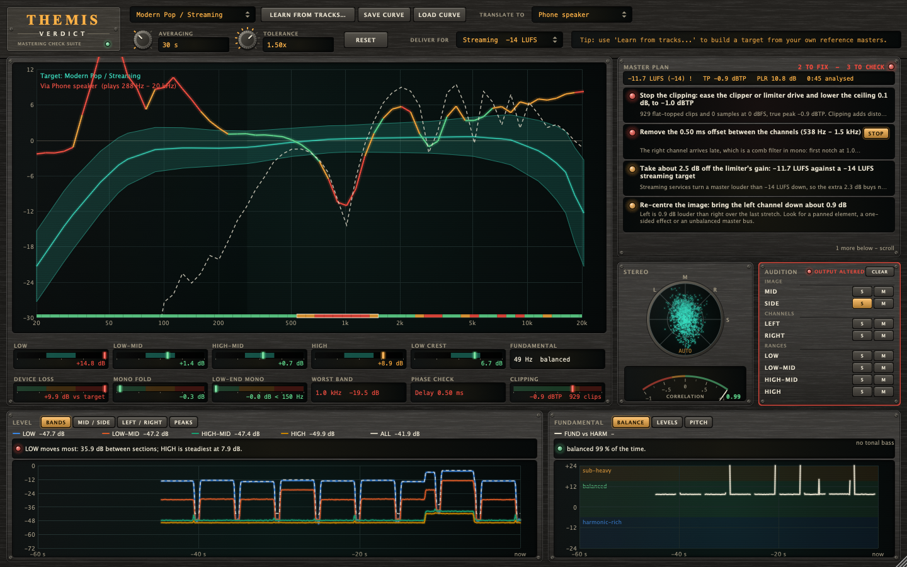
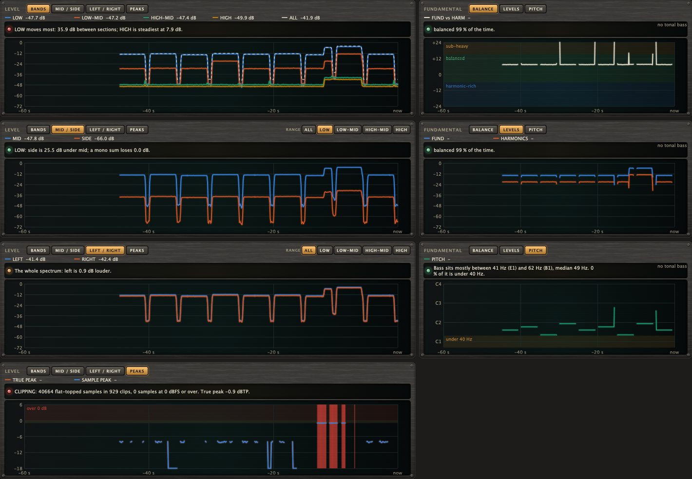

# Themis Verdict

A **mastering check suite in one plugin** (VST3 + AU) for judging a master: tonal balance, device translation, mono fold and
phase cancellation, clipping and true peak, loudness, low-end dynamics, bass fundamental and energy over time, summed up in a
short list of what to do next.

## Name origin

*Themis* is the Greek titaness of divine law and fair judgment, usually shown holding a pair of scales; *Verdict* is what
the checks add up to: a plugin that weighs a master and gives its judgment. (CMake targets, namespaces and plugin codes use
the short name "Themis".)



*Headless render of the editor (the hardware-style interface: brushed-metal modules, glass displays, lamps, knobs) measuring a synthetic programme: a four-note bass line over pink noise whose right channel is 0.5 ms late and 1 dB quieter, with a loud "chorus" driven into a hard clipper at -1 dBFS. The **MASTER PLAN** (top right) ranks what to do: stop the clipping, remove the 0.50 ms channel offset (PHASE CHECK reports it and outlines the comb-filter region, about 500 Hz–1.5 kHz, on the mono-fold strip), bring the loudness down to the streaming target, and so on (the wild tonal curve and the DEVICE LOSS readout are not in the plan: a difference from the reference is not a fault); its HEAR chip on the second item has put SIDE on solo in the **AUDITION** strip (red outline: the output is altered). CLIPPING is red with the clip count, the FUNDAMENTAL readout and graph follow the bass, and the LEVEL graph shows the notes and the louder chorus. The tonal curve looks wild because the demo is not music. Regenerate with the command under "Development".*



*The same programme in every tab of the two graphs: LEVEL (BANDS, MID / SIDE on the LOW range, LEFT / RIGHT, PEAKS with the clipped frames in red) and FUNDAMENTAL (BALANCE, LEVELS, PITCH). Each tab ends in a traffic-light verdict line.*

## Core philosophy

- **Clean and transparent: for monitoring and decisions only.** Themis has no EQ, dynamics, limiter, gain or dither stage; the
  audio passes through bit-for-bit unchanged with zero latency, so it is safe to leave on the master bus. A feature belongs
  here if it helps you *judge* a master (a measurement, a verdict, a graph, advice); it does not belong if it *processes* the
  signal.
- **One exception, for listening only.** The **Solo / Mute audition** lets you hear what a check flags. It changes the output
  only while a button is pressed, is bit-exact when idle, is never saved with the session, is ignored when the host renders
  offline, and runs after every measurement so the analysis always sees the input.
- **The plugin tells you what to do, from measurements only.** The **master plan** turns the readouts into a short list of
  changes, worst first, each with an amount and a place computed from a measurement and a *why* behind it. It never invents a
  number, and it says plainly where a limit is a rule of thumb rather than measured data.
- **Everything a mastering check needs, in one place.** All checks read the same analysis (one FFT, one band grid) and show up
  as a readout, a graph or an overlay in a single editor, each with a tooltip that explains the numbers.
- **Analog look, digital brain.** The interface is a piece of studio hardware: brushed-metal modules, glass displays with
  phosphor traces, lamps for every verdict, push switches that light up, rotary knobs with lit scales and a swing-needle
  correlation meter. It is drawn entirely from code: no image, font or sound files are shipped.
- **Free, public, source only.** The repository holds the code, not a download, under the AGPL-3.0-or-later (see
  [License and terms](#license-and-terms)).

## Features

| Area | What it does |
|---|---|
| **Master plan** | **MASTER PLAN** (top right) reads the faults the monitors below find and lists what to do about them, **worst first**, with the amount and the place: *"Stop the clipping: ease the clipper or limiter drive and lower the ceiling 0.6 dB, to -1.0 dBTP"*, *"Remove the 0.50 ms offset between the channels"*, *"Take about 3 dB off the limiter's gain: -11.2 LUFS against a -14 LUFS target"*, *"Lower the limiter ceiling by 0.6 dB, to -1.0 dBTP"*, *"Make the low end mono: high-pass the side channel around 150 Hz"*, *"Open up the low end: ease the compression on the bass by about 2 dB"*. The headline says what to change and by how much, **hover for why** (the numbers behind it, and which limit was crossed); the verdict in the corner counts what is left to fix (`READY` when nothing is). It lists **objective faults only**: how the spectrum differs from the target curve, and how it would translate to a device (also measured against that curve), is a matter of genre and taste, so those stay on the tonal view and are never turned into a to-do. Checks: clipping and peak ceiling, loudness against the **Deliver for** target, phase cancellation, low-end mono, mono fold, low-end crest, left/right balance, bass (under 40 Hz, sub-heavy / thin) and the low end's steadiness between sections. Items that can be listened to have a **HEAR** chip: it sets the Solo / Mute audition (e.g. SIDE + LOW for low-end mono, LOW for the bass); click again (STOP) to release. It needs audio: press **Reset**, play the whole track (20 s minimum, and the longer the better; set Averaging to Infinite for a whole-track measurement). Clipping is judged at once. All limits are rules of thumb, not measured data, and the plan is only as good as the audio that has played: it is a checklist for your ears and your tools, not a replacement for them. See [MasterAdvisor.h](core/include/themis/MasterAdvisor.h). |
| **Loudness** | Integrated loudness (ITU-R BS.1770 / EBU R128, K-weighted, gated) since the last Reset, shown under MASTER PLAN with the true peak and the **PLR** (peak-to-loudness ratio, true peak minus integrated LUFS: how much dynamic range the limiter left). **Deliver for** picks the target: *Streaming -14 LUFS* (Spotify, YouTube and Tidal turn a louder master down to about that, so the extra level buys nothing there and costs punch), *Loud release -9 LUFS* or *Dynamic -18 LUFS*. More than 2 LU away from it is a warning, more than 4 LU is bad; too quiet says whether the peak leaves room to raise it by plain gain. The targets and limits are rules of thumb. See [LoudnessMonitor.h](core/include/themis/LoudnessMonitor.h). |
| **Audition (Solo / Mute)** | **AUDITION** (bottom right) has **S**olo and **M**ute for **MID** (the centre, what a mono sum keeps), **SIDE** (what differs between the channels, what a mono sum loses), **LEFT**, **RIGHT** (a soloed channel plays on both sides) and the four ranges **LOW / LOW-MID / HIGH-MID / HIGH** (the same ranges as the readouts; 4th-order Linkwitz-Riley crossovers at 120 Hz, 1 kHz and 6 kHz). Within each group a solo silences the rest, a mute silences that source; groups combine (SIDE + LOW plays the side signal below 120 Hz, which is exactly the part of the low end a mono playback system throws away). Changes fade over 10 ms. **CLEAR** releases everything; while anything is engaged the panel is outlined red and says OUTPUT ALTERED. **The measurements always see the input**, never the audition, so the curve, the plan and the graphs do not move when you solo. It is the only thing in Themis that changes the output: with nothing pressed the audio is untouched bit for bit, the state is **not saved** with the session or exposed to the host, and it is **ignored while the host renders offline**, so an export cannot carry it. Put Themis last in the chain (or after your limiter) to hear what you are judging. See [Audition.h](core/include/themis/Audition.h). |
| **Tonal balance curve** | 1/6-octave long-term spectrum (20 Hz–20 kHz) vs a target *median ± tolerance* band. Segments turn green / amber / red as you leave the band. Four broadband readouts (Low / Low-Mid / High-Mid / High) show your average offset from target. A **Low Crest** meter shows the peak/RMS ratio of the 20–250 Hz band in dB: left = dynamic, right = compressed; its "typical" zone (6–10 dB) is a hand-authored guess. Averaging: 10 s / 30 s / 2 min / infinite; **Reset** restarts it. **The curve does not depend on loudness:** every analysed moment is normalised by its own total energy before averaging (so gain changes, and loud choruses vs quiet verses, don't move it), and near-silent moments are gated relative to the programme level rather than at a fixed dBFS. |
| **Translation checks** | Analysis-only help for judging how a master will carry over to other playback systems. **Device preview:** pick *Translate to* → Phone speaker / Laptop / Earbuds / Bluetooth speaker / Car / Small monitors (or Off). The curve is redrawn as that device would reproduce it (dashed line) and the range it cannot reach is darkened. **DEVICE LOSS** is how much more level your track loses through the device than the target curve does (so a bass-heavy master reads high on a phone). **Mono fold** is measured per band from the same frames as the tonal curve (level independent): the strip under the curve colours each band green / amber / red by the power lost in a mono sum, and **MONO FOLD**, **LOW-END MONO** (< 150 Hz) and **WORST BAND** summarise it. Hover the readouts for the numbers. The device responses are generic approximations (a bass limit, a treble limit and a few broad bumps), not measurements of any product, and the green/amber/red limits are rules of thumb; both are defined in [Translation.h](core/include/themis/Translation.h). The audio is never filtered. |
| **Phase-cancellation check** | **PHASE CHECK** catches stereo phase problems that a mono sum would turn into lost level. Per band, the left/right cross-spectrum is averaged like the tonal curve (so it follows the averaging time and is level independent): a band *cancels* when a mono sum loses more than the 3 dB that uncorrelated channels lose. The widest cancelling region is outlined on the mono-fold strip, and the verdict names the likely cause by fitting the inter-channel phase of the coherent bands with a pure model: **Polarity flipped** (one channel inverted), **Delay x ms** (a fixed offset, i.e. comb filtering, with the first notch frequency in the tooltip) or a frequency range when the phase is neither (a partial inversion, a phase-shifting effect). Delay and polarity are only named when the channels are copies of each other across the cancelling region (coherence ≥ 0.85); several sources at different offsets come out as a frequency range instead. Unlike the broadband correlation meter it says *where*, and it still works when the mid signal is silent. See [PhaseCancellation.h](core/include/themis/PhaseCancellation.h). |
| **Clipping detection** | **CLIPPING** (second readout row) is a true-peak meter since the last **Reset** with the clip count next to it. The audio is checked sample by sample: *sample peak*, *true peak* (4× oversampled inter-sample peak, dBTP), *over* (a sample at or above 0 dBFS) and *clips*, meaning flat tops: at least 4 equal samples in a row above −6 dBFS that the waveform ran into, which a hard clipper or an overdriven limiter leaves at any ceiling, not only at 0 dBFS. Any clip or over is red, a true peak above −1 dBTP is amber (lossy encoding can push it over) and above 0 dBTP red; those limits are rules of thumb. The **PEAKS** tab of the LEVEL graph shows *when* it happened, with the clipped frames as red columns. A synthesised square wave or a held level also looks like a flat top, and a clip that was smoothed afterwards (a soft clipper, a lowpass) leaves none to find. Audio thread cost: about 0.6 % of one core at 48 kHz. See [ClipMeter.h](core/include/themis/ClipMeter.h). |
| **Level and fundamental graphs** | Two scrolling graphs (last 60 s) under the tonal view, each with **tabs**, a **legend that is also the readout** (click an entry to hide its line; hover for the values at that moment) and a **verdict line** that turns the window into a decision (green / amber / red; the limits are rules of thumb, see [HistoryChecks.h](core/include/themis/HistoryChecks.h)). **LEVEL** is absolute energy (mean-square dBFS, unlike the level-independent tonal curve): **BANDS** (LOW / LOW-MID / HIGH-MID / HIGH and the whole spectrum; the verdict names the range that moves most between sections, the low end holding steady being the point), **MID / SIDE** and **LEFT / RIGHT** (each with a RANGE selector, so you can check the low range alone: the verdict is the mono loss with the same limits as MONO FOLD for mid / side, and the level difference for left / right) and **PEAKS** (sample and true peak, shaded 0 dB and −1 dBTP zones, clipped frames in red). **FUNDAMENTAL** tracks the bass fundamental (lowest tonal peak in 30–250 Hz of the mid signal, from the analyser's own FFT): **BALANCE** plots how far it sits above its harmonics 2–8 on a track shaded *sub-heavy* / *balanced* / *harmonic-rich* (the verdict is where it sat most of the time), **LEVELS** the two levels and **PITCH** its note on a note axis with the region under 40 Hz that small speakers cannot play shaded (the verdict is the share of time spent there). See [Fundamental.h](core/include/themis/Fundamental.h) and [FrameHistory.h](core/include/themis/FrameHistory.h). |
| **Stereo vectorscope** | Goniometer (mid vertical, side horizontal) of the last ~30 ms plus a phase-correlation meter (-1 out of phase … +1 mono, ~0.4 s smoothing). The plot auto-scales to the recent peak so it stays readable at any level; click it to switch to a fixed 0 dBFS scale. Display only; the audio is untouched. |
| **Target curves** | 7 built-in starter curves (Flat, Modern Pop, Hip-Hop, EDM, Rock, Acoustic, Orchestral) **+ "Learn from tracks…"**: pick one or more reference masters (wav/aiff/flac/ogg everywhere; mp3/m4a where the OS decoder supports them, e.g. macOS) and Themis builds a target from their average, with the tolerance set by how much they disagree. Save/load as `.themiscurve`. |
| **Pass-through** | Nothing is ever written to the audio unless you press Solo / Mute: no EQ, dynamics, limiter or gain stage; reports 0 samples of latency. The plugin exists to measure, not to process. |

> **About the built-in curves.** They are hand-authored approximations of typical mastered material, *not* percentile
> statistics from a reference dataset. Treat them as starting points. For accuracy, use **Learn from tracks** with
> masters you trust in your genre.

## How to use

### Build and install (macOS)

Themis is source only: you build it yourself. Formats: **VST3 + AU** (macOS, universal arm64 + x86_64, macOS 11+), VST3 +
Standalone on Linux/Windows if you build there. There is no VST2 build: VST2 is not available for new plugins.

```bash
brew install cmake                    # once (Xcode command line tools required)
cmake -S . -B build -DCMAKE_BUILD_TYPE=Release
cmake --build build --target Themis_VST3 Themis_AU -j8
```

The default configuration builds a **universal** binary (arm64 + x86_64) and copies the plugins to
`~/Library/Audio/Plug-Ins/VST3` and `~/Library/Audio/Plug-Ins/Components`. JUCE is fetched automatically (needs git + network).

Then rescan plugins in your host (rescan after switching Rosetta/native mode). Themis appears
under *Fx / Analyzer* (VST3 category) / *Themis Audio* (AU), as "Themis Verdict". On Apple Silicon the binary must be signed, ad-hoc is enough for local use:

```bash
codesign --force --deep --sign - "$HOME/Library/Audio/Plug-Ins/VST3/Themis Verdict.vst3"
codesign --force --deep --sign - "$HOME/Library/Audio/Plug-Ins/Components/Themis Verdict.component"
auval -v aufx Thms Thmi               # optional: validate the AU
```

Builds are for your own use; if you hand one to somebody else, see [License and terms](#license-and-terms).

### Measuring a master

1. **Put Themis last on the master bus** (after your limiter), so you hear and measure what you are judging. It is pass-through,
   so it can stay there.
2. **Choose what to measure against.** **Deliver for** (the loudness target: Streaming -14 LUFS, Loud release -9 LUFS or
   Dynamic -18 LUFS) is what the master plan judges the loudness against. To compare the tonal balance with a reference, also pick a
   target curve (a built-in one, or **Learn from tracks…** with masters you trust in your genre) and, to preview a playback
   system, **Translate to** (a device, or Off); those two shape the tonal view, not the plan.
3. **Press Reset and play the whole track.** The master plan needs at least 20 s of audio, and the longer the better; set
   Averaging to Infinite for a whole-track measurement. Clipping is judged at once.
4. **Read the MASTER PLAN.** Items are listed worst first; the headline says what to change and by how much, and hovering it
   shows why (the numbers behind it and which limit was crossed). The verdict in the corner counts what is left to fix (`READY`
   when nothing is). Make the change with your own tools, play again and look at the plan once more; fix the biggest item first.
5. **Listen to what a check flags.** Items with a **HEAR** chip set the Solo / Mute audition for you (click again to stop);
   you can also set it by hand in the **AUDITION** panel. **CLEAR** releases everything.
6. **Dig into the readouts and graphs.** The tonal curve, the mono-fold strip, PHASE CHECK, CLIPPING, the LEVEL and FUNDAMENTAL
   tabs and the vectorscope show the numbers behind the plan; hover any readout, click a legend entry to hide its line.
7. **Before you export, press CLEAR.** If your host renders in real time (some bounce modes do), it cannot tell, and an engaged
   audition would end up in the bounce.


## Development

Built with [JUCE](https://juce.com). All DSP lives in a dependency-free C++17 core
([core/include/themis](core/include/themis)) with its own unit tests; the plugin layer only draws and wires it up.

### Tests, screenshots and layout

```bash
make test                              # DSP unit tests, no dependencies (g++/clang++ only)
cmake -S . -B build -DCMAKE_BUILD_TYPE=Release -DTHEMIS_BUILD_SMOKE=ON -DTHEMIS_INSTALL_AFTER_BUILD=OFF
cmake --build build --target ThemisSmoke
./build/ThemisSmoke_artefacts/Release/ThemisSmoke docs/screenshot.png docs/graphs.png   # headless processor+editor run, writes the README images
```

`docs/screenshot.png` and `docs/graphs.png` are the output of that command, never edited by hand. They are regenerated after
every change that touches the UI or what it shows, and their captions above are kept true to the demo programme (the rules
for contributors are in [CLAUDE.md](CLAUDE.md)).

Layout (the one file map; update it when a source file is added, renamed or removed):

```
core/include/themis/   DSP: Common, Biquad, Eq, Compressor, Limiter, TruePeak, Loudness, StereoTools, FFT,
                       TonalAnalyzer, LowCrestMeter, StereoScope, TargetCurve, Translation, PhaseCancellation,
                       Fundamental, FrameHistory, ClipMeter, HistoryChecks, LoudnessMonitor, MasterAdvisor, Audition, EqFit, Engine
                       (the plugin uses only Common, TonalAnalyzer, LowCrestMeter, StereoScope, TargetCurve, Translation, PhaseCancellation,
                       Fundamental, FrameHistory, ClipMeter, HistoryChecks, LoudnessMonitor, MasterAdvisor, Audition, and TruePeak and
                       Loudness underneath them; the rest is a mastering chain kept with its tests)
plugin/Source/         JUCE layer: Parameters, PluginProcessor, PluginEditor, TonalBalanceView, StereoScopeView, HistoryViews,
                       AdvicePanel, AuditionPanel, ThemisUi.h (Themis' own words, number formats and verdict colours)
../../shared/ui/       the drawing kit of the interface, shared with the other plugins of the repository: Hardware.h (metal,
                       glass, lamps, knobs), HardwareLookAndFeel.h, MeterCell.h
tests/                 test_main.cpp (DSP), plugin_smoke.cpp (headless JUCE)
```

### Continuous integration
[.github/workflows/build.yml](../../.github/workflows/build.yml) builds the universal VST3 + AU on a macOS runner and a VST3 on
Linux, and runs the DSP tests, on every push. It checks that the code builds and publishes nothing: no downloadable binaries, by design.
Releases are version tags made by hand, source only (see [NOTICE.md](../../NOTICE.md)).

Security checks, all free for a public repository and none of them publishing anything: [codeql.yml](../../.github/workflows/codeql.yml)
(CodeQL static analysis of the C++ on every push, pull request and weekly), [dependency-review.yml](../../.github/workflows/dependency-review.yml)
(fails a pull request that adds a dependency with a known high-severity vulnerability) and Dependabot
([dependabot.yml](../../.github/dependabot.yml)) keeping the actions up to date. The workflows have read-only tokens and pin every
action to a commit SHA. Secret scanning with push protection is on, and `main` requires the build checks to pass and cannot be
force-pushed. To report a vulnerability, see [SECURITY.md](../../SECURITY.md).

### What has and hasn't been verified

| Verified (Linux aarch64 and macOS arm64; the JUCE version is in `cmake/Juce.cmake`) | Not yet verified |
|---|---|
| The DSP checks (`make test` prints the count): K-weighting vs the ITU coefficient table, −20 LUFS reference sine at 44.1/48/96 kHz, gating, inter-sample true peak, limiter ceiling, compressor curve, M/S EQ targeting, pink/white-noise spectral slopes, low-end crest meter (sine = 3 dB, band limiting, reset, NaN recovery), per-band mono fold (mono 0 dB, uncorrelated −3 dB, inverted → cancels, level independent), per-band phase / coherence, the phase-cancellation verdict (mono, uncorrelated, polarity flip, 0.5 and 1.25 ms delay with its notch frequency, a low-end-only flip), the energy history (calibrated against sines, silence, reset; mid / side / left / right against centred, one-sided and inverted tones), clip detection (a hard clipper at −1 dBFS, clean sines, a 16-bit quantised bass sine that must not count, plateaus across blocks, inter-sample peaks, totals and reset) and the verdicts on the history (swing, width, balance, peaks, bass), the audition (bit-exact when idle, mid / side / left / right against known signals, each range isolated, ranges summing back flat at the crossover corners, fades without clicks), the loudness monitor (the BS.1770 reference sine, reset, loudest section) and the master plan (every item and its numbers, worst first, waiting for enough audio; a bad tonal curve or device loss adds nothing to it), the meters surviving a NaN / inf burst and reading as cleared while a reset is pending, the bass fundamental estimator (pitch, level and harmonics of synthetic bass notes, weak fundamental, noise rejection), device profiles and the translation report, target JSON round-trip, EQ-fit error reduction, engine latency/bypass/A-B | **A macOS build** (the CI workflow does this; the code has no platform-specific paths) |
| Universal (arm64 + x86_64) VST3 + AU build on macOS, zero warnings in Themis' own sources; `auval` AU validation passes; the VST3 loads, instantiates, processes and opens its editor in a JUCE plugin host | Behaviour inside other hosts' plugin scanners |
| Headless run of the real processor + editor: audio, parameters, state save/restore incl. custom curve, *Learn from tracks* on a WAV, pass-through is bit-exact, Solo / Mute through `processBlock` (silent side of a mono signal, ignored offline, restored bit for bit), the master plan on the demo programme, resizing | Loading inside real hosts, automation, whether the Low Crest "typical" zone suits real masters, and whether the generic device profiles and translation limits match real devices and masters |

## Limitations

- **Limiter vs full-band noise** (core library only; the plugin has no limiter): the true-peak detector is a 4× interpolator; on music it stays within ~0.1 dB of the
  ceiling, but white noise reaching Nyquist can overshoot by up to ~1 dB (measured: +1.02 dB over a −1 dBTP ceiling, worst of 5 seeds). Leave the −1 dBTP default for streaming masters.
- Stereo in / stereo out only.
- **Master plan:** a rule-based checklist, not an oracle. Every threshold (loudness window, crest zone, mono-loss, balance, bass) is a hand-authored rule of thumb; it cannot know your genre or your intent, so *Deliver for* is the one setting that makes its advice yours. It does not judge the tonal curve against the target (the built-in curves are approximations, and a deviation from a reference is not a fault): read that on the tonal view. The amount it suggests is a starting point for your own EQ, limiter and compressor, not a preset. History-based items (balance, bass, low-end steadiness) look at the last ~85 s that played; the rest follow the Averaging setting or the whole time since Reset.
- **Loudness** is measured on what has played since the last Reset, so a whole-track reading needs the whole track played through (or a bounce), and a loop of the chorus will read like a chorus. It is a BS.1770 implementation tested against the reference sine, not a certified meter.
- **Audition** is a monitoring aid on the output of the plugin: anything after Themis in the chain is applied to the soloed signal. Range solos use crossovers, so a soloed range has the crossover slopes at its edges (24 dB/oct, not a brick wall; measured on a LOW solo: −6 dB at the 120 Hz edge, −25 dB at 240 Hz, −48 dB at 480 Hz). Solo / Mute is not automatable and not remembered between sessions on purpose; if your host renders in real time (some bounce modes do), it cannot tell, so press CLEAR before you export.
- **Fundamental tracking** is a spectral heuristic (lowest tonal peak in 30–250 Hz, harmonics counted only where they stand out of the spectrum) tuned and tested on synthetic tones, not on a library of real basses. A fundamental 20 dB or more under its first harmonic is not told apart from a note that starts at the harmonic (measured: a 60 Hz fundamental 15 dB under its 120 Hz harmonic is tracked at 60 Hz, at 20 dB under it reads 120 Hz); on a full mix the "harmonics" level also contains whatever else sits at those frequencies, so it is most meaningful on a bass or 808 stem or a bass-led passage. The sub-heavy / harmonic-rich limits are rules of thumb.
- **Phase check** is a long-term measurement (it follows the Averaging setting), so a short cancelling passage is diluted by the rest; use the vectorscope's correlation meter for the moment-to-moment view. The delay / polarity diagnosis fits a single inter-channel delay to bands up to 4 kHz and is a model, not proof. Delay or polarity is only named when the channels are coherent across the cancelling region (≥ 0.85; a clean delay reads about 0.99, a delay over a noise bed 20 dB down about 0.92). A mix of several sources with different offsets reads 0.0 to 0.65 there and is reported as "other" with the affected range (tested with 2 to 6 equal-level sources delayed by 0.2 to 2 ms; an earlier version named a single, misleading "Delay" for these). The 0.85 limit is a rule of thumb tuned on synthetic signals: one real delayed source mixed with a mono source (coherence about 0.65) also reads "other", and a real delay on a very noisy mix may too. A short cancelling passage is diluted away entirely: a 4 s polarity flip inside 40 s of mono flagged no band.
- The analyser's FFT runs on a background thread, not the audio thread: `processBlock` only copies samples into a lock-free ring (a few µs). Four things also run on the audio thread, none of them an FFT: the clip meter (a 4× oversampler per channel, inside the same copy), the Low Crest meter (a few biquads per sample), the loudness meter (K-weighting) and the Solo / Mute audition (which does nothing while idle). If a bounce renders far faster than real time, the worker may skip frames; the long-term average is barely affected.
- **Clip detection** is a heuristic on the waveform: flat tops are found by their shape (equal samples at a high level), so a synthesised square wave looks like clipping (a clean −6 dBFS square counted hundreds of clips per second of audio) and a clip that was smoothed afterwards does not (the same hard-clipped tone low-passed at 3 kHz counted none). True peak is a 4× oversampled estimate, not a certified BS.1770 meter. The limits (−1 / 0 dBTP, any clip) are rules of thumb.
- No CLAP build yet.

## License and terms

Themis is free software under the AGPL-3.0-or-later, and is source only. The licence, JUCE and the other third-party
components, the trademark note and what you owe somebody if you hand them a build are in [NOTICE.md](../../NOTICE.md); they are
the same for every plugin of the repository. Suggestions and bug reports are welcome as issues, code contributions are not
accepted ([CONTRIBUTING.md](../../CONTRIBUTING.md)).

- **No warranty.** Themis is provided "as is", without warranty of any kind. It measures audio and offers advice based on rules of thumb; it does not certify that a master meets any broadcast, streaming or distribution specification, and it does not replace listening.
- **Passing it on.** macOS quarantines a copy that is not signed with a Developer ID certificate and notarised
  (`xattr -cr "Themis Verdict.vst3"` clears it for personal use).
