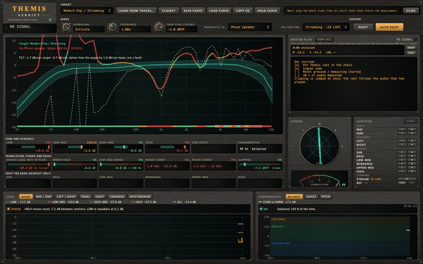
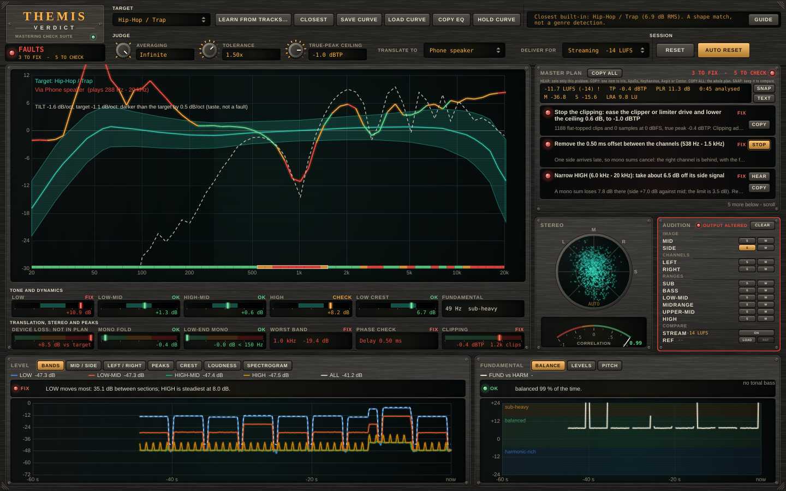
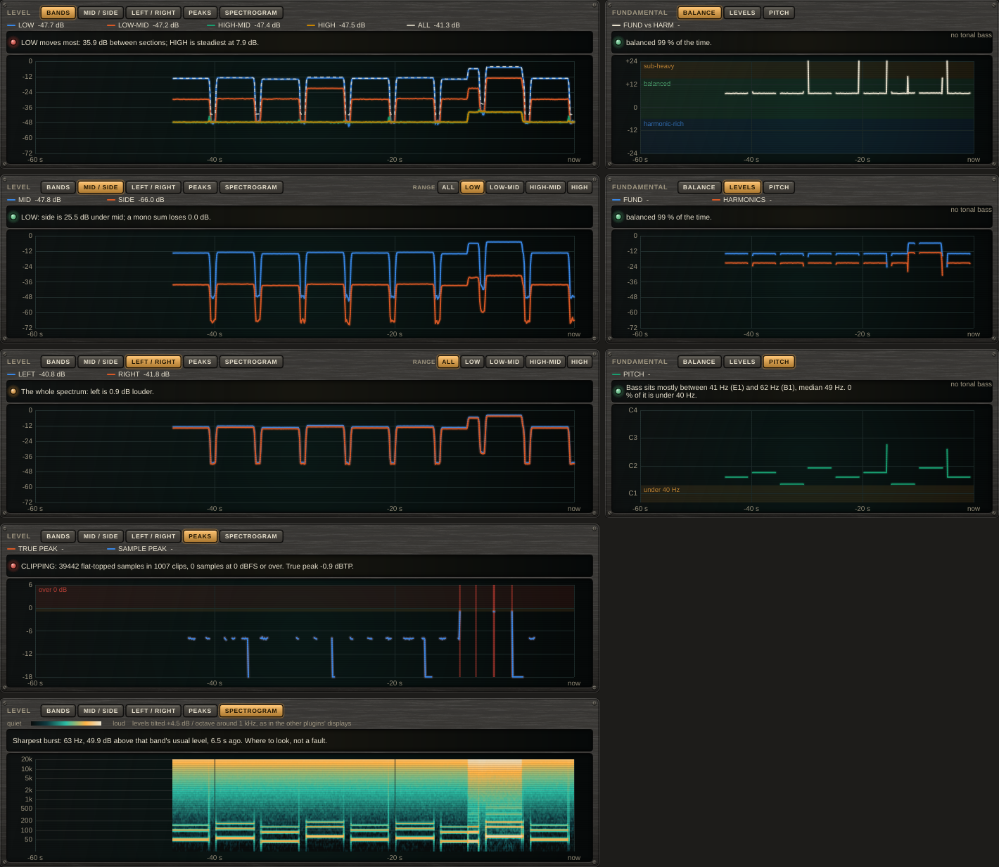

# Themis Verdict

A mastering check suite in one plugin that weighs tonal balance, translation, phase, clipping, loudness, and dynamics into a prioritised Master Plan.

**Format:** VST3 · AU (`2 in / 2 out`, universal `arm64 + x86_64` on macOS)



*Live animation of `ThemisSmoke`: dynamic tonal curve vs target band, `LEVEL` and `FUNDAMENTAL` history graphs, swinging vectorscope, and worst-first Master Plan.*

## Theme

**Name origin:** *Themis* is the Greek titaness of divine law and fair judgment, usually shown holding a pair of scales; *Verdict* is what the checks add up to: a plugin that weighs a master and gives its judgment. (CMake targets, namespaces, and plugin codes use the short name `Themis`.)

### Core philosophy

- **Clean and transparent: for monitoring and decisions only.** No EQ, dynamics, limiter, gain, or dither; zero-latency bit-exact pass-through, safe to leave on the master bus.
- **One exception, for listening only.** Solo/Mute audition and **COMPARE** (`STREAM ON` / `REF`) act only while engaged, stay bit-exact when idle, never save, and skip offline renders.
- **Tells you what to do, from measurements only.** **MASTER PLAN** ranks faults worst-first with measured amounts and *why* tooltips, stating plainly where thresholds are rules of thumb.
- **Everything a mastering check needs, in one place.** Every readout, graph, and overlay reads one FFT and one band grid in a single editor.

## See it

| View | Preview | What to look at |
|---|---|---|
| **Full Suite** |  | `FAULTS` plate (`3 FIX, 5 CHECK`), red `CLIPPING`, `PHASE CHECK` comb, `SIDE` solo, `COPY` chips. |
| **All Graph Tabs** |  | All `LEVEL` and `FUNDAMENTAL` history tabs with traffic-light verdicts, target zones, and burst pointer. |
| **Held Curve** |  | `HOLD CURVE` pale ghost behind live trace, `TILT` slope, and dashed *Phone speaker* preview. |

### UI colour legend

See [root UI colour legend](../../README.md#ui-colour-legend-hardwareh) for shared `Hardware.h` hex codes (`ThemisUi.h` defines `palette::*` and `#f06a5e`).

| Swatch | Hex | UI Element | Meaning |
|---|---|---|---|
| 🟢 | `#5fd68c` | `OK` / `CLEAR` lamps, green tonal/mono-fold segments, `on target` / `typical` / `balanced` zones | Within target/safe rule-of-thumb limits (`colours::good`) |
| 🟠 | `#f2a33a` | `CHECK` lamps, warning segments, `S`olo & `COMPARE` (`ON`/`LOAD`/`REF`) buttons, warning zones (`ceiling–0 dBTP`, `squashed`, `sub-heavy`, `< 40 Hz`) | Worth checking by ear or active solo/compare monitoring (`colours::warn`) |
| 🔴 | `#ef4a3d` / `#f06a5e` | `FIX` / `FAULTS` lamps (`#ef4a3d`), `FIX` label text (`#f06a5e`, 4.72:1 contrast), `M`ute buttons, `OUTPUT ALTERED` outline, `CLIPPING` & `> 0 dB` zone | Objective fault, clipping/over-`0 dBTP`, mute, or altered output warning |
| 🩵 | `#37e3c5` | Target median & tolerance band, Stereo vectorscope trace, Spectrogram mid-ramp | Reference target envelope (`colours::accent`) and stereo goniometer phosphor |
| 🟡 | `#ffb347` | LCD readouts, `HOLD CURVE` / `COPY ALL` / `SNAP` / `HEAR` lit buttons, `CREST PER BAND` values, Spectrogram upper ramp | Digital numbers, active plan chips, and upper spectrogram intensity (`colours::amber`) |
| ⚪ | `#eae3d0` / `#9f9680` | `HOLD CURVE` ghost, `TILT` & `ALL` dashed lines, `FUND vs HARM`, vectorscope needle, bright spectrogram peaks | Held reference trace, broadband slope/sum, and scope/spectrogram markers |
| 🔵 | `#3987e5` | Graph series: `LOW`, `MID`, `LEFT`, `SAMPLE PEAK`, `SHORT-TERM`, `FUND`; `dynamic` & `harmonic-rich` zones | Categorical graph slot 1 (`palette::blue`) |
| 🟠 | `#d95926` | Graph series: `LOW-MID`, `SIDE`, `RIGHT`, `TRUE PEAK`, `HARMONICS` | Categorical graph slot 2 (`palette::orange`) |
| 🟢 | `#199e70` | Graph series: `HIGH-MID`, `CREST`, `PITCH` | Categorical graph slot 3 (`palette::aqua`) |
| 🟡 | `#c98500` | Graph series: `HIGH` | Categorical graph slot 4 (`palette::yellow`) |

## Try it

| Workflow | Setting / Action | What you see / hear / measure |
|---|---|---|
| **Judge a whole master** | Place last after limiter; `Deliver for = Streaming -14`, `Ceiling = −1.0 dBTP`, `Averaging = Infinite`, `Auto reset = On`; play `≥ 20 s` | **MASTER PLAN** fills worst-first (`FIX`/`CHECK`/`OK`); `−1.0 dBTP` leaves `~1 dB` room before MP3/AAC encoding. |
| **Audition & hand off fixes** | Click `HEAR` on a plan item, then `COPY` (`COPY ALL` for one-shot paste, `TEXT` / `Shift-TEXT` for report) | Solos `SIDE`/band in `AUDITION`; pastes EQ/fill to Iris, Apollo, Hephaestus, width to Castor, ceiling/gain to Aegis. |
| **Compare before/after & refs** | Click `HOLD CURVE` → `Reset` → play; or `SNAP`; or `STREAM ON` / `LOAD` + `REF` (`≤ 6 min` file) | Ghost `#eae3d0` trace stays behind live curve; `SNAP` diffs faults; `COMPARE` matches loudness without altering meters. |
| **Custom target & device preview** | `Learn from tracks…` (`wav/aiff/flac/ogg`, + `mp3/m4a` on macOS), `Closest` (`≥ 20 s`), or `Translate to` | Builds `.themiscurve` average/tolerance; `Closest` picks nearest built-in; `Translate to` shows `DEVICE LOSS: NOT IN PLAN`. |

> [!IMPORTANT]
> **Press `CLEAR` before exporting:** `AUDITION` and `COMPARE` skip offline renders, **but real-time bounces capture them**; closing the editor releases both.

> [!NOTE]
> **Master Plan vs Tonal View:** Plan reports objective faults + 2 marked suggestions (narrow rings `≥ 4 dB` from `250 Hz` up; `4–10 kHz` bursts `≥ 6 dB`); tonal/device deviations stay taste.

> [!WARNING]
> **Heuristic & loop caveats:** Built-in curves are approximations (use `Learn from tracks…`); `PHASE CHECK` needs `≥ 0.85` coherence (watch `Vectorscope` for brief dips); width `COPY` pastes into Iris/Apollo OR Castor, not both.

> [!CAUTION]
> **Not an audio processor or certified meter:** Zero EQ/limiter/gain; BS.1770 loudness, `8×` true peak, and `≥ 4`-sample flat-top clips (`> −6 dBFS`) are heuristics — never replace your ears.

## Reference

### Controls

| Group | Control / Readout | Range / Options | Default | Purpose |
|---|---|---|---|---|
| **TARGET** | **Target curve** + **Learn…** / **Closest** | 7 built-ins + `Custom` (`.themiscurve`) | `Modern Pop / Streaming` | Reference tonal band; `Closest` picks nearest built-in after `20 s` |
| **TARGET** | **Copy EQ** / **HOLD CURVE** | Actions | — | Copy fitted EQ + target curve (`pdsp::link`) + fill band; freeze ghost curve |
| **JUDGE** | **Averaging** / **Tolerance** | `10 s`, `30 s`, `2 min`, `Infinite` · scale | `Infinite` · `1.00×` | Analysis window; target band width scale |
| **JUDGE** | **True-Peak Ceiling** | `-6.0 – 0.0 dBTP` | `-1.0 dBTP` | Ceiling for clipping/peak verdicts & Aegis `COPY` |
| **JUDGE** | **Deliver for** | `Streaming -14`, `Loud release -9`, `Dynamic -18`, `Quiet streaming -16`, `Broadcast -23` LUFS | `Streaming -14 LUFS` | Target integrated loudness for Plan, `LOUDNESS` tab, `STREAM ON` |
| **JUDGE** | **Translate to** | `Off`, `Phone speaker`, `Laptop`, `Earbuds`, `Bluetooth speaker`, `Car`, `Small monitors` | `Off` | Generic device tonal preview (`DEVICE LOSS: NOT IN PLAN`) |
| **SESSION** | **RESET** / **AUTO RESET** | Action / Toggle | `On` | Clears meters/event log (64-entry cap); auto-resets at timeline start (`≤ 0.05 s`) |
| **AUDITION** | **S / M** (`MID`, `SIDE`, `L`, `R`, 6 bands) | `SUB 20–60`, `BASS 60–250`, `LOW-MID 250–500`, `MIDRANGE 500–2k`, `UPPER-MID 2k–6k`, `HIGH 6k–20k` | Off | LR4-crossed monitoring (`10 ms` fade; never saved; ignored offline) |
| **COMPARE** | **STREAM ON** / **LOAD** / **REF** | Level-down preview / 6-min reference file | Off | Hear streaming loudness normalisation or loudness-matched reference |

- **Readouts:** `TONE AND DYNAMICS` (`LOW`, `LOW-MID`, `HIGH-MID`, `HIGH`, `LOW CREST` `20–250 Hz` `6–10 dB` typical, `FUNDAMENTAL` `30–250 Hz`), `TRANSLATION, STEREO AND PEAKS` (`DEVICE LOSS`, `MONO FOLD`, `LOW-END MONO` `< 150 Hz`, `WORST BAND`, `PHASE CHECK`, `CLIPPING` + DC offset hover `≥ −60 dBFS` warn / `≥ −40 dBFS` bad), `CREST PER BAND (READOUT ONLY)` (6 `MusicBands.h` bands), `MASTER PLAN & LOUDNESS` (Integrated, Momentary `400 ms`, Short-term `3 s`, `PLR` `< 6 dB` warn / `< 4 dB` bad, `LRA` EBU Tech 3342, Mono-sum loudness, Block dynamics `3 s` loudest `20%`: `≤ 8 dB` limited / `≥ 12 dB` dynamic, Silence edges, `SNAP`, `COPY ALL`, `TEXT` / `Shift-TEXT`).
- **History Graphs (`60 s`):** `LEVEL` (`BANDS`, `MID / SIDE`, `LEFT / RIGHT`, `PEAKS`, `LOUDNESS` `±1 LU` band / `> 50%` or `> 6 LU` warn, `CREST` `~85 ms` `< 8 / > 12 dB`, `SPECTROGRAM` 16384-pt FFT `85 ms` hop `1/6`-oct `4.5 dB/oct` tilt `60 dB` range); `FUNDAMENTAL` (`BALANCE` `> +15 dB` sub-heavy / `< −6 dB` harmonic-rich, `LEVELS`, `PITCH` `< 40 Hz` floor).

### Signal flow

```
in ─┬─► [Lock-free ring] ──► (Background FFT thread: 16384-pt @ 48 kHz) ─► Tonal, Mono Fold, Phase, History, Fundamental, Spectrogram
    ├─► [8× True-Peak & Clip Meter + Low/Band Crest + BS.1770 Stereo & Mono Loudness] ─► Readouts, Event Log & Master Plan
    └─► [Zero-latency bit-exact pass-through] ─► (Optional AUDITION / COMPARE when editor open & real-time) ─► out
```

### Measured

- **Core DSP (`make test`):** K-weighting vs ITU table; `−20 LUFS` sine at `44.1 / 48 / 96 kHz`; EBU Tech 3342 `10 LU` & `5 LU` LRA (`20 LU` gate); `8×` true-peak reader (`≤ 0.11 dB` low across `64/80` phases at `0.02–0.5 fs` vs `0.69 dB` on `4×`); core limiter on Nyquist white noise (`−0.5` to `−0.8 dBTP` vs `+0.3 dBTP` on `4×`, against `256`-tap sinc); per-band crest (`3.01 dB` sine, `15.0 dB` on `122.5 Hz` burst, `8.3, 10.2, 10.7, 11.6, 11.9, 11.2 dB` pink noise in `ThemisSmoke`); mono fold (`0 dB` mono, `−3 dB` uncorrelated); phase coherence (`~0.99` clean delay, `~0.92` over `−20 dB` noise, `0.0–0.65` multi-source → `"other"`); DC offset (`20 Hz` FS = none, `1%` FS = `−40 dBFS`); block dynamics, silence edges, event log (`64`-entry cap), `COPY ALL`, `Copy EQ`, rings, harshness, usage notes, and level words.
- **Audio thread cost:** `processBlock` copies in a few µs; `8×` true-peak meter benchmarked at `1.75%` of one core (`48 kHz` stereo, vs `1.3%` for `4×`).
- **Plugin & UI (`ThemisSmoke` + `auval`):** Universal `arm64 + x86_64` VST3 + AU builds with zero warnings; `auval -v aufx Thms Thmi` passes; `ThemisSmoke` verifies bit-exact pass-through, Solo/Mute (`BASS` solo `−6 dB @ 250 Hz`, `−25 dB @ 500 Hz`, `−48 dB @ 1 kHz`; `LOW-MID` `354 Hz` `−3.9 dB`, `1 kHz` `~1 dB` down), `STREAM ON`, `CLOSEST`, state/custom-curve round-trip, `65` controls (`≥ 20 × 12 px`, `47` under `24 × 24 px`), and contrast (`≥ 3:1`, lowest `4.72:1`, dim captions `4.87:1` faceplate / `6.65:1` glass).

### Limits

- **Stereo in / stereo out only;** no CLAP build yet; not verified in all third-party DAW scanners, `pluginval`, or real-world masters (including Low Crest `6–10 dB` zone & generic device curves).
- **Master Plan heuristics:** History items (`balance`, `bass`, `steadiness`, `harshness`) inspect the last `~85 s`; `1/6`-oct rings `< 250 Hz` are skipped; sustained notes read as rings; `4–10 kHz` harshness is a single range.
- **COMPARE & Memory:** Requires editor open; reference holds `~140 MB` for `6 min` at `48 kHz` (downsampled `−55 dB` at `1.5×` Nyquist) and follows host timeline from file start with no offset.
- **Fundamental tracking:** Tuned on synthetic tones (`60 Hz` `15 dB` under `120 Hz` tracks at `60 Hz`; at `20 dB` under reads `120 Hz`); best on bass/808 stems or bass-led sections.
- **Phase, Clip & Per-band Crest:** `4 s` polarity flip inside `40 s` mono dilutes away (`≥ 0.85` coherence needed); adjacent crest bands leak `10–26 dB` (`−60 dBFS` gate); `-6 dBFS` square waves trigger flat-top clips while `3 kHz`-low-passed clips count none.
- **Fast offline bounces & Audio-thread meters:** Background FFT worker may skip frames if rendering much faster than real time; `BandCrestMeter` (`~60` biquad steps/sample) and mono-sum `LoudnessMonitor` are not separately benchmarked.

## Build & develop

See [root Build & develop](../../README.md#build--develop) for shared prerequisites and image-generation rules, [CLAUDE.md](CLAUDE.md) for invariants, and [.github/workflows/build.yml](../../.github/workflows/build.yml) for CI.

```bash
scripts/build.sh themis ThemisSmoke     # build & run smoke check
scripts/build.sh themis vst3 au         # build VST3 + AU
scripts/showcase.sh themis              # regenerate docs/showcase.gif
```

Plain CMake & DSP tests (from `plugins/themis`):

```bash
make test                               # dependency-free C++17 DSP tests (g++/clang++)
cmake -S . -B build -DCMAKE_BUILD_TYPE=Release
cmake --build build --target Themis_VST3 Themis_AU -j8   # installs to ~/Library/Audio/Plug-Ins on macOS by default

# Regenerate docs/screenshot.png, docs/graphs.png, docs/hold.png:
cmake -S . -B build -DCMAKE_BUILD_TYPE=Release -DTHEMIS_BUILD_SMOKE=ON -DTHEMIS_INSTALL_AFTER_BUILD=OFF
cmake --build build --target ThemisSmoke
./build/ThemisSmoke_artefacts/Release/ThemisSmoke docs/screenshot.png docs/graphs.png docs/hold.png

# Ad-hoc sign on Apple Silicon & validate AU:
codesign --force --deep --sign - "$HOME/Library/Audio/Plug-Ins/VST3/Themis Verdict.vst3"
codesign --force --deep --sign - "$HOME/Library/Audio/Plug-Ins/Components/Themis Verdict.component"
auval -v aufx Thms Thmi
```

## Licence

AGPL-3.0-or-later, source only — see [root Licence](../../README.md#licence) and [NOTICE](../../NOTICE.md).
